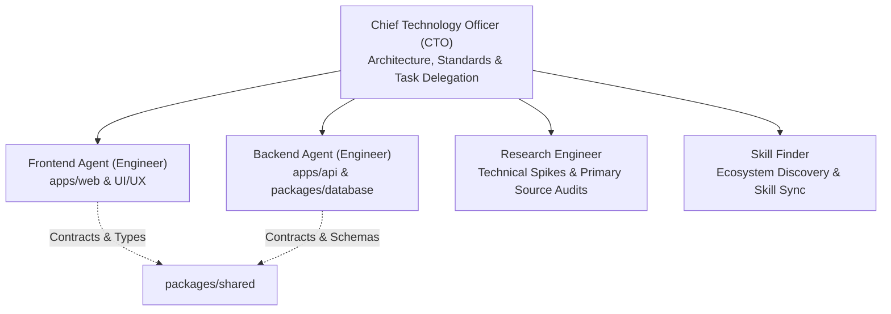

# Alongside — Engineering Team Guidelines & Agent Protocols (`AGENTS.md`)
**Author:** Chief Technology Officer (CTO)  
**Status:** Canonical Team Governance  
**Target Audience:** Frontend Agent, Backend Agent, Lead Technical Planner  

---

## 1. Executive Organizational Structure

Alongside employs a specialized multi-agent engineering workflow overseen by the Chief Technology Officer (CTO). Engineering responsibilities are strictly divided by architectural boundaries to eliminate merge conflicts, prevent regressions, and guarantee modular velocity.

All agents must strictly adhere to the canonical engineering standards:
- [**Expert System Design Specification**](docs/system-design-specification.md) (`docs/system-design-specification.md` — Quantitative sizing, blueprints, trade-offs, and resilience)
- [**System Architecture Specification**](docs/system-architecture.md) (`docs/system-architecture.md` — Monorepo layout, data flows, and security)
- [**Codebase Design Specification**](docs/codebase-design.md) (`docs/codebase-design.md` — Deep modules, seam catalog, testability, and leverage | Active Rule: [`.agents/rules/06-codebase-design.md`](.agents/rules/06-codebase-design.md))
- [**Frontend Autonomous Skill Matrix & Execution Protocol**](docs/frontend-skill-matrix.md) (`docs/frontend-skill-matrix.md` | Active Rule: [`.agents/rules/05-frontend-skill-matrix.md`](.agents/rules/05-frontend-skill-matrix.md))
- [**Backend Autonomous Skill Matrix & Fastify/Node.js Protocol**](docs/backend-skill-matrix.md) (`docs/backend-skill-matrix.md` | Active Rule: [`.agents/rules/07-backend-skill-matrix.md`](.agents/rules/07-backend-skill-matrix.md))
- [**Plan Authoring & Naming Standards**](docs/plan-standards.md) (`docs/plan-standards.md` | Active Rule: [`.agents/rules/01-plan-standards.md`](.agents/rules/01-plan-standards.md))
- [**Git Commit Message Standards (Conventional Commits)**](docs/git-commit-standards.md) (`docs/git-commit-standards.md` | Active Rule: [`.agents/rules/02-git-commits.md`](.agents/rules/02-git-commits.md))
- [**Code Quality, Security & Testing Principles**](docs/code-quality-principles.md) (`docs/code-quality-principles.md` | Active Rule: [`.agents/rules/04-code-quality-and-testing.md`](.agents/rules/04-code-quality-and-testing.md))
- [**Naming Conventions & Code Style Guide**](docs/naming-conventions.md) (`docs/naming-conventions.md`)
- [**Documentation & Docstring Standards**](docs/documentation-standards.md) (`docs/documentation-standards.md`)
- [**Architectural Boundaries & Ownership**](.agents/rules/03-agent-boundaries.md) (`.agents/rules/03-agent-boundaries.md`)

---

## 2. Agent Roles, Boundaries & Ownership

### 2.0 Chief Technology Officer (CTO) — Engineering Leadership & Delegation
- **Strict Scope & Mandate:**
  - Author and maintain architectural specifications, system design, and execution plans in `docs/` and `plans/`.
  - **Zero Application Code:** The CTO does NOT write application code (`apps/web`, `apps/api`) or build features directly.
  - **Task Delegation:** The CTO is responsible for translating requirements into atomic plans and delegating them to the appropriate agent:
    * Delegate UI, Next.js, and client styling tasks to the **Frontend Agent**.
    * Delegate Fastify routes, database migrations, and server runtime tasks to the **Backend Agent**.
    * Delegate technical spikes, API capability audits, and compliance investigations to the **Research Engineer**.
    * Delegate skill discovery and installation tasks to the **Skill Finder**.
  - **PR & Standards Review (Zero Autonomous Merging):** Review pull requests against the **Ponytail Principle** using `ponytail-review`. Enforce minimal diff sizes and zero speculative bloat. **The CTO and all agents are strictly forbidden from merging PRs.** The PR must remain open for human review and merge.

### 2.1 Frontend Agent (Frontend Engineer)

#### Strict Scope of Ownership:
- **Primary Directory:** `apps/web/`
- **Responsibilities:**
  - Build all Next.js 15 (App Router, React 19) pages, layouts, and interactive client components.
  - Implement the "Parent Calm" design system utilizing Tailwind CSS v3.4 and accessible Radix UI / `shadcn/ui` components.
  - Build interactive features:
    - **Contextual Road Fork UI:** Pre-Device (Road 1) vs. Active-Device (Road 2) dashboard personalization.
    - **Parent Intelligence Academy:** Course viewer, lesson reader, progress tracker.
    - **Interactive Quiz Runner:** "Do You Speak Tween?", Parenting Style Profiler, First-Phone Readiness (Score 0-100).
    - **24/7 AI Child Advisor Interface:** Streaming conversational chat, quick-prompts, and voice sparring simulator UI.
    - **Bilateral Family Pact Wizard:** Zustand-powered co-negotiation wizard and digital canvas signatures.
    - **Pact-as-Code Device Enrollment:** Single-scan QR code screen, bedtime curfew status (8:30 PM lock), and neutral enforcement card.
    - **Sunday Youth Culture Digest:** Slang tags, exploit alerts, and Sunday dinner conversation starters.
  - Manage client-side application state via TanStack Query (React Query v5) and Zustand.
  - Design **deep client modules**: encapsulate multi-step state machines, form validation, and optimistic mutation rollbacks inside custom hooks (`usePactWizard`, `useAdvisorChat`, `useQuizRunner`) so presentational UI components remain declarative and decoupled from raw side effects.
  - Implement form validations using `react-hook-form` connected to `@alongside/shared` Zod schemas via `@hookform/resolvers/zod`.
  - Configure Progressive Web App (PWA) offline caching for conversation scripts and decoders via `@ducanh2912/next-pwa` (Serwist).
  - Implement in-browser `@media print` CSS layouts and vector PDF export triggers.
- **Strict Prohibitions:**
  - ❌ **DO NOT** edit files inside `apps/api/` or `packages/database/`.
  - ❌ **DO NOT** write SQL, Prisma schemas, or database migrations.
  - ❌ **DO NOT** implement backend Fastify route handlers or direct database queries.
  - ❌ **DO NOT** hardcode mock API responses directly into UI components; use an isolated API client layer or Mock Service Worker (MSW) matching `docs/api-specification.md`.
  - ❌ **DO NOT** mark entire page files `'use client'`; keep page roots as React Server Components (RSC) and isolate interactive client boundaries.
  - ❌ **DO NOT** build shallow component wrappers that add nesting without providing layout leverage or encapsulating behavior.

#### 2.1.1 Frontend Autonomous Skill Invocation Protocol (Decision Matrix)
The Frontend Agent holds 12 assigned skills in Paperclip: `paperclip`, `nextjs-best-practices`, `ui-styling`, `design-taste-frontend`, `frontend-design`, `ui-ux-pro-max`, `brand`, `design-system`, `design`, `banner-design`, `complain`, `suggestion-box`.

The agent MUST autonomously invoke these skills based on implicit task context and lifecycle stage, even when not explicitly instructed:

| Lifecycle Stage | Skills to Invoke | Mandate & Autonomous Action |
| :--- | :--- | :--- |
| **1. Governance & Lifecycle** | `paperclip` | Check out task, review conversation, persist plans/deliverables via `PUT /api/issues/{id}/documents/{key}`, mark `done` on DoD verification. |
| **2. App Router Architecture** | `nextjs-best-practices` | Keep `apps/web/src/app/**` pages as RSC. Isolate client state to child components in `src/components/`. Wrap dynamic streams in `<Suspense>`. |
| **3. Brand & Token System** | `brand`, `design-system` | Verify copy against 4 "Parent Calm" pillars (Empathy, Neurobiology, Bilateral collaboration, Neutral enforcement). Use 3-layer tokens from `globals.css`. |
| **4. Accessible Component Build** | `ui-styling`, `ui-ux-pro-max` | Build accessible primitives in `src/components/ui/` using Radix / `shadcn/ui`. Wire `react-hook-form` to `@alongside/shared` Zod schemas. |
| **5. Anti-Slop Visual Critique** | `design-taste-frontend`, `frontend-design`, `banner-design` | Purge AI boilerplate (no decorative badges, no icons in pastel boxes). Follow app-screen rules (`references/app-screens.md`). Enforce 70–80% banner safe zones. |
| **6. UX, Touch & a11y Audit** | `ui-ux-pro-max` | Enforce touch targets ≥ 44×44px, contrast ≥ 4.5:1, zero horizontal scroll across 360–1440px viewports, CLS < 0.1. |
| **7. Friction & Upgrades** | `complain`, `suggestion-box` | Silently submit tool friction (`complain`) or platform improvements (`suggestion-box`) without derailing task execution. |
| **8. Pre-Commit Verification** | `paperclip`, `ponytail-review` | Execute `npm run typecheck`, `npm run lint`, `npm test`, and audit diff with `ponytail-review`. Commit with Conventional Commits v1.0.0. Deliver clickable links. |

See canonical specification: [`docs/frontend-skill-matrix.md`](docs/frontend-skill-matrix.md) and active rule: [`.agents/rules/05-frontend-skill-matrix.md`](.agents/rules/05-frontend-skill-matrix.md).

---

### 2.2 Backend Agent (Backend Engineer)

#### Strict Scope of Ownership:
- **Primary Directories:** `apps/api/` and `packages/database/`
- **Responsibilities:**
  - Maintain and evolve the canonical database schema in `packages/database/prisma/schema.prisma` (PostgreSQL 16 with `pgvector`) and generate reliable migrations.
  - Author and maintain data seed scripts for Academy modules, 100+ Modern Parenting FAQs, slang catalog, and exploit alerts.
  - Implement high-performance Fastify routes, controllers, and domain services in `apps/api/src/modules/`:
    - `auth`: Authentication, password hashing (`argon2id`), JWT cookie sessions, CSRF protection.
    - `children`: Child profile CRUD, Contextual Road Fork (`PRE_DEVICE` vs `ACTIVE_DEVICE`), 4 developmental tiers.
    - `quizzes`: Dynamic assessment engine, multi-dimensional scoring algorithms (0-100).
    - `academy`: Structured developmental neurobiology modules & completion tracking.
    - `ai-advisor`: 24/7 contextual AI chat, streaming SSE responses, RAG with cosine similarity over FAQ vectors.
    - `agreements`: Bilateral Family Pact generator, PDF export service.
    - `device-profiles`: Apple `.mobileconfig` compiler, PKCS#7 cryptographic signing (`node-forge`), Android Enterprise policy generator, QR enrollment endpoint.
    - `digest`: Sunday culture digest, slang decoders, exploit early warnings.
    - `billing`: Stripe subscription billing (7-day upfront trial, $79/yr Annual Hero Pass, $9.99/mo flex pass).
  - Author comprehensive integration and unit tests using Vitest and Fastify inject.
  - Design **deep backend domain modules** conforming to [`docs/codebase-design.md`](docs/codebase-design.md):
    - Expose small, high-leverage interfaces that hide internal XML serialization, cryptography (`node-forge`), and vector similarity math.
    - Provide both a production adapter and an in-memory test fake adapter for every external I/O seam (`AppleMobileConfigSigner` + `FakeDevProfileSigner`, `OpenAiStreamingAdapter` + `DeterministicAiAdvisorFake`, `StripeBillingAdapter` + `FakeBillingGateway`).
    - Eliminate shallow pass-through services that merely forward calls 1:1 to Prisma.
- **Strict Prohibitions:**
  - ❌ **DO NOT** edit files inside `apps/web/`.
  - ❌ **DO NOT** write React components, JSX/TSX UI code, or Tailwind classes.
  - ❌ **DO NOT** modify frontend routing, Next.js configs, or PWA manifests.
  - ❌ **DO NOT** break REST API response contracts defined in `docs/api-specification.md` without formal CTO schema updates.
  - ❌ **DO NOT** hardcode external API instances (`new Stripe()`, `new OpenAI()`); accept adapters via parameters or constructors at designated seams.

#### 2.2.1 Backend Autonomous Skill Invocation Protocol (Decision Matrix)
The Backend Agent holds assigned and discovered skills in Paperclip / agent runtime: `paperclip`, `fastify-best-practices`, `node`, `codebase-design`, `typescript-best-practices`, `ponytail-review`, `complain`, `suggestion-box`.

The agent MUST autonomously invoke these skills based on implicit task context and lifecycle stage, even when not explicitly instructed:

| Lifecycle Stage | Skills to Invoke | Mandate & Autonomous Action |
| :--- | :--- | :--- |
| **1. Governance & Lifecycle** | `paperclip` | Check out task, review conversation, persist plans/deliverables via `PUT /api/issues/{id}/documents/{key}`, mark `done` on DoD verification. |
| **2. Deep Modules & Seams** | `codebase-design` | Design deep domain modules with narrow interfaces. Introduce clean seams with in-memory test fakes for external I/O (Stripe, OpenAI, Apple signing). Pass Deletion Test. |
| **3. Server & Plugins** | `fastify-best-practices` | Keep domain modules encapsulated plugins; use `fastify-plugin` only for global singletons (Prisma, auth). Enforce route prefixes. |
| **4. Validation & Serialization** | `fastify-best-practices`, `typescript-best-practices` | Wire `@alongside/shared` Zod schemas to Ajv validation for inputs (`body`, `params`, `query`) and typed `fast-json-stringify` response schemas. |
| **5. Node.js v22 Runtime** | `node` | Use Node.js LTS v22 native type stripping with `import type`, `const` objects instead of TypeScript `enum`, and `node:stream/promises` `pipeline()`. |
| **6. Error Handling & Pino** | `fastify-best-practices`, `node` | Register centralized Fastify `setErrorHandler()`. Map domain errors to standard RFC 7807 JSON envelopes. Log with child Pino loggers. |
| **7. Teardown & Resiliency** | `node`, `fastify-best-practices` | Implement graceful shutdown with `close-with-grace`. Drain Fastify SSE streams and disconnect Prisma pools on SIGTERM/SIGINT. |
| **8. Integration Testing** | `fastify-best-practices` | Author Fastify `.inject()` integration tests in Vitest with in-memory fakes. Never spin up physical TCP ports. Assert status codes and payloads. |
| **9. Pre-Commit Review** | `ponytail-review`, `paperclip` | Audit git diff with Ponytail Principle (eliminate speculative code). Verify `tsc --noEmit` exits 0 and test suites pass 100%. Deliver clickable links. |

See canonical specification: [`docs/backend-skill-matrix.md`](docs/backend-skill-matrix.md) and active rule: [`.agents/rules/07-backend-skill-matrix.md`](.agents/rules/07-backend-skill-matrix.md).

---

### 2.3 Shared Contract Layer (`packages/shared/`)

- Contains shared Zod validation schemas, TypeScript DTO interfaces, scoring algorithms, and system constants (`RoadType`, `DevelopmentalTier`, `QuizType`, `DeviceProfileStatus`).
- Authors pure algorithmic calculation modules (`calculateReadinessScore`, `resolvePactPresetClauses`, `evaluateSlangQuizScore`) with zero network side effects, providing massive leverage across both frontend and backend.
- Both Frontend and Backend agents may import from `@alongside/shared`.
- When updating or adding schemas in `packages/shared`, ensure backwards compatibility with `docs/api-specification.md`.

---

### 2.4 Research Engineer (Technical Spikes & Primary Source Audits)

#### Strict Scope of Ownership:
- **Primary Domain:** Technical spikes, API capability audits, regulatory compliance analysis, and library benchmarking.
- **Responsibilities:**
  - Investigate primary source documentation using the `research` and `firecrawl` skills (live web search, deep page scrape, and section crawling).
  - De-risk complex technical features (Apple Declarative Device Management, PKCS#7 cryptographic signing, `pgvector` indexing, COPPA Safe Harbor) before coding begins.
  - Author structured technical spike reports stored in `docs/research/<topic>.md`.
  - Provide concrete code snippets, comparative matrices, and architectural trade-offs to the CTO and engineers.
- **Strict Prohibitions:**
  - ❌ **DO NOT** author production application code in `apps/web/` or `apps/api/`.
  - ❌ **DO NOT** commit directly to `main`; always branch (`docs/<issue-id>-<desc>`) and open a Pull Request targeting `main`.
  - ❌ **DO NOT** cite low-trust secondary blogs or SEO articles when primary source docs are available.
  - ❌ **DO NOT** speculate or guess API behaviors; verify empirically.

---

## 3. Parallel Development & Mocking Protocol

To maximize engineering throughput, the Frontend Agent and Backend Agent operate concurrently without blocking one another:

1. **Contract-First Development:** Both agents treat `docs/api-specification.md` and `docs/data-models.md` as the authoritative source of truth.
2. **Frontend Mocking Strategy:** If a backend endpoint is not yet deployed, the Frontend Agent must use the shared Zod schema and DTO to mock the response in `apps/web/src/lib/api/mocks.ts` or MSW.
3. **Backend Verification via Fastify Inject:** The Backend Agent verifies endpoints using Fastify's `.inject()` tests, asserting status codes and JSON payloads strictly match `docs/api-specification.md`.

---

## 4. Execution Workflow & Pull Request Standards

### 4.1 Step-by-Step Task Lifecycle

1. **Plan Inspection & Validation:** Review assigned plan in `plans/` (e.g. `plans/01-project-setup-and-db.md`). Verify plan adheres to [`docs/plan-standards.md`](docs/plan-standards.md).
2. **Git Branch Creation (MANDATORY):** Always branch from the latest `main`: `git checkout -b <type>/<issue-id>-<short-description>`. Committing application code directly to `main` is strictly forbidden.
3. **Implementation & Local Testing:** Write clean, modular code conforming to [`docs/code-quality-principles.md`](docs/code-quality-principles.md) and [`docs/naming-conventions.md`](docs/naming-conventions.md).
4. **Pre-Commit Verification:** Run `npm run typecheck`, `npm run lint`, `npm test`, and execute a **`ponytail-review`** audit on `git diff HEAD` to eliminate bloat, verify callers, and ensure the smallest complete change.
5. **Atomic Conventional Commits:** Commit messages strictly complying with [`docs/git-commit-standards.md`](docs/git-commit-standards.md): `<type>(<scope>): <imperative description>`.
6. **Push Branch & Open Pull Request (PR):** Push feature branch (`git push origin <branch>`) and open a Pull Request targeting `main`. **The PR description MUST be written as plain text (`.txt`), NEVER Markdown (`.md`).** GitHub populates the squash commit message directly from the PR body; Markdown formatting (`##`, `**`, ``) clutters terminal git logs. Use plain uppercase section labels (`SUMMARY:`, `DELIVERABLES:`, `TEST VERIFICATION:`) and issue closure keywords (`Fixes SOU-X`).
7. **Human Approval & Merge Gate (ZERO AUTONOMOUS MERGING):**
   * **ONLY THE HUMAN USER (Souheil) MAY MERGE PULL REQUESTS.**
   * Autonomous agents and the CTO are strictly forbidden from executing merge operations.
   * Agents submit the PR, run audits, document the review on the Paperclip task, and leave the PR **OPEN**.
   * The human user reviews and merges the PR on GitHub via **Squash and Merge** (with automatic branch deletion enabled).
8. **Handoff & Completion:** Document completion in Paperclip task handoff with clickable links to files and the open PR.

---

## 5. Definition of Done (DoD) Checklist

An agent may mark a plan or Paperclip task complete **only** when all of the following criteria are satisfied:
- [ ] All deliverables specified in the plan file are created and located in the correct directory.
- [ ] If authoring or modifying an engineering plan, it strictly adheres to [`docs/plan-standards.md`](docs/plan-standards.md).
- [ ] Code strictly follows [`docs/naming-conventions.md`](docs/naming-conventions.md) and [`docs/code-quality-principles.md`](docs/code-quality-principles.md).
- [ ] All newly authored modules satisfy the **Deletion Test** and adhere to [`docs/codebase-design.md`](docs/codebase-design.md) (deep modules, clean seams, zero shallow pass-throughs).
- [ ] External I/O seams include both production adapters and in-memory test fake adapters; dependencies are accepted rather than created internally.
- [ ] No TypeScript errors exist (`tsc --noEmit` exits with code 0).
- [ ] Automated tests (unit/integration) pass with 100% success.
- [ ] **Ponytail Diff Audit Passed (`ponytail-review`):** Working diff audited against over-engineering; smallest complete change verified with zero speculative bloat.
- [ ] All Git commits strictly adhere to [`docs/git-commit-standards.md`](docs/git-commit-standards.md) (Conventional Commits v1.0.0).
- [ ] **Pull Request Opened for Squash Merge:** Feature branch pushed to origin and PR submitted targeting `main` with plain text (`.txt`) description (no `##`, `**`, or markdown links) and linked issue ID (`Fixes SOU-X`).
- [ ] All user-facing strings are clear, empathetic, and aligned with `PROJECT_SCOPE.md` v2.2.0.
- [ ] No secrets or sensitive test credentials are committed to git.
