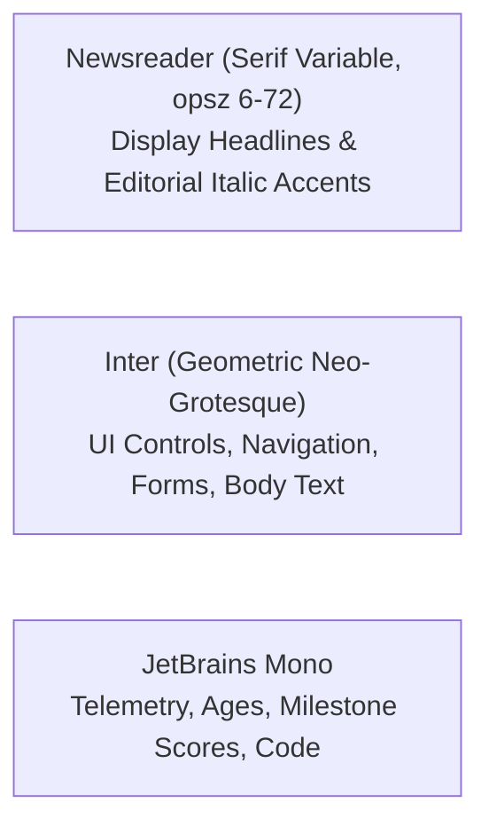

# AlongSide Design System — MASTER.md (Approved Canonical Source of Truth)

> **LOGIC:** When building or modifying a specific page or route, first check `design-system/alongside/pages/[page-name].md`.  
> If that file exists, its page-specific rules **override** this Master file.  
> If not, strictly adhere to the global rules below.

---

**Project:** AlongSide — The Parent Advisory Sanctuary: Keep Up With Your Child As They Grow (Ages 0–18)  
**Approved Direction:** **Taste 2: Editorial Pediatric Almanac** (Vercel Structural Discipline + Clinical Publication Prestige)  
**User Approval Date:** November 5, 2026  
**Methodology:** [`design-taste-frontend`](file:///C:/Users/souhe/.gemini/antigravity-cli/skills/design-taste-frontend--5b0315d236/SKILL.md) & [`ui-ux-pro-max`](file:///C:/Users/souhe/.gemini/antigravity-cli/skills/ui-ux-pro-max--0431196ef3/SKILL.md)  
**Design Dials:** Variance 2/10 (Centered / Minimal) | Motion 3/10 (Subtle) | Density 3/10 (Spacious)

---

## 1. Brand Philosophy & Core Identity

AlongSide is not a generic B2B SaaS dashboard, nor a developer cloud infrastructure tool. It is an **empathetic digital parenting sanctuary** serving families across 6 developmental lifespan stages (Infant Triage 0–1, Toddler Habits 1–3, Early Childhood 3–5, School Age 6–9, Pre-Teen Horizons 10–12, and Adolescent Independence 13–18).

### The Four Pillars of the Visual Experience:
1. **Clinical & Pediatric Authority:** Grounded in Barton Schmitt pediatric triage protocols, developmental neurobiology, and peer-reviewed science. Communicates the quiet dignity of a world-class medical publication (American Academy of Pediatrics, Harvard Health Publishing).
2. **"Parent Calm" at 2:00 AM:** Soothes the nervous system during high-stress parenting moments (infant fevers, toddler meltdowns, tween group-chat exclusion). Eliminates harsh blue-light glare through warm Archival Linen surfaces without sacrificing crisp WCAG AAA contrast.
3. **Vercel Architectural Discipline:** Built on the structural precision of Vercel—tightly tracked display typography (`-0.03em`), subtle 1px hairline boundaries (`#e3e3dc`), high-speed perception, clean card grids, and zero visual clutter.
4. **Bilateral Collaboration (Parent + Child):** Balances authoritative developmental boundaries with mutual respect. Replaces adversarial parental surveillance with shared family agreements, transparent curfews, and developmental milestone check-ins.

---

## 2. Global Color System & Semantic Tokens

All UI components must consume semantic CSS variables rather than hardcoded hex values or arbitrary utility classes.

### 2.1 Core Palette & Semantic Roles

| Token Role | Hex Code | CSS Variable | Semantic Usage |
| :--- | :--- | :--- | :--- |
| **Canvas / Background** | `#FBFBF9` | `--color-background` / `--canvas` | Primary page canvas; warm Archival Linen surface that eliminates eye strain |
| **Subtle Canvas** | `#F4F4F0` | `--color-canvas-subtle` | Secondary surface wash, table headers, alternating row fills |
| **Elevated Card** | `#FFFFFF` | `--color-card` / `--elevated` | Floating cards, modals, dropdowns, elevated interactive surfaces |
| **Foreground / Ink** | `#111413` | `--color-foreground` / `--ink` | Primary display headlines, high-emphasis text, authoritative borders (15.2:1 contrast) |
| **Body Text** | `#494F4C` | `--color-body` | Standard body paragraphs, narrative descriptions, instructions (7.1:1 contrast) |
| **Muted Text** | `#858C88` | `--color-muted-foreground` / `--mute` | Secondary captions, timestamps, table column metadata |
| **Hairline / Border** | `#E3E3DC` | `--color-border` / `--hairline` | Clean 1px structural dividing lines, card outlines, subtle dividers |
| **Soft Hairline** | `#EDEDEA` | `--color-hairline-soft` | Ultra-subtle interior grid lines, nested item dividers |
| **Primary (Spruce)** | `#143D2B` | `--color-primary` / `--accent-forest` | Institutional brand accent, active navigation items, verified clinical seals |
| **On Primary** | `#FFFFFF` | `--color-on-primary` | High-contrast text on Primary button/badge backgrounds |
| **Secondary (Ink)** | `#111413` | `--color-secondary` | Vercel pill action buttons, primary CTAs |
| **On Secondary** | `#FFFFFF` | `--color-on-secondary` | Text on Secondary buttons |
| **Accent (Amber)** | `#B45309` | `--color-accent` / `--accent-amber` | Citation amber, immediate priority badges, clinical warning highlights |
| **On Accent** | `#FFFFFF` | `--color-on-accent` | High-contrast text on Accent highlights |
| **Soft Spruce Wash** | `#EAF3EE` | `--color-accent-soft` | Background wash for clinical badges, verified checkmarks |
| **Destructive** | `#DC2626` | `--color-destructive` | Emergency triage alerts, destructive actions (Red 600) |
| **On Destructive** | `#FFFFFF` | `--color-on-destructive` | High-contrast white text on destructive states |
| **Focus Ring** | `#143D2B` | `--color-ring` | High-visibility focus indicators for keyboard navigation |

### 2.2 Ambient Mesh Hero Aura
For high-impact landing and hero headers, utilize the proprietary **Archival Ink & Deep Spruce** radial aura:
```css
background: radial-gradient(circle at 50% -20%, rgba(20, 61, 43, 0.08) 0%, rgba(180, 83, 9, 0.04) 35%, transparent 70%);
```

---

## 3. Typography Hierarchy & Font Stack

The typography stack balances **authoritative editorial gravitas** with **modern software legibility**.

### 3.1 Font Stack Roles



1. **Editorial & Display Accent Font:** `Newsreader` (Google Fonts variable font with optical size axis `opsz 6..72`, weights 400, 500, 600, 700, and italic).
   - Used for main display titles, section headings, and italicized editorial moments (e.g. *“Keep Up With Your Child As They Grow”*).
   - Designed by Production Type specifically for digital screen reading without hairline flicker.
2. **Functional UI & Body Font:** `Inter` (weights 400, 500, 600, 700).
   - Used for navigation, cards, inputs, buttons, and extended explanatory copy.
   - Provides ultra-clean letterforms and high legibility at small sizes.
3. **Monospace & Telemetry Font:** `JetBrains Mono` (weights 400, 500, 600).
   - Used for milestone scores (`Score 68/100`), age derivations (`11y • 6th Grade`), protocol stamps, and tabular data.

### 3.2 Web Font Import

```html
<link rel="preconnect" href="https://fonts.googleapis.com">
<link rel="preconnect" href="https://fonts.gstatic.com" crossorigin>
<link href="https://fonts.googleapis.com/css2?family=Newsreader:ital,opsz,wght@0,6..72,400;0,6..72,500;0,6..72,600;0,6..72,700;1,6..72,400;1,6..72,600&family=Inter:wght@400;500;600;700&family=JetBrains+Mono:wght@400;500;600&display=swap" rel="stylesheet">
```

Or in CSS:
```css
@import url('https://fonts.googleapis.com/css2?family=Newsreader:ital,opsz,wght@0,6..72,400;0,6..72,500;0,6..72,600;0,6..72,700;1,6..72,400;1,6..72,600&family=Inter:wght@400;500;600;700&family=JetBrains+Mono:wght@400;500;600&display=swap');
```

### 3.3 Typography Scale & Styles

| Level | Font Family | Size / Line Height | Weight & Style | Tracking | Usage |
| :--- | :--- | :--- | :--- | :--- | :--- |
| **Hero Display** | `Newsreader` + `Inter` | `56px` / `1.1` | 600 SemiBold (with *400 Italic* accents) | `-0.03em` | Landing and sanctuary hero titles |
| **Section Title** | `Newsreader` | `32px` / `1.2` | 600 SemiBold | `-0.02em` | Domain cards, section heads |
| **Card Heading** | `Inter` | `18px` / `1.3` | 600 SemiBold | `-0.01em` | Feature card titles, modal headers |
| **Body (Regular)** | `Inter` | `15px` / `1.6` | 400 Regular | `0` | Primary reading paragraphs |
| **UI Control** | `Inter` | `14px` / `1.4` | 500 Medium / 600 SemiBold | `0` | Buttons, navigation links, input text |
| **Publication Eyebrow**| `JetBrains Mono` | `11px` / `1.2` | 600 SemiBold Uppercase | `+0.08em` | Category stamps (`VOL. XXIV // CLINICAL`) |
| **Telemetry / Chip** | `JetBrains Mono` | `12px` / `1.3` | 500 Medium | `0` | Score badges, age derivations, timestamps |

---

## 4. Layout, Spacing & Spatial Geometry

Configured for **Spacious Density (3/10)** to provide breathing room and reduce visual noise for fatigued parents.

### 4.1 Spacing Scale

| Token | Pixels / Rem | Standard Application |
| :--- | :--- | :--- |
| `--space-xs` | `4px` / `0.25rem` | Micro gaps between icon and badge label |
| `--space-sm` | `8px` / `0.5rem` | Inline button padding, tight chip gap |
| `--space-md` | `24px` / `1.5rem` | Standard card interior padding, grid gap |
| `--space-lg` | `32px` / `2rem` | Component margin, modal internal padding |
| `--space-xl` | `48px` / `3rem` | Major section separation |
| `--space-2xl` | `64px` / `4rem` | Container vertical margins |
| `--space-3xl` | `96px` / `6rem` | Hero top/bottom breathing room |

### 4.2 Border Radii & Elevation

- **Buttons & Action Controls:** `5px` — Sharp, disciplined Vercel pill/rectangle geometry.
- **Pill Badges & Tag Labels:** `9999px` — Full rounded pill for tags and status indicators.
- **Cards & Banners:** `10px` or `12px` — Subtle, calm corners; avoids cartoonish oversized rounding.
- **Modals & Dialogs:** `16px` — Clean architectural container.
- **Hairlines:** Crisp `1px solid var(--color-border)` (`#E3E3DC`). Zero thick borders.

### 4.3 Shadow System

| Level | Value | Usage |
| :--- | :--- | :--- |
| `--shadow-sm` | `0 1px 2px rgba(17, 20, 19, 0.04)` | Subtle lift for badges and inputs |
| `--shadow-md` | `0 4px 12px rgba(17, 20, 19, 0.06)` | Standard cards, interactive hover states |
| `--shadow-lg` | `0 12px 28px rgba(17, 20, 19, 0.08)` | Floating menus, popovers, dropdowns |
| `--shadow-xl` | `0 24px 48px rgba(17, 20, 19, 0.12)` | Centered dialog modals, lightbox sheets |

---

## 5. Canonical Component Specifications

### 5.1 Buttons

```css
/* Base Button Primitive */
.btn {
  display: inline-flex;
  align-items: center;
  justify-content: center;
  gap: 8px;
  font-family: var(--font-body);
  font-size: 14px;
  font-weight: 600;
  padding: 10px 20px;
  min-height: 44px; /* WCAG touch target */
  border-radius: 5px;
  text-decoration: none;
  cursor: pointer;
  border: 1px solid transparent;
  transition: all 180ms ease;
}

/* Primary Vercel-Style Action Button */
.btn-primary {
  background: var(--color-foreground); /* #111413 */
  color: #FFFFFF;
  border-color: var(--color-foreground);
}
.btn-primary:hover {
  background: #232826;
  border-color: #232826;
  transform: translateY(-1px);
}

/* Secondary Editorial Button */
.btn-secondary {
  background: var(--color-card); /* #FFFFFF */
  color: var(--color-foreground);
  border-color: var(--color-border); /* #E3E3DC */
}
.btn-secondary:hover {
  background: var(--color-canvas-subtle);
  border-color: #C8C8BE;
}

/* Forest Brand Action Button */
.btn-forest {
  background: var(--color-primary); /* #143D2B */
  color: #FFFFFF;
  border-color: var(--color-primary);
}
.btn-forest:hover {
  background: #0E2B1E;
  transform: translateY(-1px);
}
```

### 5.2 Cards & Containers

```css
.card {
  background: var(--color-card); /* #FFFFFF */
  border: 1px solid var(--color-border); /* #E3E3DC */
  border-radius: 10px;
  padding: var(--space-md);
  box-shadow: var(--shadow-sm);
  transition: transform 180ms ease, box-shadow 180ms ease, border-color 180ms ease;
}

.card:hover {
  box-shadow: var(--shadow-md);
  border-color: #CFCFC5;
  transform: translateY(-2px);
}
```

### 5.3 Publication Stamp Badges & Telemetry Chips

```css
/* Editorial Publication Eyebrow */
.badge-publication {
  display: inline-flex;
  align-items: center;
  gap: 6px;
  background: var(--color-accent-soft); /* #EAF3EE */
  color: var(--color-primary); /* #143D2B */
  border: 1px solid rgba(20, 61, 43, 0.15);
  font-family: var(--font-mono);
  font-size: 11px;
  font-weight: 600;
  text-transform: uppercase;
  letter-spacing: 0.08em;
  padding: 4px 10px;
  border-radius: 9999px;
}

/* Clinical Telemetry Chip */
.chip-telemetry {
  display: inline-flex;
  align-items: center;
  gap: 6px;
  background: var(--color-canvas-subtle);
  color: var(--color-foreground);
  border: 1px solid var(--color-border);
  font-family: var(--font-mono);
  font-size: 12px;
  font-weight: 500;
  padding: 4px 10px;
  border-radius: 9999px;
}
```

### 5.4 Form Inputs & Controls

```css
.input {
  font-family: var(--font-body);
  font-size: 15px;
  min-height: 44px; /* WCAG touch target */
  padding: 10px 14px;
  background: var(--color-card);
  border: 1px solid var(--color-border);
  border-radius: 5px;
  color: var(--color-foreground);
  transition: border-color 180ms ease, box-shadow 180ms ease;
  width: 100%;
}

.input:focus {
  outline: none;
  border-color: var(--color-primary);
  box-shadow: 0 0 0 3px rgba(20, 61, 43, 0.15);
}

.input::placeholder {
  color: var(--color-muted-foreground);
}
```

---

## 6. Motion & Micro-Interactions

Configured for **Subtle Motion (3/10)**. Movement must communicate meaning and spatial hierarchy rather than decorative distraction.

### 6.1 GSAP Scroll Reveal

```js
import gsap from 'gsap';
import { ScrollTrigger } from 'gsap/ScrollTrigger';

gsap.registerPlugin(ScrollTrigger);

// Check reduced motion preference
const prefersReduced = window.matchMedia('(prefers-reduced-motion: reduce)').matches;

if (!prefersReduced) {
  gsap.from('.reveal-on-scroll', {
    opacity: 0,
    y: 12,
    duration: 0.35,
    ease: 'power1.out',
    stagger: 0.08,
    scrollTrigger: {
      trigger: '.reveal-container',
      start: 'top 88%',
      toggleActions: 'play none none reverse'
    }
  });
}
```

### 6.2 CSS Transition Standards
- Interactive hover states: `180ms cubic-bezier(0.16, 1, 0.3, 1)`
- Drawer and modal reveals: `240ms cubic-bezier(0.16, 1, 0.3, 1)`
- Zero layout-shifting animations (animate `transform` and `opacity` exclusively).

---

## 7. Anti-Patterns & Prohibitions (Zero Tolerance)

To prevent visual degradation and "AI slop", the following practices are strictly forbidden:

1. ❌ **No Raw Hex Values or Inline Magic Numbers:** Never place raw hex codes (`#111413`) directly in UI components; reference semantic variables (`var(--color-foreground)`).
2. ❌ **No Emoji as UI Icons:** Never use emoji (🩺, 🚨, 📱) as structural navigation or action icons. Use SVG vector icons from Lucide React or Radix UI.
3. ❌ **No "Icon in a Pastel Box" Syndrome:** Avoid generic rounded squares filled with pastel tints behind arbitrary icons. Use clean typography, crisp hairlines, or purposeful publication badges.
4. ❌ **No Touch Targets Below 44×44px:** All buttons, selectors, tabs, and interactive elements must satisfy minimum 44px hit dimensions.
5. ❌ **No Low-Contrast Text:** Text contrast must strictly meet or exceed WCAG AA (4.5:1 for body) and AAA (7:1+ for high emphasis).
6. ❌ **No Sudden Glare:** Never deploy stark `#FFFFFF` full-screen page backgrounds. The canvas must remain warm Archival Linen (`#FBFBF9`).
7. ❌ **No Layout Shifting on Hover:** Avoid changing border widths or adding padding on hover that shifts neighbouring elements.

---

## 8. Pre-Delivery Verification Checklist

Every frontend component or page built under this design system must pass:

- [ ] **Contrast Verification:** Measured against Archival Linen (`#FBFBF9`); body text ≥ 4.5:1, titles ≥ 7:1.
- [ ] **Touch Target Dimensions:** All clickable controls measure ≥ 44×44px on mobile viewports.
- [ ] **Font Roles Applied:** Headlines use `Newsreader` (with italic accents), functional text uses `Inter`, numbers/telemetry use `JetBrains Mono`.
- [ ] **Hairline Consistency:** Borders strictly use `1px solid var(--color-border)` (`#E3E3DC`).
- [ ] **Reduced Motion Support:** All transitions degrade gracefully when `prefers-reduced-motion` is active.
- [ ] **Mobile Responsiveness:** Tested and verified with zero horizontal overflow across 375px, 768px, 1024px, and 1440px viewports.
