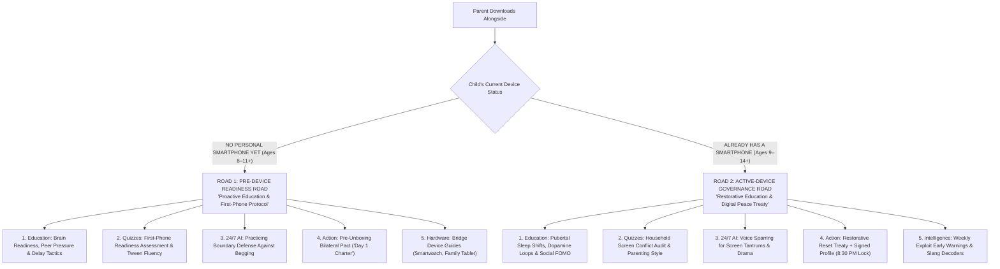

# Alongside (ParentPath) — Product Scope & Strategic Specification
## The Comprehensive Parent Intelligence & Family Operating System: Parent Education, Child Awareness, Interactive Quizzes, 24/7 AI Guidance & Transparent Bilateral Pacts
**Author:** Chief Executive Officer (CEO) & Product Visionary  
**Document Version:** 2.2.0 (The Comprehensive Parent Intelligence & Education Upgrade)  
**Target Audience:** CTO, Product Design, Engineering Team, Stakeholders, Board of Directors  
**Status:** Approved Canonical Product Scope  

---

## 1. Executive Summary & Positioning Horizon

### 1.1 One-Line Positioning
> **Alongside is the comprehensive parent intelligence platform and family operating system: educating parents on their child’s developmental psychology, emotional language, and youth culture at every age, engaging them through interactive quizzes and 24/7 AI guidance, while anchoring household peace with transparent, contract-driven device agreements.**

### 1.2 The Strategic Horizon: Beyond the "Dumb Utility" and the "Content Blog"
In digital parenting, startups perpetually die on one of two extremes:
1. **The "Content in a Trenchcoat" Extreme (v1.0):** Static parenting blogs, PDF agreements for the refrigerator, and generic advice articles. Parents read them once during an acute crisis, tape them to the fridge, and churn within 30 days. They are vitamins masquerading as SaaS.
2. **The "Dumb Utility / Commodity MDM" Extreme:** An impersonal phone-locking toggle or surveillance spyware (Bark, Qustodio). It treats children like suspects, destroys family trust, offers zero emotional education, and is perpetually vulnerable to Apple or Google OS settings updates.

**Alongside v2.2 unites the Brain and the Muscle into a Category-Defining Full-Stack Platform:**
- **The Core Foundation is Parent Education & Awareness:** Doing the device pact is *one* of the practical solutions we offer, but the heart of Alongside is **educating parents to deeply understand their child at every age stage**—their brain chemistry, emotional transitions, digital world, hidden slang, and developmental needs.
- **Interactive Quizzes & Self-Discovery:** Parents don't just read passive text; they test their knowledge with engaging quizzes (*"Do You Speak Tween?"*, *Parenting Style Profiler*, *Digital Readiness Assessments*, *Joint Parent-Child Discovery Audits*).
- **24/7 AI Child Advisor & Modern Parenting FAQ Vault:** A living intelligence layer providing pediatric- and psychologist-reviewed answers to acute questions (*"Why is my 11yo suddenly secretive?"*, *"What do I say about an inappropriate group chat?"*) alongside voice sparring to practice difficult talks.
- **The Contextual Lens (Two Dedicated Roads):** We do *not* narrow our product scope to "phone vs. no-phone." Rather, device status is a **personalization fork** that tailors the education, quizzes, and guidance to the family's exact reality (Pre-Device Preparation vs. Active-Device Governance).
- **The Operational Solution (The Pact & Signed Device Profile):** When education is internalized, AlongSide provides the tangible bridge: a bilateral Family Pact compiled into a native, transparent Apple/Android profile that automates bedtime lockouts (8:30 PM) with zero spyware.

```
┌──────────────────────────────────────────────────────────────────────────────────────────────────┐
│                                   THE ALONGSIDE v2.2 ECOSYSTEM                                   │
├──────────────────────────────────────────────────────────────────────────────────────────────────┤
│                                                                                                  │
│   ┌──────────────────────────────────────────────────────────────────────────────────────────┐   │
│   │                     1. PARENT INTELLIGENCE ACADEMY & CHILD AWARENESS                     │   │
│   │   • Age-by-Age Neurobiology (Ages 8-14+)    • Emotional Language & Tween Decoder         │   │
│   │   • Understanding Child Psychology          • Empathy First Communication Frameworks     │   │
│   └────────────────────────────────────────┬─────────────────────────────────────────────────┘   │
│                                            │                                                     │
│                                            ▼                                                     │
│   ┌──────────────────────────────────────────────────────────────────────────────────────────┐   │
│   │                     2. INTERACTIVE QUIZZES, AUDITS & SELF-DISCOVERY                      │   │
│   │   • "Do You Speak Tween?" Slang Quiz        • Parenting Conflict & Style Profiler        │   │
│   │   • First-Phone Readiness Assessment        • Joint Parent-Child Tech Discovery Audits   │   │
│   └────────────────────────────────────────┬─────────────────────────────────────────────────┘   │
│                                            │                                                     │
│                                            ▼                                                     │
│   ┌──────────────────────────────────────────────────────────────────────────────────────────┐   │
│   │                     3. 24/7 AI CHILD ADVISOR, VOICE SPARRING & FAQS                      │   │
│   │   • "Ask Alongside Anything" (24/7 AI)      • Living Modern Parenting FAQ Vault (100+)   │   │
│   │   • Interactive Voice Sparring Simulator    • Crisis De-escalation & Word-for-Word Scripts│   │
│   └────────────────────────────────────────┬─────────────────────────────────────────────────┘   │
│                                            │                                                     │
│                                            ▼                                                     │
│   ┌──────────────────────────────────────────────────────────────────────────────────────────┐   │
│   │                     4. WEEKLY YOUTH CULTURE & PLATFORM INTELLIGENCE                      │   │
│   │   • Sunday Slang & Meme Decoder             • Viral Exploit & Secret Bypass Alerts       │   │
│   │   • Platform Mechanics (Roblox, TikTok)     • Sunday Dinner Conversation Starters        │   │
│   └────────────────────────────────────────┬─────────────────────────────────────────────────┘   │
│                                            │                                                     │
│                                            ▼                                                     │
│   ┌──────────────────────────────────────────────────────────────────────────────────────────┐   │
│   │                     5. ACTIONABLE PEACE TREATY & "PACT-AS-CODE" PROFILE                  │   │
│   │   • Bilateral Co-Signed Family Agreement    • One-Tap Signed Profile (Apple / Android)   │   │
│   │   • Automated 8:30 PM Bedtime Lockdown      • Zero-Spyware Safe Harbor Guarantee         │   │
│   └──────────────────────────────────────────────────────────────────────────────────────────┘   │
│                                                                                                  │
└──────────────────────────────────────────────────────────────────────────────────────────────────┘
```

---

### 1.3 Executive Summary: What Alongside Offers (At a Glance)

To synthesize the complete product offering across education, awareness, intelligence, and operational tools:

- **1. Parent Intelligence Academy & Age-by-Age Awareness:**
  - **Neurodevelopmental Guidance (Ages 8–14+):** Translates what is biologically happening inside a child's brain (prefrontal cortex development, adrenarche, dopaminergic feedback loops, pubertal circadian shifts).
  - **Emotional Language Decoding:** Deciphers tween behavior—translating silence, eye-rolling, defensiveness, and outbursts into their underlying emotional needs (fear of missing out, peer belonging, anxiety).
  - **Age-Specific Communication Blueprints:** Practical frameworks for talking *with* children rather than talking *at* them.

- **2. Interactive Quizzes & Assessments (Gamified Education):**
  - **"Do You Speak Tween?" Cultural Fluency Quiz:** A fun weekly micro-quiz testing parent knowledge on emerging slang, platform trends, and covert apps.
  - **Parenting Style & Conflict Profiler:** Assesses whether parents lean Authoritarian, Permissive, or Authoritative/Mentorship, aligning co-parents on a united front.
  - **First-Phone Readiness Assessment (Score 0–100):** Objective 10-dimension evaluation of child maturity, responsibility, and emotional regulation.
  - **Household Tech Health & Sleep Audit:** Diagnostic identifying hidden screen friction points in the family routine.
  - **Joint Parent-Child Values Quiz:** Collaborative 3-minute quiz taken together to surface expectations and bridge conversational gaps.

- **3. 24/7 AI Child Advisor & Modern Parenting FAQ Vault:**
  - **"Ask Alongside Anything" (24/7 Contextual AI Advisor):** Real-time text and voice guidance for acute, real-world parenting dilemmas.
  - **Living Modern Parenting FAQ Vault:** Searchable repository of 100+ clinical and pediatric-backed answers to tough modern questions (*"How do I respond when they ask for Snapchat?", "What if their friends have no limits?", "How do I talk about explicit content without shaming?"*).
  - **Interactive Voice Sparring Simulator:** Live AI voice simulation of an agitated child, allowing parents to practice de-escalation aloud before the dinner table.
  - **Word-for-Word De-escalation Scripts:** Quick-reference conversational guides for acute flashpoints (dinner screen transitions, phone confiscation, homework battles).

- **4. Weekly Youth Culture & Platform Intelligence Digest:**
  - **Sunday Morning Culture & Slang Decoder:** Clear breakdowns of trending terms (*skibidi, rizz, crashout, looksmaxing, cooked*) separating playful slang from toxic rabbit holes.
  - **Viral App & Hidden Exploit Early Warnings:** Real-time parent alerts on sneak bypass tricks (calculator vault apps, Google Translate stealth browsers, anonymous bullying platforms like Sendit/NGL).
  - **Platform Mechanics Demystified:** Explaining Roblox trading scams, TikTok algorithm hooks, and Snap streaks in plain English.
  - **Sunday Dinner Conversation Starter:** One engaging, curious question delivered every Sunday to spark authentic family discussions.

- **5. The Actionable Operational Bridge ("Pact-as-Code" OS):**
  - **Bilateral Co-Signed Family Agreement:** Interactive 5-minute wizard where parent and child co-create clear boundaries.
  - **One-Tap Signed Profile Deployment:** Compiles clauses into a signed Apple Screen Time / Android Enterprise profile installed via a single QR code scan.
  - **Automated 8:30 PM Bedtime Lockdown:** Hardware-level curfew on non-essential apps; the OS acts as the neutral enforcer, ending bedtime screaming matches.
  - **Zero-Spyware Safe Harbor Guarantee:** Zero keylogging, zero message reading, zero stealth GPS. 24/7 access to phone calls, parents, and confidential emergency assistance.

- **6. Contextual Personalization (Two Dedicated Roads):**
  - **Road 1 (Pre-Device / No Phone Yet):** Readiness scoring, earned milestone step-ladders, bridge device guides (smartwatches, family tablets), and pre-handover Day 1 charters.
  - **Road 2 (Active-Device / Already Has Phone):** Restorative "Digital Reset" treaty, instant profile lockout deployment, exploit warnings, and de-escalation sparring.

- **7. High-Conviction Business Model:**
  - **7-Day Risk-Free Trial (Payment info required):** Complete family diagnostic, initial educational quiz, and profile generation.
  - **Hero Offer (Annual Pass): $79 / year (~$6.58 / mo):** Full access to Academy, Quizzes, 24/7 AI Advisor, Weekly Digest, and up to 5 child device profiles.
  - **Monthly Flex Pass ($9.99 / mo):** Flexible monthly alternative.
  - **Zero-CAC Institutional Channels:** School PTAs, middle-school orientation pledges, and pediatrician wellness referrals.

---

## 2. Core Philosophy: "Educate First, Partner Always, Enforce Neutrally"

### 2.1 The Principle of Balanced Authority
Modern parents do not want to be authoritarian surveillance wardens, nor do they want to be helpless bystanders. They want **authoritative mentorship**:
- **Education gives parents wisdom and confidence:** When parents understand *why* their 11-year-old craves peer validation or *why* melatonin is delayed during puberty, their anger transforms into empathy.
- **Awareness bridges the cultural gap:** When parents know the platforms and language their kids use, they can communicate with relevance rather than paranoia.
- **The Pact provides mutual buy-in:** When children have a voice in establishing rules, they take ownership of their behavior.
- **Automated Device Enforcement protects the family peace:** A contract without enforcement leads to parental burnout; enforcement without education leads to rebellion. By combining deep education with automated OS enforcement, Alongside creates lasting harmony.

```
        EDUCATION & AWARENESS (The Mind)  ──+──>  TRANSPARENT PACT & DEVICE PROFILE (The Hand)
       • Child psychology & neurobiology   │      • Automated 8:30 PM bedtime lockout
       • Age-by-age language & slang       │      • Neutral OS enforcement (no yelling)
       • Interactive quizzes & 24/7 FAQs   │      • Zero-spyware bilateral agreement
                                           ▼
                       HOUSEHOLD HARMONY & EARNED AUTONOMY
```

---

## 3. The 5 Core Pillars of Alongside v2.2

---

### Pillar 1: The Parent Intelligence Academy & Age-by-Age Child Awareness

The cornerstone of Alongside is helping parents understand who their child is at every developmental milestone.

#### 1. Stage-Specific Neurobiology & Psychology (Ages 8–14+):
- **Tier 1: Ages 8–9 (Early Curiosity & Impulse Centers):**
  - *Brain Reality:* The prefrontal cortex is in early formation; impulse inhibition is physically minimal. Children cannot self-regulate visual reward loops (YouTube Kids, Minecraft).
  - *Emotional Need:* Clear external structure presented with warmth. Children at this age crave predictability and clear boundaries.
  - *Communication Strategy:* Concrete, visual rules; focus on shared family viewing rather than solitary screen time.
- **Tier 2: Ages 10–11 (Tween Awakening, Adrenarche & The Peer Shift):**
  - *Brain Reality:* Adrenarche floods the brain with preliminary hormones; social reward centers activate intensely. For the first time, peer opinions carry more weight than parental approval.
  - *Emotional Need:* Feeling included among classmates; intense fear of being "the odd one out" without a phone or group chat.
  - *Communication Strategy:* Validating social anxiety without surrendering boundaries. Replacing "You're too young" with developmental readiness roadmaps.
- **Tier 3: Ages 12–13 (Pubertal Shift, Circadian Delay & Identity Exploration):**
  - *Brain Reality:* Pubertal sleep phase delay shifts circadian rhythm by ~2 hours—melatonin does not release until 10:30 PM or later, making early sleep biologically difficult. Emotional amygdala reactivity peaks.
  - *Emotional Need:* Autonomy, private identity space, and belonging in peer circles (group chats, gaming clans).
  - *Communication Strategy:* Collaborative negotiation; transparent boundaries paired with strict bedroom phone curfews to protect biological sleep.
- **Tier 4: Ages 14+ (Teens, Autonomy & Transition to Self-Regulation):**
  - *Brain Reality:* Executive function and long-term consequence reasoning mature; resistance to authoritarian control is at its highest.
  - *Emotional Need:* Respect, earned independence, and trust.
  - *Communication Strategy:* Mentorship over policing; graduated privilege extensions based on transparent accountability.

#### 2. The Age-by-Age Emotional Language Decoder:
Parents often misinterpret tween emotional reactions:
- When a tween says: *"You don't trust me!"*  
  *What they mean:* *"I feel like a baby compared to my friends, and I feel embarrassed."*  
  *How to respond:* *"I trust your heart, Maya. What we are managing together isn't your character; it's an algorithm designed to hook adult brains too."*
- When a tween slams the door after screen shutoff:  
  *What is happening:* An acute dopamine drop (neurochemical deficit) causing physiological agitation.  
  *How to respond:* Allow a 10-minute cooldown window before engaging; never lecture an agitated child during a dopamine withdrawal spike.

---

### Pillar 2: Interactive Quizzes, Assessments & Cultural Fluency Checks

To make parent education engaging, actionable, and habit-forming, Alongside incorporates interactive micro-assessments and gamified self-discovery:

```
┌────────────────────────────────────────────────────────────────────────┐
│               ALONGSIDE INTERACTIVE ASSESSMENT SUITE                   │
├────────────────────────────────────────────────────────────────────────┤
│ 1. "Do You Speak Tween?" Cultural Fluency Quiz (Weekly Micro-Quiz)     │
│    • 5 rapid questions decoding new slang, viral memes & app mechanics.│
│    • Example: "What does 'crashout' mean when your 7th grader says it? │
│      A) Falling asleep quickly                                         │
│      B) Having an explosive emotional reaction to a minor event [✓]    │
│      C) Leaving a group chat abruptly"                                 │
│    • Delivers instant educational context and parenting implications.   │
│                                                                        │
│ 2. Digital Parenting Style & Conflict Profiler                         │
│    • Evaluates parenting tendencies: Authoritarian vs. Permissive vs.  │
│      Authoritative Alongside Mentorship.                               │
│    • Identifies co-parent discrepancies and harmonizes family rules.   │
│                                                                        │
│ 3. The First-Phone & Digital Readiness Assessment (Score 0–100)        │
│    • 10-dimension evaluation: Executive function, emotional regulation,│
│      household boundary compliance, and online stranger safety.        │
│    • Generates a personalized Readiness Roadmap (Not 'No', but 'When').│
│                                                                        │
│ 4. Household Tech Health & Sleep Friction Audit                        │
│    • 3-minute diagnostic identifying evening friction points, bedroom  │
│      screens, and dinner distractions.                                 │
│                                                                        │
│ 5. Joint Parent-Child "Discovery Bridge" Quiz                          │
│    • A fun 3-minute quiz taken together on one device. Surfacing each  │
│      other's favorite apps, biggest online worries, and agreed values. │
└────────────────────────────────────────────────────────────────────────┘
```

---

### Pillar 3: 24/7 AI Child Advisor, Voice Sparring & Modern Parenting FAQs

#### 1. "Ask Alongside Anything" (24/7 Contextual AI Advisor):
Parents face high-friction dilemmas at unpredictable hours—at 2:00 AM after finding a phone under the pillow, or in the school pickup line after hearing about a disturbing group chat.
- Parents can type or speak questions naturally.
- The AI responds using evidence-based child psychology, pediatric guidelines, and AlongSide’s restorative philosophy:
  - *"My 10-year-old was invited to a Discord server with high schoolers. How do I say no without being the enemy?"*
  - *"My 12-year-old is using a calculator vault app. How do I confront them without breaking trust?"*
  - *"My ex-spouse gives our child unlimited iPad access. How do I maintain boundaries at my home?"*

#### 2. The Living Modern Parenting FAQ Vault (100+ Scenarios):
Curated, expert-reviewed answers organized by category and child age:
- **First Device & Hardware Decisions:** When is a child ready for a smartphone? What about a smartwatch or dumbphone? Who pays for the device?
- **Social Media & Group Chats:** How do I handle WhatsApp class chats? When is Snapchat appropriate? What if they are left out of a chat?
- **Gaming & Microtransactions:** How do Roblox Robux economies work? How do I stop in-game purchase begging? What about violent games?
- **Scary Content & Safety:** What if my child sees pornography or violence? How do I debrief without shaming? What are the signs of online grooming?
- **Sleep, Health & Habits:** Why won't my child sleep without their phone? How does blue light affect puberty? How do we establish a family charging station?

#### 3. Interactive AI Voice Sparring Simulator:
Theory is useless during adrenaline spikes. The Voice Sparring Simulator lets parents practice tough talks aloud against an AI simulation of an agitated child:
- **Scenario A (Begging):** *"Everyone in 5th grade has an iPhone! You're ruining my life!"*
- **Scenario B (Bedtime Resistance):** *"Just 5 more minutes! My Roblox friends are waiting for me!"*
- **Scenario C (Confiscation):** *"You invaded my privacy! I hate you!"*
- The AI provides real-time coaching on vocal tone, empathetic validation, and unshakeable boundary firmness.

---

### Pillar 4: Weekly Youth Culture, Slang & Algorithmic Intelligence Digest

Every Sunday morning, Alongside delivers a 3-minute executive intelligence briefing to keep parents culturally literate:

1. **Slang & Vernacular Decoder:**
   - Translates trending terms (*skibidi, rizz, looksmaxing, crashout, cooked, sigma, mogging, cap/no cap*).
   - Clarifies tone: Is it innocent play, playful sarcasm, or a gateway to toxic internet subcultures?
2. **Hidden Exploit & Bypass Alerts:**
   - How kids circumvent basic parental controls:
     - Using Google Translate or Apple Notes as a stealth web browser.
     - Decoy "Calculator Vault" apps with hidden PIN photo lockers.
     - Anonymous feedback and bullying apps (Sendit, NGL).
3. **Platform Mechanics Deep Dives:**
   - Explaining the business model behind algorithmic loops: Snap streaks (loss aversion), TikTok FYP (variable reward schedule), and Roblox limited-edition trading (gambling mechanics).
4. **The Sunday Dinner Conversation Starter:**
   - One open-ended, curious prompt to spark genuine, non-interrogative family dinner dialogue (*"Ask your tween what the funniest video or meme they saw this week was and ask them to explain why it's funny"*).

---

### Pillar 5: The Actionable Operational Bridge ("Pact-as-Code" OS)

Education gives parents the insight and words, but **the Family Pact and Device Profile provide the peaceful operational reality**:

```
┌────────────────────────────────────────────────────────────────────────┐
│                   PACT-TO-PROFILE COMPILER PIPELINE                    │
├────────────────────────────────────────────────────────────────────────┤
│ 1. Collaborative Negotiation: Parent & child sit together for 5 mins   │
│    answering guided trade-off questions (Curfew, Study, Allowed Apps). │
│ 2. Bilateral Digital Signature: Both parent and child co-sign.         │
│ 3. Cryptographic Compilation: Compiles clauses into a signed Apple     │
│    Declarative Management (.mobileconfig) / Android Enterprise profile.│
│ 4. Single QR Code Enrollment: Child scans QR code; profile installs     │
│    instantly into native OS settings in 60 seconds.                    │
│ 5. Automated Neutral Enforcement: At 8:30 PM, the OS locks non-exempt   │
│    apps. The parent is NOT the bad guy; the operating system neutrally │
│    enforces the exact pact the child co-signed.                        │
│ 6. Zero-Spyware Safe Harbor: Emergency calls, parent SMS, and the      │
│    help button remain active 24/7 with zero tracking or surveillance.  │
└────────────────────────────────────────────────────────────────────────┘
```

#### What the Profile Enforces:
- **Bedtime App Blackout:** Hardware-level lockout of non-essential apps at the agreed curfew (e.g., 8:30 PM for 10yo, 9:30 PM for 13yo).
- **Category & Age Gating:** Blocks downloads rated above agreed age thresholds (e.g., 17+ apps on a 12yo phone) and disables predatory microtransactions.
- **One-Tap "Family Dinner Pause":** Remote temporary freeze of non-essential screens during family meals or focus periods.
- **Semi-Annual Milestone Upgrades:** Every 6 months, adhering to the agreement unlocks earned privileges (later Friday bedtime, new apps), turning compliance into self-regulation.

---

## 4. The Two Contextual Roads: Personalization, Not Scope Narrowing

The division between **Road 1 (Pre-Device)** and **Road 2 (Active-Device)** is **not** a narrowing of our product scope. It is an intelligent **Contextual Personalization Lens** that shapes the educational journey:



### Comparative Summary: How Education & Tools Adapt by Road

| Dimension | Road 1: Pre-Device Preparation | Road 2: Active-Device Governance |
| :--- | :--- | :--- |
| **Parent Emotional State** | Anticipatory anxiety, fear of child being left out | Daily exhaustion, bedtime conflict, boundary erosion |
| **Child Emotional State** | Eager anticipation, high willingness to cooperate | Defensive, protective of digital territory |
| **Primary Educational Focus** | Understanding tween social needs, delaying full devices, building offline habits | Understanding dopamine loops, pubertal sleep delays, cyberbullying de-escalation |
| **Interactive Quizzes** | First-Phone Readiness Assessment, Family Values Quiz | Household Tech Health Audit, Parenting Conflict Profiler |
| **AI Advisor & Sparring** | Rehearsing responses to begging (*"Everyone else has one!"*) | Rehearsing de-escalation during screen transitions and confiscations |
| **Actionable Tool** | Pre-Unboxing Day 1 Family Pact & Bridge Device Setup | Restorative Peace Treaty & Signed Device Profile (8:30 PM Lock) |
| **Milestone Ritual** | "First Phone Handover Ceremony" | Semi-annual privilege upgrade review (earned autonomy) |

---

## 5. Business Model & Monetization Strategy

### 5.1 The High-Conviction Value Proposition
Free parenting apps fail because they deliver shallow advice and churn. Alongside commands a premium annual subscription because it delivers **both deep educational transformation and an automated mechanical painkiller**:
- **Why Parents Pay $79/Year:**
  - They get a year-round **Digital Parenting Masterclass & 24/7 AI Advisor** in their pocket.
  - They get **365 nights of automated bedtime peace** without screaming matches.
  - They stay culturally literate through weekly briefings and interactive quizzes.
  - It costs less than **$1.52 per week**—cheaper than a single coffee.

### 5.2 Pricing Structure

```
┌────────────────────────────────────────────────────────────────────────┐
│                        ALONGSIDE PRICING TIERS                         │
├────────────────────────────────────────────────────────────────────────┤
│ 1. 7-DAY RISK-FREE TRIAL (Payment info required upfront)               │
│    • Complete First-Phone Readiness or Household Health Assessment     │
│    • Full access to Parent Intelligence Academy & Interactive Quizzes  │
│    • 1 Signed Native Device Profile installation                       │
│    • Full access to 24/7 AI Advisor & Weekly Culture Digest            │
│                                                                        │
│ 2. ANNUAL PASS (RECOMMENDED / HERO OFFER): $79 / year (~$6.58 / mo)   │
│    • Unlimited access to Parent Intelligence Academy for all child ages│
│    • Up to 5 child profiles with native device profile deployments     │
│    • Automated 8:30 PM bedtime lockdowns & category app gating         │
│    • Complete Interactive Quiz Suite & Weekly Slang Briefings          │
│    • Unlimited 24/7 AI Child Advisor & Voice Sparring Simulator        │
│    • Living Parenting FAQ Vault (100+ Scenarios)                       │
│    • Semi-Annual Milestone Upgrade Ceremonies                          │
│    • 30-Day Money-Back "Household Peace" Guarantee                     │
│                                                                        │
│ 3. MONTHLY FLEX PASS: $9.99 / month                                    │
│    • Complete platform access billed monthly                           │
│                                                                        │
│ 4. INSTITUTIONAL B2B2C DISTRIBUTION (ZERO CAC ENGINE)                  │
│    • School PTA / District Partnerships (Class-wide digital pledges)   │
│    • Pediatrician Practice Partnerships & Family Health Sponsorships   │
└────────────────────────────────────────────────────────────────────────┘
```

---

## 6. Success Metrics & Key Performance Indicators (KPIs)

### 1. Education & Awareness Engagement (The Heart)
- **Weekly Quiz Completion Rate:** > 60% of active parents complete the Sunday Cultural Fluency Quiz.
- **Academy Module Engagement:** > 70% of parents complete at least 2 child developmental modules within their first 30 days.
- **FAQ & AI Advisor Usage:** > 4 interactions per active user per month with the 24/7 AI Advisor or FAQ vault.
- **Weekly Culture Digest Open Rate:** > 55% open rate on Sunday morning briefings.

### 2. Operational Device Health (The Muscle)
- **Profile Installation Success:** > 85% of Active-Device trial signups successfully install the signed device profile within 48 hours.
- **Enforced Peaceful Nights:** > 24 nights/month where devices successfully execute the automated 8:30 PM bedtime lockout.
- **Tamper & Bypass Rate:** < 5% of enrolled devices experience unauthorized profile removal.

### 3. Business & Family Outcomes
- **Household Conflict Reduction:** > 85% of parents report a measurable decrease in bedtime shouting matches within 14 days.
- **Annual Subscription Retention:** > 75% renewal rate at Month 12.
- **Net Promoter Score (NPS):** > +65 among paying parents.

---

## 7. Phased Implementation Roadmap

```
┌───────────────────────────────────────────────────────────────────────────┐
│ PHASE 1: MVP — The Comprehensive Parent Intelligence Platform (CURRENT)    │
│ • Parent Mobile App (iOS / Android) with Road 1 vs. Road 2 Context Fork   │
│ • Parent Intelligence Academy: Core modules for Ages 8–14 (Neuro/Emotions)│
│ • Interactive Quizzes: First-Phone Readiness Assessment & Tween Slang Quiz│
│ • 24/7 AI Parenting Advisor (Text Chat) & Top 50 Curated FAQs            │
│ • Bilateral Family Pact Builder & Vector PDF Printout                     │
│ • Road 2: Signed Device Profile with Automated 8:30 PM Bedtime Lockdown   │
│ • Weekly Sunday Youth Culture Digest & Slang Decoder                      │
│ • Stripe Checkout: 7-Day Trial into $79/yr or $9.99/mo                    │
└─────────────────────────────────────┬─────────────────────────────────────┘
                                      │
                                      ▼
┌───────────────────────────────────────────────────────────────────────────┐
│ PHASE 2: AI Voice Sparring & Expanded Gamified Assessments                │
│ • Low-latency streaming AI voice sparring simulator (Road 1 & Road 2)     │
│ • Full Interactive Quiz Suite (Parenting Style, Joint Parent-Child Quiz)  │
│ • Dynamic Milestone Upgrade Ceremonies (6-month renewal rituals)          │
│ • Co-Parent synchronization & unified household dashboard                 │
└─────────────────────────────────────┬─────────────────────────────────────┘
                                      │
                                      ▼
┌───────────────────────────────────────────────────────────────────────────┐
│ PHASE 3: Child Companion Experience & Earned Autonomy                     │
│ • Child transparent dashboard: view rules, earned bonus time, safe harbor │
│ • Frictionless extension requests with parent one-tap approval            │
│ • Router-level home Wi-Fi integration (e.g. Eero / UniFi profiles)        │
└─────────────────────────────────────┬─────────────────────────────────────┘
                                      │
                                      ▼
┌───────────────────────────────────────────────────────────────────────────┐
│ PHASE 4: Institutional B2B2C Expansion                                    │
│ • School District & PTA portal for class-wide digital pledges             │
│ • Pediatric clinic integration & adolescent wellness reimbursement code   │
└───────────────────────────────────────────────────────────────────────────┘
```

---

## 8. Handover Guidance to Chief Technology Officer (CTO)

### Technical Directives from the CEO:
1. **Academy & Content Architecture:**
   - Model rich educational modules, developmental guides, and age-specific decoders in the database schema (`EducationModule`, `DevelopmentalStage`, `CultureDigest`).
2. **Interactive Quiz Engine:**
   - Build a flexible quiz/assessment evaluation engine supporting multiple question types (multiple choice, Likert scale, joint parent-child input) and calculating multi-dimensional scores.
3. **24/7 AI Knowledge Base & Context Engine:**
   - Integrate an LLM reasoning engine backed by a curated vector database of pediatric and psychological FAQs, personalizing responses based on child age and road status.
4. **Bifurcated Child Entity Schema:**
   - Support `deviceStatus` enum (`PRE_DEVICE` vs. `ACTIVE_DEVICE`), linking readiness scores or MDM profile tokens respectively.
5. **Signed Device Management Infrastructure:**
   - Architect Apple Declarative Device Management / Screen Time APIs and Android Enterprise profiles for automated bedtime locks without spyware.

---
*Canonical Specification Approved by:*  
**Chief Executive Officer (CEO)**  
**AlongSide Technologies Inc.**
