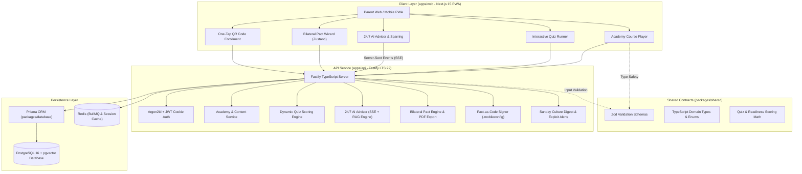

# Alongside (ParentPath)

> **The Holistic Child Upbringing, Health & Lifespan Family Operating System (Ages 0–18): Empowering parents to deeply understand and nurture their child’s pediatric health, nutrition, speech and motor milestones, brain play, and behavioral psychology, while providing modern cultural mentorship, 24/7 clinical AI guidance, and balanced transition solutions—including bilateral family pacts—when introducing technology.**

[](https://www.typescriptlang.org/)
[-black.svg)](https://nextjs.org/)
[](https://react.dev/)
[](https://fastify.dev/)
[](https://www.prisma.io/)
[](https://tailwindcss.com/)
[](#)

---

## 🌟 Executive Overview & Product Vision

**Alongside** is a category-defining holistic child upbringing, pediatric health, and family operating system designed for parents raising children from birth to adulthood (Ages 0–18).

Historically, parenting technology suffers from two fatal blinders:
1. **The "Device-Only" Trap:** Narrowing the entire journey of parenting to a battle over screens, smartphones, or parental control locks. Parents only open these apps when feeling anxious or guilty about screen time, ignoring that 95% of childhood revolves around physical health, nutrition, developmental milestones, play, emotional regulation, and family connection.
2. **The "Baby App Churn Cliff":** Baby trackers (Huckleberry, BabyCenter) capture infant sleep and feeding, but churn 90% of parents at age 2 when diapers and bottles end. No unified platform supports parents through toddler tantrums, picky eating, early childhood brain games, school lunchboxes, pre-teen friendship drama, and adolescent independence.

**Alongside v2.4 establishes the Universal Family Operating System across 7 Balanced Pillars:**
- **Developmental Milestones & Growth ("When He Moves, When He Talks"):** Guilt-free, pediatrician-backed tracking across gross motor, fine motor, speech acquisition, and cognitive stages (Ages 0–18).
- **Pediatric Health & Symptom Companion (The Safe Resort):** Evidence-based fever triage, common childhood illness decoders, medication calculators, and emergency room vs. home care protocols to end 2:00 AM panic Googling.
- **Pediatric Nutrition, Feeding & Dietary Safety:** Step-by-step guidance on infant solids, safe allergen introduction, choking hazard prevention, conquering toddler picky eating, and fueling teenage athletic growth.
- **Brain Games, Sensory Play & Cognitive Enrichment:** Purposeful, offline developmental play—from early animal puppets and high-contrast sensory cards to symbolic block play, LEGO building, and strategic logic chess.
- **Behavioral Psychology & The Modern Cultural Advisor:** Translating confusing behaviors (tantrums, biting, defiance, lying) into unmet nervous system needs, fostering authoritative warmth with firm boundaries, and mentoring kids in a complex modern world.
- **24/7 AI Clinical Child Advisor & Voice Sparring Simulator:** Multi-child contextual AI guidance for acute dilemmas and an interactive voice sparring simulator to practice high-stakes parenting conversations out loud.
- **Modern Culture, Multi-Device Ecology & The "Thinking About a Device?" Solution Hub:** Sunday slang decoders (*skibidi, crashout, looksmaxing*), exploit alerts, and an intentional milestone transition pipeline featuring the **Bilateral Family Pact ("Pact-as-Code")** and **Automated 8:30 PM Bedtime Lockdown** with zero spyware.

For the canonical product strategy, persona analyses, and market thesis authored by the CEO, see [**`PROJECT_SCOPE.md`**](PROJECT_SCOPE.md) and the [**Paul Graham Roast & Evaluation Report**](docs/PAUL_GRAHAM_ROAST.md).

---

## ⚡ Quick Start & Local Development

### 1. Prerequisites

Ensure your local development environment satisfies these requirements:

| Tool | Version | Purpose |
| :--- | :--- | :--- |
| **Node.js** | `>= 22.0.0` (LTS 22+) | Server runtime with native TypeScript support |
| **npm** | `>= 10.0.0` | Monorepo workspace package manager |
| **Docker & Docker Compose** | Latest | PostgreSQL 16 database with `pgvector` extension |
| **GNU Make** | Any (Optional) | Single-command developer ergonomics via `Makefile` |

### 2. 1-Minute Setup Guide

```bash
# 1. Clone the repository
git clone https://github.com/Souheil007/AlongSide.git
cd AlongSide

# 2. Install monorepo dependencies across all workspaces
make install
# (Alternative without make: npm install)

# 3. Create your local environment configuration
cp .env.example .env

# 4. Start PostgreSQL 16 + pgvector container
make db-up
# (Alternative without make: docker compose up -d)

# 5. Generate Prisma Client for the database workspace
make db-generate
# (Alternative without make: npm run db:generate)

# 6. Start both Frontend and Backend servers concurrently
make dev
# (Alternative without make: npm run dev)
```

Both development servers will launch concurrently:
- 📱 **Frontend (Next.js 15 Web PWA):** [http://localhost:3000](http://localhost:3000)
- 🚀 **Backend (Fastify LTS 22 API):** [http://localhost:4000](http://localhost:4000)
- 🩺 **Health Check Endpoint:** [http://localhost:4000/api/v1/health](http://localhost:4000/api/v1/health)

Press `Ctrl + C` in your terminal to gracefully shut down both servers simultaneously.

---

## 🧰 Makefile Developer Reference

Alongside includes a root [`Makefile`](Makefile) providing standardized commands across the monorepo:

| Target | Command | Description |
| :--- | :--- | :--- |
| **`make help`** | `make help` | Displays the help menu with all available targets |
| **`make dev`** | `make dev` | **Starts both Frontend (Web) and Backend (API) concurrently** via `scripts/dev.mjs` |
| **`make dev-frontend`** | `make frontend` / `make web` | Starts the Next.js 15 Web frontend exclusively on port `3000` |
| **`make dev-backend`** | `make backend` / `make api` | Starts the Fastify LTS 22 API backend exclusively on port `4000` |
| **`make db-up`** | `make db-up` | Launches the PostgreSQL 16 + `pgvector` Docker container in background |
| **`make db-down`** | `make db-down` | Stops the PostgreSQL Docker container |
| **`make db-logs`** | `make db-logs` | Follows real-time logs from the PostgreSQL container |
| **`make db-generate`** | `make db-generate` | Generates the typed Prisma Client (`packages/database`) |
| **`make db-validate`** | `make db-validate` | Validates the Prisma schema against database constraints |
| **`make db-studio`** | `make db-studio` | Opens Prisma Studio visual database browser |
| **`make test`** | `make test` | Executes all Vitest unit and integration test suites |
| **`make typecheck`** | `make typecheck` | Runs TypeScript type checking (`tsc --noEmit`) across all workspaces |
| **`make lint`** | `make lint` | Runs ESLint linters across all packages and apps |
| **`make build`** | `make build` | Compiles production builds for all workspaces |
| **`make install`** | `make install` | Installs dependencies across all npm workspaces |
| **`make clean`** | `make clean` | Cleans build caches (`.next`, `dist`, build artifacts) |

---

## 🏛️ System Architecture & Expert System Design

Alongside is engineered as a type-safe, decoupled monorepo leveraging standard npm workspaces. For complete quantitative capacity estimations (100k+ DAU sizing, QPS, cache RAM), architectural trade-off evaluations, and deep module seam architecture, see the authoritative [**Expert System Design Specification**](docs/system-design-specification.md), [**System Architecture Specification**](docs/system-architecture.md), and [**Codebase Design Specification**](docs/codebase-design.md).



---

## 🛠️ Technology Stack Overview

| Area | Technology | Purpose |
| :--- | :--- | :--- |
| **Monorepo** | **npm Workspaces** | Clean isolation between `apps/web`, `apps/api`, `packages/shared`, `packages/database` |
| **Developer Ergonomics** | **Makefile + Node Runner** | Concurrent execution (`make dev`), atomic targets, zero-dependency process manager |
| **Frontend** | **Next.js 15 (App Router, React 19)** | High performance, Server Components (RSC) for Academy/Digest, PWA offline support |
| **Styling & UI** | **Tailwind CSS v3.4 + Radix / shadcn/ui** | Empathetic "Parent Calm" design system; accessible, responsive, zero-runtime bloat |
| **State & Fetching** | **TanStack Query v5 + Zustand** | Optimistic server state caching and multi-step wizard state management |
| **Offline PWA** | **`@ducanh2912/next-pwa` (Serwist)** | Offline script reading, platform decoders, and mobile home screen launcher |
| **Backend API** | **Node.js (LTS 22) + Fastify (TypeScript)** | Ultra-fast HTTP throughput, built-in schema serialization, native SSE support |
| **Database & Vector**| **PostgreSQL 16 + `pgvector`** | Relational integrity + unified vector embeddings for AI FAQ retrieval |
| **ORM & Migrations** | **Prisma ORM** | Declarative schema modeling, migrations, and seed scripts |
| **Shared Contracts** | **Zod (Shared via `@alongside/shared`)** | Single source of truth for runtime validation on client and server |
| **Security & Auth** | **Argon2id + HTTP-Only Secure JWT Cookies** | Zero client-token exposure (immune to XSS token theft), CSRF protection |
| **AI & RAG Engine** | **Vercel AI SDK / OpenAI Client (`gpt-4o`)** | Streaming text generation over SSE; cosine similarity search over FAQ vectors |
| **Device Governance**| **`node-forge` + `plist` + `qrcode`** | PKCS#7 signed Apple `.mobileconfig` and Android Enterprise policies; QR enrollment |
| **Document Export** | **`@react-pdf/renderer` + Print CSS** | Instant refrigerator-ready printouts and vector PDF downloads |
| **Monetization** | **Stripe Billing** | 7-day upfront trial, $79/year Annual Hero Pass, $9.99/mo flex pass |
| **Testing** | **Vitest + Fastify Inject + Playwright** | Fast unit/integration tests and end-to-end critical journey testing |

---

## 📂 Repository Organization

```
AlongSide/
├── Makefile                      # Developer command orchestrator (make dev, make test, etc.)
├── scripts/
│   └── dev.mjs                   # Pure Node.js concurrent dev server orchestrator
├── apps/
│   ├── web/                      # Next.js 15 Frontend PWA (App Router, React 19, Tailwind)
│   │   ├── src/app/              # RSC routes (Landing, Auth, Onboarding, Dashboard)
│   │   ├── src/components/       # UI components & Parent Calm design system
│   │   └── src/hooks/            # Custom hooks (useAuth, useChildren, useReadiness)
│   └── api/                      # Fastify LTS 22 Node.js Backend API
│       ├── src/modules/auth/     # Argon2id password hashing, JWT cookie session auth
│       ├── src/modules/children/ # Child profile CRUD, 4 developmental tiers, road forks
│       ├── src/modules/health/   # Service health check & uptime probe
│       └── src/plugins/          # Encapsulated Fastify plugins (auth, error handler)
├── packages/
│   ├── shared/                   # Shared TypeScript Schemas, DTOs, Enums & Quiz Algorithms
│   │   ├── src/constants/        # Developmental tiers, Road types, Quiz presets
│   │   ├── src/schemas/          # Zod validation contracts shared between client & server
│   │   └── src/algorithms/       # Pure scoring math (Readiness 0-100, tween fluency)
│   └── database/                 # Prisma ORM & Database Layer
│       ├── prisma/schema.prisma  # PostgreSQL 16 schema with pgvector vector support
│       └── src/client.ts         # PrismaClient singleton with graceful teardown
├── docs/                         # Canonical Specifications & Engineering Standards
│   ├── system-design-specification.md # Quantitative sizing, capacity estimations & blueprints
│   ├── system-architecture.md         # Monorepo layout, security boundaries & data flows
│   ├── codebase-design.md             # Deep modules, seam catalog & test fakes
│   └── api-specification.md           # Authoritative REST API contract & DTO catalog
├── plans/                        # Discrete Agent Execution Plans (Numbered 01–14)
├── .agents/                      # AI Agent Governance & Machine-Enforceable Rules
├── AGENTS.md                     # Engineering team protocols, boundaries & ownership
├── PROJECT_SCOPE.md              # Canonical Product Scope v2.3.0 (CEO)
├── README.md                     # Repository Overview & Developer Guide
├── docker-compose.yml            # PostgreSQL 16 + pgvector container definition
├── package.json                  # Root npm workspace definition
└── tsconfig.base.json            # Base TypeScript configuration
```

---

## 🔌 API Endpoints & Verification

The Fastify API runs on `http://localhost:4000` with versioned `/api/v1` routes:

### Health Probe
- `GET /api/v1/health` — Service status, environment, uptime, and timestamp.

### Authentication & Sessions (`/api/v1/auth`)
- `POST /api/v1/auth/register` — Create parent account, starts 7-day trial, sets secure HttpOnly JWT cookie.
- `POST /api/v1/auth/login` — Authenticate parent credentials with Argon2id verification.
- `GET /api/v1/auth/me` — Retrieve active authenticated session and parent profile.
- `POST /api/v1/auth/logout` — Revoke session cookie.

### Children & Contextual Road Fork (`/api/v1/children`)
- `POST /api/v1/children` — Register child profile, automatically resolves developmental tier (`TIER_1_AGES_8_9`, `TIER_2_AGES_10_11`, `TIER_3_AGES_12_13`, `TIER_4_AGES_14_PLUS`) and road selection (`PRE_DEVICE` vs `ACTIVE_DEVICE`).
- `GET /api/v1/children` — List all children associated with authenticated parent.
- `GET /api/v1/children/:id` — Retrieve detailed child profile and road status.
- `POST /api/v1/children/:id/road` — Transition or update child road fork selection.

---

## 🧪 Testing & Quality Assurance

Alongside enforces high test coverage and zero-regression verification through automated Vitest suites:

```bash
# Run all monorepo test suites (shared, api, and web)
make test
# or: npm test

# Run TypeScript typechecks across all 4 workspaces
make typecheck
# or: npm run typecheck

# Run linters across all workspaces
make lint
# or: npm run lint
```

### Testing Strategy:
- **`packages/shared`:** Exhaustive unit tests for pure scoring algorithms (`calculateReadinessScore`), developmental tier resolution, and Zod schema validations.
- **`apps/api`:** Fastify integration testing via `.inject()`, testing status codes, cookies, error envelopes, and repository layers without spinning up physical TCP ports.
- **`apps/web`:** Component, form, and custom hook tests verifying validation logic, accessibility, and client state machines.

---

## 🚀 Phased Engineering Roadmap

AlongSide is executed across discrete, sequential engineering plans:

| # | Plan Title | Owner | Status |
| :-: | :--- | :--- | :-: |
| **01** | [**Monorepo Workspace Setup, Shared Package & Prisma Database**](plans/01-project-setup-and-db.md) | Backend Agent | ✅ **Complete** |
| **02** | [**Authentication, Session Cookies & Parent Account API**](plans/02-auth-and-user-profile.md) | Backend Agent | ✅ **Complete** |
| **03** | [**Next.js 15 PWA Scaffolding, ParentCalm Design System & Auth UI**](plans/03-frontend-scaffolding-and-auth-ui.md) | Frontend Agent | ✅ **Complete** |
| **04** | [**Child Profile CRUD, Contextual Road Fork & Readiness API**](plans/04-child-profile-and-road-bifurcation-api.md) | Backend Agent | ✅ **Complete** |
| **05** | [**Child Onboarding, Road Selection & Assessment Wizard UI**](plans/05-child-profile-and-road-selection-ui.md) | Frontend Agent | ✅ **Complete** |
| **06** | [**Bilateral Family Pact Engine & Device Profile Compiler API**](plans/06-bilateral-pact-and-profile-compiler-api.md) | Backend Agent | ✅ **Complete** |
| **07** | [**Pact Wizard, Digital Co-Signing & QR Enrollment UI**](plans/07-agreement-builder-and-device-enrollment-ui.md) | Frontend Agent | ✅ **Complete** |
| **08** | [**Parent Intelligence Academy Modules & Youth Culture Digest API**](plans/08-parent-academy-and-culture-digest-api.md) | Backend Agent | ✅ **Complete** |
| **09** | [**Academy Course Player, Sunday Culture Digest & Offline PWA**](plans/09-parent-academy-and-culture-digest-ui.md) | Frontend Agent | ✅ **Complete** |
| **10** | [**24/7 AI Child Advisor & Modern Parenting FAQ Vault API**](plans/10-ai-child-advisor-and-faq-vault-api.md) | Backend Agent | ✅ **Complete* |
| **11** | [**24/7 AI Advisor Chat, Living FAQ Explorer & Sparring UI**](plans/11-ai-advisor-and-voice-sparring-ui.md) | Frontend Agent | ✅ **Complete* |
| **12** | [**Interactive Assessment Suite & Cultural Fluency Quizzes**](plans/12-interactive-quiz-suite-and-fluency-checks.md) | Joint FE & BE | ⏳ Queued |
| **13** | [**Stripe 7-Day Trial, $79/yr Hero Pass & Webhook Sync**](plans/13-stripe-billing-and-trial-lifecycle.md) | Backend Agent | ⏳ Queued |
| **14** | [**End-to-End Integration, Playwright Verification & Launch Hardening**](plans/14-e2e-integration-hardening-and-launch.md) | Joint FE & BE | ⏳ Queued |
| **15** | [**Whole-Child Development Research & Knowledge Base**](plans/15-child-development-research-and-knowledge-base.md) | Research Engineer | ✅ **Complete** (PR #25) |
| **16** | [**Holistic Domain Schema, Health Triage & Milestone API**](plans/16-holistic-domain-schema-and-seeding-api.md) | Backend Agent | ✅ **Complete** (PR #28) |
| **17** | [**Holistic Family Dashboard & Unified Navigation UI**](plans/17-holistic-family-dashboard-and-navigation-ui.md) | Frontend Agent | ⏳ Queued |
| **18** | [**Pediatric Health Triage & Nutrition Hub UI**](plans/18-pediatric-health-triage-and-nutrition-ui.md) | Frontend Agent | ✅ **Complete** (PR #27) |
| **19** | [**Brain Games, Puppets & Behavioral Psychology UI**](plans/19-brain-games-puppets-and-behavior-ui.md) | Frontend Agent | ⏳ Queued |
| **20** | [**Clinical AI Advisor Lifespan RAG & Sparring Upgrade**](plans/20-ai-clinical-advisor-lifespan-rag-upgrade.md) | Joint FE & BE | ⏳ Queued |

For complete plan details, see [**`plans/README.md`**](plans/README.md).

---

## 📜 Team Governance & Pull Request Protocol

All contributions adhere to canonical team governance defined in [**`AGENTS.md`**](AGENTS.md):
- **Conventional Commits (v1.0.0):** Commits follow standard `<type>(<scope>): <imperative summary>`.
- **The Ponytail Principle:** Solve complete problems with the smallest amount of new code. Zero speculative bloat, zero unnecessary dependencies.
- **Plain Text (`.txt`) PR Descriptions:** PR descriptions and squash commits must use plain text formatting without Markdown symbols (`##`, `**`, `[]()`) so terminal git logs remain clean.
- **Squash & Merge Exclusively:** Linear git history enforced via squash-merge onto `main`.
