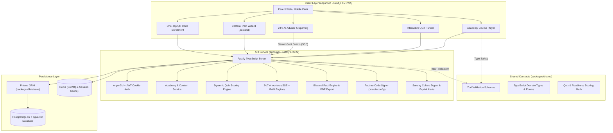

# Alongside (ParentPath)

> **The Comprehensive Parent Intelligence Platform & Family Operating System: Educating parents on their child’s developmental psychology, emotional language, and youth culture, engaging them through interactive quizzes and 24/7 AI guidance, while anchoring household peace with transparent, contract-driven device agreements.**

[](https://www.typescriptlang.org/)
[-black.svg)](https://nextjs.org/)
[](https://react.dev/)
[](https://fastify.dev/)
[](https://www.prisma.io/)
[](https://tailwindcss.com/)
[](#)

---

## 🌟 Executive Overview & Product Vision

**Alongside** is a category-defining parent intelligence platform and family operating system designed for parents of children aged 8–14+.

In digital parenting, solutions historically die on one of two extremes:
1. **The "Content in a Trenchcoat" Extreme:** Static parenting blogs, PDF agreements for the refrigerator, and generic advice articles. Parents read them during an acute crisis, tape them to the fridge, and churn within 30 days.
2. **The "Dumb Utility / Commodity MDM" Extreme:** Impersonal phone-locking toggles or surveillance spyware (Bark, Qustodio). They treat children like suspects, destroy family trust, offer zero emotional education, and trigger endless household warfare.

**Alongside v2.2 unites the Brain (The Mind) and the Muscle (The Hand) into a unified platform:**
- **Parent Intelligence Academy:** Educates parents on child neurobiology, emotional language, and age-by-age transitions (Ages 8–14+).
- **Interactive Quizzes & Self-Discovery:** Gamified assessments (*"Do You Speak Tween?"*, Parenting Style Profilers, 10-Dimension First-Phone Readiness Audits).
- **24/7 AI Child Advisor & Modern Parenting FAQ Vault:** Real-time text/voice guidance for acute dilemmas and interactive AI voice sparring to practice difficult talks before the dinner table.
- **Contextual Personalization Fork (Two Dedicated Roads):**
  - **Road 1 (Pre-Device / No Phone Yet):** Brain readiness, delay strategies, bridge device guides (smartwatches, family tablets), and pre-unboxing "Day 1 Charters".
  - **Road 2 (Active-Device / Already Has Phone):** Restorative Digital Reset treaties, automated bedtime lockouts, and exploit early warnings.
- **Actionable "Pact-as-Code" OS & Signed Device Profile:** Neutral hardware-level app blackouts at 8:30 PM bedtime curfew via signed Apple Declarative Management (`.mobileconfig`) and Android Enterprise profiles with a **Zero-Spyware Safe Harbor Guarantee**.

For the canonical product strategy, persona analyses, and market thesis authored by the CEO, see [**`PROJECT_SCOPE.md`**](PROJECT_SCOPE.md) and the [**Paul Graham Roast & Evaluation Report**](docs/PAUL_GRAHAM_ROAST.md).

---

## 🏛️ System Architecture & Expert System Design

Alongside is engineered as a type-safe, decoupled monorepo leveraging standard npm workspaces. For complete quantitative capacity estimations (100k+ DAU sizing, QPS, cache RAM), architectural trade-off evaluations, and deep module seam architecture, see the authoritative [**Expert System Design Specification**](docs/system-design-specification.md), [**System Architecture Specification**](docs/system-architecture.md), and [**Codebase Design Specification**](docs/codebase-design.md).



---

## 🛠️ Technology Stack Overview

| Area | Technology | Purpose |
| :--- | :--- | :--- |
| **Monorepo** | **npm Workspaces** | Clean isolation between `apps/web`, `apps/api`, `packages/shared`, `packages/database` |
| **Frontend** | **Next.js 15 (App Router, React 19)** | High performance, Server Components (RSC) for Academy/Digest, PWA offline support |
| **Styling & UI** | **Tailwind CSS v3.4 + Radix / shadcn/ui** | Empathetic "Parent Calm" design system; accessible, responsive, zero-runtime bloat |
| **State & Fetching** | **TanStack Query v5 + Zustand** | Optimistic server state caching and multi-step wizard state management |
| **Offline PWA** | **`@ducanh2912/next-pwa` (Serwist)** | Offline script reading, platform decoders, and mobile home screen launcher |
| **Backend API** | **Node.js (LTS 22) + Fastify (TypeScript)** | Ultra-fast HTTP throughput, built-in schema serialization, native SSE support |
| **Database & Vector**| **PostgreSQL 16 + `pgvector`** | Relational integrity + unified vector embeddings for AI FAQ retrieval |
| **ORM & Migrations** | **Prisma ORM** | Declarative schema modeling, migrations, and seed scripts |
| **Shared Contracts** | **Zod (Shared via `@alongside/shared`)** | Single source of truth for runtime validation on client and server |
| **Security & Auth** | **Argon2id + HTTP-Only Secure JWT Cookies** | Zero client-token exposure (immune to XSS token theft), CSRF protection |
| **AI & RAG Engine** | **Vercel AI SDK / OpenAI Client (`gpt-4o`)** | Streaming text generation over SSE; cosine similarity search over FAQ vectors |
| **Device Governance**| **`node-forge` + `plist` + `qrcode`** | PKCS#7 signed Apple `.mobileconfig` and Android Enterprise policies; QR enrollment |
| **Document Export** | **`@react-pdf/renderer` + Print CSS** | Instant refrigerator-ready printouts and vector PDF downloads |
| **Monetization** | **Stripe Billing** | 7-day upfront trial, $79/year Annual Hero Pass, $9.99/mo flex pass |
| **Testing** | **Vitest + Playwright** | Fast unit/integration tests and end-to-end critical journey testing |

---

## 📂 Repository Organization

```
AlongSide/
├── .github/                      # CI/CD Workflows
├── .agents/                      # AI Agent Governance & Machine-Enforceable Rules
├── apps/
│   ├── web/                      # Next.js 15 Frontend PWA
│   └── api/                      # Fastify Node.js Backend API
├── packages/
│   ├── shared/                   # Shared TypeScript Schemas, DTOs & Enums
│   └── database/                 # Prisma ORM & Database Layer
├── docs/                         # Canonical Specifications & Engineering Standards
├── plans/                        # Discrete Agent Execution Plans (Numbered 01–14)
├── AGENTS.md                     # Engineering boundaries for Frontend and Backend agents
├── PROJECT_SCOPE.md              # Canonical Product Scope v2.2.0 (CEO)
├── README.md                     # Repository Overview
├── package.json                  # Root npm workspace definition
└── tsconfig.base.json            # Base TypeScript configuration
```

---

## 🚀 Phased Engineering Roadmap

AlongSide is executed across 14 discrete, sequential engineering plans:

1. [**Plan 01: Monorepo Workspace Setup, Shared Package & Prisma Database**](plans/01-project-setup-and-db.md) (`Backend Agent`)
2. [**Plan 02: Authentication, Session Cookies & Parent Account API**](plans/02-auth-and-user-profile.md) (`Backend Agent`)
3. [**Plan 03: Next.js 15 PWA Scaffolding, ParentCalm Design System & Auth UI**](plans/03-frontend-scaffolding-and-auth-ui.md) (`Frontend Agent`)
4. [**Plan 04: Child Profile CRUD, Contextual Road Fork & Readiness API**](plans/04-child-profile-and-road-bifurcation-api.md) (`Backend Agent`)
5. [**Plan 05: Child Onboarding, Road Selection & Assessment Wizard UI**](plans/05-child-profile-and-road-selection-ui.md) (`Frontend Agent`)
6. [**Plan 06: Bilateral Family Pact Engine & Device Profile Compiler API**](plans/06-bilateral-pact-and-profile-compiler-api.md) (`Backend Agent`)
7. [**Plan 07: Pact Wizard, Digital Co-Signing & QR Enrollment UI**](plans/07-agreement-builder-and-device-enrollment-ui.md) (`Frontend Agent`)
8. [**Plan 08: Parent Intelligence Academy Modules & Youth Culture Digest API**](plans/08-parent-academy-and-culture-digest-api.md) (`Backend Agent`)
9. [**Plan 09: Academy Course Player, Sunday Culture Digest & Offline PWA**](plans/09-parent-academy-and-culture-digest-ui.md) (`Frontend Agent`)
10. [**Plan 10: 24/7 AI Child Advisor & Modern Parenting FAQ Vault API**](plans/10-ai-child-advisor-and-faq-vault-api.md) (`Backend Agent`)
11. [**Plan 11: 24/7 AI Advisor Chat, Living FAQ Explorer & Sparring UI**](plans/11-ai-advisor-and-voice-sparring-ui.md) (`Frontend Agent`)
12. [**Plan 12: Interactive Assessment Suite & Cultural Fluency Quizzes**](plans/12-interactive-quiz-suite-and-fluency-checks.md) (`Joint FE & BE`)
13. [**Plan 13: Stripe 7-Day Trial, $79/yr Hero Pass & Webhook Sync**](plans/13-stripe-billing-and-trial-lifecycle.md) (`Backend Agent`)
14. [**Plan 14: End-to-End Integration, Playwright Verification & Launch Hardening**](plans/14-e2e-integration-hardening-and-launch.md) (`Joint FE & BE`)

For complete plan details, see [**`plans/README.md`**](plans/README.md).
