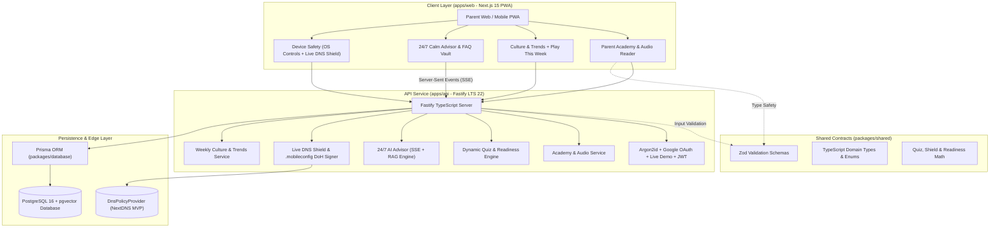

# Alongside (ParentPath)

> **The Holistic Child Upbringing, Developmental Science & Family Operating System (Ages 0–18): Empowering parents with age-calibrated Parent Academy guides, Weekly Culture & Trends, 24/7 Calm Advisor scripts, and practical Device Safety combining built-in OS parental controls with Live Encrypted DNS filtering.**

[](https://www.typescriptlang.org/)
[-black.svg)](https://nextjs.org/)
[](https://react.dev/)
[](https://fastify.dev/)
[](https://www.prisma.io/)
[](https://tailwindcss.com/)
[](#)

---

## 🌟 Executive Overview & Product Vision

**Alongside** is a category-defining holistic child upbringing, developmental science, and family operating system designed for parents raising children from birth to adulthood (Ages 0–18).

Historically, parenting technology suffers from two fatal blinders:
1. **The "Device-Only" Trap:** Narrowing the entire journey of parenting to a battle over screens, smartphones, or third-party surveillance subscriptions. Parents only open these apps when feeling anxious or guilty about screen time, ignoring that 95% of childhood revolves around sleep, nutrition, developmental milestones, play, emotional regulation, and family connection.
2. **The "Baby App Churn Cliff":** Baby trackers (Huckleberry, BabyCenter) capture infant sleep and feeding, but churn 90% of parents at age 2 when diapers and bottles end. No unified platform supports parents through toddler tantrums, picky eating, early childhood screen-free play, school-age focus, tween device transitions, and adolescent independence.

**Alongside v2.5 establishes the Universal Family Operating System across Core Pillars:**
- **Parent Academy (`/academy`, Ages 0–18):** Short, science-backed guides (readable or audio-narrated with natural neural voices) across developmental milestones, restorative sleep, pediatric nutrition, emotional regulation, and digital maturity (strictly educational, non-clinical per SOU-86).
- **Weekly Culture & Trends (`/digest`) + Play This Week:** Curated weekly videos, articles, trending app/slang decoders, Sunday dinner conversation starters, and zero-prep screen-free play decks (`#play-this-week`) for ages 0–8.
- **Calm Advisor (`/advisor`):** 24/7 age-aware AI parenting advisor and 250+ scenario FAQ vault delivering practical, word-for-word communication scripts.
- **Device Safety & Parental Controls (`/devices`):**
  - **Built-in OS & App Control Blueprints:** Priority-ranked, age-calibrated setup steps for Apple Screen Time, Google Family Link, Roblox, YouTube, and Home Safe DNS (app download approvals, purchase blocks, adult content filtering, daily screen-time & Shorts limits, and bedtime/school locks).
  - **Live Encrypted DNS Shield:** Signed iOS `.mobileconfig` (`com.apple.dnsSettings.managed` DoH), Android Private DNS (DoT), and Home Router DNS backed by a swappable `DnsPolicyProvider` seam to block adult sites, pause specific apps/services (TikTok, YouTube, Roblox, Instagram, Snapchat, Discord, Fortnite, Twitch), enforce SafeSearch, and schedule bedtime lockouts across Wi-Fi and 5G.
  - **Standalone Phone Readiness Check (`?tab=readiness`):** 2-minute 0–100 diagnostic before buying a first device.
- **1-Click Live Demo & Free Early Access:** Zero-signup read-safe demo (sample family: Maya age 3 and Leo age 11) plus Google OAuth and email/password authentication.

For the canonical product strategy, persona analyses, and market thesis authored by the CEO, see [**`PROJECT_SCOPE.md`**](PROJECT_SCOPE.md), the [**Competitive Analysis & Strategic Differentiation Specification**](docs/COMPETITIVE_ANALYSIS.md), and the [**Live DNS Parental Controls Architecture**](docs/dns-parental-controls-architecture.md).

---

## ⚡ Quick Start & Local Development

### 1. Prerequisites

Ensure your local development environment satisfies these requirements:

| Tool | Version | Purpose |
| :--- | :--- | :--- |
| **Node.js** | `>= 22.0.0` (LTS 22+) | Server runtime with native TypeScript support |
| **npm** | `>= 10.0.0` | Monorepo workspace package manager |
| **Docker & Docker Compose** | Latest | PostgreSQL 16 database with `pgvector` extension |
| **GNU Make** | Any (Optional) | Single-command developer ergonomics via `Makefile` |

### 2. 1-Minute Setup Guide

```bash
# 1. Clone the repository
git clone https://github.com/Souheil007/AlongSide.git
cd AlongSide

# 2. Install monorepo dependencies across all workspaces
make install
# (Alternative without make: npm install)

# 3. Create your local environment configuration
cp .env.example .env

# 4. Start PostgreSQL 16 + pgvector container
make db-up
# (Alternative without make: docker compose up -d)

# 5. Generate Prisma Client for the database workspace
make db-generate
# (Alternative without make: npm run db:generate)

# 6. Start both Frontend and Backend servers concurrently
make dev
# (Alternative without make: npm run dev)
```

Both development servers will launch concurrently:
- 📱 **Frontend (Next.js 15 Web PWA):** [http://localhost:3000](http://localhost:3000)
- 🚀 **Backend (Fastify LTS 22 API):** [http://localhost:4000](http://localhost:4000)
- 🩺 **Health Check Endpoint:** [http://localhost:4000/api/v1/health](http://localhost:4000/api/v1/health)

Press `Ctrl + C` in your terminal to gracefully shut down both servers simultaneously.

---

## 🧰 Makefile Developer Reference

Alongside includes a root [`Makefile`](Makefile) providing standardized commands across the monorepo:

| Target | Command | Description |
| :--- | :--- | :--- |
| **`make help`** | `make help` | Displays the help menu with all available targets |
| **`make dev`** | `make dev` | **Starts both Frontend (Web) and Backend (API) concurrently** via `scripts/dev.mjs` |
| **`make dev-frontend`** | `make frontend` / `make web` | Starts the Next.js 15 Web frontend exclusively on port `3000` |
| **`make dev-backend`** | `make backend` / `make api` | Starts the Fastify LTS 22 API backend exclusively on port `4000` |
| **`make db-up`** | `make db-up` | Launches the PostgreSQL 16 + `pgvector` Docker container in background |
| **`make db-down`** | `make db-down` | Stops the PostgreSQL Docker container |
| **`make db-logs`** | `make db-logs` | Follows real-time logs from the PostgreSQL container |
| **`make db-generate`** | `make db-generate` | Generates the typed Prisma Client (`packages/database`) |
| **`make db-validate`** | `make db-validate` | Validates the Prisma schema against database constraints |
| **`make db-studio`** | `make db-studio` | Opens Prisma Studio visual database browser |
| **`make test`** | `make test` | Executes all Vitest unit and integration test suites |
| **`make typecheck`** | `make typecheck` | Runs TypeScript type checking (`tsc --noEmit`) across all workspaces |
| **`make lint`** | `make lint` | Runs ESLint linters across all packages and apps |
| **`make build`** | `make build` | Compiles production builds for all workspaces |
| **`make install`** | `make install` | Installs dependencies across all npm workspaces |
| **`make clean`** | `make clean` | Cleans build caches (`.next`, `dist`, build artifacts) |

---

## 🏛️ System Architecture & Expert System Design

Alongside is engineered as a type-safe, decoupled monorepo leveraging standard npm workspaces. For complete quantitative capacity estimations (100k+ DAU sizing, QPS, cache RAM), architectural trade-off evaluations, and deep module seam architecture, see the authoritative [**System Architecture & Design Specification**](docs/system-architecture.md) and [**Codebase Design Specification**](docs/engineering-standards/codebase-design.md).



---

## 🛠️ Technology Stack Overview

| Area | Technology | Purpose |
| :--- | :--- | :--- |
| **Monorepo** | **npm Workspaces** | Clean isolation between `apps/web`, `apps/api`, `packages/shared`, `packages/database` |
| **Developer Ergonomics** | **Makefile + Node Runner** | Concurrent execution (`make dev`), atomic targets, zero-dependency process manager |
| **Frontend** | **Next.js 15 (App Router, React 19)** | High performance, Server Components (RSC) for Academy/Digest, PWA offline support |
| **Styling & UI** | **Tailwind CSS v3.4 + Radix / shadcn/ui** | Empathetic "Parent Calm" design system; accessible, responsive, zero-runtime bloat |
| **State & Fetching** | **TanStack Query v5 + Zustand** | Optimistic server state caching and child context / quiz state management |
| **Offline PWA** | **`@ducanh2912/next-pwa` (Serwist)** | Offline script reading, platform decoders, and mobile home screen launcher |
| **Backend API** | **Node.js (LTS 22) + Fastify (TypeScript)** | Ultra-fast HTTP throughput, built-in schema serialization, native SSE support |
| **Database & Vector**| **PostgreSQL 16 + `pgvector`** | Relational integrity + unified vector embeddings for AI FAQ retrieval |
| **ORM & Migrations** | **Prisma ORM** | Declarative schema modeling, migrations, and seed scripts |
| **Shared Contracts** | **Zod (Shared via `@alongside/shared`)** | Single source of truth for runtime validation on client and server |
| **Security & Auth** | **Argon2id + Google OAuth + JWT Cookies** | Secure cookie + mobile bearer fallback, PKCE Google OAuth, and read-safe Live Demo |
| **AI & RAG Engine** | **Multi-LLM Adapter + `pgvector`** | Streaming SSE guidance over curated developmental FAQ & script embeddings |
| **Device Controls** | **`node-forge` + `plist` + `DnsPolicyProvider`** | Signed iOS DoH `.mobileconfig`, Android Private DNS (DoT), and NextDNS MVP policy sync |
| **Monetization** | **100% Free Early Access (Planned Stripe)** | Free during early access; planned $79/year Family Pass & $9.99/mo flex tier |
| **Testing** | **Vitest + Fastify Inject + Playwright** | Fast unit/integration tests and end-to-end critical journey testing |

---

## 📂 Repository Organization

```
AlongSide/
├── Makefile                      # Developer command orchestrator (make dev, make test, etc.)
├── scripts/
│   └── dev.mjs                   # Pure Node.js concurrent dev server orchestrator
├── apps/
│   ├── web/                      # Frontend Application (Next.js 15, React 19, Tailwind)
│   │   ├── src/app/              # RSC routes (Landing, Auth, Dashboard, Academy, Digest, Advisor, Devices)
│   │   ├── src/components/       # UI components & Parent Calm design system
│   │   └── src/hooks/            # Custom hooks (useAuth, useChildren, useDeviceShield, useReadiness)
│   └── api/                      # Fastify LTS 22 Node.js Backend API
│       ├── src/modules/auth/     # Argon2id, Google OAuth, Live Demo, JWT cookie/bearer auth
│       ├── src/modules/children/ # Child profile CRUD, 8 developmental tiers, road forks
│       ├── src/modules/device-profiles/ # Live DNS Shield (NextDNS seam) + .mobileconfig DoH signer
│       └── src/plugins/          # Encapsulated Fastify plugins (auth, error handler)
├── packages/
│   ├── shared/                   # Shared TypeScript contracts and pure algorithmic engines
│   │   ├── src/constants/        # Developmental tiers, shield service catalog, quiz presets
│   │   ├── src/schemas/          # Zod validation contracts shared between client & server
│   │   └── src/algorithms/       # Pure scoring math (Readiness 0-100, tier derivation)
│   └── database/                 # Prisma ORM & Database Layer
│       ├── prisma/schema.prisma  # PostgreSQL 16 schema with pgvector vector support
│       └── src/client.ts         # PrismaClient singleton with graceful teardown
├── docs/                         # Canonical Specifications & Engineering Standards
│   ├── system-design-specification.md # Quantitative sizing, capacity estimations & blueprints
│   ├── system-architecture.md         # Monorepo layout, security boundaries & data flows
│   ├── dns-parental-controls-architecture.md # Live DNS Shield & OS parental controls spec
│   ├── engineering-standards/         # Deep modules, skill matrices, plan & git standards
│   └── api-specification.md           # Authoritative REST API contract & DTO catalog
├── plans/                        # Discrete Agent Execution Plans
├── .agents/                      # AI Agent Governance & Machine-Enforceable Rules
├── AGENTS.md                     # Engineering team protocols, boundaries & ownership
├── PROJECT_SCOPE.md              # Canonical Product Scope v2.5.0 (CEO)
├── README.md                     # Repository Overview & Developer Guide
├── docker-compose.yml            # PostgreSQL 16 + pgvector container definition
├── package.json                  # Root npm workspace definition
└── tsconfig.base.json            # Base TypeScript configuration
```

---

## 🔌 API Endpoints & Verification

The Fastify API runs on `http://localhost:4000` with versioned `/api/v1` routes:

### Health Probe
- `GET /api/v1/health` — Service status, environment, uptime, and timestamp.

### Authentication & Sessions (`/api/v1/auth`)
- `GET /api/v1/auth/providers` — List active authentication providers (`google`, `demo`, `emailPassword`).
- `GET /api/v1/auth/google` & `GET /api/v1/auth/google/callback` — PKCE Google OAuth 2.0 flow.
- `POST /api/v1/auth/demo` — Start a read-only Live Demo session with a sample family.
- `POST /api/v1/auth/register` — Create parent account and set secure HttpOnly JWT cookie.
- `POST /api/v1/auth/login` — Authenticate parent credentials with Argon2id verification.
- `GET /api/v1/auth/me` — Retrieve active authenticated session and parent profile.
- `POST /api/v1/auth/logout` — Revoke session cookie.

### Children & Device Safety (`/api/v1/children`, `/api/v1/devices`)
- `POST /api/v1/children` / `GET /api/v1/children` — Register and manage child profiles across ages 0–18.
- `GET /api/v1/devices/shield/:childId` / `PUT /api/v1/devices/shield/:childId` — Get and sync a child's Live Encrypted DNS Shield policy.
- `GET /api/v1/devices/shield/:childId/status` — Retrieve aggregate 24h DNS shield query health.
- `GET /api/v1/devices/shield/profile/:enrollmentToken` — Download signed Apple `.mobileconfig` (`com.apple.dnsSettings.managed` DoH).

---

## 🧪 Testing & Quality Assurance

Alongside enforces high test coverage and zero-regression verification through automated Vitest suites:

```bash
# Run all monorepo test suites (shared, api, and web)
make test
# or: npm test

# Run TypeScript typechecks across all 4 workspaces
make typecheck
# or: npm run typecheck

# Run linters across all workspaces
make lint
# or: npm run lint
```

### Testing Strategy:
- **`packages/shared`:** Exhaustive unit tests for pure scoring algorithms (`calculateReadinessScore`), developmental tier resolution, and Zod schema validations.
- **`apps/api`:** Fastify integration testing via `.inject()`, testing status codes, cookies, error envelopes, Live DNS Shield policy adapters, and repository layers without spinning up physical TCP ports.
- **`apps/web`:** Component, form, and custom hook tests verifying validation logic, accessibility, and client state machines.

---

## 📜 Team Governance & Pull Request Protocol

All contributions adhere to canonical team governance defined in [**`AGENTS.md`**](AGENTS.md):
- **Conventional Commits (v1.0.0):** Commits follow standard `<type>(<scope>): <imperative summary>`.
- **The Ponytail Principle:** Solve complete problems with the smallest amount of new code. Zero speculative bloat, zero unnecessary dependencies.
- **Plain Text (`.txt`) PR Descriptions:** PR descriptions and squash commits must use plain text formatting without Markdown symbols (`##`, `**`, `[]()`) so terminal git logs remain clean.
- **Squash & Merge Exclusively:** Linear git history enforced via squash-merge onto `main`.
