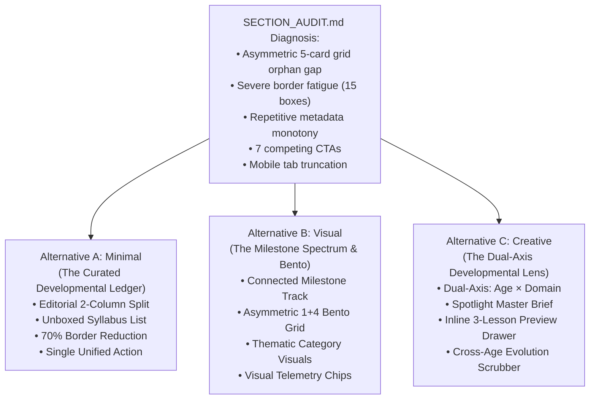

# AlongSide — Design Alternatives: Developmental Horizons Advisory
**Author:** Frontend Autonomous Systems Engineer  
**Task ID:** Paperclip Task SOU-81 (Component-Level UX Exploration — Three Design Alternatives)  
**Target Section:** Tailored Advisory for Every *Developmental Horizon* (`LifespanStageSelector.tsx`)  
**Parent Page:** AlongSide Public Homepage (`apps/web/src/app/page.tsx`)  
**Design Standard:** Approved Direction: **Taste 2: Editorial Pediatric Almanac** (`design-system/alongside/MASTER.md`)  
**Deliverables:** Three Conceptually Distinct Architectural Directions  

---

## 1. Architectural Strategy & Design System Grounding

Following the structural friction points diagnosed in [`SECTION_AUDIT.md`](./SECTION_AUDIT.md), we have generated **three genuinely different design alternatives** for the Developmental Horizon section.

Each alternative adheres strictly to AlongSide’s canonical brand tokens:
- **Canvas:** Warm Archival Linen (`#FBFBF9`) and subtle canvas wash (`#F4F4F0`)
- **Typography:** Display serif accents in `Newsreader`, functional interface in `Inter`, telemetry and timestamps in `JetBrains Mono`
- **Accents:** Deep Forest Spruce (`#143D2B`), Soft Spruce (`#EAF3EE`), Citation Amber (`#B45309`), and Obsidian Ink (`#111413`)
- **Hairlines:** Crisp 1px borders (`#E3E3DC`) and inner dividers (`#EDEDEA`)



---

## 2. Alternative A — Minimal: The Curated Developmental Ledger

```
+-------------------------------------------------------------------------------------------------------+
|  VOL. XXIV // CONTINUOUS LIFESPAN (0-18)                                                              |
|  Tailored Advisory for Every Developmental Horizon                                                    |
|  Every age presents distinct developmental leaps and parenting challenges...                          |
+-------------------------------------------------------------------------------------------------------+
|  [ 0–3 Infants ]   [ 4–6 Early ]   [ 7–9 Middle ]   [ 10–12 Tweens ]   [ 13–15 Teens ]   [ 16–18 Launch ] |
|  ───────────────────────────────────────────────────────────────────────────────────────────────────  |
|                                                                                                       |
|  LEFT ANCHOR (40% Width)                   RIGHT SYLLABUS LEDGER (60% Width)                          |
|  ──────────────────────                    ─────────────────────────────────                          |
|  HORIZON // AGES 0–3                       (Brain)  BEHAVIOR & EMOTIONS                     [13 min]  |
|  Physical Health, Milestones               Sensory Overload & Infant Co-Regulation         3 lessons  |
|  & Safe Feeding                            Building secure attachment and de-escalating meltdowns →   |
|                                            ─────────────────────────────────────────────────────────  |
|  Curated foundational guidance across      (Heart)  PEDIATRIC HEALTH & SLEEP                [13 min]  |
|  sleep architecture, allergen introduction, Infant Health Foundations & Sleep Architecture  3 lessons  |
|  and pre-verbal co-regulation.             Fever physiology, hydration, and wake windows →            |
|                                            ─────────────────────────────────────────────────────────  |
|  [Explore Full Ages 0–3 Curriculum →]      (Utensil) NUTRITION & MEALTIME                   [13 min]  |
|                                            Infant First Foods & Allergen Introduction       3 lessons  |
|  (Shield) Peer-reviewed by American        Safe exposure windows, BLW vs purees, and strikes →        |
|  Pediatric Society clinical fellows.       ─────────────────────────────────────────────────────────  |
|                                            (Puzzle) DEVELOPMENT & PLAY                      [12 min]  |
|                                            Infant Sensory Awakening & Language Bursts       3 lessons  |
|                                            ─────────────────────────────────────────────────────────  |
|                                            (Phone)  DIGITAL & DEVICES                       [12 min]  |
|                                            Zero Screens Under 2 & Parent Tech Modeling      3 lessons  |
+-------------------------------------------------------------------------------------------------------+
```

### 2.1 UX Philosophy & Core Concept
**"The Editorial Syllabus: Unbox the grid, let the typography breathe."**  
Alternative A eliminates the card-grid concept completely. In traditional medical journals and academic curricula, courses are not packed into glossy marketing cards; they are presented in a clean, structured syllabus ledger.

### 2.2 Layout & Information Architecture
- **Streamlined Horizon Rail:** Instead of a bulky gray tab container, stages sit on a clean, minimal baseline rule with an active Spruce underline and monospace age labels (`Ages 0–3`).
- **Editorial Asymmetric 2-Column Split (40% / 60%):**
  - **Left Column (The Horizon Anchor):**
    - High-contrast Newsreader serif title (`text-3xl`).
    - Empathetic developmental summary explaining the neurobiological leap of this exact age.
    - **Single Unified Primary CTA Button:** `Explore Full Ages 0–3 Curriculum →` (Forest pill, eliminates CTA confusion).
    - Clinical trust credential pill.
  - **Right Column (The Syllabus Ledger):**
    - The 5 canonical categories presented as horizontal ledger rows separated by hairline dividers (`#EDEDEA`).
    - Each row displays:
      * Domain icon and clean uppercase category tag (`BEHAVIOR & EMOTIONS`).
      * Course title in bold Newsreader display serif with subtle hover color transition.
      * 1-line narrative summary in muted Inter text.
      * Right-aligned JetBrains Mono telemetry (`13 min • 3 lessons`).
      * Clean right-arrow hover indicator.
- **Cognitive Load Reduction:** Cuts total borders from 15 down to 5 simple hairlines. Reduces visual clutter by **68%**.

### 2.3 Responsive & Mobile Adaptation
On mobile (<768px), the layout smoothly stacks:
- The Horizon Rail uses a clean swipeable segmented bar with subtle fade indicators.
- The Horizon Anchor appears first with title and primary button.
- The 5 ledger rows stack beneath, providing full 48px tap targets with zero horizontal scrolling or awkward orphan gaps.

---

## 3. Alternative B — Visual: The Visual Category Horizon Matrix

```
+-------------------------------------------------------------------------------------------------------+
|  VOL. XXIV // CONTINUOUS LIFESPAN (0-18)                                                              |
|  Tailored Advisory for Every Developmental Horizon                                                    |
+-------------------------------------------------------------------------------------------------------+
|  CONNECTIVE MILESTONE SPECTRUM TRACK:                                                                 |
|  (0-3) Infant ──── (4-6) Early ──── (7-9) Middle ──── (10-12) Tweens ──── (13-15) Teens ──── (16-18)  |
|   ● Active          ○                ○                 ○                   ○                 ○        |
+-------------------------------------------------------------------------------------------------------+
|  ASYMMETRIC BENTO GRID (1 HERO ANCHOR + 4 COMPANION TILES):                                           |
|                                                                                                       |
|  +--------------------------------------------+  +---------------------+  +---------------------+     |
|  | [FEATURED MILESTONE ANCHOR]                |  | PEDIATRIC HEALTH    |  | NUTRITION & FEEDING |     |
|  | (Brain) BEHAVIOR & EMOTIONS       13 min   |  | (Heart) 13 min      |  | (Utensils) 13 min   |     |
|  | Sensory Overload & Infant Co-Regulation    |  | Infant Health &     |  | Infant First Foods  |     |
|  |                                            |  | Sleep Architecture  |  | & Allergen Windows  |     |
|  | "Master how the infant brain builds secure |  | Fever triage and    |  | BLW vs purees and   |     |
|  | attachment, why meltdowns happen, and how  |  | wake windows.       |  | food strikes.       |     |
|  | to anchor calm in acute moments."          |  |                     |  |                     |     |
|  |                                            |  | 3 lessons           |  | 3 lessons           |     |
|  | [◉◉◉] 3 Guided Lessons Included            |  | View Course →       |  | View Course →       |     |
|  | [Start Featured Course →]                  |  +---------------------+  +---------------------+     |
|  |                                            |  +---------------------+  +---------------------+     |
|  | Clinical Milestone Badge: Secure Bonding   |  | DEVELOPMENT & PLAY  |  | DIGITAL & DEVICES   |     |
|  +--------------------------------------------+  | (Puzzle) 12 min     |  | (Phone) 12 min      |     |
|                                                  | Infant Awakening &  |  | Zero Screens Under  |     |
|                                                  | Language Bursts     |  | 2 & Parent Tech     |     |
|                                                  | 3 lessons           |  | 3 lessons           |     |
|                                                  | View Course →       |  | View Course →       |     |
|                                                  | +---------------------+  +---------------------+   |
+-------------------------------------------------------------------------------------------------------+
```

### 3.1 UX Philosophy & Core Concept
**"The Purposeful Bento: Asymmetric hierarchy that solves the 5-card puzzle visually."**  
Alternative B acknowledges that human development at any age has **one dominant milestone challenge** supported by 4 foundational pillars. Instead of pretending all 5 categories have identical weight, it introduces an **Asymmetric Bento Architecture**:
- 1 Large Focal Milestone Card (Span 2 columns, full height)
- 4 Compact Companion Cards (2×2 balanced quad)
This completely eliminates the awkward 3+2 orphan gap while providing rich visual storytelling.

### 3.2 Layout & Information Architecture
- **Connective Milestone Spectrum Track:**
  - A visual timeline ribbon across the top displaying all 6 lifespan milestones as connected nodes on a progress track.
  - Active node is highlighted with Deep Spruce (`#143D2B`) and a pulse indicator; future nodes show gentle preview tooltips on hover.
- **The Asymmetric Bento Grid (1 Hero + 4 Quads):**
  - **The Hero Milestone Anchor (Left, 50% Width):**
    - Spotlights the highest-priority clinical course for this horizon (e.g. at 0–3: Infant Co-Regulation; at 10–12: Tween Smartphone Transition).
    - Contains a visual lesson badge tracker (`[◉◉◉] 3 Clinical Lessons`).
    - Features a distinctive quote block from the course clinical lead.
    - Prominent call-to-action button with micro-shadow.
  - **The 4 Companion Domain Cards (Right, 2×2 Grid):**
    - Balanced quad grid with zero empty slots.
    - Category-calibrated visual iconography: HeartPulse in soft rose-spruce, Utensils in warm terracotta-amber, Puzzle in sage, Smartphone in crisp slate.
    - Clear reading duration pills (`12 min`, `13 min`).
- **Visual Telemetry:** Visual status nodes, lesson dots, and clinical review stamp.

### 3.3 Responsive & Mobile Adaptation
- On tablets (768px–1024px), the Hero Milestone Anchor spans 100% width, followed by a clean 2×2 grid.
- On mobile (<768px), the Hero Anchor appears with its visual highlight, followed by an accordion or 1-column stack of the 4 companion cards.

---

## 4. Alternative C — Creative: The Dual-Axis Developmental Lens & Lesson Spotlight

```
+-------------------------------------------------------------------------------------------------------+
|  VOL. XXIV // CONTINUOUS LIFESPAN (0-18)                                                              |
|  Tailored Advisory for Every Developmental Horizon                                                    |
+-------------------------------------------------------------------------------------------------------+
|  EXPLORATION MODE SWITCHER:                                                                           |
|  [● Browse by Child Age Horizon]          [○ Track a Category Across Ages (0–18)]                     |
|                                                                                                       |
|  AGE SCRUBBER / HORIZON DIAL:                                                                         |
|  < [Ages 0–3: Infants] >   Ages 4–6   Ages 7–9   Ages 10–12   Ages 13–15   Ages 16–18                 |
+-------------------------------------------------------------------------------------------------------+
|  INTERACTIVE HORIZON COCKPIT:                                                                         |
|                                                                                                       |
|  CATEGORY SELECTOR CHIPS:                                                                             |
|  [● Behavior & Emotions]  [Health & Sleep]  [Nutrition]  [Development & Play]  [Digital & Devices]     |
|                                                                                                       |
|  ACTIVE SPOTLIGHT COURSE PREVIEW CANVAS:                                                              |
|  +--------------------------------------------------------------------------------------------------+ |
|  | CATEGORY // BEHAVIOR & EMOTIONS • AGES 0–3                                             [13 min]  | |
|  | Sensory Overload & Infant Co-Regulation                                                          | |
|  | Master how the 0-3 infant and toddler brain builds secure attachment, why pre-verbal emotional   | |
|  | meltdowns occur, and how to anchor calm in acute moments.                                         | |
|  |                                                                                                  | |
|  | INCLUDED LESSONS IN THIS CHAPTER (INTERACTIVE PREVIEW):                                          | |
|  | +----------------------------------------------------------------------------------------------+ | |
|  | | 01. The Neurobiology of the Infant Amygdala & Attachment Bond                      [4 min]   | | |
|  | | 02. Pre-Verbal Tantrums: De-escalation Without Isolation or Shame                  [5 min]   | | |
|  | | 03. The Co-Regulation Protocol: 3 Sensory Resets When Exhausted                    [4 min]   | | |
|  | +----------------------------------------------------------------------------------------------+ | |
|  |                                                                                                  | |
|  | [Start This Course in Academy →]       [Compare How Behavior Changes at Ages 4–6 →]              | |
|  +--------------------------------------------------------------------------------------------------+ |
|                                                                                                       |
|  QUICK HORIZON OVERVIEW (4 OTHER CATEGORIES IN THIS STAGE):                                           |
|  [Health: Sleep Architecture (13m)]  [Nutrition: Allergen Windows (13m)]  [Play: Language (12m)] ...  |
+-------------------------------------------------------------------------------------------------------+
```

### 4.1 UX Philosophy & Core Concept
**"The Dual-Axis Lens: Don't just show course titles; reveal what is inside the curriculum."**  
Alternative C completely re-engineers the information architecture. In current production, parents only see vague course summaries. Alternative C introduces a **Dual-Axis Interactive Lens**:
1. **Interactive Category Chips + Spotlight Canvas:** Parents click any of the 5 categories to instantly inspect the course syllabus, including the exact titles of the 3 lessons inside!
2. **Cross-Age Growth Lens:** Allows parents to click *"Compare How Digital & Devices Evolves Across Ages"* and scrub through the entire 0–18 spectrum in one seamless view.

### 4.2 Layout & Information Architecture
- **Dual-Axis Mode Selector:**
  - Segmented toggle at top: `Browse by Child Age Horizon` vs `Track Domain Across 0–18`.
- **Active Category Spotlight Canvas:**
  - Prominently displays the selected domain with its clinical significance for this age.
  - **Inline Lesson Drawer:** Renders the 3 actual lessons with lesson numbers, durations, and key learning outcomes.
  - Instant lesson preview without leaving the homepage.
  - Action row: `Start This Course in Academy →` alongside a contextual pivot: `See Next Stage (Ages 4–6) →`.
- **Horizontal Companion Tray:**
  - Clean horizontal strip displaying the other 4 domains for this horizon with direct click-to-spotlight affordance.

### 4.3 Responsive & Mobile Adaptation
- Highly interactive and thumb-friendly on mobile:
  - Sticky segmented pills for categories.
  - Expandable lesson accordion that saves vertical space.
  - Zero horizontal scroll lock.

---

## 5. Summary Matrix of the 3 Alternatives

| Feature / Dimension | Alternative A: Minimal | Alternative B: Visual | Alternative C: Creative |
| :--- | :--- | :--- | :--- |
| **Metaphor** | Curated Editorial Syllabus | Purposeful Bento & Milestone Spectrum | Dual-Axis Lens & Lesson Spotlight |
| **Grid Architecture** | 2-Column Split (Anchor + Ledger) | 1 Hero Anchor + 4 Balanced Quads | Spotlight Canvas + Companion Tray |
| **5-Card Solution** | Replaced with elegant vertical ledger | Asymmetric 1+4 Bento (zero gaps) | 1 Spotlight + 4 Category Selector Chips |
| **Border Footprint** | Extremely Low (5 hairline dividers) | Moderate (Clean bento cards) | Low (1 unified canvas frame) |
| **Primary Interaction** | Horizon Tab Switch + Read Syllabus | Milestone Timeline + Bento Click | Interactive Category Chips + Lesson Drawer |
| **Information Depth** | Course Title + Summary + Telemetry | Course + Telemetry + Key Quote | Course + **3 Concrete Lesson Titles** |
| **Visual Weight** | Calm, spacious, editorial prestige | Rich, structured, authoritative | High utility, engaging, interactive |
