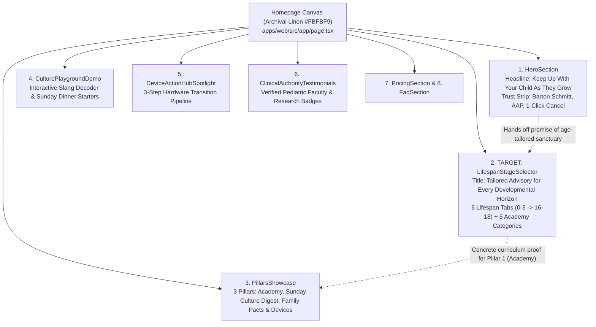

# AlongSide — Comprehensive Component-Level UX/UI Audit: Developmental Horizons
**Author:** Frontend Autonomous Systems Engineer  
**Task ID:** Paperclip Task SOU-81 (Component-Level UX Exploration — Three Design Alternatives)  
**Target Section:** Tailored Advisory for Every *Developmental Horizon* (`LifespanStageSelector.tsx`)  
**Parent Page:** AlongSide Public Homepage (`apps/web/src/app/page.tsx`)  
**Design Standard:** Approved Direction: **Taste 2: Editorial Pediatric Almanac** (`design-system/alongside/MASTER.md`)  
**Status:** Audit Complete — Ready for Exploration  

---

## 1. Executive Summary & Problem Statement

AlongSide is the **Parent Advisory Sanctuary**—an empathetic platform replacing adversarial parent-child friction with calm developmental neurobiology, bilateral media pacts, and age-calibrated clinical guidance spanning ages 0 to 18.

On the public landing page (`apps/web/src/app/page.tsx`), the **Developmental Horizon Advisory Section** (`apps/web/src/components/home/LifespanStageSelector.tsx`) occupies Section 2, placed immediately after the Hero fold. Its mandate is vital: **it is the primary proof engine demonstrating that AlongSide is not an undifferentiated screen-time app, but a continuous clinical curriculum tailored to the child's exact developmental stage across 5 core growth domains.**

While commit `8b76ffb1` (Plan 35 / SOU-78) successfully purged outdated triage widgets, fever emergency protocols, and slang cringe scores, the section's present UX and visual layout suffer from **structural layout flaws, card-in-card nesting, metadata repetition, and the notorious "5-card grid asymmetry problem"**.

> [!IMPORTANT]
> **Exploration Protocol:** In strict compliance with `AGENTS.md` and Paperclip task SOU-81 instructions, **no production code, existing components, styles, or database schemas have been altered**. All exploration and visual prototypes remain completely isolated within `previews/` and `design-explorations/sou-81-developmental-horizons/`.

---

## 2. Section Role, Page Context & Structural Relationships



### 2.1 Relationship with Preceding Hero Section
The Hero section establishes high emotional stakes: *"Parents can’t be expected to out-engineer Silicon Valley algorithms alone."* It promises a personalized sanctuary across ages 0–18 and displays trust credentials. The Developmental Horizon section directly inherits this interest: the parent scrolls down asking, *"What does AlongSide actually have for my 2-year-old toddler, or my 11-year-old tween?"*

### 2.2 Relationship with Succeeding 3 Pillars Showcase
Section 3 breaks down the platform into 3 core architectural pillars: Pillar 1 (Parent Intelligence Academy), Pillar 2 (Sunday Youth Culture Digest), and Pillar 3 (Bilateral Family Media Pacts & Hardware Curfews). The Developmental Horizon section acts as the living, interactive proof of **Pillar 1**, showing real course titles, lesson durations, and clinical domains before the user ever encounters the pillar architecture or pricing.

---

## 3. Information Architecture & Content Inventory

The section manages a multi-dimensional matrix: **6 Developmental Lifespan Stages × 5 Canonical Academy Growth Domains = 30 Tailored Clinical Courses**.

```mermaid
graph LR
    subgraph Stages ["6 Developmental Horizons"]
        H1["0-3: Infants & Toddlers"]
        H2["4-6: Early Childhood"]
        H3["7-9: Middle Childhood"]
        H4["10-12: Pre-Teens & Tweens"]
        H5["13-15: Early Adolescence"]
        H6["16-18: Late Adolescence"]
    end

    subgraph Categories ["5 Canonical Academy Domains"]
        C1["Behavior & Emotions (Brain)"]
        C2["Pediatric Health & Sleep (HeartPulse)"]
        C3["Nutrition & Mealtime (Utensils)"]
        C4["Development & Play (Puzzle)"]
        C5["Digital & Devices (Smartphone)"]
    end

    Stages --> Categories
```



### Data Elements per Horizon:
1. **Horizon Metadata:**
   - Unique identifier (`id`) and canonical tier enum (`DevelopmentalTier`).
   - Horizon Tab Label (e.g. `Infants & Toddlers`).
   - Age Band Badge (e.g. `Ages 0–3`).
   - Stage Title (e.g. `Physical Health, Milestones & Safe Feeding`).
   - Stage Subtitle narrative (e.g. `Curated foundational guidance across sleep architecture, allergen introduction, and pre-verbal co-regulation.`).
   - Icon representation (`LucideIcon`).
2. **5 Curated Category Courses (Per Stage):**
   - Academy Category Enum (`AcademyCategory`).
   - Category Label & Lucide Icon.
   - Course Title (e.g. `Sensory Overload & Infant Co-Regulation`).
   - Detailed Narrative Summary (25–35 words).
   - Academy Slug (`/academy/[slug]`).
   - Estimated Course Duration (e.g. `13 min`).
   - Lesson Count (e.g. `3 lessons`).
3. **Global Reassurance Callout:**
   - Clinical peer-review guarantee badge.
   - Direct link to full Academy catalog (`/academy`).

---

## 4. Current Visual Hierarchy & Component Breakdown

```
+----------------------------------------------------------------------------------------------------+
|  [VOL. XXIV // CONTINUOUS LIFESPAN (0-18)]                                                         |
|  Tailored Advisory for Every Developmental Horizon                                                 |
|  Every age presents distinct developmental leaps and parenting challenges...                       |
+----------------------------------------------------------------------------------------------------+
|  [Tab: Infants (0-3)] [Tab: Early (4-6)] [Tab: Middle (7-9)] [Tab: Tweens (10-12)] ... (6 tabs)    |
+----------------------------------------------------------------------------------------------------+
|  +----------------------------------------------------------------------------------------------+  |
|  | HORIZON // AGES 0-3                                                                          |  |
|  | Physical Health, Milestones & Safe Feeding               [Explore Infants Curriculum ->]     |  |
|  | Curated foundational guidance across sleep architecture...                                    |  |
|  +----------------------------------------------------------------------------------------------+  |
|                                                                                                    |
|  +------------------------+  +------------------------+  +------------------------+                |
|  | Behavior & Emotions    |  | Health & Sleep         |  | Nutrition & Mealtime   |                |
|  | Sensory Overload...    |  | Infant Health Found... |  | Infant First Foods...  |                |
|  | 3 lessons | View Course|  | 3 lessons | View Course|  | 3 lessons | View Course|                |
|  +------------------------+  +------------------------+  +------------------------+                |
|  +------------------------+  +------------------------+                                            |
|  | Development & Play     |  | Digital & Devices      |  [AWKWARD EMPTY GAP IN 3-COL GRID]         |
|  | Sensory Awakening...   |  | Zero Screens Under 2.. |                                            |
|  | 3 lessons | View Course|  | 3 lessons | View Course|                                            |
|  +------------------------+  +------------------------+                                            |
|                                                                                                    |
|  +----------------------------------------------------------------------------------------------+  |
|  | (Shield) Continuous Lifespan Curriculum: 5 tailored modules... [Browse All Categories ->]    |  |
|  +----------------------------------------------------------------------------------------------+  |
+----------------------------------------------------------------------------------------------------+
```

---

## 5. Detailed Heuristic Critique & Usability Friction Points

Our heuristic analysis against the **Ponytail Principle**, **WCAG 2.1 AA/AAA**, and **Taste 2: Editorial Pediatric Almanac** guidelines reveals 6 acute friction points in the existing component:

### 5.1 Friction Point 1: The Asymmetric "5-Card Grid" (Row 2 Orphan Gap)
- **The Problem:** The active stage renders 5 courses using `grid-cols-1 sm:grid-cols-2 lg:grid-cols-3`. On desktop screens (>1024px), Row 1 displays 3 cards, while Row 2 displays 2 cards with a gaping empty void in the 3rd slot.
- **Cognitive Impact:** Creates a perception of an incomplete page, broken layout, or missing database item. In responsive web design, an odd number of items (5) in a 3-column grid is a classic anti-pattern that violates visual balance.

### 5.2 Friction Point 2: Severe "Border Fatigue" & Card Nesting
- **The Problem:** The current section stacks multiple bordered containers within a single view:
  1. The outer Tab bar container border (`border-[#E3E3DC]`)
  2. The 6 individual active/inactive tab buttons with borders
  3. The Stage Header Banner box (`rounded-[10px] border border-[#E3E3DC] bg-white`)
  4. Five individual Course Cards with borders (`border-[#E3E3DC]`)
  5. Five interior card header/footer divider hairlines (`border-t border-[#EDEDEA]`)
  6. The bottom reassurance callout box (`border border-[#E3E3DC] bg-[#F4F4F0]`)
  **Total:** Up to **15 separate bordered boxes and dividing lines** competing for eye attention within 700 vertical pixels!
- **Cognitive Impact:** Instead of feeling like a serene, airy pediatric almanac, the section feels like an overcrowded administrative dashboard or a dense table of contents.

### 5.3 Friction Point 3: Redundant Repetitive Metadata (Visual Monotony)
- **The Problem:** Every single card repeats identical structural tokens:
  - Top: Green category badge + Clock icon + duration tag (`12 min` / `13 min`).
  - Middle: Serif title + 3-line summary.
  - Bottom: Book icon + lesson count (`3 lessons`) + "View Course ->" link.
- **Cognitive Impact:** Because every card has the identical visual weight, font size, and badge styling, parents cannot quickly distinguish the relative developmental urgency of different domains (e.g. at Ages 0–3, infant sleep and allergen introduction are acute milestones, whereas at Ages 10–12, group chat anxiety and pubertal leaps dominate).

### 5.4 Friction Point 4: Call-to-Action (CTA) Paralysis
- **The Problem:** The section presents **7 simultaneous interactive link targets**:
  - 1 large primary button in the header banner: `Explore [Stage] Curriculum ->`
  - 5 secondary text links inside cards: `View Course ->`
  - 1 tertiary outline button in the footer: `Browse All Academy Categories ->`
- **Cognitive Impact:** Hick’s Law violation. Visitors are unsure whether they should click into a specific course or explore the entire stage curriculum. The primary conversion path is diluted.

### 5.5 Friction Point 5: Mobile Horizon Tab Truncation & Thumb Gymnastics
- **The Problem:** The 6 horizon tabs are arranged in a horizontal scroll strip (`overflow-x-auto gap-2`). On a 375px mobile screen (iPhone SE / standard iPhone), only 2.2 tabs fit within the viewport.
- **Cognitive Impact:** Parents browsing for older children (e.g., ages 10–12 or 13–15) do not immediately see that AlongSide covers adolescent tech or high school curfews unless they notice the subtle scroll affordance and manually drag the tabs.

### 5.6 Friction Point 6: Category Distinction Loss
- **The Problem:** The 5 core domains (Behavior, Health, Nutrition, Play, Digital) represent fundamentally different facets of human development. Yet in the current design, every card uses the identical Spruce green badge wash (`bg-[#EAF3EE] text-[#143D2B]`).
- **Cognitive Impact:** The parent's eye scans a wall of green pills without experiencing the rich multidimensionality of the AlongSide curriculum.

---

## 6. Accessibility & Responsiveness Audit

| Evaluation Check | Current State | Rating | Issue / Opportunity |
| :--- | :--- | :--- | :--- |
| **Touch Target Size** | `min-h-[44px]` on tab buttons and primary CTA | **Pass** | Satisfies 44×44px Apple HIG / WCAG standard. |
| **Color Contrast** | Forest `#143D2B` on `#EAF3EE` = 6.4:1; Ink `#111413` on White = 15.2:1 | **Pass** | Meets WCAG AAA requirements for text contrast. |
| **Keyboard Navigation** | Tabs use `role="tab"` and `aria-selected`, but lack arrow-key switching | **Partial** | Full ARIA tablist pattern requires `ArrowRight` / `ArrowLeft` spatial roving focus. |
| **Orphan Grid Slot** | 5 cards in `lg:grid-cols-3` produces empty 6th slot | **Fail** | Severe visual imbalance on desktop resolutions (1024px+). |
| **Information Density** | 5 summaries × 3 lines = 15 lines of text in cards | **Overcrowded** | High cognitive load for parents scanning on mobile in 2-minute bursts. |

---

## 7. Strategic Redesign Objectives for the 3 Alternatives

To resolve these friction points, our exploration must satisfy the following non-negotiable requirements:

1. **Solve the "5-Card Layout Problem":** Eliminate the awkward 3+2 orphan grid on desktop through purposeful asymmetric layouts, list/ledger structures, or category-balanced matrices.
2. **Purge Border Fatigue:** Replace nested rectangular card-in-card containers with generous white space, hairline rules (`#EDEDEA`), and typography-driven visual hierarchy.
3. **Clarify Primary Action:** Establish a single, undeniable primary conversion path while retaining direct course access for high-intent parents.
4. **Elevate Editorial Almanac Identity:** Maximize the warmth and prestige of **Taste 2: Editorial Pediatric Almanac** with Newsreader editorial serif accents, Inter clarity, and JetBrains Mono age telemetry.
5. **Guarantee Mobile Ergonomics:** Deliver effortless mobile horizon navigation without hiding adolescent stages or requiring awkward horizontal swiping.
