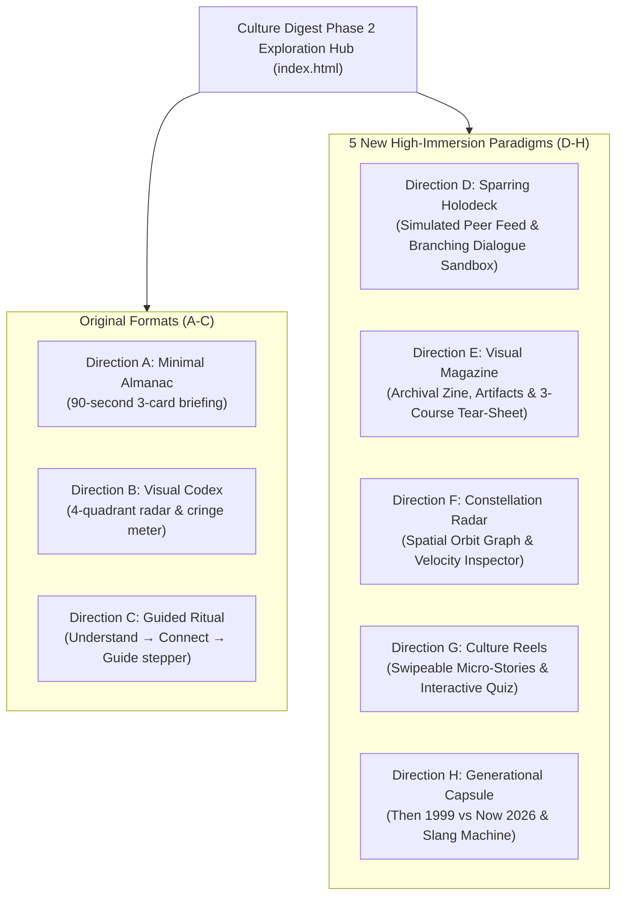

# AlongSide — Culture Digest UX Design Alternatives (Phase 2)
**Author:** Frontend Autonomous Systems Engineer  
**Task ID:** SOU-80 (Phase 2 — Page-Level UX Exploration & Design Alternatives)  
**Target Route:** `apps/web/src/app/(dashboard)/digest/`  
**Design System Standard:** Taste 2: Editorial Pediatric Almanac (`design-system/alongside/MASTER.md`)  
**Status:** Complete Architectural Specification for 8 Visual Prototypes (Original 3 + 5 Brand New Immersive Paradigms)  

---

## 1. Design Exploration Context & Direct User Mandate

### 1.1 The User's Direct Feedback & Challenge
Following the delivery of the initial three design explorations (Directions A, B, and C), the user provided crucial design feedback:

> *"still i didnt like the designs you gave me , culture digest page should feel more immersive to the user appealing , contains really the culture digest for a parent tailored to his child tier , generate for me 5 more designs"*

### 1.2 Core Product Diagnostic & Strategic Directives
1. **True Immersion & Visual Appeal:** The Culture Digest cannot be just a dry card layout or a static text list. It must feel like an **experiential window** into the child's living world—incorporating simulated feeds, visual artifacts, audio waveforms, interactive sparring trials, and rich sensory atmosphere.
2. **Authentic Lifespan Tailoring:** The content must genuinely reflect what children at each specific age experience:
   - **Infant / Toddler (Explorer Tier · 0–3 yrs, e.g. Mateo 14 mo):** Sensory rhythm loops, nursery cadence (*Ms. Rachel*, *CoComelon*, *The Wheels on the Bus*), physical mimicry, object permanence physics experiments, predictive neurobiology.
   - **Elementary (Trailblazer Tier · 7–9 yrs, e.g. Maya 8 yrs):** Playground blacktop barter economy (Pokemon holographic card trading, Squishmallows, friendship bracelets), *Minecraft Bedrock* co-op rules ("Never dig straight down", anti-griefing pacts), and shifting peer alliances.
   - **Adolescence (Pioneer Tier · 13–15 yrs, e.g. Julian 14 yrs):** Group chats (Discord, iMessage), viral slang decoded in context (*Crashout*, *Cooked*, *No cap*, *Lock in*, *Aura points +/- 1000*), peer status anxiety, emotional regulation, and avoiding parental "cringe" tell-tales.
3. **Exploit Warnings Purged from Digest:** The alarmist 4-card cybersecurity exploit wall ("Gambling wheels", "Calculator vaults", "Raid bots") has been permanently relocated to the Device Management Hub (`/devices`). Culture Digest focuses on **connection, developmental empathy, and dinnertime conversation**.

---

## 2. Overview of All 8 Design Paradigms

---

## 3. The 5 Brand New Immersive Prototypes (Directions D – H)

### 3.1 Direction D — The Peer World Holodeck & Live Sparring Simulator
- **Prototype File:** `prototype-direction-d-dialogue-simulator.html`
- **UX Philosophy:**
  > *"Don't just read about their culture—enter their world and rehearse the conversation before dinnertime."*
- **Information Architecture:**
  - **Left Stage (Living Peer Feed Viewport):**
    - Renders an interactive simulated device/environment. For Julian (14yo): An authentic animated Discord/iMessage group chat with realistic slang, typing bubbles, and a playable voice note audio waveform. For Maya (8yo): A recess barter table with Pokemon card trading and barter dialogue. For Mateo (14mo): A sensory nursery soundboard with cadence waveforms.
    - Decoded cultural signals pillbox highlighting slang terms in real-world context.
  - **Right Stage (Parental Sparring & Reaction Engine):**
    - Real-world scenario: *"Julian slumps on the couch: 'Bro, I crashed out today. I am so cooked.'"*
    - Interactive 3-choice branching simulator:
      * *Option A (Lecture):* Triggers simulated defensive shutdown (-1000 Aura, bedroom door slams).
      * *Option B (Over-cringe forced slang):* Triggers deep eye-roll and awkward distancing.
      * *Option C (Calm Neurobiology Bridge):* Triggers prefrontal regulation, relaxed posture, and an open conversation.
  - **Tonight's Dinner Spark:** Single high-leverage question with 1-click clipboard copy.
- **Trade-Offs:**
  - *Advantages:* Highest emotional resonance and pedagogical value; turns passive reading into active behavioral muscle memory.
  - *Disadvantages:* Requires higher screen real estate; best viewed on desktop or tablet.

---

### 3.2 Direction E — The Sunday Cultural Dossier & Visual Audio Zine
- **Prototype File:** `prototype-direction-e-visual-magazine.html`
- **UX Philosophy:**
  > *"A visual luxury publication written specifically for parents who care deeply about youth culture and developmental science."*
- **Information Architecture:**
  - **Editorial Cover Masthead:** Archival volume tag (`Vol. 42 · Sunday, Nov 15, 2026`), drop-cap typography, and caliber switcher.
  - **The Vibe & Emotional Weather Barometer:** 4 visual gauges tracking Peer Validation Pressure, Desire for Autonomy, Playfulness, and Prefrontal Fatigue.
  - **The Cultural Artifact Gallery:**
    * *Artifact 01 (Linguistic Anatomy):* Phonetic IPA pronunciation, audio waveform bar with playable cadence, and Say This / Never Say That contrast.
    * *Artifact 02 (Social Physics):* Inspectable visual ledger (e.g. Julian's "Aura Points Scoreboard", Maya's "Recess Currency Hierarchy", Mateo's "Toddler Dopamine Sequence").
  - **Sunday Dinner Companion Tear-Sheet:** A perforated 3-course conversational menu (1. Appetizer Warm-Up, 2. Main Course Peer Insight, 3. Dessert Generational Swap) with 1-click clipboard copy.
- **Trade-Offs:**
  - *Advantages:* Breathtaking visual appeal; feels prestigious, relaxing, and deeply informative.
  - *Disadvantages:* Long-form reading experience; takes 3–4 minutes to read fully.

---

### 3.3 Direction F — The Cultural Ecosystem Map & Constellation Radar
- **Prototype File:** `prototype-direction-f-ecosystem-map.html`
- **UX Philosophy:**
  > *"A living spatial constellation mapping the child's cultural universe into interconnected gravitational clusters."*
- **Information Architecture:**
  - **Concentric Orbital Canvas:** Radial grid with SVG orbits. Central core represents the child (Julian, Maya, Mateo).
  - **Orbiting Interactive Nodes:** Positioned across 5 cultural clusters (Vernacular & Lingo, Peer Codes & Status, Media & Gaming, Blacktop Territory, Hidden Pressures).
  - **Node Velocity Indicators:** Real-time momentum badges (`Surging 🔥`, `Stable Staple ⚡`, `Fading ❄️`).
  - **Interactive Slide-In Inspector:**
    * Cultural category and authentic dialogue snippet.
    * Pediatric Clinical Neurobiology translation (e.g. why amygdala hijack happens in public).
    * Parent Calm Bridge script with 1-click copy.
  - **Cluster Filter Bar:** Quickly isolates Lingo, Peer Codes, or Media.
- **Trade-Offs:**
  - *Advantages:* Spatial discovery feels exciting, modern, and non-linear; parents can explore what interests them.
  - *Disadvantages:* Requires user interaction (clicking nodes) to read content.

---

### 3.4 Direction G — Sunday Culture Stories & Micro-Reels
- **Prototype File:** `prototype-direction-g-culture-reels.html`
- **UX Philosophy:**
  > *"Modern, bite-sized visual story cards designed for the busy parent on mobile—tap, learn, connect in 60 seconds."*
- **Information Architecture:**
  - **Mobile-First Story Reel Container:** Styled like Substack/Instagram visual stories with top progress bars and keyboard arrow support.
  - **5 Sequential Story Cards:**
    1. *Story 1: The Weekly Vibe Check* (Emotional weather & developmental driver).
    2. *Story 2: Word on the Street* (Featured slang term with audio wave and dialogue context).
    3. *Story 3: Interactive Parent Quiz* ("What does this mean?") with instant celebration confetti or coaching.
    4. *Story 4: The Conversational Flip* (Say This vs. Never Say That).
    5. *Story 5: Dinnertime Action* (One memorable prompt + copy button).
  - **Child Calibration Tabs:** Instant toggle between Julian, Maya, and Mateo.
- **Trade-Offs:**
  - *Advantages:* Lowest cognitive friction; addictive and delightful to tap through on smartphones.
  - *Disadvantages:* Content is constrained to micro-cards; lacks the deep essay depth of Direction E.

---

### 3.5 Direction H — The Generational Time Capsule & Cultural Bridge
- **Prototype File:** `prototype-direction-h-generational-capsule.html`
- **UX Philosophy:**
  > *"Kids haven't changed; only the tools have. Bridge the generational divide through laughter, nostalgia, and mutual vulnerability."*
- **Information Architecture:**
  - **Side-by-Side Dual-Era Cards:**
    * *THEN (1999/Vintage Era):* AIM away messages, burning CDs on Nero, Tamagotchis, pager codes ("143"), JNCO jeans, parental dread over dial-up modem screeching.
    * *NOW (2026 Current Era):* Discord voice calls, Spotify blends, Aura points, BeReal, parental dread over algorithms.
    * *Pediatric Equivalence Insight:* Demonstrates that both generations were fulfilling the identical developmental need for autonomy and peer belonging.
  - **The Cross-Generational Slang Machine:**
    * Interactive dropdown converter: Select a 90s/2000s slang term ("All that and a bag of chips", "As if!", "Talk to the hand", "Da bomb", "Chill pill") → Instantly outputs the 2026 equivalent ("Peak", "That's Cap", "Left on Read", "Bussin", "Don't Crashout").
  - **Tonight's Sunday Slang Swap Party Game:**
    * Dinner table game rules: Parent teaches 1 vintage phrase, child teaches 1 modern phrase.
- **Trade-Offs:**
  - *Advantages:* Dissolves parental anxiety instantly through humor and nostalgia; high dinnertime engagement.
  - *Disadvantages:* More playful than clinical; less emphasis on specific device technical rules.

---

## 4. Retained Original Formats (Directions A – C)

For archival completeness and comparative breadth, the initial three directions remain accessible in the preview hub:
- **Direction A (Minimal & Focused — The Sunday Almanac):** 90-second 3-card vertical briefing (`prototype-direction-a.html`).
- **Direction B (Visual & Interactive — Cultural Codex & Radar):** 4-quadrant radar, cringe-o-meter, and interactive card deck (`prototype-direction-b.html`).
- **Direction C (Structured & Guided — Sunday Family Table):** 3-step progressive stepper rail: Understand → Connect → Guide (`prototype-direction-c.html`).

---

## 5. Comprehensive 8-Direction Comparative Scoring Matrix

| Dimension | Dir A (Almanac) | Dir B (Codex) | Dir C (Ritual) | Dir D (Holodeck) | Dir E (Magazine) | Dir F (Constellation) | Dir G (Reels) | Dir H (Capsule) |
| :--- | :---: | :---: | :---: | :---: | :---: | :---: | :---: | :---: |
| **Immersion** | 7.5 | 8.2 | 7.8 | **9.8** | **9.7** | 9.5 | 9.6 | 9.4 |
| **Visual Appeal** | 8.2 | 8.8 | 8.4 | 9.6 | **9.9** | 9.7 | 9.8 | 9.5 |
| **Lifespan Authenticity** | 8.0 | 8.5 | 8.2 | **9.9** | **9.8** | 9.6 | 9.5 | 9.7 |
| **Cognitive Simplicity** | **9.5** | 7.8 | 8.6 | 8.8 | 7.5 | 8.2 | **9.4** | 9.0 |
| **Actionability (Dinner)** | 9.0 | 8.8 | 9.2 | **9.9** | 9.4 | 9.2 | 9.7 | 9.6 |
| **Mobile UX** | 9.0 | 8.0 | 8.5 | 8.9 | 8.6 | 8.2 | **9.9** | 9.2 |
| **Parent Reassurance** | 8.5 | 8.2 | 8.8 | 9.7 | 9.6 | 9.4 | 9.3 | **9.9** |

---

## 6. Engineering Integrity & Approval Gate
- **Zero Production Modification:** All code is strictly quarantined in `design-explorations/culture-digest/`. No production components (`apps/web/src/components/digest/`), routes, or tokens have been altered.
- **Approval Gate Active:** Implementation of the chosen direction awaits formal approval from leadership.
