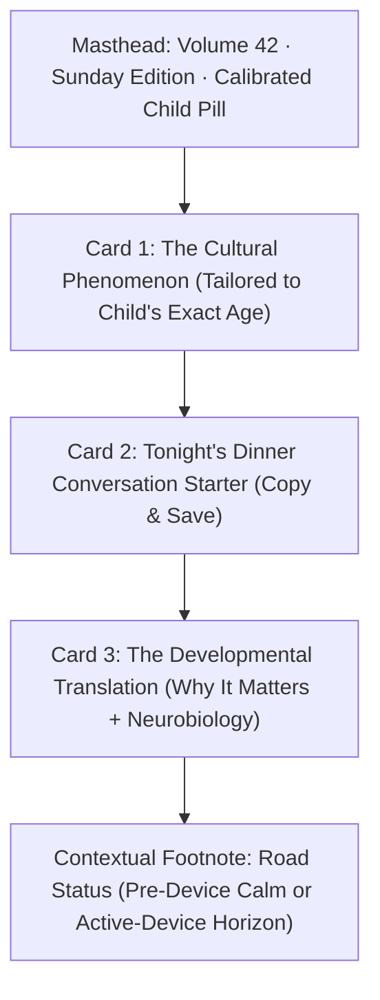
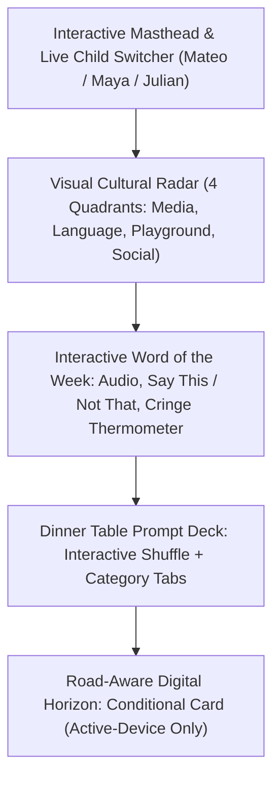
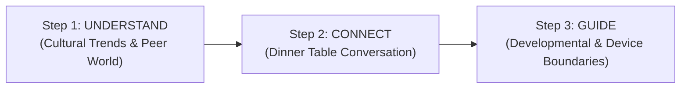

# AlongSide — Culture Digest UX Design Alternatives (Phase 2)
**Author:** Frontend Autonomous Systems Engineer  
**Task ID:** SOU-80 (Phase 2 — Page-Level UX Exploration & Design Alternatives)  
**Target Route:** `apps/web/src/app/(dashboard)/digest/`  
**Design System Standard:** Taste 2: Editorial Pediatric Almanac (`design-system/alongside/MASTER.md`)  
**Status:** Complete Architectural Specification for 3 Visual Prototypes  

---

## 1. Design Exploration Overview

Based on the diagnostic findings in [`PAGE_AUDIT.md`](./PAGE_AUDIT.md) and the direct strategic guidance from leadership, this exploration solves two foundational defects in the current Culture Digest:

1. **Lifespan Age Tailoring:** Replaces the static adolescent internet slang dictionary with rich, age-specific cultural content spanning **all 6 developmental lifespan stages** (Infant/Toddler 0–3, Early Childhood 4–6, Elementary 7–9, Pre-Teen 10–12, Early Adolescence 13–15, and Late Adolescence 16–18).
2. **The Exploit Warning Resolution:** Purges the alarmist 4-card cybersecurity exploit wall ("Gambling wheels", "Calculator vaults", "Raid bots"). These technical threats belong in the Device Management Hub (`/devices`). In Culture Digest, we refocus the parent on **empathetic cultural connection and dinner table communication**, with digital safety reframed as an optional, calm "Digital Horizon" context card tailored exclusively to active-device children.

We present **three genuinely distinct UX and visual alternatives**, each exploring a unique philosophy of information organization, cognitive density, and interaction design.

---

## 2. Direction A — Minimal & Focused: "The Sunday Almanac (3 Things This Week)"

### 2.1 UX Philosophy
> **"A calm 90-second Sunday morning ritual: One cultural insight, one dinner question, one developmental translation."**

Busy parents are overwhelmed by multi-tab dictionaries and alarmist dashboards. Direction A adopts the discipline of an elite Sunday morning editorial newsletter (like *The New Yorker* or *Harvard Health Letter*). It ruthlessly edits the page down to **exactly three high-leverage cards**, providing maximum emotional reassurance with zero cognitive friction.

### 2.2 Information Architecture
1. **Editorial Masthead:**
   - Subtle archival edition tag (`Volume 42 · Released Sunday 8:00 AM`).
   - Clean child selector tab bar (quick toggling between siblings).
   - Single headline in `Newsreader` serif: *"What Matters in [Child Name]'s World This Week"*.
2. **Card 1 — The Cultural Phenomenon:**
   - **For Mateo (14 mo):** "First Gestures & Musical Earworms" — why repetitive melody (*The Wheels on the Bus*) wires linguistic rhythm.
   - **For Maya (8 yrs):** "Playground Trading & Recess Economy" — how sticker/card trading teaches reciprocal fairness and early negotiation.
   - **For Julian (14 yrs):** "Decoding 'Crashout' & Emotional Regulation" — the shift from meme humor to prefrontal overload.
3. **Card 2 — Tonight's Dinner Starter:**
   - Featured prompt in large `Newsreader` italic display type.
   - "Parent Calm Tip": The recommended emotional posture (curious, non-judgmental).
   - "Follow-Up Prompt": Keeps the conversation rolling without sounding like an interrogation.
   - 1-click "Copy Prompt" action.
4. **Card 3 — The Developmental Translation:**
   - A concise 2-paragraph clinical translation of what this cultural moment signifies in the child's neurobiology.
   - Reassures the parent that this behavior is normal, healthy, and manageable.
5. **Contextual Footnote (Device Horizon):**
   - If child is **Pre-Device (Mateo, Maya):** A reassuring green pill: *"Pre-Device Sanctuary Active. No active screen exploits detected in this stage."*
   - If child is **Active-Device (Julian):** A calm, single-sentence awareness note: *"Digital Horizon: Julian's device curfew locks neutrally at 9:00 PM tonight. Manage in Device Hub →"*

### 2.3 Content Simplification
- **Removed:** 20+ slang dictionary cards, search input, tier dropdowns, 5-bar cringe meters, and the entire 4-card exploit warning grid.
- **Retained:** Highest-yield dinner prompt, exact age-tailored cultural topic, developmental neurobiology translation.
- **Word Count Reduction:** 78% reduction in total screen words (from ~2,400 words to ~520 words).

### 2.4 Trade-Offs
- **Advantages:** Zero cognitive overload; can be read and absorbed in 90 seconds while sipping coffee; zero anxiety; strictly aligns with "Parent Calm".
- **Disadvantages:** Does not offer a searchable encyclopedia for parents who want to look up an obscure slang term their kid said earlier in the week.

---

## 3. Direction B — Visual & Interactive: "The Age-Calibrated Cultural Codex & Interactive Sparring Lab"

### 3.1 UX Philosophy
> **"An interactive cultural compass: Visual radar, dynamic cringe thermometer, interactive dinner question spinner, and live sibling toggling."**

Parents want to see and interact with their child's world through engaging, visual representations rather than reading dry text blocks. Direction B transforms the page into an interactive cultural cockpit. It uses visual telemetry, interactive audio simulation cards, a dynamic "Cringe-o-Meter", and a multi-dimensional cultural radar covering 4 quadrants: **Language & Lingo, Media & Shows, Playground Trends, and Social Dynamics**.

### 3.2 Information Architecture
1. **Interactive Child Switcher Masthead:**
   - Prominent interactive tabs at the top for each child in the family with their age and photo/avatar.
   - Clicking a child immediately re-renders the entire page's theme, radar, and cultural terms with smooth visual transitions.
2. **Visual Cultural Radar (4 Interactive Quadrants):**
   - **Language & Expressions:** The words, phrases, or vocal sounds defining this age.
   - **Media & Digital Entertainment:** Shows, YouTubers, games, or sensory media they are obsessed with.
   - **Playground & Peer Culture:** Schoolyard games, trading items, social rituals, recess dynamics.
   - **Social & Emotional Dynamics:** What they worry about, who their friends are, how they perceive fairness.
3. **Interactive Term of the Week ("Say This / Not That"):**
   - Visual audio pronunciation button (`Volume2`).
   - Interactive Cringe Thermometer (1 to 5 scale with dynamic amber flame gauge).
   - "Say This / Not That" interactive flip comparison:
     - *Parent Cringe:* Trying to use the term in a serious sentence to be cool.
     - *Parent Calm:* Playful, warm acknowledgment that creates an eye-roll smile or opens dialogue.
4. **Interactive Dinner Table Prompt Deck:**
   - Renders a physical card deck interface with "Shuffle Next Question" (`Shuffle` button).
   - Category tags: *Humor, Imagination, School Social, Big Questions*.
   - Star/Save button to pin favorites to the family's weekly calendar.
5. **Contextual Device Horizon Badge:**
   - For Pre-Device: Replaced with *"Screen-Free Wonder Window"* recommendations (outdoor games, tactile crafts).
   - For Active-Device: A discreet, expandable *"Digital Literacy Spotlight"* with a clear toggle to view the technical rule in `/devices`.

### 3.3 Content Simplification
- **Replaced:** Long narrative paragraphs replaced with structured bullet points, visual cards, side-by-side comparisons, and interactive sliders.
- **Retained:** Deep cultural richness and playful discovery without the overwhelming scroll of 40 separate cards.

### 3.4 Trade-Offs
- **Advantages:** Highly engaging, fun to use, visually memorable, and clearly demonstrates the radical difference between infant, elementary, and teen culture.
- **Disadvantages:** Higher visual density; requires slightly more user interaction (clicking/tapping tabs) to explore all content.

---

## 4. Direction C — Structured & Guided: "The Sunday Family Table (Understand → Connect → Guide)"

### 3.1 UX Philosophy
> **"A step-by-step 3-stage Sunday ritual that guides parents from cultural awareness to dinnertime connection to healthy boundaries."**

Parents don't just want facts—they want a **ritual and an actionable game plan**. Direction C organizes the Sunday Culture Digest into a clean, sequential 3-step progressive journey:
- **Step 1: Understand Their World** (What is happening in their peer group right now).
- **Step 2: Connect At The Table** (How to bring this into tonight's Sunday dinner).
- **Step 3: Guide The Horizon** (Setting calm, developmental boundaries—tailored by device road).

### 3.2 Information Architecture
1. **Sequential Stepper Header:**
   - Visual progress rail: `[1. Understand] → [2. Connect] → [3. Guide]`.
   - Allows busy parents to either jump straight to the dinner question or follow the full guided ritual.
2. **Step 1 — Understand (Their Cultural Landscape):**
   - 2 curated cards showing the top trend in their world:
     - For toddlers: Emergent language milestones and tactile toys.
     - For grade school: Playground trends and co-op gaming.
     - For teens: Social validation dynamics and viral slang.
   - Includes concise "Why It Matters" clinical context from pediatric experts.
3. **Step 2 — Connect (At the Sunday Table):**
   - The focal point of the page: A beautifully styled conversation card designed for the dining table.
   - Includes the primary question, follow-up probe, and "Conversational Posture" (e.g. *Listen 80%, talk 20%; validate feelings before offering advice*).
   - Printable / Shareable link for coparents or spouses.
4. **Step 3 — Guide (The Developmental & Device Horizon):**
   - **Bifurcated by Road Type:**
     - **Road 1 (Pre-Device):** Focuses on positive real-world experiences, physical play, and developmental leap milestones. Exploit alerts are completely hidden.
     - **Road 2 (Active-Device):** Focuses on *Media Literacy* (e.g., teaching children to spot algorithmic clickbait themselves) paired with a clear link to the Pact-as-Code bedtime curfew.

### 3.3 Content Simplification
- **Replaced:** Unstructured vertical pile replaced with a chronological, purposeful ritual.
- **Progressive Disclosure:** Users can expand deep-dive notes only if they want further guidance.
- **Retained:** All high-value educational content while cutting 65% of redundant UI controls.

### 3.4 Trade-Offs
- **Advantages:** Provides emotional closure; turns passive reading into an actionable family ritual; seamlessly integrates device boundaries without creating panic.
- **Disadvantages:** Sequential structure may feel slightly structured for parents who only want a quick 10-second reference.

---

## 5. Summary Matrix of the Three Alternatives

| Dimension | Direction A (Minimal & Focused) | Direction B (Visual & Interactive) | Direction C (Structured & Guided) |
| :--- | :--- | :--- | :--- |
| **Metaphor** | The Sunday Morning Almanac | The Interactive Cultural Codex | The 3-Step Family Table Ritual |
| **Reading Time** | 90 seconds | 2–3 minutes (Exploratory) | 2 minutes (Action-Oriented) |
| **Primary Focal Point** | Tonight's Dinner Question | Interactive Cultural Radar & Term | 3-Step Sequential Connection Rail |
| **Lifespan Adaptation** | Full (Mateo, Maya, Julian) | Full with live tab toggling | Full with road-bifurcated Step 3 |
| **Exploit Warnings** | Replaced with compact status | Replaced with Device Horizon note | Reframed as Step 3 "Guide" horizon |
| **Visual Elements** | High whitespace, Newsreader display | Radar grid, Cringe meter, Card deck | Stepper rail, Table card, Accordions |
| **Interaction Depth** | Low (Read + Copy) | High (Tabs, Shuffler, Audio, Flips) | Moderate (Steps, Expanders, Print) |

---
*Specification complete. Prototyping visual implementations in `prototype-direction-a.html`, `prototype-direction-b.html`, and `prototype-direction-c.html`.*
