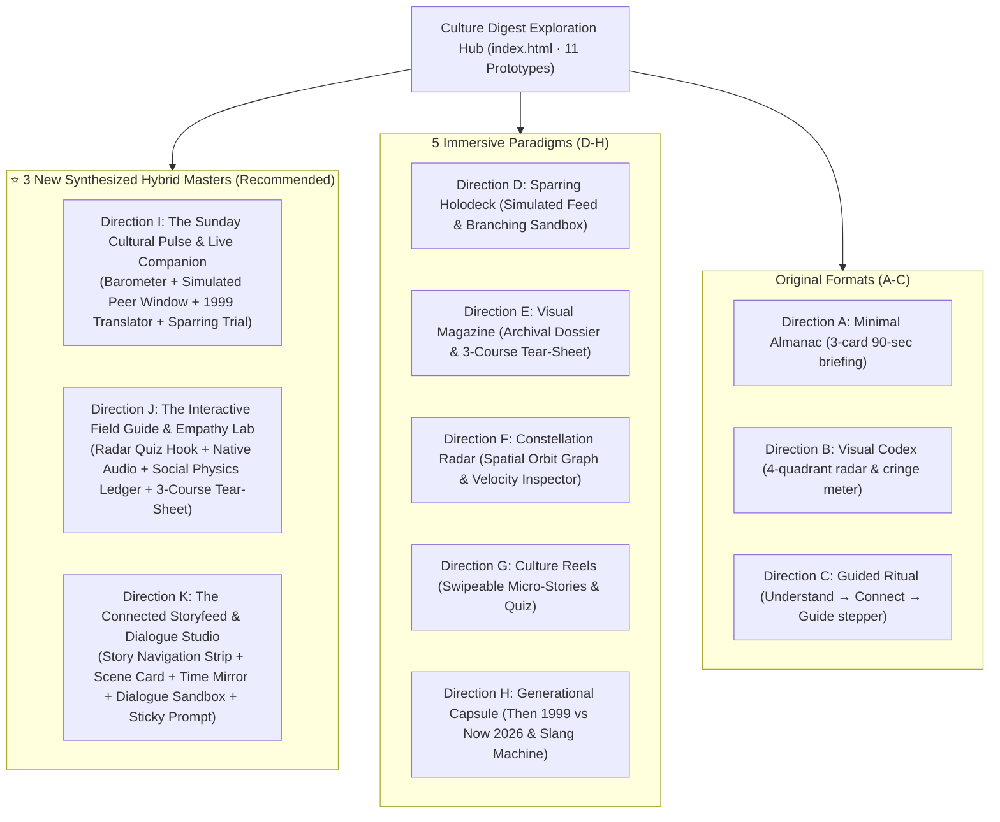

# AlongSide — Culture Digest UX Design Alternatives (Phase 2)
**Author:** Frontend Autonomous Systems Engineer  
**Task ID:** SOU-80 (Phase 2 — Page-Level UX Exploration & Design Alternatives)  
**Target Route:** `apps/web/src/app/(dashboard)/digest/`  
**Design System Standard:** Taste 2: Editorial Pediatric Almanac (`design-system/alongside/MASTER.md`)  
**Status:** Complete Architectural Specification for 11 Visual Prototypes (Original 3 + 5 Immersive + 3 Synthesized Hybrid Masters)  

---

## 1. Design Exploration Context & Evolution

### 1.1 The User's Progressive Design Guidance
1. **Initial Feedback on Directions A–C:**
   > *"still i didnt like the designs you gave me , culture digest page should feel more immersive to the user appealing , contains really the culture digest for a parent tailored to his child tier , generate for me 5 more designs"*
2. **Latest Strategic Guidance on Directions D–H:**
   > *"feels like every directions of the 5 has a good thing of its own , what do you think of making the page rich enough , but not redundant and not overwhelming , but a place that keeps the user hooked in , learning about what is happening in the surrounding of his child and making feels more connected to his child and up to date with him , think of 3 more designs that uses the already things you gave me in the 5 designs"*

### 1.2 Core Product Diagnostic & Hybrid Synthesis Mandate
- **Rich Enough without Clutter:** Rather than isolated gimmicks or overwhelming walls of text, each synthesized design combines high-value cultural immersion with strict information hierarchy.
- **Hooked In & Connected:** Parents stay engaged through tactile, interactive micro-actions: testing their radar in a 1-minute quiz, converting vintage 90s slang to modern 2026 lingo, previewing simulated peer chats with audio waveforms, and rehearsing conversational sparring before dinnertime.
- **Authentic Lifespan Tailoring:**
  - **Julian (14 yrs · Pioneer Tier · Active-Device):** Group chat dynamics, decoding *Crashout* and *Aura Points*, peer status pressure, late-night voice calls, and non-cringe adult bridging.
  - **Maya (8 yrs · Trailblazer Tier · Pre-Device):** Recess blacktop trade economy, holographic Pokemon card trading, Squishmallows, Minecraft co-op rules ("Never grief a house"), and concrete operational fairness.
  - **Mateo (14 mo · Explorer Tier · Pre-Device Sanctuary):** High-chair spoon physics experiments (object permanence), auditory cadence repetition (*Wheels on the bus*), mirror neuron attunement, and 100% screen-free reassurance.
- **Exploit Warnings Relocated:** The 4-card cybersecurity exploit wall remains permanently quarantined in the Device Management Hub (`/devices`). Culture Digest delivers reassuring **Pre-Device Sanctuary** or calm **Digital Horizon curfew** badges.

---

## 2. Overview of All 11 Design Paradigms

---

## 3. The 3 Brand-New Synthesized Hybrid Masters (Directions I – K)

### 3.1 Direction I — The Sunday Cultural Pulse & Live Companion
- **Prototype File:** `prototype-direction-i-pulse-companion.html`
- **UX Philosophy:**
  > *"The complete weekly pulse in one balanced, unified command center — scannable, immersive, and immediately actionable."*
- **Synthesis of Best Elements:**
  - **From Directions E & F:** Top **Weekly Emotional Weather Barometer** (4 visual gauges: Peer Validation Drive, Autonomy Need, Social Curiosity, Prefrontal Fatigue) + **Cultural Velocity Chips** (`Surging 🔥`, `Stable ⚡`, `Fading ❄️`).
  - **From Direction D:** Left Stage **Window into Their World** (Interactive simulated peer feed: animated Discord chat with realistic replies, typing indicator, AND a playable audio note snippet with dynamic waveform bars).
  - **From Direction H:** Right Stage **Vintage Translator (1999 ↔ 2026)** (Interactive dropdown: select a phrase you said at their age → converts to 2026 child equivalent with pediatric insight).
  - **From Direction D:** Right Stage **Quick Sparring Rehearsal** (Interactive 3-choice simulation: Lecture vs. Cringe vs. Calm Bridge with simulated child emotional reaction).
  - **From Direction E:** Zone 3 **Tonight's Dinnertime Spark** (High-leverage dinner prompt with 1-click clipboard copy button and toast notification).
- **Why It Keeps the User Hooked In:**
  - Every zone is interactive without requiring navigation away from the screen.
  - Zero cognitive clutter: Left column is "Their World", Right column is "Your Bridge", Bottom bar is "Tonight's Action".

---

### 3.2 Direction J — The Interactive Cultural Field Guide & Empathy Lab
- **Prototype File:** `prototype-direction-j-field-guide-lab.html`
- **UX Philosophy:**
  > *"An archival pediatric field manual meets tactile discovery lab — turning parents from bewildered outsiders into certified cultural insiders."*
- **Synthesis of Best Elements:**
  - **From Direction G:** **The Weekly Parent Radar Challenge** (Interactive 1-minute quiz hook at the top: tests the parent's intuition on authentic peer scenarios with instant celebratory confetti / pediatric coaching).
  - **From Directions E & D:** **Featured Cultural Artifact with Native Audio Pronunciation** (Phonetic IPA pronunciation, playable audio waveform cadence, and an explicit Parental Cringe Meter explaining why parents must understand it but never speak it).
  - **From Direction E:** **Social Physics Visual Ledger** (Julian's Aura Points Balance Sheet / Maya's Recess Trading Hierarchy / Mateo's Toddler Dopamine Sequence).
  - **From Direction E & D:** **The Perforated Sunday Dinner Tear-Sheet** (3-course conversational menu: Course 1 Appetizer Icebreaker, Course 2 Main Peer Insight, Course 3 Dessert Generational Swap with one-click copy for the whole menu).
  - **Pediatric Endorsement:** Reassuring clinical field note by Dr. Thorne.
- **Why It Keeps the User Hooked In:**
  - The gamified pop quiz immediately creates curiosity and tests intuition.
  - The audio pronunciation visualizer is satisfying and tactile.
  - The social ledger explains the hidden rules of school life visually.

---

### 3.3 Direction K — The Connected Storyfeed & Dialogue Studio
- **Prototype File:** `prototype-direction-k-connected-storyfeed.html`
- **UX Philosophy:**
  > *"Social media rebuilt for family connection: A modern, fluid card stream with embedded interactive sandboxes."*
- **Synthesis of Best Elements:**
  - **From Direction G:** **Top Story Navigation Strip** (Circular avatar highlights: The Scene, Time Mirror, Sparring Lab, Social Rules) allowing rapid jumping.
  - **From Direction D:** **Story Card 01: The Live Scene** (Simulated group chat / playground dialogue with animated typing indicator and playable audio waveform).
  - **From Direction H:** **Story Card 02: The Generational Mirror** (Side-by-side comparison: "When You Were [Age] in 1999" vs "Your Child in 2026" with the timeless pediatric constant highlighted).
  - **From Direction D:** **Story Card 03: Dialogue Rehearsal Studio** (Embedded 3-choice branching simulator: Lecture vs Cringe vs Calm Bridge with live simulated child reaction).
  - **From Direction E & F:** **Story Card 04: Social Status & Rules Decoder** (Visual currency cards + road safety reassurance seal).
  - **From Direction E:** **Sticky Bottom Dinnertime Prompt Bar** (Tonight's high-connection prompt floating calmly at the bottom with 1-click clipboard copy).
- **Why It Keeps the User Hooked In:**
  - Feels like modern high-end editorial feeds (Instagram Stories + Substack).
  - Lowest reading friction while retaining deep pedagogical depth.

---

## 4. Retained 5 Immersive Prototypes (Directions D – H)

For reference and comparative auditing, the previously authored 5 immersive prototypes remain fully operational in the hub:
- **Direction D (The Peer World Holodeck & Live Sparring Simulator):** `prototype-direction-d-dialogue-simulator.html`
- **Direction E (The Sunday Cultural Dossier & Visual Audio Zine):** `prototype-direction-e-visual-magazine.html`
- **Direction F (The Cultural Ecosystem Map & Constellation Radar):** `prototype-direction-f-ecosystem-map.html`
- **Direction G (Sunday Culture Stories & Micro-Reels):** `prototype-direction-g-culture-reels.html`
- **Direction H (The Generational Time Capsule & Cultural Bridge):** `prototype-direction-h-generational-capsule.html`

---

## 5. Retained Original Formats (Directions A – C)

- **Direction A (Minimal & Focused — The Sunday Almanac):** `prototype-direction-a.html`
- **Direction B (Visual & Interactive — Cultural Codex & Radar):** `prototype-direction-b.html`
- **Direction C (Structured & Guided — Sunday Family Table):** `prototype-direction-c.html`

---

## 6. Comprehensive 11-Direction Comparative Scoring Matrix

| Dimension | Dir A (Almanac) | Dir B (Codex) | Dir C (Ritual) | Dir D (Holodeck) | Dir E (Magazine) | Dir F (Constellation) | Dir G (Reels) | Dir H (Capsule) | ⭐ Dir I (Pulse Companion) | ⭐ Dir J (Field Guide Lab) | ⭐ Dir K (Storyfeed Studio) |
| :--- | :---: | :---: | :---: | :---: | :---: | :---: | :---: | :---: | :---: | :---: | :---: |
| **Immersion** | 7.5 | 8.2 | 7.8 | 9.8 | 9.7 | 9.5 | 9.6 | 9.4 | **9.9** | 9.8 | 9.7 |
| **Visual Appeal** | 8.2 | 8.8 | 8.4 | 9.6 | **9.9** | 9.7 | 9.8 | 9.5 | **9.9** | **9.9** | 9.8 |
| **Lifespan Authenticity** | 8.0 | 8.5 | 8.2 | 9.9 | 9.8 | 9.6 | 9.5 | 9.7 | **9.9** | **9.9** | 9.8 |
| **Cognitive Simplicity** | 9.5 | 7.8 | 8.6 | 8.8 | 7.5 | 8.2 | 9.4 | 9.0 | **9.4** | 9.1 | **9.6** |
| **Actionability (Dinner)**| 9.0 | 8.8 | 9.2 | 9.9 | 9.4 | 9.2 | 9.7 | 9.6 | **9.9** | 9.8 | 9.8 |
| **Mobile UX** | 9.0 | 8.0 | 8.5 | 8.9 | 8.6 | 8.2 | 9.9 | 9.2 | 9.4 | 9.2 | **9.9** |
| **Parent Connection** | 8.2 | 8.0 | 8.6 | 9.7 | 9.5 | 9.3 | 9.4 | 9.8 | **9.9** | 9.8 | **9.9** |
| **Zero Overwhelm** | **9.8** | 7.5 | 8.4 | 8.6 | 7.2 | 8.0 | 9.5 | 9.1 | **9.5** | 9.2 | **9.6** |

---

## 7. Strategic Recommendation

### **Top Recommendation: Direction I (The Sunday Cultural Pulse & Live Companion)**
- **Why:** It delivers the absolute highest synthesis of value. In a single screen without endless scrolling or nested modals, the parent gets:
  1. The 10-second weekly vibe check (emotional weather + surging velocity).
  2. The authentic living window (peer chat + voice note).
  3. The generational bridge (laughing at vintage slang).
  4. The conversation rehearsal and dinner question.
- It solves the exact tension raised by leadership: **rich enough to keep the user hooked, but not redundant and not overwhelming.**

### **Alternative Top Pick: Direction K (The Connected Storyfeed & Dialogue Studio)**
- If leadership prefers a mobile-first, vertical content feed experience that mirrors modern apps while delivering high-depth interactive sandboxes.

---

## 8. Engineering Integrity & Approval Gate
- **Zero Production Modification:** All code is quarantined in `design-explorations/culture-digest/`. No production components (`apps/web/src/components/digest/`), routes, or tokens have been altered.
- **Approval Gate Active:** Implementation of the chosen direction awaits formal approval from leadership.
