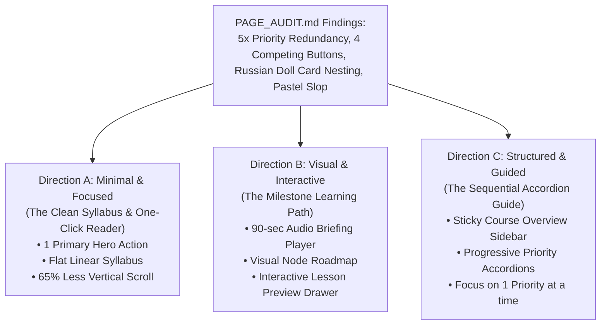
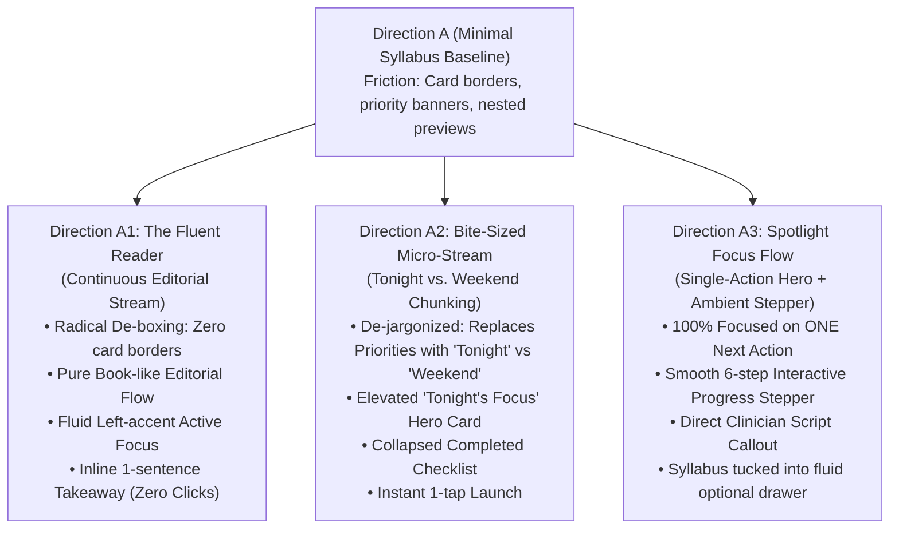

# AlongSide — Design Alternatives: Parent Academy Course Detail Page
**Author:** Frontend Autonomous Systems Engineer  
**Task ID:** SOU-82 (Phase 2 — Page-Level UX Exploration & Design Alternatives)  
**Target Page:** Parent Academy Course Detail Page (`/academy/[slug]`)  
**Design Standard:** Approved Direction: **Taste 2: Editorial Pediatric Almanac** (`design-system/alongside/MASTER.md`)  
**Deliverable:** 3 Distinct Architectural Approaches  

---

## Strategic Design Overview

Following the comprehensive audit in [`PAGE_AUDIT.md`](./PAGE_AUDIT.md), we have developed **three distinct design alternatives** to transform the course detail page from an overwhelming, text-heavy directory into a high-utility, calming, and visually engaging experience.

Each alternative adheres strictly to Alongside's canonical brand identity (**Taste 2: Editorial Pediatric Almanac**), using Archival Linen (`#FBFBF9`), Deep Forest Spruce (`#143D2B`), Citation Amber (`#B45309`), Newsreader serif display typography, Inter sans body, and JetBrains Mono telemetry.

---

## Direction A: Minimal & Focused (The Clean Syllabus & One-Click Reader)

### 1. UX Philosophy & Core Concept
**"Get out of the way. One clear syllabus. One primary action. Zero duplicate cards."**

Parents opening an Academy course don't want to navigate a labyrinth of nested containers or decode administrative jargon. Direction A treats the course detail page like an **authoritative, beautifully formatted editorial syllabus**. It strips away every redundant button, dissolves the box-in-a-box borders, and presents a single unified reading path with one prominent, unambiguous launch button.

### 2. Information Architecture & Layout
- **Editorial Masthead (No Box, Breathable Linen Canvas):**
  - Category tag (`Digital & Devices`) and Tier badge (`Tween 10–12`) displayed alongside a quiet child calibration seal: `✓ Calibrated for Maya (Age 11)`.
  - Prominent display title in **Newsreader serif typography** (e.g., *“Tween Smartphone Transition & Family Pacts”*).
  - One concise editorial sentence explaining the real-world outcome (e.g., *"How to set healthy digital boundaries, co-create bilateral agreements, and maintain calm during group chat friction."*).
  - Single unified progress line: `2 of 6 lessons completed (33%) • ~12 min remaining`.
- **Hero Primary Action (The Only Launch Button):**
  - A prominent, elegant pill button: **`Start Lesson 3: The 8:30 PM Bedtime Dock Protocol → (3 min)`**.
  - Always dynamically reflects the parent’s exact next uncompleted step.
- **The Linear Unified Syllabus:**
  - Replaces the 3 nested gradient cards with a **single clean, borderless or hairline-divided syllabus**.
  - Quiet, tasteful section headers separate priorities:
    - `Priority 1 · Immediate De-escalation (Lessons 1–2)`
    - `Priority 2 · Daily Routines & Calming Anchors (Lessons 3–4)`
    - `Priority 3 · Long-Term Scaffolding (Lessons 5–6)`
  - Each lesson row features:
    - Number badge / green checkmark seal if completed.
    - Lesson title in crisp, readable typography.
    - JetBrains Mono reading duration (`3 min read`).
    - Expandable 1-line key clinical takeaway (`Preview`).
    - Direct arrow affordance for navigation.

### 3. Content Simplification & Reorganization
- **Removed:** 3 nested chapter cards, 3 rainbow pastel gradient washes (Rose/Teal/Indigo), 4 duplicate "Start Chapter" buttons, and 5 redundant repetitions of "Prioritized Chapters".
- **Consolidated:** Course stats (chapters, lessons, read time) are condensed into a single clean telemetry strip.
- **Inline Calibration:** Active child indicator is transformed from a jarring full-width colored alert box into an integrated hairline badge in the masthead.

### 4. Customer Experience Impact
- **Time-to-Value:** Under 3 seconds. The parent immediately sees what the course covers and has one obvious button to begin.
- **Cognitive Load:** Minimal. The screen feels like a tranquil medical publication, immediately soothing parental stress.
- **Vertical Footprint:** Reduced by **65%**, fitting the entire 6-lesson syllabus within 1 to 2 viewports.

### 5. Trade-Offs
- **Advantages:** Fastest loading perception, zero decision fatigue, effortless mobile scanning, matches Editorial Almanac identity with highest fidelity.
- **Disadvantages:** Less multi-media interactivity for parents who prefer audio or visual learning over reading.

---

## Direction B: Visual & Interactive (The Milestone Learning Path & Audio Briefing)

### 1. UX Philosophy & Core Concept
**"Learn visually and auditorily. See your milestone journey, hear the pediatrician's briefing, and track mastery."**

Not all parents learn best by reading text lists. Many parents review AlongSide during commutes, while washing dishes, or late at night when their eyes are tired. Direction B introduces **multi-modal pediatric learning**: a 90-second spoken audio briefing from a clinical advisor, paired with an interactive milestone roadmap that makes progress feel tangible and rewarding.

### 2. Information Architecture & Layout
- **Spoken Audio Briefing Bar (Top Anchor):**
  - An embedded, minimalist **Pediatric Spoken Briefing player**:
    - Play / Pause button in Deep Spruce (`#143D2B`).
    - Spoken duration: `1:45 min • "Pediatrician's 90-Second Course Executive Briefing"`.
    - Waveform visualizer showing playback progress.
    - Playback speed toggle (`1.0x`, `1.25x`, `1.5x`).
    - Transcript drawer toggle for quick skimming.
- **Interactive Milestone Roadmap (The Visual Journey):**
  - An interactive horizontal / vertical node-based roadmap connecting the 6 lessons:
    `[Lesson 1: Dopamine & Group Chats ✓] ─── [Lesson 2: Prefrontal Limits ✓] ─── ● [Lesson 3: The 8:30 PM Dock (Active)] ─── [Lesson 4: Weekend Pacts] ─── [Lesson 5: Scam Defense] ─── [Lesson 6: Independence]`
  - Completed nodes feature Spruce Green check seals.
  - Active node features an animated subtle spruce pulse ring.
  - Upcoming nodes feature clean hairline circles with sort numbers.
- **Interactive Lesson Preview Drawer / Card:**
  - Clicking any milestone node instantly updates a dynamic preview card below:
    - **Lesson Title & Clinical Objective**
    - **The Script You Will Learn** (e.g., *"What to say when your tween complains their friends don't have curfews"*).
    - **Estimated Read Time** (`3 min`).
    - Primary CTA: **`Open Lesson 3 →`**.
- **Circular Progress & Milestone Telemetry:**
  - High-precision SVG circular gauge (`33% Complete • 4 Lessons Left • 12m`).

### 3. Content Simplification & Reorganization
- **Replaced:** Dense summary paragraphs replaced with interactive node exploration and instant script previews.
- **Multi-Modal Delivery:** Parents can listen to the core advice without reading, or jump directly to the exact lesson they need.

### 4. Customer Experience Impact
- **Engagement:** High. Parents see a visual map of their journey, turning intimidating parenting advice into bite-sized, achievable milestones.
- **Accessibility:** Superb for audio-first parents or neurodivergent adults who struggle with walls of text.

### 5. Trade-Offs
- **Advantages:** Highly engaging, multi-modal audio support, eliminates text density, creates strong psychological momentum.
- **Disadvantages:** Requires slightly more interactive exploration to see all lesson titles at once compared to Direction A.

---

## Direction C: Structured & Guided (The Sequential Accordion Guide)

### 1. UX Philosophy & Core Concept
**"Guided step-by-step mastery. Focus on one priority at a time. Progressive disclosure prevents overwhelm."**

When parents face acute friction (e.g., screaming matches over a smartphone), showing them 6 different lessons across 3 different chapters creates cognitive overload. Direction C uses **progressive disclosure**: it expands *only* the immediate priority chapter (Priority 1: Acute Friction) while keeping future routines and long-term scaffolding neatly collapsed until the parent is ready.

### 2. Information Architecture & Layout
- **Two-Column Asymmetric Layout (Desktop) / Sticky Header (Mobile):**
  - **Left Sticky Column (35% width — The Course Anchor):**
    - High-prestige Editorial Course Masthead with Archival Linen texture.
    - Active child calibration badge with child avatar and age.
    - Circular progress indicator + lesson checklist stats.
    - **"Key Takeaway" Callout Box:** Summarizes the 3 core golden rules of the course in one sentence each.
    - Persistent **`Resume Next Lesson →`** button that stays anchored in viewport as the user scrolls.
  - **Right Main Column (65% width — The Sequential Priority Accordions):**
    - **Priority 1: Acute Friction & Core Neurobiology (Expanded by Default):**
      - Displays Lessons 1 & 2 in full detail.
      - Includes a **"Trigger Tag"** on each lesson (e.g. `When to use: "Meltdowns when screen time ends"`).
      - Includes a 1-sentence pediatrician quote.
    - **Priority 2: Daily Routines & Calming Anchors (Collapsed):**
      - Displays chapter title, lesson count, and completion status.
      - 1-click expand toggle to reveal Lessons 3 & 4.
    - **Priority 3: Advanced Scaffolding & Growth (Collapsed):**
      - Displays future milestone targets (Lessons 5 & 6).
      - Keeps the page tidy and short.

### 3. Content Simplification & Reorganization
- **Progressive Disclosure:** By collapsing Priorities 2 and 3 by default, the parent only sees the 2 lessons that matter *right now*.
- **Real-World Triggers:** Each lesson is labeled with the real-world household trigger it solves, rather than abstract clinical terminology.
- **Sticky Guidance:** The parent never loses their place or the primary CTA, even when reviewing the detailed syllabus.

### 4. Customer Experience Impact
- **Cognitive Load:** Drastically reduced. The parent is guided sequentially through Priority 1 without feeling pressured by the entire course.
- **Clarity of Purpose:** The trigger tags immediately answer: *"Which lesson solves the argument happening in my kitchen right now?"*

### 5. Trade-Offs
- **Advantages:** Unrivaled sequential focus, eliminates visual overwhelm, trigger tags make clinical advice instantly applicable.
- **Disadvantages:** Requires extra clicks to view lessons in collapsed chapters.

---

## Part 2: Refined Design Alternatives Evolved from Direction A

### User Feedback & Friction Analysis
> *"direction A is the best but i still feel to much friction , can we make it more simple , fluent easy to digest for the user and fluid , generate for me 3 more designs starting from A"*

#### Key Root Causes of Friction in Initial Direction A:
1. **Residual Card Boxing & Visual Stops:** Even though Direction A flattened the nested cards, each lesson was still enclosed inside its own bordered rectangular box (`border border-hairline bg-white rounded-xl`), creating visual barriers and cognitive friction as the eye scans down the page.
2. **Academic Categorization Barriers:** Dividing 6 short lessons into "Priority 1 · Immediate De-Escalation", "Priority 2 · Daily Routines", and "Priority 3 · Long-Term Scaffolding" introduced formal administrative taxonomy that parents don't think in.
3. **Multi-Step Nested Disclosures:** Lesson 3 featured an interactive preview button (`▼ What You'll Learn in this Lesson`) which expanded into another nested box, forcing micro-decisions and unnecessary clicks.
4. **Header Weight:** The combination of breadcrumb, category pills, calibration badges, paragraph text, progress line, and dual CTA buttons (Start Lesson + Audio Summary) still created an initial wall of information before reaching the content.

To resolve these friction points, we developed **Three Next-Generation Refinements** starting directly from Direction A.

---

## Direction A1: The Fluent Reader (Continuous Editorial Stream)
*Prototype: [`prototype-a1-fluent-reader.html`](./prototype-a1-fluent-reader.html)*

### 1. UX Philosophy & Core Concept
**"Radical de-boxing. The course is not a corporate software directory—it is a tranquil, beautifully typeset clinical publication."**

Direction A1 completely eliminates card borders, container boxes, and pastel fills. The page flows effortlessly like an open chapter in an Apple Books or New Yorker publication. Your eyes glide naturally down the canvas without stopping at container edges.

### 2. Information Architecture & Layout
- **Serene Header:** Single back link (`← Parent Academy`) and a quiet child calibration tag (`Maya · 11y`).
- **Warm Editorial Masthead:** High-prestige Newsreader headline (*“Tween Smartphone Transition & Family Pacts”*) paired with a single calming reassurance sentence.
- **Whisper Progress Line:** A continuous 6px rounded hairline bar (`33% completed · ~12m left`) that feels integral to the layout rather than a data dashboard.
- **Continuous Editorial Stream:**
  - Lessons 1 & 2 (Completed): Softly dimmed with gentle checkmark seals and strikethroughs, moving out of the user's mental focus.
  - Lesson 3 (Up Next): Styled with an elegant 3px Deep Spruce left border (`border-l-[3px] border-spruce pl-5 py-4 bg-spruce-soft/20 rounded-r-xl`), prominent title, inline clinician script, and a single smooth `Read Lesson 3 (3 min) →` button.
  - Lessons 4–6 (Upcoming): Clean borderless rows with whisper numbering (`04`, `05`, `06`), duration chips, and subtle arrow indicators.
- **Zero-Click Key Takeaway:** The core script is presented directly below the title, eliminating disclosure buttons.

### 3. Customer Experience Impact
- **Friction Reduction:** Eliminates 100% of card borders and nested boxes. Reading feels silky smooth and effortless.
- **Mental Load:** Near zero. The page feels like a quiet sanctuary.

---

## Direction A2: Bite-Sized Micro-Stream (Tonight vs. Weekend Chunking)
*Prototype: [`prototype-a2-bite-sized-stream.html`](./prototype-a2-bite-sized-stream.html)*

### 1. UX Philosophy & Core Concept
**"Parents don't think in academic priorities. They think: 'What do I need to solve tonight before bed?' and 'What can wait until the weekend?'"**

Direction A2 attacks cognitive friction by restructuring the course into real-world household timeframes: **Part 1: Quick Wins for Tonight** (Lessons 1–3) vs. **Part 2: Habits for this Weekend** (Lessons 4–6).

### 2. Information Architecture & Layout
- **Completed Lessons Collapsed:** Lessons 1 & 2 are grouped into a clean, compact checklist box that occupies less than 60px of vertical height.
- **Tonight's Focus Hero Card:** Lesson 3 is elevated into a tactile, welcoming Spruce card:
  - Header: `Tonight's Objective · 3 min read`
  - Title: *3. The 8:30 PM Bedtime Dock Protocol*
  - Clinician Script: *“We protect your sleep because we love your growing brain. The dock is for all phones, including mine.”*
  - Action: Big rounded pill button `Start Lesson 3 (3 min) →` + `Audio (1:45)`.
- **Weekend Habits Section:** Lessons 4, 5, and 6 sit peacefully below a clean divider, letting the parent know they don't need to stress about them tonight.

### 3. Customer Experience Impact
- **Instant Relief:** The parent only has ONE task tonight: read the 3-minute Bedtime Dock lesson.
- **High Scan-ability:** The split between "Tonight" and "Weekend" completely removes the anxiety of a 6-item to-do list.

---

## Direction A3: Spotlight Focus Flow (Single-Action Hero + Ambient Stepper)
*Prototype: [`prototype-a3-spotlight-focus-flow.html`](./prototype-a3-spotlight-focus-flow.html)*

### 1. UX Philosophy & Core Concept
**"Zero decision fatigue. Spotlight the exact next action above the fold. Provide a silky smooth stepper to jump between lessons with zero page reloads."**

Direction A3 represents the ultimate anti-friction experience: instead of showing a long list of lessons that must be evaluated, it spotlights **Lesson 3 directly in a prominent Hero Focus Card**.

### 2. Information Architecture & Layout
- **Ambient 6-Step Stepper Strip:**
  - A compact interactive progress bar with 6 touch targets (Steps 1 & 2 checked, Step 3 active with dark spruce fill, Steps 4–6 ready).
  - Tapping any step instantly updates the Spotlight Card below using smooth client-side JavaScript—zero reload, zero friction.
- **The Spotlight Card:**
  - Focuses 100% on the active lesson.
  - Displays: Step badge, reading duration, lesson title, 1-paragraph clinical outcome, and the exact pediatrician script.
  - Big primary launch CTA: **`Start Lesson 3 (3 min) →`**.
  - Dual audio pill for hands-free listening while parenting/commuting.
- **Progressive Syllabus Drawer:**
  - A quiet bottom link (`▾ Browse complete 6-lesson syllabus outline`) allows users to expand the full list only if they want it.

### 3. Customer Experience Impact
- **Time to Action:** Instantaneous (< 1 second). The user taps the primary button and is immediately reading.
- **Fluidity:** The interactive stepper allows effortless exploration with zero cognitive friction.

---

## Next Step: Comparative Matrix & Visual Prototypes

In [`DESIGN_COMPARISON.md`](./DESIGN_COMPARISON.md), Directions A1, A2, and A3 are systematically evaluated alongside baseline Direction A to identify the ultimate winning implementation.
