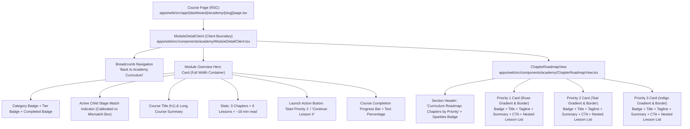

# AlongSide — Comprehensive UX/UI Audit: Parent Academy Course Detail Page
**Author:** Frontend Autonomous Systems Engineer  
**Task ID:** SOU-82 (Phase 2 — Page-Level UX Exploration & Design Alternatives)  
**Target Page:** Parent Academy Course Detail Page (`/academy/[slug]` • `apps/web/src/app/(dashboard)/academy/[slug]/page.tsx`)  
**Active Components:** `apps/web/src/components/academy/ModuleDetailClient.tsx` & `ChapterRoadmapView.tsx`  
**Design Standard:** Approved Direction: **Taste 2: Editorial Pediatric Almanac** (`design-system/alongside/MASTER.md`)  
**Status:** Audit Complete — Pending Direction Approval  

---

## Executive Summary & Problem Statement

AlongSide’s Parent Intelligence Academy delivers evidence-based pediatric guidance, developmental neurobiology, and clinical conversation scripts across 6 developmental lifespan stages (Ages 0–18).

When a parent enters a specific course (such as *"Tween Smartphone Transition & Family Pacts"* or *"Preschool Big Feelings & Theory of Mind"*), they are usually seeking **practical, timely advice for an immediate parenting challenge**—for example, resolving a heated argument over phone access, setting a peaceful bedtime routine, or handling school-age sibling friction.

However, the current course detail page (`/academy/[slug]`) suffers from **severe information redundancy, competing calls-to-action, multiple nested card borders with conflicting pastel gradients, and an overwhelming wall of administrative and academic metadata**. Instead of guiding the parent smoothly into their first 3-minute lesson, the page exhausts them with repetitive priority explanations and visual clutter before they even start reading.

> [!IMPORTANT]
> **Design Exploration Protocol:** In strict compliance with `AGENTS.md` and Paperclip task SOU-82 specifications, **this phase is exclusively a design and UX exploration**. No existing application code, production components, routes, stylesheets, or database models have been altered. All exploration deliverables are isolated within `design-explorations/parent-academy-course/`.

---

## 1. Codebase Component Breakdown & Architecture Audit

The course detail experience is mounted in Next.js 15 App Router at `apps/web/src/app/(dashboard)/academy/[slug]/page.tsx` via `ModuleDetailClient.tsx`, which queries the course detail payload (`AcademyModuleDetailDTO`) using TanStack Query and delegates the curriculum breakdown to `ChapterRoadmapView.tsx`.

### Component Inventory & Line Inspection:

| Component | File Path | Current Content & Responsibilities | Cognitive Footprint & Friction Points |
| :--- | :--- | :--- | :--- |
| **ModuleDetailPage** | `apps/web/src/app/(dashboard)/academy/[slug]/page.tsx` (24 lines) | Server component generating metadata and mounting `ModuleDetailClient`. | **Clean**: Proper RSC delegating to client boundary. |
| **ModuleDetailClient** | `apps/web/src/components/academy/ModuleDetailClient.tsx` (234 lines) | Fetches module data via React Query, accesses child context store, renders breadcrumb, hero card, calibration banner, stats, start CTA, progress bar, and mounts `ChapterRoadmapView`. | **High**: The hero card alone has 6 visual compartments, 4 badges, an alert box, a progress bar, and a launch CTA. |
| **ChapterRoadmapView** | `apps/web/src/components/academy/ChapterRoadmapView.tsx` (341 lines) | Orders chapters by priority (Priority 1 Critical, Priority 2 Routines, Priority 3 Scaffolding), renders 3 massive cards with rose/teal/indigo gradient backgrounds, duplicate badges, taglines, summaries, redundant "Start Chapter" buttons, and nested lesson lists. | **Severe**: Multi-layered card nesting ("Russian doll" effect), repeating identical priority labels 5 times, and presenting 4 competing action buttons on one page. |

---

## 2. Customer Problem & User Psychology Analysis

### 2.1 The Customer's Core Job-to-be-Done (JTBD)
When a busy parent clicks into an Academy course, their primary psychological objective is:
> *"I have 5 minutes right now. Show me what I will learn, where I should start, and let me begin reading immediately without cognitive fatigue."*

### 2.2 Primary User Action
- **Primary Action (90% of visits):** Click **"Start Lesson 1"** (or **"Continue Next Lesson"**) to begin reading the actionable script and clinical insight.
- **Secondary Action (10% of visits):** Briefly scan the 5 or 6 micro-lessons in the course syllabus to ensure this course covers their child's specific situation.

### 2.3 What Information Users Actually Need vs. What They Are Given:
| What Parents Actually Need | What the Page Gives Them Today | Friction Impact |
| :--- | :--- | :--- |
| **1. Fast Course Clarity:** What will this course teach me in plain English? | A high-level course title, plus a course summary paragraph, plus 3 separate chapter summaries, plus 3 chapter taglines in quotes. | **Text Overload**: The parent must read 300+ words of administrative overview text before reading any actual advice. |
| **2. One Obvious Starting Button:** Where do I click to start? | 4 competing buttons on screen simultaneously: Header CTA ("Start Priority 1"), Chapter 1 CTA ("Start Chapter"), Chapter 2 CTA ("Start Chapter"), Chapter 3 CTA ("Start Chapter"), plus 6 individual lesson row links. | **Decision Paralysis**: Users hesitate because multiple buttons with different labels compete for attention. |
| **3. A Quick 6-Lesson Syllabus:** What are the topics and how long does each take? | 3 giant separate cards taking up ~2,400px of vertical height. The lessons are buried inside inner boxes inside outer cards. | **Vertical Sprawl**: Parents must scroll 4 full mobile viewports just to see all lesson titles. |
| **4. Stage & Age Confirmation:** Is this right for my child? | A large, full-width colored alert box (`bg-teal-50` or `bg-amber-50`) inserted between the category badges and course title. | **Visual Interruption**: The banner splits the header hierarchy, pushing the course title down. |
| **5. Calm, Cohesive Design:** An interface that lowers heart rate and feels authoritative. | 3 different pastel gradient backgrounds (Rose for Priority 1, Teal for Priority 2, Indigo for Priority 3), 6 rounded border styles, and rainbow badges. | **Visual Chaos**: Violates the approved **Editorial Pediatric Almanac** design system (Archival Linen `#FBFBF9`, Deep Spruce `#143D2B`, 1px hairlines `#E3E3DC`). |

---

## 3. Detailed Friction Audit: Redundancies & Visual Clutter

### 3.1 Flaw 1: Massive Redundancy of Priority Terminology
The concept of "Prioritized Chapters" is repeated **5 separate times** on a single page:
1. Header Stats Bar: `[Layers icon] 3 Prioritized Chapters`
2. Roadmap Section Subtitle: `Curriculum Roadmap: Chapters by Priority`
3. Roadmap Section Pill: `[Sparkles icon] 3 Prioritized Chapters`
4. Chapter 1 Badge: `Priority 1 · Critical`
5. Chapter 1 Description: *"Start here for acute friction and core neurobiology."*

This repetition adds zero new information while cluttering the user's field of view with repetitive administrative metadata.

### 3.2 Flaw 2: Competing CTAs and Action Paralysis
When opening the page on desktop or mobile:
- Top right of header: `<Button> Start Priority 1 → </Button>`
- Top right of Chapter 1: `<Button variant="default" className="bg-rose-700"> Start Chapter → </Button>`
- Top right of Chapter 2: `<Button variant="default" className="bg-teal-700"> Start Chapter → </Button>`
- Top right of Chapter 3: `<Button variant="default" className="bg-indigo-700"> Start Chapter → </Button>`
- Plus 6 individual lesson links with right arrows.

A first-time user has no idea whether clicking "Start Priority 1" takes them somewhere different than clicking "Start Chapter" on Chapter 1, or clicking "Lesson 1" in the list below.

### 3.3 Flaw 3: "Russian Doll" Card Nesting Hell
The current layout stacks containers inside containers:
- **Level 1:** Global page container (`max-w-4xl mx-auto`).
- **Level 2:** Outer chapter container (`rounded-2xl border bg-white p-5 sm:p-7 shadow-xs`).
- **Level 3:** Chapter priority gradient wash (`bg-gradient-to-br from-rose-50/40 via-white to-white`).
- **Level 4:** Inner micro-lesson list box (`divide-y divide-slate-100 rounded-xl border border-slate-200/80 bg-white`).
- **Level 5:** Individual lesson rows with gray icon blocks (`bg-slate-100 text-slate-600 rounded-lg`).

This multi-level box-in-a-box styling creates excessive visual boundaries, thick borders, and heavy shadows that make the page feel heavy, boxed-in, and dated.

### 3.4 Flaw 4: Departure from Approved Brand System (Editorial Almanac)
The approved platform design system codified in `design-system/alongside/MASTER.md` is **Taste 2: Editorial Pediatric Almanac**:
- **Canvas:** Archival Linen (`#FBFBF9`) with quiet hairlines (`#E3E3DC`).
- **Typography:** Newsreader editorial serif for titles, Inter for UI, and JetBrains Mono for telemetry.
- **Accents:** Deep Forest Spruce (`#143D2B`), Citation Amber (`#B45309`), Spruce Soft (`#EAF3EE`).
- **Density:** 3/10 (Spacious and breathable, not boxed-in).

The current course page is still using legacy Tailwind pastel styles (Rose 50, Teal 50, Indigo 50) and generic sans-serif typography, making it look like a generic corporate LMS rather than a prestigious pediatric publication.

---

## 4. Key Opportunities for UX & Visual Simplification

1. **Unify into One Hero Action**: Establish a single, prominent **"Start Next Lesson"** (or **"Resume Course"**) button in the masthead. Remove redundant chapter-level duplicate buttons.
2. **Flatten the Syllabus Hierarchy**: Eliminate nested gradient boxes. Present the 6 lessons in a clean, linear, beautifully typeset syllabus with subtle priority dividers.
3. **Embed Child Calibration Gracefully**: Turn the intrusive full-width alert box into a quiet, elegant telemetry tag (`✓ Tailored for Maya • Age 11`) integrated into the masthead metadata.
4. **Progressive Disclosure for Lesson Overviews**: Allow parents to see the lesson titles immediately, with one-click expandable previews showing what script or strategy they will learn.
5. **Support Multi-Modal Learning**: Add a quick 60-second audio summary option or visual milestone track so audio-first parents or visual thinkers don't have to read dense paragraphs.
6. **Enforce the Editorial Pediatric Almanac Aesthetic**: Elevate typography to Newsreader display serif, clean JetBrains Mono time badges, and soothing Archival Linen surfaces.

---

## 5. Conclusion & Transition to Design Alternatives

The course detail page does not need *more* features; it needs **clarity, restraint, and intentional information architecture**. 

In [`DESIGN_ALTERNATIVES.md`](./DESIGN_ALTERNATIVES.md), we propose three distinct architectural directions:
- **Direction A: Minimal & Focused** (The Clean Syllabus & One-Click Reader)
- **Direction B: Visual & Interactive** (The Learning Path & Spoken Audio Briefing)
- **Direction C: Structured & Guided** (The Step-by-Step Priority Flow)

Each direction addresses the problems identified in this audit and brings the page into full compliance with Alongside's canonical design system.
