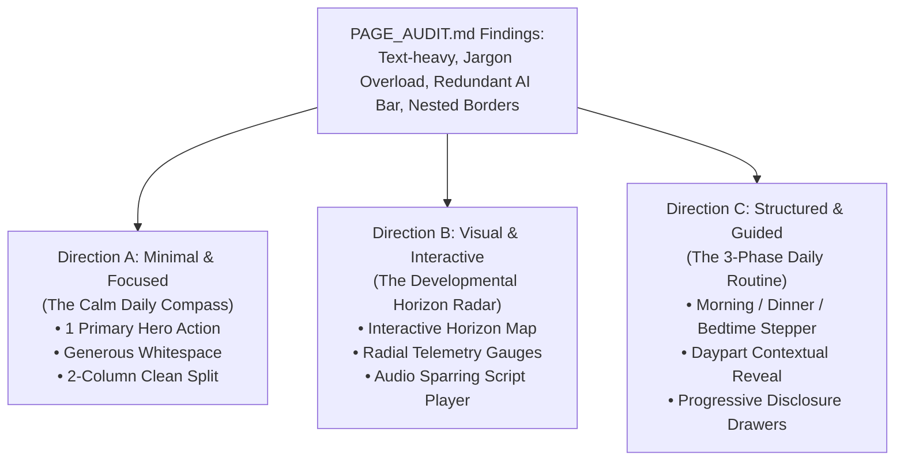

# AlongSide — Design Alternatives: Logged-In Home Dashboard
**Author:** Frontend Autonomous Systems Engineer  
**Task ID:** SOU-79 (Phase 2 — Page-Level UX Exploration & Design Alternatives)  
**Target Page:** Logged-In Home Page (`/dashboard`)  
**Design Identity:** **Taste 2: Editorial Pediatric Almanac** (Archival Linen `#FBFBF9`, Deep Spruce `#143D2B`, Newsreader Editorial Serif + Inter UI + JetBrains Mono)  
**Deliverable:** 3 Distinct Architectural Approaches  

---

## Strategic Design Overview

Following the comprehensive audit in [`PAGE_AUDIT.md`](./PAGE_AUDIT.md), we have developed **three distinct design alternatives** to transform the logged-in home dashboard from a text-heavy, fragmented control panel into a high-utility, calming parent sanctuary.

Each alternative adheres strictly to Alongside's approved brand tokens and typography while exploring fundamentally different information architectures, interaction models, and visual hierarchies:

---

## Direction A: Minimal & Focused (The Calm Daily Compass)

### 1. UX Philosophy & Core Concept
**"One primary anchor. Zero unnecessary noise."**
Parents frequently check AlongSide with less than two minutes between tasks. Direction A treats the dashboard as a **Calm Daily Compass**. It eliminates all nested borders, strips out academic jargon in favor of plainspoken empathy, and focuses 100% of the initial screen fold on the #1 tool parents need today: **Today's Word-for-Word Empathy Script**.

### 2. Information Architecture & Layout
- **Global Child Header Glance (Quiet Strip):**
  - Child avatar, name, age, active developmental stage, and a single status pill (`Readiness: 78%` or `Curfew: 8:30 PM Lock`).
  - No nested leap boxes, no duplicate badges.
- **Hero Anchor (100% Width): The Daily Dialogue Card:**
  - The relatable real-world friction scenario displayed clearly: *"When your tween feels excluded from a middle school group chat."*
  - The exact words to say highlighted in high-contrast editorial serif (`Newsreader`, 22px):
    > *“I hear how lonely and painful it feels when friends talk about a chat you can’t see. We protect your sleep because we love you. Let's look at the readiness checklist together.”*
  - Fast action buttons: **Copy Script**, **Listen (Audio)**, and an expandable toggle for **"Why this works with tween brain biology"** (progressive disclosure).
- **Secondary Grid (Clean 50/50 Balanced Split):**
  - **Left Pillar — Today's 3-Minute Micro-Lesson:**
    - Single Academy chapter card with an understated progress bar, estimated reading time (`3 min`), and direct "Read Lesson" CTA.
  - **Right Pillar — Today's Youth Culture & Dinner Starter:**
    - Slang of the week (`Crashout`), clean 3-point cringe rating, and one dinner conversation question to ask tonight.
- **Quiet Baseline Footer Dock:**
  - A subtle 1-line bar displaying hardware curfew status and quick link to pact settings.

### 3. Content Simplification & Reorganization
- **Removed:** Redundant static AI Advisor prompt box, 4 competing hero badges, inline 5-line biological descriptions, secondary slang pills that clutter the card.
- **Progressively Disclosed:** The "What NOT to say" and medical justifications are hidden behind an elegant "Show Neurobiology Why" toggle so parents see the positive action first.
- **Replaced:** Medical terminology (*"sensitizing neural reward circuits"*) replaced with plain empathetic coaching (*"Tween brains feel peer exclusion like physical pain"*).

### 4. Customer Experience Impact
- **Time-to-Value:** 3 seconds. The parent immediately sees what to say to their child today without scrolling.
- **Cognitive Load:** Minimal. Zero visual clutter, airy white space, clear focal hierarchy.

### 5. Trade-Offs
- **Advantages:** Fastest scanning speed, lowest cognitive friction, ideal for mobile devices, high emotional calm.
- **Disadvantages:** Less immediate visibility of deep platform features (e.g. secondary academy courses, health triage) until navigated to via top menu.

---

## Direction B: Visual & Interactive (The Developmental Horizon Radar)

### 1. UX Philosophy & Core Concept
**"See your child's developmental world visually, not through paragraphs."**
Instead of asking busy parents to read paragraphs of developmental milestones and curfew agreements, Direction B translates data into **engaging visual telemetry, interactive radar maps, and audio-first tools**.

### 2. Information Architecture & Layout
- **Top Interactive Strip: The Developmental Horizon Radar (Timeline Visualizer):**
  - An interactive horizontal node-based timeline showing the child's progress across 6 lifespan stages:
    `[Infant] ➔ [Toddler] ➔ [Early Childhood] ➔ [Middle Childhood] ➔ ● [Tween (Age 11)] ➔ [Teen] ➔ [Young Adult]`
  - Clicking any milestone node visually slides the active focus and displays that stage's key developmental challenge.
- **Split Telemetry Cockpit (7 cols / 5 cols):**
  - **Left (7 cols): The Interactive Voice & Script Studio:**
    - Visual "Audio Waveform Player" mockup allowing parents to listen to an empathetic pediatrician voice model reading the script.
    - Interactive "Adversarial Reaction vs. Connected Co-Regulation" toggle slider demonstrating the neurological difference.
    - Direct "Launch Voice Sparring Simulator" button with live microphone indicator.
  - **Right (5 cols): The Family Status Radar & Culture Pulse:**
    - **Visual Circular Progress Gauge (Radial Score):** A beautiful SVG ring displaying First-Phone Readiness (`78/100`) broken into 4 colored quadrant arcs: *Sleep Hygiene, Social Impulse, Online Safety, Emotional Regulation*.
    - **Interactive Slang Decoder Card:** A visual "Cringe Meter" (flame icons + danger level) with interactive flip-card revealing the secret app exploit alert.
- **Bottom Full-Width Strip: Course Learning Horizon:**
  - Visual chapter cards with icon badges and interactive completion checkboxes.

### 3. Content Simplification & Reorganization
- **Visualized:** The text-based 78/100 readiness score is replaced with an interactive radial breakdown.
- **Transformed:** The static script is transformed into an interactive audio-visual practice module with a toggle between destructive vs. connected phrasing.
- **Interactive:** Slang and culture warnings use interactive flip-cards rather than dense text boxes.

### 4. Customer Experience Impact
- **Engagement:** High. Parents feel like they have a modern, high-tech instrument panel for family upbringing.
- **Retention:** Visual progress bars and interactive gauges give parents a sense of tangible progress and gamified growth.

### 5. Trade-Offs
- **Advantages:** Highly engaging, replaces text fatigue with visual models, provides interactive micro-actions (audio, dials, sliders), appeals to tech-forward parents.
- **Disadvantages:** Higher visual density than Direction A; requires deliberate visual hierarchy so the gauges do not feel overwhelming.

---

## Direction C: Structured & Guided (The 3-Phase Daily Routine)

### 1. UX Philosophy & Core Concept
**"Guided parenting synchronized with the rhythm of your family's day."**
Parenting does not happen in a vacuum—it moves through daily rituals: **Morning Preparation**, **After-School Connection**, and **Evening Wind-Down**. Direction C organizes the dashboard into an intuitive, time-of-day guided journey that automatically surfaces the right advice at the right hour.

### 2. Information Architecture & Layout
- **Contextual Daypart Stepper (Top Navigation Bar):**
  - Three distinct interactive tabs with live time indicator:
    - 🌅 **Phase 1: Morning Mindset** (Active 6:00 AM – 11:59 AM)
    - 🌆 **Phase 2: After-School & Dinner Pulse** (Active 12:00 PM – 6:59 PM)
    - 🌙 **Phase 3: Evening Dock & Bedtime Calm** (Active 7:00 PM – 11:59 PM)
  - Parents can click any tab to jump forward or backward in their day's routine, or let the app highlight the active time automatically.
- **Phase-Specific Focused Content Cards:**
  - **If Morning Mindset Selected:**
    - Surfaces the **3-Minute Academy Micro-Lesson**: Morning parenting neurobiology booster.
    - Quick habit checklist: "Set intention for calm responses before school drop-off."
  - **If After-School & Dinner Selected:**
    - Surfaces **Today's Youth Culture & Dinner Starter**: The slang word of the day (`Crashout`) + The dinner conversation starter question.
    - The **Daily Empathy Script** for after-school phone/friend friction.
  - **If Evening Dock Selected:**
    - Surfaces the **Bedtime Curfew & Device Dock Status**: Hardware curfew lock countdown (`8:30 PM Lock in 1h 45m`).
    - The bedtime blue-light negotiation script.
- **Progressive Disclosure Accordions:**
  - Deep scientific citations, AAP guidelines, and neurobiology explanations are nested within collapsible accordions labeled *"Why this works: Pediatric Clinical Science"*.
- **Persistent Bottom Bar: Quick Switcher:**
  - Quick-switch between children with individual daily routine progress checkmarks (e.g. `Maya: 2/3 complete`, `Leo: 1/3 complete`).

### 3. Content Simplification & Reorganization
- **Chunked by Time:** Instead of presenting all 6 domain areas at once, the dashboard chunks content into three bite-sized chapters matching real parent schedules.
- **Accordionized:** Detailed background text is hidden until explicitly requested.
- **Sequential:** Parents are guided through a clear, achievable 3-step daily routine.

### 4. Customer Experience Impact
- **Cognitive Load:** Ultra-low per view, because only 1 of the 3 phases is prominently expanded at any moment.
- **Routine Building:** Builds a daily habit of opening AlongSide in the morning, at dinner, and at bedtime.

### 5. Trade-Offs
- **Advantages:** Eliminates information overload by 66% on any single view; deeply intuitive for routine-oriented parents; creates natural morning and evening engagement loops.
- **Disadvantages:** Hides evening device data when on the morning tab unless the user clicks the tab; requires an active click to browse across the full day.

---

## Summary Comparison Matrix of Directions

| Dimension | Direction A: Minimal & Focused | Direction B: Visual & Interactive | Direction C: Structured & Guided |
| :--- | :--- | :--- | :--- |
| **Primary Focal Point** | Today's Word-for-Word Empathy Script | Interactive Developmental Horizon Radar & Gauges | Contextual 3-Phase Daily Routine (Morning/Dinner/Night) |
| **Reading Burden** | Low (Concise, high-impact typography) | Very Low (Visual diagrams, dials, audio cards) | Low-Medium (Chunked into 3 focused phase views) |
| **Information Density** | Clean & Spacious (Minimalist) | Rich & Visual (Telemetry Dashboard) | Modular & Sequential (Accordion-based) |
| **Interactive Mechanisms** | Copy button, Audio toggle, Science drawer | Timeline node picker, Radial arc gauge, Audio player | Daypart tab switcher, Habit checklist, Expandable drawers |
| **Mobile UX** | Superior (zero scroll needed for primary script) | High (compact interactive visual cards) | Excellent (vertical accordions match mobile habits) |
| **Brand Alignment** | 100% (Taste 2 Editorial Almanac) | 100% (Taste 2 + Modern Vercel Telemetry) | 100% (Taste 2 + Pediatric Routine Structure) |

All three directions will be brought to life as fully interactive, responsive standalone prototypes in `design-explorations/sou-79-loggedin-home/`.
