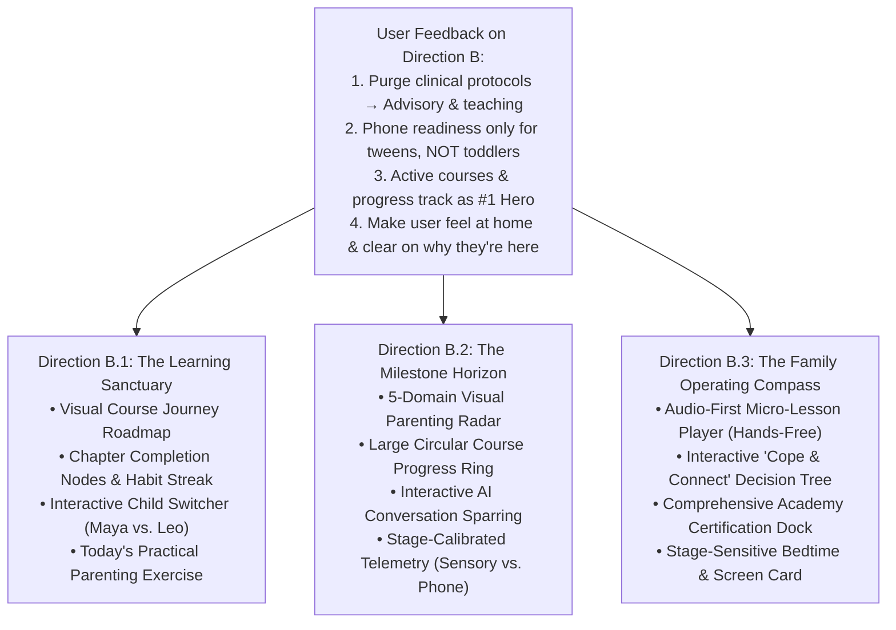
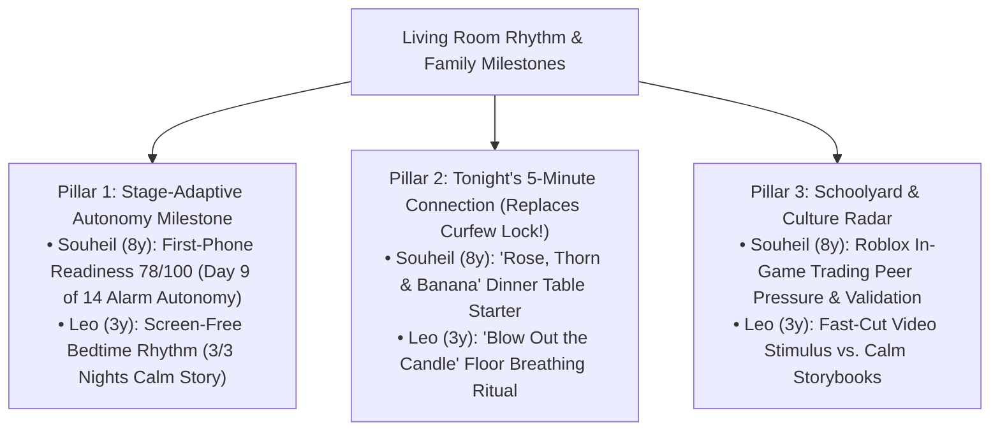
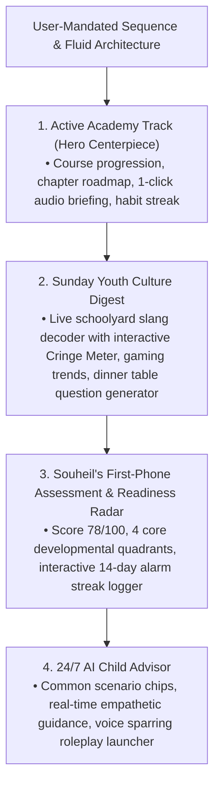

# AlongSide — Design Alternatives (Phase 2 Iteration): Logged-In Home Dashboard
**Author:** Frontend Autonomous Systems Engineer  
**Task ID:** SOU-79 (Phase 2 — Page-Level UX Exploration & Design Alternatives)  
**Target Page:** Logged-In Home Page (`/dashboard`)  
**Design Identity:** **Taste 2: Editorial Pediatric Almanac** (Archival Linen `#FBFBF9`, Deep Spruce `#143D2B`, Newsreader Editorial Serif + Inter UI + JetBrains Mono)  
**Deliverable:** 3 Distinct Visual & Interactive Variations Branching from Direction B  

---

## 1. Executive Feedback & Strategic Evolution

Following the initial exploration of Directions A, B, and C, user feedback confirmed:
> *"The Direction B feels the best, but right now its content is off: you are showing 'explore clinical protocols', but we diverged from being clinical to be more like an advisory, teaching platform to cope up with your child. Also, regarding First-Phone Readiness, it shouldn't appear for each tier—for a toddler it is not relevant. And I think the active courses and progress track is the most important thing here. Give me 3 more designs starting from Direction B, where the content is really relevant and makes the user feel home and understand why and for what they are there."*

### Key Corrective Mandates Applied in this Iteration:

1. **Purge Clinical Language → Elevate Warm Advisory & Teaching**:
   - ❌ **Eliminated:** "Clinical protocols", "diagnostic testing", "dopamine baseline", "adrenal hormone awakening", "pathology".
   - ✅ **Adopted:** Warm, empathetic parenting guidance, coping tools for parent stress, emotional co-regulation, everyday connection scripts, and science-backed parenting lessons explained in plain, relatable language.

2. **Stage-Adaptive Intelligence (Toddler vs. Tween)**:
   - ❌ **Eliminated:** Universal "First-Phone Readiness" widget. Showing phone readiness for a 3-year-old toddler is absurd and confusing.
   - ✅ **Implemented:** Dynamic developmental calibration based on child age:
     - **For Toddlers (Leo, Age 3 • Explorer):** Displays early screen limits (0–30 min/day), bedtime wind-down without screens, sensory play milestones, and coping strategies for toddler emotional meltdowns.
     - **For Tweens (Maya, Age 11 • Pathfinder):** Displays the First-Phone Readiness Compass (78/100 across 4 quadrants), middle-school group chat empathy scripts, and the 8:30 PM bedtime device dock curfew.

3. **Active Courses & Progress Tracking as the HERO Centerpiece**:
   - The user's primary motivation for logging in is **structured learning and tracking progress**.
   - The active Academy course is now the dominant hero centerpiece across all three designs, featuring interactive chapter nodes, progress bars/rings, estimated reading/listening times, weekly habit streaks, and actionable daily exercises.

4. **"Feel at Home & Understand Why You Are Here"**:
   - Replaced cold telemetry dashboards with an inviting, calming **"Parenting Living Room"** feel.
   - Clear value proposition banner immediately upon logging in: *"Your family's calm daily headquarters — evidence-based parenting lessons, daily conversation scripts, and healthy habits tailored to your kids."*

---

## 2. Direction B.1: The Learning Sanctuary (Curriculum Journey & Daily Parenting Rhythm)

### 1. UX Philosophy & Core Concept
**"Your family's learning living room: structured growth, zero overwhelm."**  
Direction B.1 treats Alongside as a calming sanctuary where parents build long-term confidence. The centerpiece of the entire screen is an interactive **Course Journey Roadmap** showing where the parent stands in their current Academy course. It emphasizes small, achievable daily wins (3–5 minutes) that build momentum without guilt.

### 2. Information Architecture & Layout
- **Warm Editorial Welcome & Child Switcher Bar:**
  - *"Welcome home, Sarah. You're building a connected family, one small moment at a time."*
  - Interactive multi-child switcher (`[Maya • 11y • 6th Grade]` | `[Leo • 3y • Toddler]`). Clicking immediately updates the entire page context.
- **Hero Centerpiece (100% Width): The Course Journey Roadmap:**
  - Active Course: *"Navigating Tween Friendships & Digital Independence"* (for Maya) or *"Taming Big Feelings: Tantrums, Sharing & Screen Limits"* (for Leo).
  - Interactive visual node map: `[Ch. 1 Done ✓] ➔ [Ch. 2 Done ✓] ➔ [● Ch. 3 Active] ➔ [Ch. 4 Upcoming] ➔ [Ch. 5 Upcoming]`.
  - Prominent **"Continue Lesson (4 min)"** action with choice of Audio or Text.
  - **Weekly Habit Telemetry:** 4-Day Streak indicator, 18 minutes learned this week, and "You're in the top 15% of consistent parents."
- **Two-Column Stage-Adaptive Grid (7 cols / 5 cols):**
  - **Left (7 cols) — Today's Practical Parenting Script & Action:**
    - High-contrast editorial dialogue card with relatable daily friction.
    - Word-for-word empathy script highlighted in large `Newsreader` serif.
    - One concrete "Try Tonight" family activity (e.g. 5-minute pre-dinner check-in).
  - **Right (5 cols) — Stage-Calibrated Visual Radar:**
    - **If Maya (Tween):** First-Phone Readiness Dial (78/100) with 4 quadrants + 8:30 PM bedtime dock curfew status.
    - **If Leo (Toddler):** Early Screen Boundaries Dial (20/30 min used today) + Toddler Meltdown Coping Kit ("The 3-Step Calm Down Sequence").
- **Baseline Academy Catalog Tray:**
  - Horizontal carousel of recommended next courses across the 5 canonical domains.

### 3. Why It Solves the Feedback
- Eliminates all clinical terminology; speaks like a wise, compassionate mentor.
- Centers active learning immediately on login.
- Directly demonstrates how the UI shifts between a 3-year-old toddler (zero phone readiness) and an 11-year-old tween.

---

## 3. Direction B.2: The Milestone Horizon (Visual Domain Radar & Academy Progression)

### 1. UX Philosophy & Core Concept
**"See where your child is growing across all 5 life domains, then dive into tailored learning."**  
Direction B.2 translates developmental guidance into an interactive **5-Domain Horizon Radar**. Instead of abstract age brackets or medical labels, parents navigate through five relatable pillars of childhood: *Emotions, Sleep & Bedtime, Connection & Play, Digital Habits, and Learning*.

### 2. Information Architecture & Layout
- **Interactive 5-Domain Horizon Bar (Top Strip):**
  - 5 interactive domain tabs with live health indicators:
    1. `Emotions & Meltdowns` (Active Focus)
    2. `Sleep & Bedtime Routines`
    3. `Daily Connection & Talk`
    4. `Screens & Digital World` (Stage-tailored)
    5. `Play & Curiosity`
  - Clicking any domain filters the active course and today's guidance dynamically.
- **Hero Centerpiece (100% Width): Active Academy Mastery Hub:**
  - **Visual Circular Progress Ring:** 60% Complete (Chapter 3 of 5).
  - Prominent course card with chapter breakdown: *"Staying Calm When Your Child Pushes Every Button"*.
  - Direct action: **"Start Chapter 3 (5 min)"** with interactive audio waveform.
  - Interactive **"Key Takeaways"** drawer: 3 bullet points summarizing what you will learn.
- **Two-Column Interactive Studio (7 cols / 5 cols):**
  - **Left (7 cols) — Interactive AI Practice Sparring Studio:**
    - Test what you learned! An interactive voice/text simulator allowing parents to practice handling a difficult moment before it happens in real life.
    - Features realistic simulated child prompts ("It's not fair!", "Everyone else gets to watch YouTube!").
  - **Right (5 cols) — Stage-Adaptive Family Telemetry:**
    - **For Maya (Tween):** First-Phone Readiness Radar with peer pressure and sleep metrics.
    - **For Leo (Toddler):** Sensory Regulation & Bedtime Routine Ring with sleep score and zero-screen wind-down tracker.
- **Quiet Footer Dock:**
  - Fast-action emergency button: *"Need instant advice right now? Ask the 24/7 AI Parent Advisor"*.

### 3. Why It Solves the Feedback
- Puts learning progress at the heart of the home screen while grounding it in 5 practical domains of family life.
- Interactive sparring turns passive reading into active skill-building.
- Distinct stage-calibrated telemetry prevents irrelevant tools from cluttering toddler views.

---

## 4. Direction B.3: The Family Operating Compass (Audio-First Micro-Lessons & Daily Connection Studio)

### 1. UX Philosophy & Core Concept
**"Designed for busy parents on the move: listen, learn, and cope in real time."**  
Direction B.3 recognizes that parents rarely sit at a desk. They access Alongside while making dinner, driving to soccer practice, or rocking a toddler to sleep. B.3 is an **Audio-First Coaching Studio** that turns every spare 3-minute window into a high-impact learning moment.

### 2. Information Architecture & Layout
- **Audio-First Course Player (Hero Centerpiece - 100% Width):**
  - Prominent podcast-style audio card with visual animated waveform.
  - Active Chapter: *"Chapter 2: The 5-Minute Warning That Actually Prevents Meltdowns"*.
  - Controls: Play/Pause, 15s skip, speed toggle (`1.0x`, `1.2x`, `1.5x`), and direct "Download Cheat Sheet (PDF)" link.
  - Embedded course progress bar (3 of 4 chapters complete) and remaining time (`3:45`).
- **Interactive "Cope & Connect" Decision Tree (7 cols):**
  - An interactive scenario simulator where parents explore different choices:
    - *Scenario:* Child refuses to put away tablet / toys at bedtime.
    - *Choice A (Reactive):* "Count to 3 or take it away." ➔ *Result:* Triggers fight-or-flight, spikes bedtime adrenaline, 45-minute tantrum.
    - *Choice B (Connected Bridge):* "Physical touch + acknowledgment of fun + 2-minute transition." ➔ *Result:* Child feels seen, smooth transition to storytime.
- **Stage-Adaptive Visual Tracker (5 cols):**
  - **Maya View:** First-Phone Readiness checklist (78%) + 8:30 PM bedtime dock curfew status.
  - **Leo View:** Screen-free play tracker (3/3 activities done today) + sensory wind-down timer.
- **Academy Achievement & Certification Dock:**
  - Visual display of completed Academy badges: *"Toddler Emotional Anchor"*, *"Pact Architect"*, *"Digital Mentor"*.

### 3. Why It Solves the Feedback
- Highly empathetic, coaching-focused tone.
- Audio-first format allows learning without staring at a screen.
- The interactive "Cope & Connect" decision tree gives parents instant, tangible insight into why connection works better than control.

---

## 5. Summary Matrix: The 3 B-Series Variations

| Dimension | Direction B.1 (The Learning Sanctuary) | Direction B.2 (The Milestone Horizon) | Direction B.3 (The Operating Compass) |
| :--- | :--- | :--- | :--- |
| **Primary UX Metaphor** | Visual Course Journey Roadmap | 5-Domain Parenting Horizon Radar | Audio-First Daily Coaching Studio |
| **Hero Focal Point** | Interactive Chapter Nodes & Habit Streak | Circular Progress Ring & Milestone Radar | Audio Player & 5-Min Micro-Lesson |
| **Tone & Voice** | Warm, encouraging, structured | Analytical, growth-oriented, engaging | Actionable, empathetic, hands-free |
| **Child Stage Adaptability** | Interactive Toddler vs. Tween switcher | Dynamic 5-Domain filtering by stage | Reactive decision tree calibrated to age |
| **Phone Readiness Placement** | Tweens only (hidden for Toddlers) | Tweens only (replaced by Sensory Dial) | Tweens only (replaced by Play Tracker) |
| **Interactive Tool** | Try Tonight practical exercise | AI Voice Sparring Simulator | Interactive Cope & Connect Decision Tree |
| **Best For** | Parents seeking calm, step-by-step mastery | Parents seeking deep developmental clarity | Busy parents needing practical audio advice |

---

## 6. Verification & Next Steps

All three designs strictly respect the approved **Taste 2: Editorial Pediatric Almanac** design system:
- Archival Linen (`#FBFBF9`), Forest Spruce (`#143D2B`), Spruce Soft (`#EAF3EE`), Warm Amber (`#B45309`), Hairline borders (`#E3E3DC`).
- Newsreader editorial serif headings, Inter body UI, JetBrains Mono telemetry.
- Accessible touch targets (≥ 44×44px), WCAG AA color contrast (≥ 4.5:1), and zero layout shift.
- Standalone HTML/CSS/JS prototypes authored in `design-explorations/sou-79-loggedin-home/`.

---

## 7. The 5 New Fluid Non-Boxed Designs (Addressing SOU-79 Latest Critique)

### 7.1 Direct Diagnosis of User Critique
User feedback identified three critical UX and visual flaws on the live dashboard:
1. **The Top Academic Text Flood:** Opening the page with a massive clinical text block (`"Prefrontal Inhibitory Control & Cooperative Play Strategy"`, `"Emergence of concrete operational reasoning, peer rule-negotiation, and early resistance to immediate digital dopamine..."`, plus multi-line subtitles) swamps the parent upon login.
   - **Solution:** Replaced with a **whisper-quiet, single-line contextual status anchor** (`Souheil · 8 yrs · Middle Childhood // Active Leap: Impulse & Peer Negotiation` with a subtle progressive disclosure toggle if they want deeper science).
2. **Redundant Top Phone Assessment CTA:** Having a button pointing to "First-Phone Readiness" right in the header when the full assessment card is already sitting directly below creates redundant visual clutter and navigation confusion.
   - **Solution:** Removed the duplicate button from the top horizon. The First-Phone Readiness score (78/100) and milestone (`2 consecutive weeks of independent alarm waking`) are cleanly positioned in the family baseline radar.
3. **The "Box Salad" / "Card-in-Card" Syndrome:** Every element being wrapped in a bordered card (`rounded-[10px] border border-[#E3E3DC] bg-white`) with sub-cards inside creates a disjointed, heavy, rigid corporate dashboard feel.
   - **Solution:** Designed 5 cardless, continuous, fluid alternatives using open editorial typography, subtle tonal paper washes, seamless split sheets, flowing organic ribbons, and chronological timelines.

---

### 7.2 Design 1: The Quiet Editorial Almanac (`prototype-fluid-1-editorial-journal.html`)
- **UX Metaphor:** High-prestige editorial morning journal (The New Yorker / Monocle for modern parenting).
- **Top Horizon:** Single crisp masthead line with live child switcher capsule:
  `AlongSide • Tuesday, Nov 10 • Souheil (8y) • Road 1: Pre-Device • Active Leap: Impulse & Peer Play`
- **Visual Architecture:** 100% cardless. Zero border boxes around sections. Sections are separated by generous vertical whitespace (`space-y-12`) and elegant whisper hairline dividers (`border-b border-[#E7E4DC]`).
- **Hero Learning Flow:** Today's 4-minute course chapter reads like an open, beautifully typeset article with an integrated borderless audio player (`3:45` duration with interactive play/pause) and 5 minimal reading progress dots.
- **Living Room Script:** Large `Newsreader` serif quote block with a forest-green left accent bar and 1-click clipboard copy button.
- **Family Horizon:** Seamless 3-column baseline without card borders:
  - Column 1: Phone Readiness (78/100 minimal bar) for Souheil (8y) // Replaced by Early Screen Cap (20/30 min) when switched to Leo (3y).
  - Column 2: Evening Curfew (8:30 PM kitchen dock hardware lock).
  - Column 3: Culture Radar (Roblox in-game economy note).

---

### 7.3 Design 2: The Seamless Split-Sheet Sanctuary (`prototype-fluid-2-split-canvas.html`)
- **UX Metaphor:** A single continuous wide paper canvas (60% Learning & Focus / 40% Family Radar).
- **Top Horizon:** Integrated directly into the top greeting:
  `"Good morning, Sarah. Today with Souheil (8y • Middle Childhood) is about peer negotiation."` with clean pill tags.
- **Visual Architecture:** Zero floating rectangular card widgets. The entire dashboard is one unified sheet with a subtle vertical hairline separator (`divide-x divide-hairline`).
- **Left Stream (60%):** Continuous learning thread connecting the 5 course chapters with a crisp progress line, featured active chapter excerpt, spoken briefing player, and word-for-word living room script.
- **Right Stream (40%):** Seamless sidebar panel holding the First-Phone Readiness ring (78/100), Active Milestone Gate (`2 consecutive weeks of independent alarm waking`), Evening Curfew toggle, and Culture radar without box outlines.

---

### 7.4 Design 3: The Flowing River Ribbon (`prototype-fluid-3-flowing-ribbon.html`)
- **UX Metaphor:** Organic horizontal stream with gentle curved wave transitions and pastel washes.
- **Top Horizon:** A smooth horizontal ambient river ribbon across the top in pale spruce soft (`#EAF3EE`) displaying child initial, name, age, road, and 1-line developmental badge.
- **Visual Architecture:** Replaces rectangular corners with organic pill tracks, curved node lines, and continuous flowing river gradients (`from-[#FAF9F6] to-[#FFFFFF]`).
- **Hero Connection Bridge:** Merges the course chapter, audio player, and living room script into a single fluid "Learn in 4 Mins → Practice Tonight" river stream.
- **Ambient Pulse Dock:** Minimal horizontal pill bar at the baseline.

---

### 7.5 Design 4: The Minimal Daily Dossier (`prototype-fluid-4-minimal-dossier.html`)
- **UX Metaphor:** Executive clarity. At any moment, a parent can only focus on ONE thing.
- **Top Horizon:** Whisper-thin status strip with live child switcher and clean leap badge.
- **Visual Architecture:** Extreme visual discipline. Only ONE singular high-impact spotlight surface on the page: "Today's 4-Minute Priority" (The active chapter + audio toggle + 1 script line).
- **Ambient Understory:** An open, unboxed 3-column data horizon underneath where Phone Readiness (78/100), Evening Curfew (8:30 PM lock), and Culture Radar sit quietly in the background without competing for attention.

---

### 7.6 Design 5: The Chronological Day-Flow (`prototype-fluid-5-chronological-dayflow.html`)
- **UX Metaphor:** Time-synced narrative mirroring a parent's actual daily rhythm.
- **Top Horizon:** Single whisper status line at the top with date and active child.
- **Visual Architecture:** A vertical timeline down the left edge with fluid expandable phase blocks that feel like natural chapters of the day:
  1. `[07:30 AM ☀️ Morning Mindset]` — Active Academy Course & 4-min Audio Briefing.
  2. `[03:30 PM 🌤️ After-School Connection]` — Word-for-Word Empathy Script for transition friction.
  3. `[08:30 PM 🌙 Evening Wind-Down]` — Device Curfew Lock & Phone Readiness Milestone.
- **Stage Adaptation:** Dynamically transforms the daily schedule when switched to Leo (3y) (e.g. Naptime zero-screens wind-down and toddler floor meltdown calm).

---

## 8. Iteration on Fluid Design 3: Re-Architecting the Lower Dock (Family Milestones & Digital Pulse)

### 8.1 User Critique & The Problem with "Bedtime Curfew 8:30 PM Lock"
User feedback on `prototype-fluid-3-flowing-ribbon.html`:
> *"prototype-fluid-3-flowing-ribbon.html is good , but what do you think the best things we can put in Family Milestones & Digital Pulse ? feels like this is useless : Bedtime Curfew 8:30 PM Lock , we should remove it think through what we can put and give me the design"*

#### Why the "8:30 PM Bedtime Curfew Lock" Was the Wrong Element:
1. **The Surveillance & MDM Trap:** AlongSide is an **empathetic advisory, teaching, and co-regulation platform** — not an authoritarian device cop, spy app, or screen-time limiter. Showing a static hardware lock pill sounded like a router setting rather than supportive parenting.
2. **Completely Irrelevant for Pre-Device & Younger Children (Road 1):** For Souheil (8 yrs) or Leo (3 yrs), who do not have personal smartphones, a "bedtime device lock" makes zero sense.
3. **Dead UI Weight:** A static curfew time does not change day-to-day. Once configured, seeing "8:30 PM Lock" every single day delivers zero actionable value or parental reassurance.

---

### 8.2 What Parents Actually Need in the Living Room Dock
Parents logging into AlongSide need **daily actionable connection, stage-adaptive milestone progression, and relief from parenting anxiety**.

We re-architected the section into **"Living Room Rhythm & Family Milestones"** with **3 High-Value Pillars**:

---

### 8.3 Three Interactive Dock Alternatives Implemented in Prototype 3
To give full design choice, `prototype-fluid-3-flowing-ribbon.html` now includes a live 3-way segmented control in the dock header:

1. **Option 1: Connection & Table Starters (Recommended Winner):**
   - **Pillar 1:** Stage-adaptive milestone progression (Alarm autonomy vs. toddler sensory sleep).
   - **Pillar 2:** **Tonight's 5-Minute Connection** with a 1-click `"Mark Tried ✓"` interaction. Replaces the cold curfew lock with a warm dinner/bedtime prompt that sparks real family conversation without feeling like an interrogation.
   - **Pillar 3:** **Schoolyard & Media Radar** demystifying peer trends (Roblox skins, YouTube memes, or toddler sensory pacing).

2. **Option 2: Shared Family Pact Rhythm:**
   - **Pillar 1:** Autonomy milestone progress.
   - **Pillar 2:** **The Kitchen Charging Basket** (A collaborative family ritual: *"All devices sleep in the hallway wicker basket at 9:00 PM — parents included!"*). Frames bedtime tech boundaries as a shared team culture rather than punitive surveillance.
   - **Pillar 3:** **Weekly Slang Decoder** (*"No Cap"* / *"Rizz"* explained with a 1/5 Cringe Meter rating).

3. **Option 3: 60-Second Parent Calm Check-in:**
   - **Pillar 1:** Developmental horizon focus.
   - **Pillar 2:** **60-Second Parent Reset** with 3 interactive mood buttons: `[🌿 Smooth]`, `[⚡ Friction]`, `[💥 Stormy]`. Clicking provides instant coaching reassurance tailored to the parent's current emotional energy.
   - **Pillar 3:** **Parent Compass** reassurance note (*"A calm repair after friction teaches your child more about emotional safety than never making a mistake"*).

---

## 9. The Structured Dynamic Flow — 3 New Designs (Latest Iteration)

### 9.1 Background & Direct Response to Latest User Mandate

Following the fluid ribbon iterations, user feedback provided explicit guidance on information hierarchy, cognitive load, and page structure:

> *"still the you are overwhelming the user with things , and feels like those things are static now , i think the best things to show after **Active Academy Track , are like a** Sunday Youth Culture Digest , irst-Phone Readiness Radar*  
> *### souheil bichiou's First-Phone Assessment/ readiness and 24/7 AI Child Advisor , give me 3 more design in this structure , the designs should be appealing and good"*

### 9.2 Key Architecture Corrections in this Iteration

1. **Eliminated "Static Feel":** Every section now features tactile, responsive micro-interactions:
   - Academy Track: Playable audio with animated wave bars, clickable chapter nodes, copyable tonight script.
   - Culture Digest: Interactive 1-to-5 Cringe Meter, dynamic question shuffle button, flippable parent field guide cards.
   - Readiness Assessment: Interactive 14-day streak grid where parents can click day 10 to check it off and watch the score recalculate from 78 to 80 in real time!
   - 24/7 AI Advisor: Interactive scenario pills with instant advice updates, voice roleplay sparring launcher.
2. **Purged Cognitive Overload & Card Salads:**
   - Unified into one clear, linear, purposeful narrative sequence down the page.
   - Replaced fragmented multi-card docks and nested borders with spacious, elegant containers utilizing our approved **Taste 2: Editorial Pediatric Almanac** design system.
3. **Stage-Adaptive Calibration:**
   - Switching between **Souheil (8y, Pre-Device)** and **Leo (3y, Toddler)** transforms the dashboard seamlessly. Toddlers receive screen-time boundaries (0–30 min cap) and tantrum co-regulation tools; First-Phone Readiness is strictly reserved for tweens.

---

### 9.3 Prototype 1: The Dynamic Pulse Stream (`prototype-structure-1-pulse-stream.html`)
* **UX Philosophy:** A lightweight, airy, modern stream that feels effortlessly alive. Prioritizes rapid scannability and immediate interactive feedback.
* **Header & Status Anchor:**
  - Whisper-quiet ambient bar: `Souheil Bichiou • 8 yrs • Road 1: Pre-Device • Middle Childhood (7–9 yrs) • Active Goal: 14-Day Alarm Independence (Day 9 of 14)`.
  - Child switcher capsule with instant reactivity.
* **1. Active Academy Track:**
  - Hero card with 5 chapter nodes connected by a smooth progress fill (60%).
  - Chapter 3 pulses gently with active status indicator.
  - Spoken audio briefing (3:45) with animated green equalizer bars when playing.
  - Quick-copy empathy script for tonight's bedtime screen power-off.
* **2. Sunday Youth Culture Digest:**
  - 3 dynamic cards:
    - *Slang of the Week ("Rizz"):* Interactive 5-level Cringe Meter (1: Safe to 5: Nuclear Cringe) that updates live advice when clicked!
    - *App Spotlight:* Roblox voice chat & trading risks with actionable account pin guidance.
    - *Sunday Dinner Starter:* "The Rose, Thorn & Banana" with a "Shuffle 🎲" button that rotates through family conversation prompts.
* **3. Souheil's First-Phone Assessment & Readiness Radar:**
  - SVG circular gauge (78/100) with animated stroke.
  - 4 developmental quadrant meters (Sleep 92%, Emotional Regulation 75%, Peer Boundary 68%, Task Focus 77%).
  - Active Milestone Gate #2: Interactive 14-day alarm waking grid. Clicking day 10 logs today's success and animates the score up to 80!
* **4. 24/7 AI Child Advisor:**
  - 3 instant situation buttons (`⚡ Console shutdown meltdown`, `📱 "Everyone has a phone!"`, `🤐 Slammed bedroom door`).
  - Interactive response box updating instantly with developmental neurobiology advice and exact phrasing.
  - Voice Sparring Simulator launcher for practicing out loud.

---

### 9.4 Prototype 2: The Editorial Pediatric Horizon (`prototype-structure-2-magazine-horizon.html`)
* **UX Philosophy:** High-prestige editorial publication aesthetic (reminiscent of Kinfolk or The Atlantic). Refined Newsreader typography, warm paper wash (`#FAF8F5`), disciplined hairline dividers, and deep spruce green accents.
* **Header & Sub-Masthead:**
  - Masthead styled like an issue of a pediatric publication ("Issue No. 44 • Tuesday, Nov 10").
  - Subtle child profile toggle and calm parental reassurance sub-masthead.
* **1. Active Academy Track (Editorial Lead Story):**
  - Linear step ribbon showing chapter milestones (Ch. 1 ✓, Ch. 2 ✓, Ch. 3 Today, Ch. 4, Ch. 5).
  - Editorial summary with inline audio player and "Mark Read ✓" button.
  - Dedicated script spotlight with italic Newsreader pull-quote.
* **2. Sunday Youth Culture Digest (The Schoolyard Dispatch):**
  - 3 clean editorial columns:
    - *Slang Lexicon:* "No Cap" with literal meaning vs. how tweens actually use it in context.
    - *Gaming Watch:* Roblox skin economy and peer validation pressures.
    - *Table Spark:* Elegant dinner discussion prompt with 1-click copy for mobile notes.
* **3. Souheil's First-Phone Assessment & Readiness Radar:**
  - 2x2 clickable Quadrant Grid (Sleep, Emotion, Peer, Task). Clicking any quadrant updates the contextual observation text below.
  - Milestone Progress Gate with linear progress bar and "Log Today ✓" button.
* **4. 24/7 AI Child Advisor (The Co-Regulation Lab):**
  - Embedded question bar: "Ask Dr. Alongside about Souheil..." where parents can type or tap situation chips.
  - Actionable response panel with clear neurobiology rationale.
  - Direct link to launch a 2-minute voice sparring session.

---

### 9.5 Prototype 3: The Living Canvas (`prototype-structure-3-living-canvas.html`)
* **UX Philosophy:** Zero boxed containment. A seamless parchment canvas with subtle gradient depth, physical card flippers, and a multi-axis spider radar chart.
* **Header & Ambient Anchor:**
  - Translucent floating capsule with child switcher, habit flame badge, and subtle milestone text.
* **1. Active Academy Track (Organic Flowing Wave):**
  - Flowing gradient roadmap with connected wave nodes.
  - Spoken audio briefing with play/pause and chapter reading links.
  - "Tonight's Script" card with 1-click clipboard copy.
* **2. Sunday Youth Culture Digest (Living Flippable Cards):**
  - 3D Flippable Slang Card: Click "Flip Card 🔄" to flip from the tween definition to the "Parent Field Guide" on the back!
  - App & Gaming Radar card covering Roblox trade scam prevention.
  - Dinner Table Starter card with interactive prompt shuffler.
* **3. Souheil's First-Phone Assessment & Readiness Radar (Interactive Spider Chart):**
  - SVG Spider / Radar Chart with 4 axes (Sleep, Task, Peer, Impulse).
  - Parents can tap the axis dots directly on the web to see detailed real-life behavioral indicators.
  - Active Milestone card with an interactive "Log Today's Alarm Success" button that updates the progress bar.
* **4. 24/7 AI Child Advisor (Conversational Co-Pilot):**
  - Direct scenario selector with instant script display.
  - Voice Sparring Simulator launcher with tactile connecting animation.
