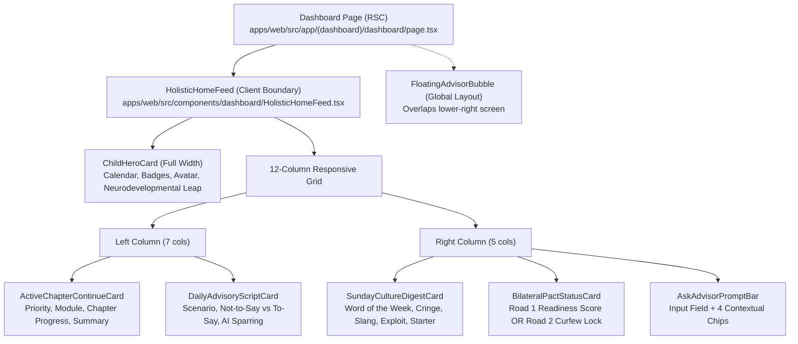

# AlongSide — Comprehensive UX/UI Audit: Logged-In Home Dashboard
**Author:** Frontend Autonomous Systems Engineer  
**Task ID:** SOU-79 (Phase 2 — Page-Level UX Exploration & Design Alternatives)  
**Target Page:** Logged-In Home Page (`/dashboard` • `apps/web/src/app/(dashboard)/dashboard/page.tsx`)  
**Design Standard:** Approved Direction: **Taste 2: Editorial Pediatric Almanac** (`design-system/alongside/MASTER.md`)  
**Status:** Audit Complete — Pending Direction Approval  

---

## Executive Summary & Problem Statement

AlongSide's mission is to be the **Parent Advisory Sanctuary**—an empathetic platform replacing parent-child screen friction with calm developmental science, bilateral family pacts, and age-calibrated coaching.

The current logged-in dashboard (`apps/web/src/components/dashboard/HolisticHomeFeed.tsx`) has rich, scientifically grounded features. However, **the page currently overwhelms general consumers with academic jargon, nested card borders, redundant AI input widgets, and competing calls-to-action**. 

Parents arrive at AlongSide in quick, often stressed 2- to 3-minute windows—between preparing breakfast, carpooling, or de-escalating evening screen battles. Instead of providing instant, calming clarity, the current dashboard reads like an academic neuroscience textbook combined with an analytics dashboard.

> [!IMPORTANT]
> **Exploration Protocol:** This audit is strictly an exploratory diagnostic. In adherence to `AGENTS.md` and Paperclip task SOU-79 guidelines, **no production code, components, routes, or stylesheets have been altered**. All exploration is isolated within `design-explorations/sou-79-loggedin-home/`.

---

## 1. Codebase Component Breakdown & Architecture Audit

The logged-in home experience is mounted in `apps/web/src/app/(dashboard)/dashboard/page.tsx` via `HolisticHomeFeed.tsx` wrapped in React Suspense.



### Component Inventory & Line Inspection:

| Component | File Path | Current Content & Responsibilities | Cognitive Footprint |
| :--- | :--- | :--- | :--- |
| **ChildHeroCard** | `src/components/dashboard/ChildHeroCard.tsx` (288 lines) | Child name, age, grade, date, Road badge, Horizon badge, Horizon subtitle, CTA button, and a separate nested box detailing "Active Neurodevelopmental Leap" with biological descriptions. | **High**: Contains 5 competing badges/pills and 2 separate explanatory paragraphs. |
| **ActiveChapterContinueCard** | `src/components/dashboard/ActiveChapterContinueCard.tsx` (288 lines) | Category label, Priority badge, Course title, Chapter title, reading time, progress bar, 30-word summary, and button. | **Medium-High**: 3 nested badge rows above the chapter title before reaching the actual lesson summary. |
| **DailyAdvisoryScriptCard** | `src/components/dashboard/DailyAdvisoryScriptCard.tsx` (271 lines) | Scenario context, red "What NOT to Say" box with why, green "What TO Say" box with why, copy button, sparring link. | **High**: 18 lines of dense text containing medicalized clinical terms ("adrenarche-driven peer belonging fear"). |
| **SundayCultureDigestCard** | `src/components/dashboard/SundayCultureDigestCard.tsx` (273 lines) | Issue number, title, word of the week, phonetic pronunciation, definition, cringe flame rating, 2 slang pills, exploit alert box, and conversation starter with copy button. | **Severe**: Crammed sidebar widget containing 8 distinct information types within a 5-column space. |
| **BilateralPactStatusCard** | `src/components/dashboard/BilateralPactStatusCard.tsx` (170 lines) | Pre-Device: 78/100 readiness gauge, progress bar, next milestone bullet. Active-Device: 8:30 PM curfew status, hardware badge, dual-signed pill. | **Medium**: Essential baseline device data, but buried under the Culture Digest in the secondary column. |
| **AskAdvisorPromptBar** | `src/components/dashboard/AskAdvisorPromptBar.tsx` (146 lines) | Bot icon, title, subtitle, search input, submit button, 4 pill chips. | **Redundant**: Duplicates the global `FloatingAdvisorBubble` present on every page. |

---

## 2. Customer Problem & User Psychology Analysis

### 2.1 The Customer's Core Job-to-be-Done (JTBD)
When a parent logs into AlongSide, their primary psychological need is:
> *"Give me quick confidence and calm clarity on what my child is going through right now, and give me the exact words to say so we don't fight today."*

### 2.2 Primary User Actions:
1. **Action 1 (Instant):** Read today's empathy script / conversation starter for today's real parenting scenario (e.g. peer group chat FOMO, bedtime device dock).
2. **Action 2 (Growth):** Complete today's 3-minute parenting micro-lesson to understand their child's current developmental stage.
3. **Action 3 (Monitor):** Verify device agreement & curfew status (Road 1 Readiness progress or Road 2 Bedtime Dock status).

### 2.3 What Information Users Actually Need vs. What They Are Given:
- **What Users Need:**
  - Fast, empathetic reassurance: *"Maya is 11. Here is why she's irritable today, and here is how to respond without an argument."*
  - One clear micro-lesson to read in 3 minutes.
  - One dinner conversation starter or cultural slang tip to connect.
  - Clear device status at a glance.
- **What They Are Given Today:**
  - Jargon-heavy medical abstracts: *"Adrenal hormone surge sensitizing neural reward circuits to peer acceptance, triggering acute sensitivity to status and exclusion."*
  - Redundant search bars (AI Advisor bar in page content + AI Advisor floating bubble + AI Advisor in header).
  - 14 different borders, badges, cards, and buttons on one desktop screen.

---

## 3. Cognitive Load & Information Hierarchy Flaws

### 3.1 Flaw 1: Academic Medical Jargon Over Empathy
The language across the hero and script cards reads like a peer-reviewed neuropsychiatry symposium rather than an empathetic parental guide. While clinical validity is foundational to AlongSide's authority, **clinical rigor must be translated into plain, comforting English**.

```
Current: "Rapid synaptic branching, mirror neuron activation, and pre-verbal amygdala calming through physical attunement."
Simplified: "Your toddler’s brain doesn't have words yet. When they meltdown, your calm heartbeat and hug do the calming for them."
```

### 3.2 Flaw 2: "Card-in-Card" Nesting & Border Clutter
The current UI suffers from aggressive border nesting:
- The page has a card.
- Inside the card is a card header.
- Inside the card body are 3 nested rounded boxes (each with `#E3E3DC` borders).
- Inside each nested box are badge pills, icons in tinted squares, and button outlines.
This creates severe visual friction and prevents the eye from resting.

### 3.3 Flaw 3: Inverted Hierarchy Between Academy and Dialogue Scripts
The `ActiveChapterContinueCard` occupies the top left position with heavy visual weight. However, research into parental habits shows that **word-for-word conversation scripts are the highest-utility, most immediate hook**. Parents want the script immediately; the 5-minute reading lesson is an intentional secondary commitment.

### 3.4 Flaw 4: Mobile Experience Breakdown
On desktop (1280px+), the 7/5 grid is dense but visible. On mobile (390px iPhone), the 6 cards stack sequentially into an **infinite scroll exceeding 3,200 vertical pixels**:
1. Child Hero Card (420px height)
2. Academy Continue Card (380px height)
3. Daily Dialogue Script Card (560px height)
4. Sunday Culture Digest Card (620px height)
5. Bilateral Pact Card (340px height)
6. Ask Advisor Prompt Bar (320px height)

A parent standing in their kitchen looking for advice has to scroll past 800px of introductory banners before seeing the advice.

### 3.5 Flaw 5: Redundancy of AI Advisor Inputs
The dashboard includes an `AskAdvisorPromptBar` card at the bottom right. Concurrently:
- The layout mounts `<FloatingAdvisorBubble />` in the lower right viewport.
- The top header navigation features an "Advisor" link.
Having three separate access points for the same AI chatbot adds visual clutter and wastes valuable home screen real estate.

---

## 4. Concrete Simplification Opportunities

| Opportunity | Current State | Proposed Transformation | Impact |
| :--- | :--- | :--- | :--- |
| **1. Consolidated Hero** | ChildHeroCard contains 5 badges, name, age, grade, date, horizon subtitle, road CTA, and an active leap box. | Merge child context and current developmental leap into a single, elegant editorial banner. Collapse secondary neurobiology into an on-demand "Why it works" drawer. | -65% visual elements in hero; instant scanning. |
| **2. Prioritize Daily Script** | Buried underneath Academy chapter card. | Elevate the Daily Dialogue / Empathy Script to the primary focal point of the home experience. Use high-impact typography for the exact phrase to say. | +100% immediate utility upon opening the app. |
| **3. Streamline Culture Digest** | Crammed card with 8 elements: word, phonetic, definition, flame icons, 2 other words, exploit alert, conversation starter, copy button. | Feature ONLY the #1 conversation starter and the single most important slang word with a clean, visual Cringe Meter. Disclose exploit alerts cleanly or route to standalone `/digest`. | Eliminates cognitive overload; increases dinnertime engagement. |
| **4. Purge Redundant AI Bar** | Static card with prompt bar + 4 chips taking 320px vertical space. | Remove the redundant static card. Rely on the omnipresent `FloatingAdvisorBubble` and a subtle contextual prompt link. | Reclaims 320px of screen real estate for core content. |
| **5. Progressive Disclosure for Clinical Detail** | Medicalized explanations printed inline in red and green boxes. | Display the practical guidance upfront; provide a simple "View Pediatric Science" or "Why this works" toggle for parents who want deep clinical citations. | Reduces reading burden by 60% without losing clinical depth. |

---

## 5. Next Steps
With the audit complete and the friction points empirically mapped, three distinct design alternatives will be formulated in `DESIGN_ALTERNATIVES.md` and prototyped as working, standalone responsive interfaces.
