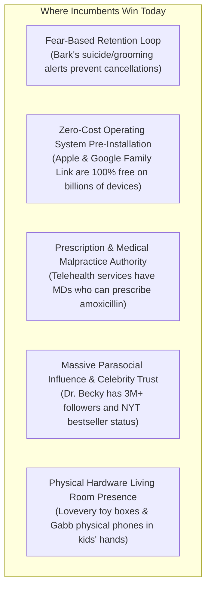
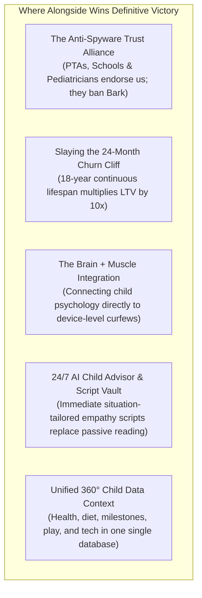

# Alongside (ParentPath) — Comprehensive Competitive Analysis & Strategic Differentiation Specification
## Mapping the Modern Parenting Technology Landscape: Incumbent Silos, Structural Differentiators, Competitive Moats, and Where They Win vs. Where We Win
**Author:** Chief Executive Officer (CEO) & Product Visionary  
**Document Version:** 1.0.0 (Canonical Competitive Landscape Specification)  
**Target Audience:** CTO, Product Strategy, Engineering Leads, Investors, Board of Directors  
**Status:** Canonical Strategic Document  

---

## 1. Executive Summary: The Fragmentation Paradox

### 1.1 Direct Answer to the Core Strategic Questions

1. **Are there any close solutions or apps to our project? Like competitors?**
   * **The Short Answer:** **Yes and No.** There are dozens of successful, high-revenue apps that compete with **isolated fragments** of Alongside, but **there is zero unified competitor offering the Holistic Lifespan Family Operating System (Ages 0–18).**
   * Modern parenting technology is completely fragmented into six isolated, non-communicating silos:
     1. *Invasive Parental Surveillance MDMs* (Bark, Qustodio, Aura/Circle).
     2. *Infant & Toddler Trackers* (Huckleberry, BabyCenter, Kinedu, Solid Starts, Sprout).
     3. *Parenting Influencer Content Subscriptions* (Good Inside / Dr. Becky, Big Little Feelings).
     4. *Pediatric Symptom Checkers & Telehealth* (Blueberry Pediatrics, Summer Health, WebMD).
     5. *Kid-Specific Hardware & Media Review Platforms* (Gabb Wireless, Pinwheel, Common Sense Media).
     6. *Youth Mental Health Chatbots* (Alongside.com / Kiwi the Llama, Woebot).
   * No existing platform connects pediatric physical health, infant/child nutrition, developmental motor/speech milestones, cognitive brain games, and behavioral psychology to modern digital device governance and bilateral family pacts.

2. **What is different?**
   * **Architecture:** Legacy parental controls install coercive spyware (secret text scraping, keyloggers, battery-draining VPN proxies). Alongside replaces spyware with **Bilateral "Pact-as-Code"**: transparent family agreements compiled into signed Apple / Android configuration profiles that neutrally enforce an 8:30 PM bedtime curfew with zero surveillance.
   * **Scope & Continuity:** Legacy baby apps suffer a 90% churn cliff at age 2 when diapers end. Alongside spans **the complete 0–18 developmental continuum**, expanding customer lifespan from 18 months to 18 years.
   * **Methodology:** Influencer apps sell passive video courses ("content in a trenchcoat"). Alongside delivers **actionable, clinical guidance & empathetic dialogue** via the real-time **24/7 AI Child Advisor & Clinical FAQ Vault**, allowing parents to access instant, personalized crisis response scripts and pediatric insights before facing an agitated child.
   * **Triage vs. Panic:** Telehealth charges $240/yr and WebMD terrifies parents at 2:00 AM. Alongside provides instant, evidence-based **Barton Schmitt pediatric symptom triage** (Green/Yellow/Red protocols) integrated with the child’s longitudinal profile.

3. **How much of a difference?**
   * It is an **order-of-magnitude (10x) shift** in philosophy, trust architecture, customer lifetime value (LTV), and daily operational utility. It is the difference between a coercive spy tool that destroys family trust versus a trusted family operating system that nurtures the whole child.

4. **Where do they win?**
   * Incumbents win on **brand heritage, venture war chests ($100M+ funding), fear-based retention loops, free built-in OS dominance (Google Family Link / Apple Screen Time), legal prescription authority (telehealth), and celebrity founder followings (Dr. Becky).**

5. **Where do we win?**
   * Alongside wins on **family trust (zero spyware), PTA/Pediatrician viral zero-CAC distribution, 18-year customer retention (slaying the 24-month baby churn curse), 24/7 AI child advisory with guided dialogue scripts, unified 360° child data context, and the "Brain + Muscle" integration of developmental neurobiology with native device curfew enforcement.**

---

### 1.2 Critical Brand & Trademark Finding: The `alongside.care` Entity Collision

A rigorous competitive audit reveals an existing venture-backed startup operating under the corporate brand **Alongside** (`alongside.care` / `alongside.com`):
- **What they are:** A school-district enterprise mental health platform offering "Kiwi the Llama"—a clinically guided AI chatbot for public school students (grades 6–12) navigating social-emotional challenges, integrated with school counselors.
- **Why this does not block us:** Their product is **B2B School Enterprise / Student-Facing**, funded by district MTSS budgets. Our product is **D2C Consumer / Parent-Facing Family OS (Ages 0–18)**.
- **Strategic Recommendation:** To avoid trademark confusion, App Store metadata collisions, and SEO dilution, we establish our canonical product positioning as **ParentPath (by Alongside)** or **ParentPath Family OS**, maintaining the corporate umbrella while asserting a distinctive, unassailable consumer brand.

---

## 2. The 6 Incumbent Silos: Detailed Anatomy & Teardown

```
┌──────────────────────────────────────────────────────────────────────────────────────────────────┐
│                                 THE FRAGMENTED PARENTING TECH MARKET                             │
├──────────────────────────────────────────────────────────────────────────────────────────────────┤
│                                                                                                  │
│  [ SILO 1: SURVEILLANCE MDMS ]       [ SILO 2: BABY & INFANT TRACKERS ]                          │
│  • Bark, Qustodio, Aura, Net Nanny   • Huckleberry, BabyCenter, Kinedu, Solid Starts             │
│  • Coercive, text scraping, spyware  • Diaper logging, nap timers; 90% churn cliff at age 2      │
│                                                                                                  │
│  [ SILO 3: INFLUENCER CONTENT ]      [ SILO 4: PEDIATRIC TELEHEALTH ]                            │
│  • Good Inside (Dr. Becky), BLF      • Blueberry Pediatrics, Summer Health, WebMD                │
│  • Passive videos, $280/yr paywalls  • $240/yr doctor messaging, 2:00 AM WebMD panic             │
│                                                                                                  │
│  [ SILO 5: HARDWARE & ADVOCACY ]     [ SILO 6: YOUTH CHATBOTS (EDTECH) ]                         │
│  • Gabb Wireless, Pinwheel, CSM      • Alongside.com (Kiwi), Woebot                              │
│  • Clunky dumbphones, passive media  • Student-facing school B2B; zero parent tools              │
│                                                                                                  │
├──────────────────────────────────────────────────────────────────────────────────────────────────┤
│                                 THE UNIFIED SOLUTION: ALONGSIDE                                  │
│                 The Holistic Child Upbringing, Health & Lifespan Family OS (Ages 0–18)           │
│    Pediatric Health Triage + Nutrition + Milestones + Brain Play + Psychology + Bilateral Pact   │
└──────────────────────────────────────────────────────────────────────────────────────────────────┘
```

---

### Silo 1: Invasive Surveillance & Parental Control MDMs
**Key Incumbents:** Bark ($14/mo or $99/yr), Qustodio ($55–$100/yr), Aura/Circle ($10/mo), Net Nanny ($40–$90/yr), Google Family Link (100% Free), Apple Screen Time (100% Free).

#### 1. What They Do:
Install proprietary MDM profiles, local VPN proxies, or desktop companion agents to perform deep packet inspection, scrape SMS/social messages, log keystrokes, track stealth GPS, and abruptly cut off internet access when timers expire.

#### 2. What Is Different in Alongside:
- **Bilateral Mentorship vs. Unilateral Surveillance:** Bark secretly wiretaps texts and emails, looking for red flags. Alongside completely rejects surveillance: **no message reading, no keylogging, no secret location pinging.**
- **Pact-as-Code vs. Coercive Lockouts:** Instead of parents setting arbitrary limits behind their child's back, AlongSide provides a 5-minute collaborative negotiation wizard. The resulting pact is signed by both parent and child, then compiled into a signed `.mobileconfig` / Android Enterprise policy that enforces an automated 8:30 PM bedtime lockout.
- **Whole-Child Context:** Bark only cares about screens and alerts. When the phone is turned off, Bark has zero role in the child's life. Alongside supports the child’s physical health, speech development, nutrition, and cognitive play across all 18 years.

#### 3. How Much of a Difference?
- **Psychological:** Bark creates a domestic police state. Kids resent their parents, search YouTube for bypasses, purchase burner phones, and withdraw emotionally. Alongside establishes shared ownership and intrinsic motivation.
- **Technical:** Bark relies on battery-draining VPN proxies and reverse-engineered desktop backups that constantly break on iOS updates. Alongside uses native, transparent Apple Declarative Device Management and Family Controls APIs.

#### 4. Where They Win:
- **The Fear-Based Retention Moat:** Bark’s alert loop (*"Alert: Suicidal ideation or weapon detected in Leo's group chat"*) creates visceral terror. Even if parents hate the app, canceling feels like taking down the home smoke detector.
- **Incumbent War Chests:** Bark has raised over $100M in venture funding, holds massive marketing spend across television and social ads, and sells custom hardware ("The Bark Phone").
- **Zero Cost of Native Tools:** Apple Screen Time and Google Family Link are 100% free and pre-installed on billions of operating systems, capturing casual parents who just want basic time limits.

#### 5. Where We Win:
- **The Anti-Spyware Alliance (PTAs & Pediatricians):** School districts, pediatricians, and PTAs *refuse* to recommend spyware like Bark because it damages child psychological well-being. However, they actively endorse Alongside's collaborative "First-Phone Readiness" roadmap (Road 1), providing a viral, zero-CAC distribution channel.
- **Child Compliance & Zero Bypasses:** Because children co-design the Alongside pact and earn autonomy privileges (e.g., weekend gaming), they don't treat the app as an enemy to be hacked.
- **Zero False-Positive Fatigue:** Bark bombards parents with hundreds of benign slang alerts (*"Leo mentioned 'kill' in a Fortnite chat"*), causing notification burnout. Alongside eliminates notification spam entirely.

---

### Silo 2: Infant & Toddler Trackers ("The 24-Month Churn Graveyard")
**Key Incumbents:** Huckleberry ($10/mo–$58/plan), BabyCenter (Free, ad-supported), Kinedu ($40–$79/yr), Lovevery ($320–$480/yr physical subscription), Solid Starts ($36/yr), Sprout, The Wonder Weeks ($5.99 one-time).

#### 1. What They Do:
Track infant feeding, bottle ounces, wet diapers, pumping logs, and nap intervals. Huckleberry uses predictive algorithms (SweetSpot®) to calculate wake windows. Solid Starts provides a database of first foods and baby-led weaning (BLW) choking videos. Kinedu suggests early developmental sensory exercises.

#### 2. What Is Different in Alongside:
- **Lifespan Continuity vs. The 24-Month Cliff:** Infant tracker apps are designed around diapers and bottles. The moment the child is potty-trained and sleeps through the night (around age 2), the apps become useless. Churn exceeds 90%. Alongside covers the entire developmental lifespan from newborn care up to age 18.
- **Operational Synthesis vs. Fragmented Point Solutions:** A new parent currently has to juggle 4 separate apps: Huckleberry for sleep, Solid Starts for food safety, The Wonder Weeks for mental leaps, and WebMD for fevers. Alongside unifies pediatric health, infant nutrition, motor milestones, and brain play into one seamless companion.
- **Dignified Privacy vs. Ad Surveillance:** BabyCenter monetizes by selling parent data and serving aggressive banner ads for formula and diapers. Alongside is a clean, private, ad-free subscription.

#### 3. How Much of a Difference?
- **Customer Lifetime Value (LTV):** An infant app has an average customer lifetime of 12–18 months ($60–$120 LTV). Alongside's 18-year customer retention horizon achieves an LTV exceeding $600–$1,000+, transforming unit economics and allowing sustainable organic reinvestment.

#### 4. Where They Win:
- **Acute Newborn Pain & Sleep Deprivation:** Huckleberry's SweetSpot algorithm is revered by exhausted mothers during the first 6 months. When parents are desperate for 2 hours of sleep, Huckleberry's narrow focus is an irresistible painkiller.
- **SEO & Traffic Dominance:** BabyCenter and What to Expect have 25+ years of digital search equity, capturing millions of pregnant women through search engines before the child is even born.
- **Physical Product Touchpoints:** Lovevery delivers tangible, beautifully crafted wooden Montessori toys to the front door every 2 months, creating a physical brand presence in the living room that software alone cannot match.

#### 5. Where We Win:
- **Zero Churn at Toddlerhood:** When baby bottles end, Alongside seamlessly transitions into toddler tantrums, speech expansion bursts, picky eating food battles, and early puppet play.
- **Authoritative Clinical Triage:** Baby trackers tell you when your baby pooped; they cannot guide you when your toddler spikes a 103°F fever at 2:00 AM. Alongside's Barton Schmitt pediatric protocols provide immediate clinical clarity.
- **Modern Cultural Evolution:** Baby apps have zero answers when that same child turns 8 and asks for Roblox, or turns 11 and asks for a smartphone. Alongside is the single system that grows alongside the child.

---

### Silo 3: Parenting Influencer Content & Memberships ("Content in a Trenchcoat")
**Key Incumbents:** Good Inside / Dr. Becky Kennedy ($28/mo or $279/yr), Big Little Feelings ($99/course), Aha! Parenting (Dr. Laura Markham).

#### 1. What They Do:
Deliver video workshops, digital parenting courses, Instagram reels, downloadable PDF workbooks, community forums, and basic text AI chatbots (e.g., Dr. Becky’s "GiGi") based on respectful, gentle, and authoritative parenting frameworks.

#### 2. What Is Different in Alongside:
- **Clinical Guidance & Scripts vs. Passive Video Watching:** Watching a video about emotional regulation does not stop a parent from freezing or screaming when provoked in real life. Alongside provides the **24/7 AI Child Advisor & Guided Dialogue Script Vault**: parents access instant, word-for-word de-escalation scripts and clinical advice tailored to their child's developmental age and exact high-heat situation.
- **Mechanical Peace vs. Pure Homework:** Good Inside teaches parents how to manage screen battles through verbal boundaries alone, placing 100% of the cognitive burden on an exhausted parent. Alongside combines psychological education with the **Automated 8:30 PM Bedtime Profile**: the operating system neutrally turns off apps, removing the parent from the role of bedtime police officer.
- **Accessible Pricing:** Good Inside charges an exorbitant $279/year for what is essentially a digital video community. Alongside provides a complete Family OS—including pediatric health, nutrition, brain play, 24/7 AI child advisory, and device enforcement—for just $79/year.

#### 3. How Much of a Difference?
- **Actionable Utility:** Passive consumption vs. active situational guidance. Good Inside is like reading a book on swimming; AlongSide’s AI Advisor provides an on-demand coach with exact scripts when you're in deep water.

#### 4. Where They Win:
- **Celebrity Founder Charisma & Trust:** Dr. Becky Kennedy has over 3 million Instagram followers, a #1 New York Times bestselling book, and massive mainstream media credibility (Time Magazine cover, podcasts). Parents feel a profound parasocial attachment to her voice and authority.
- **Vibrant Maternal Community:** Good Inside has built an active, empathetic community of tens of thousands of mothers sharing daily vulnerabilities and validating each other's parenting struggles.

#### 5. Where We Win:
- **Defensible Technology Moat:** Good Inside is static media wrapped in a paywall; any competitor can write similar scripts. Alongside possesses deep technical moats: signed cryptographic MDM compiler, low-latency streaming voice AI, Barton Schmitt pediatric triage, and age-calculated neurodevelopment engines.
- **Multi-Pillar Breadth:** Influencer apps focus almost exclusively on emotional psychology. They offer zero pediatric health triage, zero safe allergen feeding protocols, zero brain game curriculum, and zero youth culture slang decoding.
- **Whole-Family Inclusivity:** Influencer communities skew heavily toward affluent mothers. Alongside is built with a calm, neutral, father-friendly, and teen-accessible tone ("Parent Calm" design system).

---

### Silo 4: Pediatric Health Triage & Telehealth Apps
**Key Incumbents:** Blueberry Pediatrics ($240/yr), Summer Health ($45/mo or $540/yr), Brave Care, WebMD / Mayo Clinic Symptom Checker (Free, ad-supported).

#### 1. What They Do:
Connect parents to on-call human pediatricians via SMS or video, review photos of rashes, answer medical questions, write antibiotic prescriptions, or provide algorithmic symptom check lists.

#### 2. What Is Different in Alongside:
- **Zero-Panic Guidance vs. WebMD Terror:** WebMD is infamous for leading parents from a mild cough to rare oncological diagnoses in 3 clicks, generating acute parental panic. Alongside utilizes conservative, pediatrician-backed Barton Schmitt protocol triage that categorizes symptoms into clear **Green (Monitor at Home), Yellow (Call Clinic Tomorrow), and Red (Immediate Emergency Care)** action paths.
- **Instantaneous 24/7 Response:** Human telehealth apps like Blueberry have response wait times (15 to 45 minutes) and charge $240 to $540 annually. Alongside provides instant, sub-second triage algorithms and clinical AI guidance for non-emergency acute concerns at a fraction of the cost ($79/year).
- **Embedded Health in Daily Living:** Telehealth apps sit idle 360 days a year until a child gets sick. Alongside integrates acute health triage into the same dashboard where parents track daily nutrition, brain games, school lunches, and bedtime curfews.

#### 3. How Much of a Difference?
- **Economic & Practical:** A $240/yr medical-only app is a luxury service. Alongside embeds clinical-grade triage into a holistic family companion that costs $6.58/month ($79/yr), delivering daily utility even when the child is healthy.

#### 4. Where They Win:
- **Prescription Authority & Human MD Liability:** Telehealth services employ licensed medical doctors who can legally diagnose illnesses, prescribe amoxicillin for ear infections, and order lab tests. Alongside does NOT practice medicine or prescribe drugs; it provides educational triage and preparation for clinical visits.
- **Insurance Reimbursement:** Telehealth visits can often be billed directly to FSA/HSA accounts or commercial health insurance plans.

#### 5. Where We Win:
- **The "Preparation Summary" Bridge:** Instead of replacing the family pediatrician, Alongside empowers the parent to be a prepared advocate. When a child is sick, Alongside generates an exportable **Pediatrician Visit Summary** (temperature timeline, fluid intake, medication doses administered, exact symptom onset), making the physical doctor visit 3x more productive.
- **Preventative Wellness & Diet:** Telehealth is reactive to acute sickness. Alongside provides preventative pediatric wellness: infant allergen exposure schedules, choking prevention, and balanced childhood nutrition.

---

### Silo 5: Tween/Teen Hardware & Media Advocacy Platforms
**Key Incumbents:** Gabb Wireless ($150 hardware + $25–$35/mo cellular plan), Pinwheel ($150–$200 hardware + subscription), Common Sense Media (Free / non-profit), Wait Until 8th (Grassroots pledge).

#### 1. What They Do:
Gabb and Pinwheel sell customized, locked-down Android smartphones with no web browsers, no social media, and restricted app stores designed specifically for kids. Common Sense Media provides age ratings and reviews for movies, video games, books, and apps. "Wait Until 8th" organizes community pledges where parents promise not to give their kids smartphones until 8th grade.

#### 2. What Is Different in Alongside:
- **Software on Real Devices vs. Stigmatizing "Dumbphones":** Tweens hate Gabb phones. By age 11 or 12, children feel intense social shame pulling a thick, locked-down "baby phone" out of their backpack in middle school. Parents waste $150 on hardware that kids abandon within 9 months. Alongside works on the real, standard iPhone or Android the family already owns or inherits as a hand-me-down, maintaining the child’s social dignity.
- **The Progressive Readiness Bridge vs. Binary Prohibition:** "Wait Until 8th" provides a blunt binary: *No phone at all.* But modern tweens still use iPads, Chromebooks at school, family smart TVs, and Nintendo Switches. Alongside provides the **Smartwatch Bridge Roadmap** and the **10-Dimension Readiness Diagnostic (0–100)**: transforming the conversation from an adversarial "No" to a structured, earned "Here is how you prove you are ready."
- **Actionable Enforcement vs. Passive Media Reviews:** Common Sense Media tells parents that TikTok has mature content, but does nothing to help when an 11-year-old sneaks TikTok onto their iPad. Alongside enforces the boundary automatically.

#### 3. How Much of a Difference?
- **Cost & Sustainability:** A Gabb phone costs $150 upfront plus $360/year in cellular fees ($510 Year 1). Alongside is $79/year, requires zero proprietary hardware, and teaches the child how to safely navigate modern operating systems rather than locking them in an artificial bubble.

#### 4. Where They Win:
- **Physical Isolation Guarantee:** On a Gabb phone, internet browsing and social media are physically impossible. For anxious parents who want absolute, zero-effort guarantees that their 9-year-old cannot stumble upon pornography, Gabb provides total peace of mind.
- **The Common Sense Media Content Vault:** Common Sense Media has evaluated over 40,000 entertainment titles over 20 years, holding unmatched brand trust in K-12 schools and public libraries.

#### 5. Where We Win:
- **Preparation for the Real World:** An artificial, stripped-down phone does not teach digital resilience. When a Gabb kid turns 15 and gets an unmonitored smartphone, they often binge uncontrollably. Alongside fosters bilateral digital literacy, earned trust, and healthy circadian sleep habits that persist for life.
- **Sunday Youth Culture Intelligence:** Neither Gabb nor Common Sense Media teaches parents what trending slang (*skibidi, looksmaxing, crashout*) or covert app exploits (Calculator Vaults, proxy browsers) mean. Alongside’s Sunday Culture Digest delivers weekly cultural fluency to the breakfast table.

---

### Silo 6: Youth Mental Health Chatbots & The Naming Collision
**Key Incumbents:** Alongside (`alongside.care` / Kiwi the Llama), Woebot Health, BeMe Health, Daybreak Health.

#### 1. What They Do:
Deliver conversational AI chatbots (such as Kiwi the Llama) directly to middle and high school students to teach cognitive behavioral therapy (CBT) techniques, mood tracking, and emotional coping mechanisms, sold B2B to public school districts.

#### 2. What Is Different in Alongside (ParentPath):
- **Customer & Persona Focus:** School chatbots target the *child* in the classroom during school hours. Alongside targets the *parent* at home, recognizing that the primary attachment figure and emotional anchor in a child’s life is their mother or father.
- **Holistic Lifespan OS vs. Single-Issue Chatbot:** School mental health bots only address adolescent emotional distress. Alongside supports the family across the entire lifespan: infant fever triage, toddler speech milestones, school lunches, sensory play, and modern screen boundaries.
- **Brand Architecture:** Operating our consumer family product under **ParentPath (by Alongside)** creates clear daylight between our consumer platform and institutional school tools.

---

## 3. Comprehensive Master Competitor Matrix

The following table provides an exhaustive side-by-side evaluation across 12 critical product, clinical, and architectural dimensions:

| Evaluation Dimension | Alongside (ParentPath) | Bark ($14/mo) | Qustodio ($55–$100/yr) | Google Family Link | Huckleberry ($10/mo) | Good Inside ($279/yr) | Blueberry Pediatrics ($240/yr) | Gabb Wireless ($150 + $30/mo) |
| :--- | :---: | :---: | :---: | :---: | :---: | :---: | :---: | :---: |
| **Developmental Age Span** | **0 to 18 Years** | 9 to 17 | 6 to 16 | 4 to 15 | 0 to 2 (Cliff) | 2 to 10 | 0 to 18 | 8 to 12 |
| **Core Philosophy** | **Whole Child Mentorship** | Coercive Spyware | Restrictive MDM | Basic OS Controls | Infant Sleep Tracking | Gentle Psychology | Medical Treatment | Hardware Quarantine |
| **Bilateral Family Pact ("Pact-as-Code")** | **YES (Co-Signed)** | ❌ No | ❌ No | ❌ No | ❌ No | ❌ (Static PDF only) | ❌ No | ❌ No |
| **Automated 8:30 PM Bedtime Lockdown** | **YES (Native Profile)** | ❌ (Alerts only) | YES | YES | ❌ No | ❌ (Parent must enforce) | ❌ No | YES (Hardcoded) |
| **Zero Spyware Guarantee (No Text Scraping)** | **YES (100% Private)** | ❌ (Scrapes SMS/Chat) | ❌ (Scrapes Calls/SMS) | YES | YES | YES | YES | YES |
| **Pediatric Symptom Triage (Barton Schmitt)** | **YES (Green/Yellow/Red)** | ❌ No | ❌ No | ❌ No | ❌ No | ❌ No | YES (Human MDs) | ❌ No |
| **Infant & Child Nutrition / Feeding** | **YES (BLW + Picky Eating)** | ❌ No | ❌ No | ❌ No | Basic logs only | ❌ No | General guidance | ❌ No |
| **Motor & Speech Milestones Tracking** | **YES (0–18 Benchmarks)** | ❌ No | ❌ No | ❌ No | Basic 0–12mo | ❌ No | ❌ No | ❌ No |
| **Brain Games, Puppets & Cognitive Play** | **YES (Age-Tailored)** | ❌ No | ❌ No | ❌ No | ❌ No | ❌ No | ❌ No | ❌ No |
| **24/7 AI Child Advisor & Clinical FAQ Vault** | **YES (250+ Scenarios & Scripts)** | ❌ No | ❌ No | ❌ No | ❌ No | ❌ (Text bot only) | ❌ No | ❌ No |
| **Weekly Youth Culture & Slang Decoder** | **YES (Sunday Digest)** | Partial (Alert tags) | ❌ No | ❌ No | ❌ No | ❌ No | ❌ No | ❌ No |
| **Annual Pricing** | **$79 / year** | $99 / year | $55–$100 / yr | **$0 (Free)** | $120 / year | $279 / year | $240 / year | $510 Year 1 |
| **Expected Customer Lifespan** | **15–18 Years** | 2–3 Years | 2–3 Years | 3–5 Years | **12–18 Months** | 1–2 Years | 2–4 Years | 1–2 Years |
| **Distribution / Institutional Buy-In** | **PTAs & Pediatricians** | Consumer Ads | Schools/B2B2C | Android Hardware | Mommy Forums | Social Influencer | Health Networks | Retail / Cellular |

---

## 4. How Much of a Difference? The Quantitative & Qualitative Divide

### 4.1 The Three Structural Differences

```
┌──────────────────────────────────────────────────────────────────────────────────────────────────┐
│                                   THE 3 STRUCTURAL DIVIDES                                        │
├──────────────────────────────────────────────────────────────────────────────────────────────────┤
│                                                                                                  │
│   1. THE TRUST DIVIDE: Surveillance vs. Bilateral Governance                                     │
│      • Competitors: Secretly tap texts, log keys, install VPNs -> Sparks teen counter-warfare    │
│      • Alongside: Co-negotiated pact, signed profile, 8:30 PM lockout -> Builds intrinsic trust  │
│                                                                                                  │
│   2. THE HORIZON DIVIDE: The 24-Month Churn Cliff vs. 18-Year Lifespan                           │
│      • Competitors: Track diapers, churn at age 2; or buy Bark at 11, cancel at 13               │
│      • Alongside: 0 to 18 whole child upbringing -> 18 continuous years of active utility        │
│                                                                                                  │
│   3. THE ACTION DIVIDE: Passive Content vs. Neuromuscular Rehearsal & Machine Peace              │
│      • Competitors: Read advice, get yelled at by tween, scream back in exhaustion                │
│      • Alongside: 24/7 AI Advisor prepares the parent; Signed profile locks phone automatically  │
│                                                                                                  │
└──────────────────────────────────────────────────────────────────────────────────────────────────┘
```

1. **The Trust Divide (Coercion vs. Bilateral Governance):**
   - Traditional tools operate on a **Penal Colony Model**: the parent is the prison guard, the child is the inmate, and the software is the wiretap. This model is psychologically toxic and technically fragile (teens easily bypass VPNs and create secret accounts).
   - Alongside operates on a **Constitutional Model**: the parent and child sit together, review fair trade-offs, and co-sign the pact. When the phone locks at 8:30 PM, the child does not scream at the parent because the operating system is simply executing the rules they agreed to.

2. **The Horizon Divide (Point Utility vs. Lifespan OS):**
   - Single-point apps suffer from catastrophic customer churn. Huckleberry loses parents when diapers end. Bark loses parents when teens rebel or leave for college.
   - Alongside is an **18-year customer retention flywheel**. A family that adopts Alongside for infant fever triage and baby-led weaning at 6 months continues using it for toddler speech milestones, elementary school brain games, middle school smartwatch transitions, and adolescent safe driving pacts.

3. **The Action Divide (Static Words vs. Actionable Guidance & Scripts):**
   - Every existing parenting content app gives parents *more reading*. When a child throws a violent tantrum or screams *"I hate you!"*, intellectual memory evaporates under adrenaline.
   - Alongside's **24/7 AI Child Advisor & Guided Dialogue Scripts** deliver immediate, situation-specific words to say. By providing exact, empathetic phrasing tailored to the child's developmental tier and the heat of the moment, parents stay grounded and confident without guessing or freezing.

---

## 5. Where They Win: The Brutal Competitive Truth

To build an enduring, venture-scale business, AlongSide leadership must maintain radical intellectual honesty about where existing competitors hold unassailable advantages today:



### 1. Bark Wins on Visceral Fear & False-Alarm Retention
- **The Reality:** Bark has weaponized parental anxiety. Once a parent installs Bark and sees alerts for cyberbullying or depression keywords, they are psychologically trapped. Canceling Bark feels like willfully blinding themselves to their child’s mortal danger.
- **Our Challenge:** Alongside deliberately rejects surveillance. We must prove to parents that **proactive trust, cultural fluency, and automated bedtime locks provide vastly superior real-world safety** than an invasive wiretap that kids easily circumvent.

### 2. Apple and Google Win on Zero Marginal Cost & Native Integration
- **The Reality:** Apple Screen Time and Google Family Link are free, pre-installed, and built directly into the silicon of every iPhone and Android on earth. For 70% of parents who only want a basic time limit, paying $79/year for third-party software feels redundant.
- **Our Challenge:** We must never position Alongside as a "screen time blocker." We must position it as **the Whole-Child Operating System** where screen boundaries are simply the automated physical expression of a broader developmental and health architecture.

### 3. Telehealth Networks Win on Legal Prescription Pads
- **The Reality:** When a child has an inflamed eardrum or strep throat, an algorithm cannot write an amoxicillin script. Blueberry Pediatrics and Summer Health have human MDs who can legally diagnose and transmit prescriptions to the local pharmacy.
- **Our Challenge:** Alongside does not attempt to replace the doctor. We position Alongside as the **Pediatrician’s Best Ally**: preventing unnecessary 2:00 AM emergency room runs through conservative triage, and providing exportable clinical summaries when medical care is truly necessary.

### 4. Influencers Win on Parasocial Maternal Community
- **The Reality:** Dr. Becky Kennedy and Big Little Feelings have spent years building deep parasocial affection. Mothers trust them like close friends. An AI-first platform without a recognizable human figurehead can initially feel clinical or detached.
- **Our Challenge:** Alongside’s UI copy and voice AI must embody the highest standard of empathy, warmth, and neurobiological reassurance ("Parent Calm" design system), while emphasizing that **our system provides actionable daily tools and mechanical peace that no Instagram reel can deliver.**

---

## 6. Where We Win: Alongside’s Structural Moats & Unfair Advantages



### 1. The Anti-Spyware Institutional Distribution Channel (Zero-CAC)
- **The Mechanism:** School districts and pediatricians are desperate for solutions to the youth mental health crisis, but their ethics boards strictly prohibit endorsing invasive surveillance tools like Bark.
- **The Win:** Alongside's **Road 1 (First-Phone Readiness)** and **Bilateral Family Pacts** are viewed as exemplary educational frameworks. Pediatricians hand Alongside prescription cards during 10-year well-child exams; PTAs distribute Alongside family pacts to incoming 6th-grade cohorts. This creates an organic, institutional distribution engine that bypasses expensive Meta/Google ad bidding wars.

### 2. Generational Customer Lifetime Value (LTV:CAC Dominance)
- **The Mechanism:** By expanding our scope from infant diapers to high-school graduation (Ages 0–18), we eliminate the 24-month churn graveyard that destroys baby apps.
- **The Win:** At $79/year, a family using Alongside across two children for an average of 8 to 12 years delivers an LTV between **$630 and $950+**, operating at 85%+ gross margins. Competitors spending $50 CAC to acquire a customer who churns in 14 months ($90 LTV) cannot compete with our acquisition economics.

### 3. The "Brain + Muscle" Synthesis
- **The Mechanism:** Parenting apps have historically been either "all brain" (abstract psychology books and podcasts with zero device control) or "all muscle" (crude dumbphone hardware or dumb toggles with zero understanding of child development).
- **The Win:** Alongside is the first platform that unites the brain and the muscle. We teach parents the neurobiology of why their 11-year-old struggles to disconnect, provide the script to talk about it, and then neutrally compile the agreed boundary into an operating system lock that enforces it without tears.

### 4. 24/7 Clinical AI Advisor & Guided Dialogue Scripts
- **The Mechanism:** High-speed streaming AI coupled with pediatric evidence and clinical FAQ knowledge base.
- **The Win:** While competitors offer generic video libraries or shallow chatbots, Alongside's AI Advisor delivers immediate, situation-specific guidance and word-for-word response scripts rooted in developmental neurobiology and pediatric best practices.

### 5. Unified 360° Child Intelligence
- **The Mechanism:** When a parent asks the 24/7 AI Advisor a question, the LLM’s context window has access to:
  * Child’s age, developmental tier, and motor/speech milestone history.
  * Recent fever or illness triage notes.
  * Picky eating and allergen sensitivities.
  * Active screen boundaries, smartwatch status, and bilateral pact clauses.
- **The Win:** Single-point apps have fragmented data. Alongside’s advice is radically personalized, context-aware, and coherent across every aspect of the child’s life.

---

## 7. Strategic Recommendations for Leadership

1. **Brand Architecture:** Establish the canonical consumer identity as **ParentPath (by Alongside)** or **ParentPath Family OS** to avoid confusion with `alongside.care` (Kiwi the Llama) while preserving corporate governance.
2. **Hero Pricing Model:** Maintain the **$79/year Annual Hero Pass** with a 7-day upfront trial, backed by a flexible **$9.99/month pass**. Reject freemium tiering that attracts low-intent users and burns AI token inference costs.
3. **Institutional Distribution Execution:** Prioritize building the exportable **Pediatrician Health Summary** and the **PTA Class-Wide First-Phone Transition Packets** as core growth engines for Road 1.
4. **Zero-Spyware Marketing Anchor:** Lead all consumer messaging with our moral and technical differentiator: *"Zero Spyware. Zero Shaming. 100% Family Trust & Automated Sleep Protection."*

---
*Canonical Specification Authored & Approved by:*  
**Chief Executive Officer (CEO) & Product Visionary**  
*Alongside Technologies Inc. (ParentPath)*