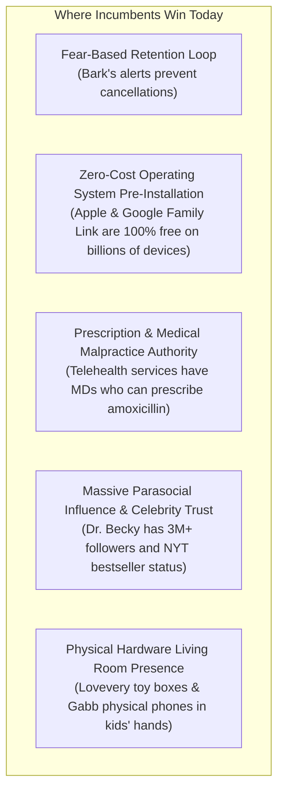
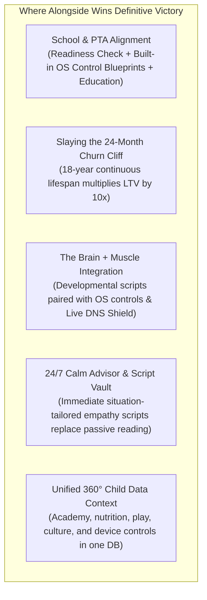

# Alongside (ParentPath) — Comprehensive Competitive Analysis & Strategic Differentiation Specification
## Mapping the Modern Parenting Technology Landscape: Incumbent Silos, Structural Differentiators, Competitive Moats, and Where They Win vs. Where We Win
**Author:** Chief Executive Officer (CEO) & Product Visionary  
**Document Version:** 2.0.0 (Canonical Competitive Landscape Specification)  
**Target Audience:** CTO, Product Strategy, Engineering Leads, Investors, Board of Directors  
**Status:** Canonical Strategic Document  

---

## 1. Executive Summary: The Fragmentation Paradox

### 1.1 Direct Answer to the Core Strategic Questions

1. **Are there any close solutions or apps to our project? Like competitors?**
   * **The Short Answer:** **Yes and No.** There are dozens of successful, high-revenue apps that compete with **isolated fragments** of Alongside, but **there is zero unified competitor offering the Holistic Lifespan Family Operating System (Ages 0–18).**
   * Modern parenting technology is completely fragmented into six isolated, non-communicating silos:
     1. *Third-Party Parental Control Suites* (Bark, Qustodio, Aura/Circle) & Unassisted OS Settings (Apple Screen Time, Google Family Link).
     2. *Infant & Toddler Trackers* (Huckleberry, BabyCenter, Kinedu, Solid Starts, Sprout).
     3. *Parenting Influencer Content Subscriptions* (Good Inside / Dr. Becky, Big Little Feelings).
     4. *Pediatric Symptom Checkers & Telehealth* (Blueberry Pediatrics, Summer Health, WebMD).
     5. *Kid-Specific Hardware & Media Review Platforms* (Gabb Wireless, Pinwheel, Common Sense Media).
     6. *Youth Mental Health Chatbots* (Alongside.com / Kiwi the Llama, Woebot).
   * No existing platform connects developmental milestones, sleep, nutrition, screen-free play, and behavioral psychology directly to **priority-ranked built-in OS parental controls and Live Encrypted DNS enforcement** across ages 0–18.

2. **What is different?**
   * **Device Controls Architecture:** Third-party control suites charge $99–$140/yr for battery-draining VPN proxies, while free built-in OS controls (Apple Screen Time, Google Family Link) bury critical settings across 40+ menus and leave blind spots inside Roblox, YouTube, and mixed-OS homes. Alongside combines **priority-ranked OS & app setup blueprints** (anti-tamper locks, app download/purchase approvals, adult filtering, daily time/Shorts limits, bedtime/school locks) with a **Live Encrypted DNS Shield** (signed iOS `.mobileconfig` DoH, Android Private DNS DoT, Home Router DNS) that blocks adult sites, pauses specific apps, enforces SafeSearch, and runs bedtime schedules across Wi-Fi and 5G.
   * **Scope & Continuity:** Legacy baby apps suffer a 90% churn cliff at age 2 when diapers end. Alongside spans **the complete 0–18 developmental continuum**, expanding customer lifespan from 18 months to 18 years.
   * **Methodology:** Influencer apps sell passive video courses ("content in a trenchcoat"). Alongside delivers **actionable, science-backed guidance & word-for-word scripts** via the **24/7 Calm Advisor & Living FAQ Vault** plus concise audio-narrated **Parent Academy** guides.
   * **Strict Non-Clinical Boundary (SOU-86):** Unlike telehealth or WebMD, Alongside does not perform clinical symptom triage, medical diagnosis, or medication dosing—keeping medical decisions strictly with licensed pediatricians while empowering parents on daily development, sleep, nutrition, behavior, and digital safety.

3. **How much of a difference?**
   * It is an **order-of-magnitude (10x) shift** in utility, customer lifetime value (LTV), and daily coherence: uniting whole-child developmental guidance (0–18) with real OS and network-level device controls in one calm workspace.

4. **Where do they win?**
   * Incumbents win on **brand heritage, venture war chests ($100M+ funding), pre-installed OS ownership (Apple/Google), legal prescription authority (telehealth), and celebrity founder followings (Dr. Becky).**

5. **Where do we win?**
   * Alongside wins on **combining built-in OS control blueprints + Live Encrypted DNS Shield with 0–18 developmental intelligence, 18-year customer retention (slaying the 24-month baby churn curse), 24/7 Calm Advisor scripts, Weekly Culture & Trends, and unified 360° child context.**

---

### 1.2 Critical Brand & Trademark Finding: The `alongside.care` Entity Collision

A rigorous competitive audit reveals an existing venture-backed startup operating under the corporate brand **Alongside** (`alongside.care` / `alongside.com`):
- **What they are:** A school-district enterprise mental health platform offering "Kiwi the Llama"—a clinically guided AI chatbot for public school students (grades 6–12) navigating social-emotional challenges, integrated with school counselors.
- **Why this does not block us:** Their product is **B2B School Enterprise / Student-Facing**, funded by district MTSS budgets. Our product is **D2C Consumer / Parent-Facing Family OS (Ages 0–18)**.
- **Strategic Recommendation:** To avoid trademark confusion, App Store metadata collisions, and SEO dilution, we establish our canonical product positioning as **ParentPath (by Alongside)** or **ParentPath Family OS**, maintaining the corporate umbrella while asserting a distinctive, unassailable consumer brand.

---

## 2. The 6 Incumbent Silos: Detailed Anatomy & Teardown

```
┌──────────────────────────────────────────────────────────────────────────────────────────────────┐
│                                 THE FRAGMENTED PARENTING TECH MARKET                             │
├──────────────────────────────────────────────────────────────────────────────────────────────────┤
│                                                                                                  │
│  [ SILO 1: PARENTAL CONTROL SUITES ] [ SILO 2: BABY & INFANT TRACKERS ]                          │
│  • Bark, Qustodio, Aura, Net Nanny   • Huckleberry, BabyCenter, Kinedu, Solid Starts             │
│  • Heavy VPN proxies, $99–$140/yr    • Diaper logging, nap timers; 90% churn cliff at age 2      │
│                                                                                                  │
│  [ SILO 3: INFLUENCER CONTENT ]      [ SILO 4: PEDIATRIC TELEHEALTH ]                            │
│  • Good Inside (Dr. Becky), BLF      • Blueberry Pediatrics, Summer Health, WebMD                │
│  • Passive videos, $280/yr paywalls  • $240/yr doctor messaging, 2:00 AM WebMD panic             │
│                                                                                                  │
│  [ SILO 5: HARDWARE & ADVOCACY ]     [ SILO 6: YOUTH CHATBOTS (EDTECH) ]                         │
│  • Gabb Wireless, Pinwheel, CSM      • Alongside.com (Kiwi), Woebot                              │
│  • Clunky dumbphones, passive media  • Student-facing school B2B; zero parent tools              │
│                                                                                                  │
├──────────────────────────────────────────────────────────────────────────────────────────────────┤
│                                 THE UNIFIED SOLUTION: ALONGSIDE                                  │
│            The Holistic Child Upbringing & Lifespan Family Operating System (Ages 0–18)          │
│  Parent Academy + Culture & Trends + Calm Advisor + Built-in OS Controls + Live Encrypted DNS    │
└──────────────────────────────────────────────────────────────────────────────────────────────────┘
```

---

### Silo 1: Third-Party Parental Controls & Raw OS Settings
**Key Incumbents:** Bark ($14/mo or $99/yr), Qustodio ($55–$100/yr), Aura/Circle ($10/mo), Net Nanny ($40–$90/yr), Google Family Link (100% Free), Apple Screen Time (100% Free).

#### 1. What They Do:
Third-party suites install proprietary MDM profiles, local VPN proxies, or desktop agents to filter traffic, monitor alerts, and enforce time limits. Meanwhile, Apple Screen Time and Google Family Link offer free native OS controls—including app approvals (*Ask to Buy*), adult web filters, Communication Safety nudity blurring, daily app limits, and bedtime Downtime—but bury them across dozens of menus and miss in-app settings inside Roblox and YouTube.

#### 2. What Is Different in Alongside:
- **Priority-Ranked Built-in OS Blueprints + Live Encrypted DNS Shield:** Rather than asking parents to buy a $140/yr battery-draining VPN wrapper or guess which iPhone/Android switches actually stop bypasses, Alongside configures **both layers together**:
  1. **OS & App Blueprints:** Priority-ranked setup for Apple Screen Time, Google Family Link, Roblox, YouTube, and Home Safe DNS—locking anti-tamper passcodes, preventing app deletion/APK sideloading, requiring download & purchase approvals, capping YouTube Shorts, and locking bedtime/school hours.
  2. **Live Encrypted DNS Shield:** Signed iOS `.mobileconfig` (`com.apple.dnsSettings.managed` DoH), Android Private DNS (DoT), and Home Router DNS that updates in ~30 seconds across Wi-Fi and 5G to block adult sites, pause specific apps (TikTok, Roblox, YouTube, Instagram, Snapchat, Discord), lock SafeSearch, and enforce bedtime quiet hours.
- **Whole-Child Context:** Bark and Qustodio only care about alerts and screen blocks. Alongside connects device boundaries to developmental neurobiology, Parent Academy audio lessons, Weekly Culture & Trends, and 24/7 Calm Advisor scripts across ages 0–18.

#### 3. How Much of a Difference?
- **Practicality:** Parents get hard control over apps, downloads, purchases, content, and screen-time limits using native OS capabilities + lightweight OS-native Encrypted DNS rather than fragile local VPN tunnels.
- **Technical:** Alongside uses Apple's official `com.apple.dnsSettings.managed` DoH payload and Android's native Private DNS (DoT) paired with Apple Screen Time and Google Family Link native lockdowns.

#### 4. Where They Win:
- **Alert-Driven Retention & Hardware:** Bark has raised over $100M, sells custom hardware ("The Bark Phone"), and retains anxious parents through continuous text/keyword alerts.
- **Zero Cost of Native OS Tools:** Apple Screen Time and Google Family Link are 100% free and pre-installed on billions of devices.

#### 5. Where We Win:
- **Eliminating the Configuration & Blind-Spot Gap:** Most parents don't know that *Ask to Buy*, *Deleting Apps = Don't Allow*, *Roblox chat locks*, and *YouTube Shorts 0-min limits* exist—or how to manage mixed-OS homes (iPhone parent / Android child and vice versa). Alongside turns 40 buried settings into a 6-minute ranked blueprint plus Live DNS enforcement.
- **Zero Browsing-History Snooping:** Alongside's Live DNS Shield checks aggregate 24h query/block health counts without storing a child's visited URL history.
- **Education + Enforcement Together:** Parents get both the technical controls *and* the exact scripts to talk with their child about why the limits exist.

---

### Silo 2: Infant & Toddler Trackers ("The 24-Month Churn Graveyard")
**Key Incumbents:** Huckleberry ($10/mo–$58/plan), BabyCenter (Free, ad-supported), Kinedu ($40–$79/yr), Lovevery ($320–$480/yr physical subscription), Solid Starts ($36/yr), Sprout, The Wonder Weeks ($5.99 one-time).

#### 1. What They Do:
Track infant feeding, bottle ounces, wet diapers, pumping logs, and nap intervals. Huckleberry uses predictive algorithms (SweetSpot®) to calculate wake windows. Solid Starts provides a database of first foods and baby-led weaning (BLW) choking videos. Kinedu suggests early developmental sensory exercises.

#### 2. What Is Different in Alongside:
- **Lifespan Continuity vs. The 24-Month Cliff:** Infant tracker apps are designed around diapers and bottles. The moment the child is potty-trained and sleeps through the night (around age 2), the apps become useless. Churn exceeds 90%. Alongside covers the entire developmental lifespan from newborn care up to age 18.
- **Operational Synthesis vs. Fragmented Point Solutions:** A new parent currently has to juggle 4 separate apps: Huckleberry for sleep, Solid Starts for food safety, The Wonder Weeks for mental leaps, and WebMD for fevers. Alongside unifies pediatric health, infant nutrition, motor milestones, and brain play into one seamless companion.
- **Dignified Privacy vs. Ad Surveillance:** BabyCenter monetizes by selling parent data and serving aggressive banner ads for formula and diapers. Alongside is a clean, private, ad-free subscription.

#### 3. How Much of a Difference?
- **Customer Lifetime Value (LTV):** An infant app has an average customer lifetime of 12–18 months ($60–$120 LTV). Alongside's 18-year customer retention horizon achieves an LTV exceeding $600–$1,000+, transforming unit economics and allowing sustainable organic reinvestment.

#### 4. Where They Win:
- **Acute Newborn Pain & Sleep Deprivation:** Huckleberry's SweetSpot algorithm is revered by exhausted mothers during the first 6 months. When parents are desperate for 2 hours of sleep, Huckleberry's narrow focus is an irresistible painkiller.
- **SEO & Traffic Dominance:** BabyCenter and What to Expect have 25+ years of digital search equity, capturing millions of pregnant women through search engines before the child is even born.
- **Physical Product Touchpoints:** Lovevery delivers tangible, beautifully crafted wooden Montessori toys to the front door every 2 months, creating a physical brand presence in the living room that software alone cannot match.

#### 5. Where We Win:
- **Zero Churn at Toddlerhood:** When baby bottles end, Alongside seamlessly transitions into toddler tantrums, speech expansion bursts, picky eating food battles, and Play This Week screen-free decks.
- **Developmental Clarity Without WebMD Panic:** Baby trackers tell you when your baby pooped; Alongside helps parents understand what developmental milestones are normal across ages 0–18 and how to prepare thoughtful questions for their pediatrician (strictly non-clinical per SOU-86).
- **Modern Cultural Evolution:** Baby apps have zero answers when that same child turns 8 and asks for Roblox, or turns 11 and asks for a smartphone. Alongside is the single system that grows alongside the child.

---

### Silo 3: Parenting Influencer Content & Memberships ("Content in a Trenchcoat")
**Key Incumbents:** Good Inside / Dr. Becky Kennedy ($28/mo or $279/yr), Big Little Feelings ($99/course), Aha! Parenting (Dr. Laura Markham).

#### 1. What They Do:
Deliver video workshops, digital parenting courses, Instagram reels, downloadable PDF workbooks, community forums, and basic text AI chatbots (e.g., Dr. Becky’s "GiGi") based on respectful, gentle, and authoritative parenting frameworks.

#### 2. What Is Different in Alongside:
- **24/7 Calm Advisor & Scripts vs. Passive Video Watching:** Watching a video about emotional regulation does not stop a parent from freezing or screaming when provoked in real life. Alongside provides the **24/7 AI Calm Advisor & Living FAQ Vault**: parents access instant, word-for-word de-escalation scripts tailored to their child's exact developmental age and situation.
- **Mechanical Peace vs. Pure Homework:** Good Inside teaches parents how to manage screen battles through verbal boundaries alone, placing 100% of the cognitive burden on an exhausted parent. Alongside pairs developmental education with **OS Parental Control Blueprints + Live Encrypted DNS Shield**: the phone and network enforce app blocks, download approvals, and bedtime locks automatically.
- **Accessible Pricing:** Good Inside charges $279/year for a digital video community. Alongside is **free during early access** (and planned at $79/year post-early access) for the complete 0–18 ecosystem including real device controls.

#### 3. How Much of a Difference?
- **Actionable Utility:** Passive consumption vs. active situational guidance + technical enforcement. Good Inside is like reading a book on swimming; Alongside provides both an on-demand script coach and real OS/DNS guardrails.

#### 4. Where They Win:
- **Celebrity Founder Charisma & Trust:** Dr. Becky Kennedy has over 3 million Instagram followers, a #1 New York Times bestselling book, and massive mainstream media credibility (Time Magazine cover, podcasts). Parents feel a profound parasocial attachment to her voice and authority.
- **Vibrant Maternal Community:** Good Inside has built an active, empathetic community of tens of thousands of mothers sharing daily vulnerabilities and validating each other's parenting struggles.

#### 5. Where We Win:
- **Defensible Technology Moat:** Good Inside is static media wrapped in a paywall. Alongside combines an OS-native Live DNS Shield (`.mobileconfig` DoH + Android DoT), priority-ranked OS control blueprints across 5 platforms, streaming contextual AI RAG, and neural audio Academy guides.
- **Multi-Pillar Breadth:** Influencer apps focus almost exclusively on emotional psychology. They offer zero safe allergen feeding guidance, zero screen-free play decks, zero weekly culture/slang briefings, and zero device/DNS controls.
- **Whole-Family Inclusivity:** Influencer communities skew heavily toward affluent mothers. Alongside is built with a calm, neutral, father-friendly, and all-stage tone ("Parent Calm" design system).

---

### Silo 4: Pediatric Telehealth & Medical Symptom Apps
**Key Incumbents:** Blueberry Pediatrics ($240/yr), Summer Health ($45/mo or $540/yr), Brave Care, WebMD / Mayo Clinic Symptom Checker (Free, ad-supported).

#### 1. What They Do:
Connect parents to on-call human pediatricians via SMS or video, review photos of rashes, answer medical questions, write antibiotic prescriptions, or provide algorithmic symptom check lists.

#### 2. What Is Different in Alongside:
- **Strict Non-Clinical Boundary (SOU-86):** Alongside intentionally does **not** practice medicine, perform symptom triage, or calculate medication dosages. All acute medical assessment stays strictly with licensed pediatricians or emergency care.
- **Everyday Developmental Utility (365 Days/Year):** Telehealth apps sit idle 360 days a year until a child gets sick. Alongside delivers daily value across sleep architecture, nutrition, motor/speech milestones, behavior scripts, Weekly Culture & Trends, and device safety controls.

#### 3. How Much of a Difference?
- **Complementary, Not Competing:** Telehealth is an acute medical service ($240–$540/yr). Alongside is the everyday developmental, behavioral, and digital safety operating system ($0 in early access / $79/yr planned).

#### 4. Where They Win:
- **Prescription Authority & Human MD Liability:** Telehealth services employ licensed medical doctors who can legally diagnose illnesses, prescribe antibiotics, and order lab tests.

#### 5. Where We Win:
- **Pediatrician Ally & Prepared Visits:** Alongside prepares parents with developmental, sleep, and feeding context for routine checkups without inducing WebMD anxiety.
- **Preventative Wellness & Daily Habits:** Nutrition, allergen schedules, choking awareness, sleep routines, and screen boundaries—every single day.

---

### Silo 5: Tween/Teen Hardware & Media Advocacy Platforms
**Key Incumbents:** Gabb Wireless ($150 hardware + $25–$35/mo cellular plan), Pinwheel ($150–$200 hardware + subscription), Common Sense Media (Free / non-profit), Wait Until 8th (Grassroots pledge).

#### 1. What They Do:
Gabb and Pinwheel sell customized, locked-down Android smartphones with no web browsers, no social media, and restricted app stores designed specifically for kids. Common Sense Media provides age ratings and reviews for movies, video games, books, and apps. "Wait Until 8th" organizes community pledges where parents promise not to give their kids smartphones until 8th grade.

#### 2. What Is Different in Alongside:
- **Real Guardrails on Real Devices vs. Expensive Proprietary Hardware:** Parents waste $150+ on proprietary hardware plus $360/yr in locked cellular plans—hardware tweens often reject or outgrow quickly. Alongside locks down the standard iPhone, Android, console, or tablet the family already owns using built-in OS controls (app approvals, time limits, anti-tamper) plus Live Encrypted DNS filtering.
- **The Progressive Readiness Bridge vs. Binary Prohibition:** "Wait Until 8th" is a binary pledge, yet modern tweens still use iPads, school Chromebooks, YouTube, and Roblox. Alongside's **Phone Readiness Check (0–100)** helps parents decide when to hold off, when to use a starter watch, and how to configure real OS + DNS guardrails on existing screens.
- **Actionable Enforcement vs. Passive Media Reviews:** Common Sense Media tells parents that TikTok or Roblox has mature content, but doesn't configure the lock. Alongside gives the exact Roblox/YouTube/OS setup steps and 1-tap DNS app blocking.

#### 3. How Much of a Difference?
- **Cost & Sustainability:** A Gabb phone costs $150 upfront plus $360/year in cellular fees ($510 Year 1). Alongside is free in early access ($79/year planned), requires zero proprietary hardware, and works across phones, tablets, and home Wi-Fi.

#### 4. Where They Win:
- **Physical Isolation Guarantee:** On a Gabb phone, internet browsing and social media are physically absent at the hardware level.
- **The Common Sense Media Content Vault:** Common Sense Media has evaluated over 40,000 entertainment titles over 20 years, holding unmatched brand trust in K-12 schools and public libraries.

#### 5. Where We Win:
- **Graduated Real-World Readiness:** Parents can tighten or loosen app approvals, daily limits, Shorts timers, and Live DNS app blocks as their child matures, pairing technical boundaries with developmental scripts.
- **Weekly Culture & Trends:** Neither Gabb nor Common Sense Media delivers weekly videos, articles, and plain-English trend/slang explainers calibrated to your child's exact age tier.

---

### Silo 6: Youth Mental Health Chatbots & The Naming Collision
**Key Incumbents:** Alongside (`alongside.care` / Kiwi the Llama), Woebot Health, BeMe Health, Daybreak Health.

#### 1. What They Do:
Deliver conversational AI chatbots (such as Kiwi the Llama) directly to middle and high school students to teach cognitive behavioral therapy (CBT) techniques, mood tracking, and emotional coping mechanisms, sold B2B to public school districts.

#### 2. What Is Different in Alongside (ParentPath):
- **Customer & Persona Focus:** School chatbots target the *child* in the classroom during school hours. Alongside targets the *parent* at home, recognizing that the primary attachment figure and emotional anchor in a child’s life is their mother or father.
- **Holistic Lifespan OS vs. Single-Issue Chatbot:** School mental health bots only address adolescent emotional distress. Alongside supports the family across the entire lifespan: milestones, nutrition, sleep, screen-free play, behavior scripts, weekly culture trends, and OS/DNS device controls.
- **Brand Architecture:** Operating our consumer family product under **ParentPath (by Alongside)** creates clear daylight between our consumer platform and institutional school tools.

---

## 3. Comprehensive Master Competitor Matrix

The following table provides an exhaustive side-by-side evaluation across critical product and architectural dimensions:

| Evaluation Dimension | Alongside (ParentPath) | Bark ($14/mo) | Qustodio ($55–$100/yr) | Google Family Link | Huckleberry ($10/mo) | Good Inside ($279/yr) | Blueberry Pediatrics ($240/yr) | Gabb Wireless ($150 + $30/mo) |
| :--- | :---: | :---: | :---: | :---: | :---: | :---: | :---: | :---: |
| **Developmental Age Span** | **0 to 18 Years** | 9 to 17 | 6 to 16 | 4 to 15 | 0 to 2 (Cliff) | 2 to 10 | 0 to 18 | 8 to 12 |
| **Core Philosophy** | **Whole-Child + OS/DNS Control** | Text/Alert MDM | Restrictive MDM | Basic OS Controls | Infant Sleep Tracking | Gentle Psychology | Medical Treatment | Hardware Quarantine |
| **OS & App Control Blueprints** | **YES (iOS/Android/Roblox/YT)** | ❌ No | ❌ No | Partial (Android only) | ❌ No | ❌ No | ❌ No | ❌ No |
| **App Download & Usage Controls** | **YES (OS + Live DNS Shield)** | Partial | YES | YES | ❌ No | ❌ No | ❌ No | YES (Hardcoded) |
| **Bedtime Auto-Lock & Schedules** | **YES (OS + DNS Quiet Hours)** | ❌ (Alerts only) | YES | YES | ❌ No | ❌ (Parent enforces) | ❌ No | YES (Hardcoded) |
| **Zero Browsing-History Snooping** | **YES (Aggregate DNS health only)** | ❌ (Scrapes SMS/Chat) | ❌ (Logs activity) | YES | YES | YES | YES | YES |
| **Non-Clinical Educational Mandate** | **YES (SOU-86 Educational)** | N/A | N/A | N/A | N/A | YES | ❌ (Medical MDs) | N/A |
| **Infant & Child Nutrition / Feeding** | **YES (BLW + Picky Eating)** | ❌ No | ❌ No | ❌ No | Basic logs only | ❌ No | General guidance | ❌ No |
| **Motor & Speech Milestones** | **YES (0–18 Guides)** | ❌ No | ❌ No | ❌ No | Basic 0–12mo | ❌ No | ❌ No | ❌ No |
| **Screen-Free Play (Ages 0–8)** | **YES (Play This Week)** | ❌ No | ❌ No | ❌ No | ❌ No | ❌ No | ❌ No | ❌ No |
| **24/7 AI Advisor & Script Vault** | **YES (250+ Scenarios & Scripts)** | ❌ No | ❌ No | ❌ No | ❌ No | ❌ (Text bot only) | ❌ No | ❌ No |
| **Weekly Culture & Trends Hub** | **YES (Videos, Articles, Slang)** | Partial (Alert tags) | ❌ No | ❌ No | ❌ No | ❌ No | ❌ No | ❌ No |
| **Pricing** | **$0 Early Access ($79/yr planned)** | $99 / year | $55–$100 / yr | **$0 (Free)** | $120 / year | $279 / year | $240 / year | $510 Year 1 |
| **Expected Customer Lifespan** | **15–18 Years** | 2–3 Years | 2–3 Years | 3–5 Years | **12–18 Months** | 1–2 Years | 2–4 Years | 1–2 Years |

---

## 4. How Much of a Difference? The Quantitative & Qualitative Divide

### 4.1 The Three Structural Differences

```
┌──────────────────────────────────────────────────────────────────────────────────────────────────┐
│                                   THE 3 STRUCTURAL DIVIDES                                       │
├──────────────────────────────────────────────────────────────────────────────────────────────────┤
│                                                                                                  │
│   1. THE CONTROL + CLARITY DIVIDE: Buried OS Menus & Fragile VPNs vs. OS Blueprints + Live DNS   │
│      • Competitors: Either charge $100+/yr for heavy VPNs or leave 40 OS settings unconfigured   │
│      • Alongside: Priority-ranked iOS/Android/Roblox/YT setup + Live Encrypted DNS Shield        │
│                                                                                                  │
│   2. THE HORIZON DIVIDE: The 24-Month Churn Cliff vs. 18-Year Lifespan                           │
│      • Competitors: Track diapers, churn at age 2; or buy Bark at 11, cancel at 13               │
│      • Alongside: 0 to 18 whole-child upbringing -> 18 continuous years of active utility        │
│                                                                                                  │
│   3. THE ACTION DIVIDE: Passive Content vs. Calm Advisor Scripts & Machine Enforcement           │
│      • Competitors: Read advice, get yelled at by tween, scream back in exhaustion                │
│      • Alongside: 24/7 Calm Advisor gives exact scripts; OS & DNS lock apps/bedtime neutrally    │
│                                                                                                  │
└──────────────────────────────────────────────────────────────────────────────────────────────────┘
```

1. **The Control & Clarity Divide (OS Blueprints + Live Encrypted DNS):**
   - Built-in OS controls (Apple Screen Time, Google Family Link) are powerful for app approvals, purchase locks, and time limits, but parents routinely miss anti-tamper settings, Roblox/YouTube in-app locks, and network-level filtering.
   - Alongside bridges both: priority-ranked setup steps for iOS, Android, Roblox, and YouTube paired with a Live Encrypted DNS Shield (signed `.mobileconfig` DoH / Android Private DNS DoT) that blocks adult sites, pauses apps, enforces SafeSearch, and runs bedtime schedules across Wi-Fi and 5G.

2. **The Horizon Divide (Point Utility vs. Lifespan OS):**
   - Single-point apps suffer from catastrophic customer churn. Huckleberry loses parents when diapers end. Bark loses parents when teens rebel or leave for college.
   - Alongside is an **18-year customer retention flywheel**. A family that adopts Alongside for baby-led weaning and toddler tantrum scripts continues using it for screen-free play, school-age focus, tween phone readiness, OS/DNS parental controls, and adolescent autonomy.

3. **The Action Divide (Static Words vs. Actionable Scripts & Enforcement):**
   - Every existing parenting content app gives parents *more reading*. When a child throws a tantrum or screams over an iPad cutoff, intellectual memory evaporates under adrenaline.
   - Alongside's **24/7 Calm Advisor & Living FAQ Vault** deliver immediate, situation-specific words to say, while **OS controls and Live DNS Shield** enforce app limits and bedtime locks neutrally.

---

## 5. Where They Win: The Brutal Competitive Truth

To build an enduring, venture-scale business, AlongSide leadership must maintain radical intellectual honesty about where existing competitors hold unassailable advantages today:



### 1. Bark Wins on Visceral Fear & Custom Hardware
- **The Reality:** Bark has weaponized parental anxiety. Once a parent installs Bark and sees alerts for cyberbullying or depression keywords, canceling feels scary—and Bark also sells dedicated hardware.
- **Our Challenge:** Alongside focuses on **proactive OS control over apps/downloads/time, Live DNS web/app filtering, cultural fluency, and calm communication scripts**—delivering high protection without forcing families into bloated $140/yr VPN suites.

### 2. Apple and Google Win on Zero Marginal Cost & Native Integration
- **The Reality:** Apple Screen Time and Google Family Link are free, pre-installed, and built directly into the silicon of every iPhone and Android on earth.
- **Our Challenge:** Rather than competing against native Screen Time and Family Link, Alongside **embraces and operationalizes them** with priority-ranked blueprints, Roblox/YouTube/mixed-OS coverage, Live Encrypted DNS filtering, and whole-child education (0–18).

### 3. Telehealth Networks Win on Legal Prescription Pads
- **The Reality:** When a child has an inflamed eardrum or strep throat, software cannot write an amoxicillin script. Blueberry Pediatrics and Summer Health have human MDs who can legally diagnose and prescribe.
- **Our Challenge:** Alongside does not practice medicine or triage symptoms (SOU-86). We stay strictly educational on developmental milestones, sleep, nutrition, and behavior while directing medical concerns to licensed clinicians.

### 4. Influencers Win on Parasocial Maternal Community
- **The Reality:** Dr. Becky Kennedy and Big Little Feelings have spent years building deep parasocial affection.
- **Our Challenge:** Alongside’s UI copy and audio Academy lessons embody warmth and neurobiological reassurance ("Parent Calm" design system), while emphasizing that **our system provides both instant scripts and real OS/DNS device guardrails that no Instagram reel can deliver.**

---

## 6. Where We Win: Alongside’s Structural Moats & Unfair Advantages



### 1. School & PTA Distribution Potential (Zero-CAC)
- **The Mechanism:** PTAs and schools want families to configure Apple Screen Time, Google Family Link, and phone readiness thoughtfully without forcing parents into expensive hardware lock-ins.
- **The Win:** Alongside's **Phone Readiness Check**, **priority-ranked OS Control Blueprints**, and **Live DNS Shield** package naturally into middle-school transition guides and family digital wellness nights.

### 2. Generational Customer Lifetime Value (LTV:CAC Dominance)
- **The Mechanism:** By expanding our scope from infancy to high-school graduation (Ages 0–18), we eliminate the 24-month churn graveyard that destroys baby apps.
- **The Win:** At $79/year (planned post-early access), a family using Alongside across two children for 8 to 12 years delivers an LTV between **$630 and $950+** at high software gross margins.

### 3. The "Brain + Muscle" Synthesis
- **The Mechanism:** Parenting apps have historically been either "all brain" (abstract psychology courses with zero device control) or "all muscle" (raw parental control toggles with zero child development guidance).
- **The Win:** Alongside unites both: we teach parents the neurobiology behind behavior, give them word-for-word scripts in the Calm Advisor, and guide/enforce real app, download, content, and bedtime limits via OS Blueprints + Live Encrypted DNS Shield.

### 4. 24/7 Calm Advisor & Living FAQ Scripts
- **The Mechanism:** Streaming AI coupled with developmental science and our curated FAQ knowledge base.
- **The Win:** Immediate, age-calibrated guidance and word-for-word dialogue scripts in the moments parents actually need them.

### 5. Unified 360° Child Intelligence
- **The Mechanism:** The platform connects the child's profile across:
  * Exact age and developmental tier (0–18).
  * Feeding stage and nutrition context.
  * Academy progress and Weekly Culture & Trends tier.
  * Active device OS, readiness score, and Live DNS Shield policy.
- **The Win:** Advice and device defaults adapt automatically as each child grows.

---

## 7. Strategic Recommendations for Leadership

1. **Brand Architecture:** Establish the canonical consumer identity as **ParentPath (by Alongside)** or **Alongside Family** to maintain clear distinction from `alongside.care` (Kiwi the Llama) while preserving brand continuity.
2. **Early Access & Hero Pricing:** Keep Alongside **100% free during early access** alongside the **1-click Live Demo** to maximize word-of-mouth adoption, transitioning cleanly into the **$79/year Annual Family Pass** (with **$9.99/mo** flex option).
3. **Device Safety Positioning:** Lead device messaging with real parental control over what children can access, download, and use: *"Control apps, downloads, content, and daily screen time using built-in OS controls + Live Encrypted DNS filtering—paired with 0–18 parenting scripts."*
4. **Non-Clinical Discipline:** Maintain strict SOU-86 compliance across all product copy, Advisor prompts, and marketing materials.

---
*Canonical Specification Authored & Approved by:*  
**Chief Executive Officer (CEO) & Product Visionary**  
*Alongside Technologies Inc. (ParentPath)* (Version 2.0.0)