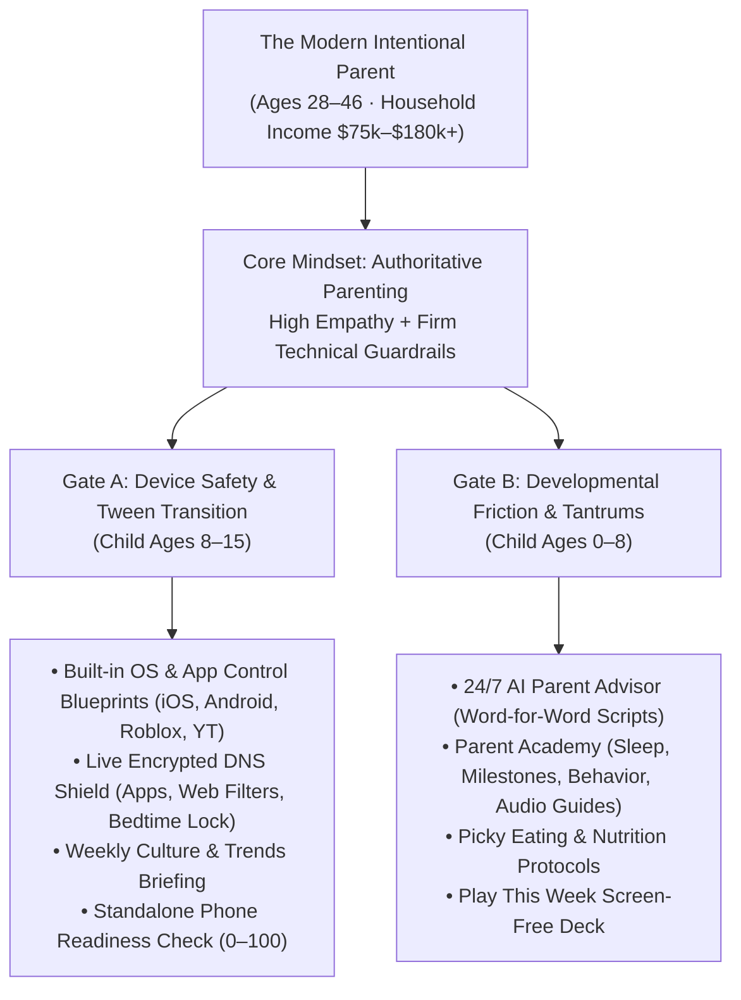

# Alongside — Canonical Ideal Customer Profile (ICP) Specification
**Document Version:** 2.0.0  
**Author:** Chief Technology Officer (CTO) & Product Strategy  
**Status:** Canonical Strategy Specification  
**Target Audience:** Product Team, Marketing, Sales, Engineering Leads, Investors  

---

## 1. Executive Summary & Core ICP Statement

> ### The Modern Intentional Parent
> A digitally literate, college-educated parent (ages 28–46) raising children aged 0–18 who strives for **authoritative parenting** (high warmth and emotional co-regulation paired with clear, firm boundaries). 
>
> They are exhausted by fragmented, anxiety-inducing parenting advice (panic-Googling at 2:00 AM, conflicting blogs, unvetted Reddit threads) and deeply alarmed by youth digital addiction, unrestricted app downloads, and late-night scrolling. They want a **calm, evidence-based family operating system** that gives them instant developmental guidance and word-for-word scripts in high-stress moments **plus** real, practical control over what their child can access, download, and use—via priority-ranked built-in OS controls (Apple Screen Time, Google Family Link, Roblox, YouTube) and Live Encrypted DNS filtering.



---

## 2. Demographic & Socio-Economic Profile

| Attribute | Canonical ICP Profile | Secondary / Emerging Segment |
| :--- | :--- | :--- |
| **Parent Age** | **32 – 44 years old** (Millennials & elder Gen-Z) | 45 – 52 years old (Gen-X with late teenagers) |
| **Child Age Range** | **Ages 1 to 14** (Highest concentration: 1–5 toddlerhood, 8–14 pre-teen/early teen) | Infants 0–12 months, Teens 15–18 |
| **Household Structure** | Dual-income or working single parents; 1 to 3 children | Blended families, co-parenting households |
| **Household Income (HHI)** | **$75,000 – $180,000+ USD** (Discretionary income for child health, coaching & apps) | $50,000 – $74,000 USD (Value-conscious seekers) |
| **Education Level** | College degree or post-graduate education | Some college or specialized trade certification |
| **Geography** | Suburban, metro-adjacent, and tech-dense urban centers (US, UK, Canada, Australia, Western Europe) | English-proficient global expatriate communities |
| **Tech Literacy** | High: daily users of Slack/Teams, Notion, Spotify, Apple Health, smart home ecosystems | Moderate: comfortable with iOS/Android app stores |

---

## 3. Psychographic Profile & Behavioral Drivers

### 3.1 Core Values & Philosophy
1. **Authoritative, Not Permissive:** They believe discipline means *"to teach, guide, and protect"*—combining emotional warmth with real, enforceable boundaries around sleep, apps, downloads, and online safety.
2. **Real Technical Control Without Confusion:** They want to reliably block adult websites, require approval for every app download and purchase, cap daily screen time and YouTube Shorts, and enforce bedtime locks—without having to spend a weekend deciphering 40+ buried Apple Screen Time or Google Family Link menus or paying for fragile third-party bloat.
3. **Evidence & Neuroscience Oriented:** They value explanations rooted in child development (dopamine crashes, amygdala hijack, prefrontal cortex development, circadian sleep delay) rather than arbitrary "because I said so" rules.
4. **Guilt & Emotional Hijacking Vulnerability:** They know the theoretical best practices, but when exhausted after work, they get emotionally dysregulated by defiance, shouting, or tablet tantrums. They crave **in-the-moment scripts** that rescue them before they lose their temper.

### 3.2 Reading List & Influences
The Alongside ICP actively follows or consumes:
* **Dr. Becky Kennedy** (*Good Inside*) — Deep focus on internal emotional safety and parental repair.
* **Jonathan Haidt** (*The Anxious Generation*) — Urgent awareness of the rewiring of childhood by smartphones and social media.
* **Emily Oster** (*Cribsheet*, *Expecting Better*) — Data-driven, guilt-free parenting decisions.
* **Dr. Dan Siegel & Tina Payne Bryson** (*The Whole-Brain Child*) — Practical neurobiology and upstairs/downstairs brain models.
* **Podcasts & Communities:** *Huberman Lab* (sleep & dopamine episodes), *We Can Do Hard Things*, Reddit `r/Parenting` and `r/ScienceBasedParenting`.

---

## 4. The Two High-Intent Acquisition Gates

While Alongside serves children across ages 0–18, customer acquisition is propelled by two acute, urgent life moments where willingness to pay is concentrated:

```
┌──────────────────────────────────────────────────────────────────────────────────────────────────┐
│                                THE TWO HIGH-INTENT ACQUISITION GATES                             │
├──────────────────────────────────────────────────────────────────────────────────────────────────┤
│                                                                                                  │
│  GATE A: DEVICE SAFETY & THE TWEEN PHONE TRANSITION (AGES 8–15)                                  │
│  • Acute Trigger: Child begging for a phone, sneaking apps/YouTube Shorts, or staying up late.   │
│  • The Crisis: Unapproved downloads, Roblox/social chat risks, bypasses, and bedtime arguments.  │
│  • Why They Convert: Priority-ranked OS controls (iOS, Android, Roblox, YT) + Live DNS Shield.   │
│                                                                                                  │
│  GATE B: EARLY CHILDHOOD & TODDLER FRICTION (AGES 0–8)                                           │
│  • Acute Trigger: Picky eating meltdowns, bedtime resistance, biting, speech/motor panic.        │
│  • The Crisis: 2:00 AM panic Googling, conflicting advice, intense parental exhaustion and guilt.│
│  • Why They Convert: 24/7 AI Calm Advisor scripts + audio-first Parent Academy + Play This Week. │
│                                                                                                  │
└──────────────────────────────────────────────────────────────────────────────────────────────────┘
```

### 4.1 Gate A: The "Device Safety & First Phone" Parent (Highest Conversion Velocity)
* **Parent Persona Example:** *Laura & Mark (Parents of 11-year-old Leo)*. Leo is entering middle school and already uses an iPad, Roblox, and YouTube, and is now asking for an iPhone.
* **The Emotional Dilemma:** Mark wants Leo reachable for soccer pickup logistics; Laura wants strict control over what apps he can download, who can message him, daily time/Shorts limits, and automatic bedtime shutdowns—without getting outsmarted by time-zone tricks or calculator vaults.
* **Current Alternatives Considered:**
  * Trying to configure Apple Screen Time or Google Family Link blindly: Parents miss the critical anti-tamper lock (allowing kids to delete apps or change settings) and forget that OS controls don't reach inside Roblox or YouTube.
  * Expensive third-party subscription suites (Bark / Qustodio): $99–$140/yr for battery-draining VPN proxies with zero developmental education or scripts for the actual parenting conversations.
* **Why Alongside Wins:** Laura and Mark run the **2-minute Phone Readiness Check**, follow the **priority-ranked OS & App Blueprints** in 6 minutes (locking anti-tamper, *Ask to Buy* app approvals, Contacts Only, Roblox chat locks, and YouTube Shorts caps), and install the **Live Encrypted DNS Shield** (`.mobileconfig` DoH / Android Private DNS) to block adult sites, pause distracting apps, and enforce bedtime quiet hours across Wi-Fi and 5G.

### 4.2 Gate B: The "Early Childhood & Daily Friction" Parent (Highest Retention LTV)
* **Parent Persona Example:** *Jessica (Mother of 3-year-old Maya)*. Maya refuses to eat anything except beige carbohydrates and throws bowls across the kitchen during tantrums.
* **The Emotional Dilemma:** Jessica lost her temper, screamed, and spent the night crying with mother guilt. She doesn't have 45 minutes to watch a video lecture or wait 3 weeks for a child therapist appointment.
* **Current Alternatives Considered:**
  * Searching Reddit or Instagram reels: Anxious, conflicting, and guilt-inducing.
  * Huckleberry / BabyCenter: Outgrown after infancy; focuses on diaper logging rather than behavioral guidance.
* **Why Alongside Wins:** Jessica opens the **24/7 Calm Advisor**, types her crisis, and receives an instant, science-backed **word-for-word script** to regulate Maya's frustration while holding firm boundaries—paired with 4-minute audio Academy lessons and **Play This Week** screen-free activities.

---

## 5. Jobs-To-Be-Done (JTBD) Framework

| When I am... (Trigger) | I want to... (Action) | So that I can... (Outcome) |
| :--- | :--- | :--- |
| **Facing an intense bedtime or device meltdown** | Open a trusted companion and get an immediate, word-for-word de-escalation dialogue script | Stay calm, avoid shouting, and guide my child to sleep without guilt. |
| **Setting up or tightening controls on a kid's phone, tablet, or console** | Follow a priority-ranked checklist for iOS/Android/Roblox/YouTube + activate a Live DNS Shield | Control app downloads, purchases, adult content, daily time limits, and bedtime lockouts without missing hidden bypasses. |
| **Considering buying my child their first smartphone** | Run a structured 2-minute Phone Readiness Check (0–100) | Decide clearly whether they are ready for a smartphone, a starter watch, or shared family screens. |
| **Worried about my child's motor, speech, or social milestones** | Consult clear, age-calibrated developmental guides without doom-scrolling | Know what is developmentally normal and what questions to bring to our pediatrician. |
| **Hearing unfamiliar slang, games, or online trends** | Check the Weekly Culture & Trends briefing | Understand my child's digital world, spot app risks early, and spark meaningful dinner conversations. |

---

## 6. Competitive Differentiation: Where Competitors Fail the ICP

```
┌──────────────────────────────────────────────────────────────────────────────────────────────────┐
│                                 ICP COMPETITIVE POSITIONING MATRIX                               │
├───────────────────────┬───────────────────────────────┬──────────────────────────────────────────┤
│ Category / Competitor │ Why the ICP Rejects Them      │ Why Alongside Wins with This ICP         │
├───────────────────────┼───────────────────────────────┼──────────────────────────────────────────┤
│ Legacy Parental       │ • Fragile VPN proxies & bloat │ • Priority-ranked built-in OS blueprints │
│ Control Suites        │ • Zero developmental education  │ • Live Encrypted DNS Shield (Wi-Fi + 5G) │
│ (Bark, Qustodio)      │ • $99–$140/yr per silo        │ • Paired with 0–18 scripts & Academy     │
├───────────────────────┼───────────────────────────────┼──────────────────────────────────────────┤
│ Video Course Hubs     │ • Passive "content in trench" │ • Real-time 24/7 Calm Advisor            │
│ (Good Inside, Big     │ • Exhausted parents don't     │ • 10-second crisis dialogue scripts      │
│  Little Feelings)     │   watch 45-min video lectures │ • Free early access ($79/yr planned vs   │
│                       │ • $279/yr cost; zero controls │   $279/yr) + real device safety controls │
├───────────────────────┼───────────────────────────────┼──────────────────────────────────────────┤
│ Baby Trackers         │ • 90% churn by age 2          │ • Continuous lifespan progression (0–18) │
│ (Huckleberry,         │ • Only logs diapers & bottles │ • Evolves into speech, play, nutrition,  │
│  BabyCenter)          │ • Irrelevant for tantrums &   │   culture trends, and device controls    │
│                       │   school-age device challenges│                                          │
├───────────────────────┼───────────────────────────────┼──────────────────────────────────────────┤
│ Unassisted OS Menus   │ • 40+ buried settings         │ • Exact 6-min setup ranked by impact     │
│ (Raw Screen Time /    │ • Kids exploit missed locks   │ • Covers mixed-OS homes, Roblox & YT     │
│  Family Link alone)   │ • Zero behavioral guidance    │ • Live DNS Shield adds 1-tap app/bedtime │
└───────────────────────┴───────────────────────────────┴──────────────────────────────────────────┘
```

---

## 7. Willingness to Pay & Unit Economics

* **Price Elasticity:** High willingness to pay for peace of mind, family calm, and reliable child safety. Parents routinely spend $50–$279 on parenting courses or parental control subscriptions.
* **Alongside Pricing Strategy:**
  * **100% Free During Early Access:** Full access to Parent Academy, Weekly Culture & Trends, Calm Advisor, and Device Safety (OS Blueprints + Live DNS Shield + Readiness Check) with no credit card required, plus a 1-click Live Demo.
  * **$79.00 / year — Family Pass Annual (Planned Post-Early Access):** Less than $1.55/week—far below $279/yr influencer memberships or $99–$140/yr parental control subscriptions.
  * **$9.99 / month — Family Pass Monthly (Planned):** Flexible monthly option.

---

## 8. Anti-ICP: Who Alongside is NOT Built For

Clarifying who Alongside does **not** serve protects product velocity and prevents toxic customer churn:

1. **The Ultra-Permissive / Zero-Boundary Parent:**
   * *Behavior:* Parents who want zero limits on apps, downloads, bedtime screens, or age-inappropriate content.
   * *Why We Disqualify:* Zero alignment with Alongside's core mission of healthy developmental boundaries, restorative sleep, and intentional device safety.
2. **The Medical Telehealth / Emergency Seeker:**
   * *Behavior:* Parents seeking emergency diagnostic prescriptions, clinical symptom triage, medication dosing calculators, or replacement for urgent medical care.
   * *Why We Disqualify:* Alongside is strictly an educational child upbringing and parenting companion (SOU-86 non-clinical mandate).
3. **The Passive "Course Collector" Seeking Only Video Entertainment:**
   * *Behavior:* Users looking for long-form celebrity podcasts rather than concise daily scripts, audio lessons, and practical device controls.
   * *Why We Disqualify:* Alongside optimizes for fast, in-the-moment clarity and technical follow-through.

---

## 9. Go-To-Market (GTM) Acquisition Channels for This ICP

To acquire the Modern Intentional Parent efficiently while avoiding hyper-competitive broad consumer ad bidding:

1. **High-Intent Digital & Tech-Parent Launches:**
   * **Hacker News (`Show HN`) & Product Hunt:** Lead with the 1-click Live Demo, the technical architecture of OS-native Encrypted DNS (signed iOS `.mobileconfig` DoH + Android Private DNS DoT), and the priority-ranked OS parental controls engine.
   * **High-Intent Parent Communities:** `r/ScienceBasedParenting`, `r/Parenting`, `r/Daddit`, `r/Mommit`, `r/tweens`, Substack Notes (*After Babel*, *ParentData* readers), and local school/parent Facebook groups.
2. **Pediatric & School PTA Synergy:**
   * PTA / Middle school transition packets distributed during 4th-to-6th grade orientation (*"Preparing for your child's first phone & OS safety setup checklist"*).
3. **Weekly Culture & Trends + SEO Flywheel (Organic Word-of-Mouth):**
   * Shareable **Culture & Trends** explainers (apps, games, slang, hidden settings) and high-intent guides (*"how to lock down iPhone Screen Time for an 11-year-old"*, *"YouTube Shorts limit Family Link"*, *"toddler transition meltdown script"*).
