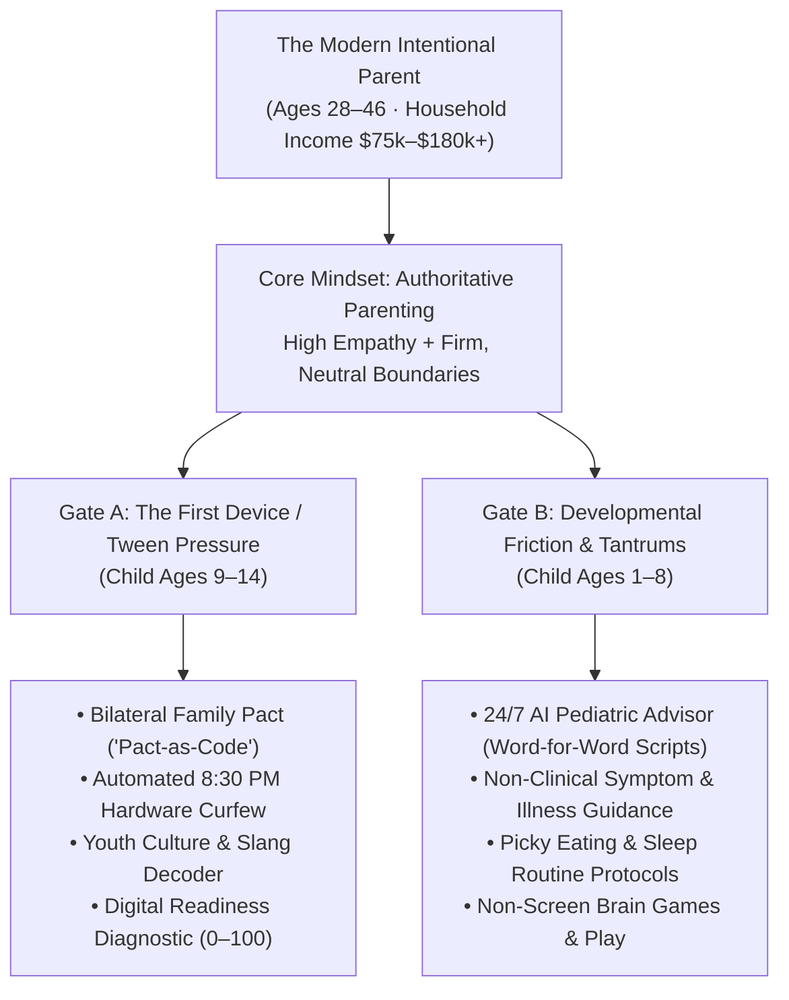

# Alongside — Canonical Ideal Customer Profile (ICP) Specification
**Document Version:** 1.0.0  
**Author:** Chief Technology Officer (CTO) & Product Strategy  
**Status:** Canonical Strategy Specification  
**Target Audience:** Product Team, Marketing, Sales, Engineering Leads, Investors  

---

## 1. Executive Summary & Core ICP Statement

> ### The Modern Intentional Parent
> A digitally literate, college-educated parent (ages 28–46) raising children aged 0–18 who strives for **authoritative parenting** (high warmth and emotional co-regulation paired with clear, non-negotiable boundaries). 
>
> They are exhausted by fragmented, anxiety-inducing parenting advice (panic-Googling at 2:00 AM, conflicting blogs, unvetted Reddit threads) and deeply alarmed by youth digital addiction. However, they categorically reject authoritarian surveillance apps (like Bark or Qustodio) that spy on private chats and destroy parent-child trust. They want a **calm, evidence-based family operating system** that provides instant pediatric developmental scripts in high-stress moments and a neutral, collaborative mechanism for technology boundaries.



---

## 2. Demographic & Socio-Economic Profile

| Attribute | Canonical ICP Profile | Secondary / Emerging Segment |
| :--- | :--- | :--- |
| **Parent Age** | **32 – 44 years old** (Millennials & elder Gen-Z) | 45 – 52 years old (Gen-X with late teenagers) |
| **Child Age Range** | **Ages 1 to 14** (Highest concentration: 1–5 toddlerhood, 9–13 pre-teen) | Infants 0–12 months, Teens 15–18 |
| **Household Structure** | Dual-income or working single parents; 1 to 3 children | Blended families, co-parenting households |
| **Household Income (HHI)** | **$75,000 – $180,000+ USD** (Discretionary income for child health, coaching & apps) | $50,000 – $74,000 USD (Value-conscious seekers) |
| **Education Level** | College degree or post-graduate education | Some college or specialized trade certification |
| **Geography** | Suburban, metro-adjacent, and tech-dense urban centers (US, UK, Canada, Australia, Western Europe) | English-proficient global expatriate communities |
| **Tech Literacy** | High: daily users of Slack/Teams, Notion, Spotify, Apple Health, smart home ecosystems | Moderate: comfortable with iOS/Android app stores |

---

## 3. Psychographic Profile & Behavioral Drivers

### 3.1 Core Values & Philosophy
1. **Authoritative, Not Authoritarian:** They do not believe in corporal punishment, public shaming, or heavy-handed obedience. Instead, they believe discipline means *"to teach and guide"*, not *"to punish"*.
2. **Anti-Surveillance Stance:** They view stealth keyloggers and reading a child's private diary or group chats as toxic violations of trust that incentivize children to create burner accounts or hide distress.
3. **Evidence & Neuroscience Oriented:** They value explanations rooted in child development (dopamine crashes, amygdala hijack, prefrontal cortex development, circadian sleep delay) rather than arbitrary "because I said so" rules.
4. **Guilt & Emotional Hijacking Vulnerability:** They know the theoretical best practices, but when exhausted after work, they get emotionally dysregulated by defiance, shouting, or tablet tantrums. They crave **in-the-moment scripts** that rescue them before they lose their temper.

### 3.2 Reading List & Influences
The Alongside ICP actively follows or consumes:
* **Dr. Becky Kennedy** (*Good Inside*) — Deep focus on internal emotional safety and parental repair.
* **Jonathan Haidt** (*The Anxious Generation*) — Urgent awareness of the rewiring of childhood by smartphones and social media.
* **Emily Oster** (*Cribsheet*, *Expecting Better*) — Data-driven, guilt-free parenting decisions.
* **Dr. Dan Siegel & Tina Payne Bryson** (*The Whole-Brain Child*) — Practical neurobiology and upstairs/downstairs brain models.
* **Podcasts & Communities:** *Huberman Lab* (sleep & dopamine episodes), *We Can Do Hard Things*, Reddit `r/Parenting` and `r/ScienceBasedParenting`.

---

## 4. The Two High-Intent Acquisition Gates

While Alongside serves children across ages 0–18, customer acquisition is propelled by two acute, urgent life moments where willingness to pay is concentrated:

```
┌──────────────────────────────────────────────────────────────────────────────────────────────────┐
│                                THE TWO HIGH-INTENT ACQUISITION GATES                             │
├──────────────────────────────────────────────────────────────────────────────────────────────────┤
│                                                                                                  │
│  GATE A: THE TWEEN PHONE TRANSITION (AGES 9–14)                                                  │
│  • Acute Trigger: Child entering middle school, begging for a personal phone, peer group pressure.│
│  • The Crisis: Nighttime screen battles, sleep deprivation, fear of social media algorithms.    │
│  • Why They Buy: "Pact-as-Code" bilateral agreements + automated 8:30 PM curfew without spyware.│
│                                                                                                  │
│  GATE B: EARLY CHILDHOOD & TODDLER FRICTION (AGES 1–8)                                           │
│  • Acute Trigger: Picky eating meltdowns, bedtime resistance, biting, speech/motor milestone panic.│
│  • The Crisis: 2:00 AM panic Googling, conflicting advice, intense parental exhaustion and guilt.│
│  • Why They Buy: 24/7 AI Pediatric Advisor delivering immediate, word-for-word calming scripts.  │
│                                                                                                  │
└──────────────────────────────────────────────────────────────────────────────────────────────────┘
```

### 4.1 Gate A: The "First Phone / Tween Dilemma" Parent (Highest Conversion Velocity)
* **Parent Persona Example:** *Laura & Mark (Parents of 10-year-old Sophie)*. Sophie is starting 5th grade and begs for an iPhone because *"literally everyone in my class has one and I'm left out of group chats."*
* **The Emotional Dilemma:** Mark wants Sophie to have a phone for soccer pickup logistics; Laura is terrified of TikTok rabbit holes and late-night insomnia.
* **Current Alternatives Considered:**
  * Apple Screen Time: Clunky, easily bypassed by entering time-zone tricks, and causes arguments when daily limits hit.
  * Bark / Qustodio: Feels like putting an ankle monitor on their daughter; Laura hates reading Sophie's personal chats.
* **Why Alongside Wins:** Sophie and her parents co-create the **Bilateral Family Pact**, take the **Readiness Assessment (0–100)**, and install an automated Apple/Android profile that locks down at 8:30 PM. The phone itself enforces bedtime curfews neutrally, protecting the parent-child bond.

### 4.2 Gate B: The "Early Childhood & Daily Friction" Parent (Highest Retention LTV)
* **Parent Persona Example:** *Carlos & Maria (Parents of 14-month-old Mateo)* or *Jessica (Mother of 3-year-old Chloe)*. Chloe refuses to eat anything except beige carbohydrates and throws bowls across the kitchen during tantrums.
* **The Emotional Dilemma:** Jessica lost her temper, screamed, and spent the night crying with mother guilt. She doesn't have 45 minutes to watch a video lecture or wait 3 weeks for a child therapist appointment.
* **Current Alternatives Considered:**
  * Searching Reddit or Instagram reels: Anxious, conflicting, and guilt-inducing.
  * Huckleberry / BabyCenter: Outgrown after infancy; focuses on diaper logging rather than behavioral guidance.
* **Why Alongside Wins:** Jessica opens the **24/7 AI Child Advisor**, types her crisis, and receives an instant, pediatrician-backed **word-for-word script** to regulate Chloe's dopamine crash while preserving firm boundaries.

---

## 5. Jobs-To-Be-Done (JTBD) Framework

| When I am... (Trigger) | I want to... (Action) | So that I can... (Outcome) |
| :--- | :--- | :--- |
| **Facing an intense bedtime or device meltdown** | Open a trusted companion and get an immediate, word-for-word de-escalation dialogue script | Stay calm, avoid shouting, and guide my child to sleep without guilt. |
| **Considering buying my child their first smartphone or tablet** | Administer a structured digital readiness assessment and co-sign a clear agreement | Establish healthy boundaries *before* unboxing rather than fighting over them later. |
| **Worried about my child's motor, speech, or social milestones** | Consult clear, age-calibrated developmental horizons without doom-scrolling | Know what is developmentally normal and when to consult our pediatrician without panic. |
| **Hearing unfamiliar slang or trends (e.g., 'Skibidi', Roblox scams)** | Check a weekly culture and slang decoder | Understand my child's world, protect them from exploits, and spark meaningful dinner conversations. |
| **Exhausted from enforcing bedtime screen curfews manually** | Rely on neutral operating system automation (8:30 PM lockout) | Avoid being the "bad guy" cop while protecting my child's melatonin and deep restorative sleep. |

---

## 6. Competitive Differentiation: Where Competitors Fail the ICP

```
┌──────────────────────────────────────────────────────────────────────────────────────────────────┐
│                                 ICP COMPETITIVE POSITIONING MATRIX                               │
├───────────────────────┬───────────────────────────────┬──────────────────────────────────────────┤
│ Category / Competitor │ Why the ICP Rejects Them      │ Why Alongside Wins with This ICP         │
├───────────────────────┼───────────────────────────────┼──────────────────────────────────────────┤
│ Spyware & Surveillance│ • Feels like a police state   │ • Zero spyware guarantee                 │
│ (Bark, Qustodio,      │ • Breaks child trust          │ • Bilateral co-designed agreements       │
│  mSpy)                │ • Creates sneaky workarounds  │ • Neutral hardware-level bedtime locks   │
│                       │ • $99–$140/yr cost            │                                          │
├───────────────────────┼───────────────────────────────┼──────────────────────────────────────────┤
│ Video Course Hubs     │ • Passive "content in trench" │ • Real-time situational AI Advisor       │
│ (Good Inside, Big     │ • Exhausted parents don't     │ • 10-second crisis dialogue scripts      │
│  Little Feelings)     │   watch 45-min video lectures │ • $79/yr (vs. Good Inside's $279/yr)     │
│                       │ • Exorbitant pricing          │ • Complete lifespan family OS (0–18)     │
├───────────────────────┼───────────────────────────────┼──────────────────────────────────────────┤
│ Baby Trackers         │ • 90% churn by age 2          │ • Continuous lifespan progression (0–18) │
│ (Huckleberry,         │ • Only logs diapers & bottles │ • Evolves into speech, brain games,      │
│  BabyCenter)          │ • Irrelevant for tantrums,    │   nutrition, and digital balance         │
│                       │   eating, and school age      │                                          │
├───────────────────────┼───────────────────────────────┼──────────────────────────────────────────┤
│ Native OS Screen Time │ • Trivial for kids to bypass  │ • Cryptographically signed profiles      │
│ (Apple Screen Time,   │ • Zero behavioral guidance    │ • Grounded in developmental neurobiology │
│  Google Family Link)  │ • Constant friction & nagging │ • Pairs automation with parent education │
└───────────────────────┴───────────────────────────────┴──────────────────────────────────────────┘
```

---

## 7. Willingness to Pay & Unit Economics

* **Price Elasticity:** High willingness to pay for peace of mind, family calm, and child well-being. Parents routinely spend $50–$150 on single parenting books, courses, or pediatrician co-pays.
* **Alongside Pricing Strategy:**
  * **$79.00 / year — Annual Hero Pass (Primary Engine):** Positioned at less than $1.55/week. Readily perceived as a high-value steal compared to $279/yr influencer platforms or $120/yr spyware.
  * **$9.99 / month — Flex Pass:** Lower commitment tier for acute problem-solving (e.g., immediate phone transition month).
  * **7-Day Risk-Free Upfront Trial:** Allows parents to test the 24/7 AI Advisor and explore the Family Pact wizard before payment converts.

---

## 8. Anti-ICP: Who Alongside is NOT Built For

Clarifying who Alongside does **not** serve protects product velocity and prevents toxic customer churn:

1. **The Stealth Surveillance Hunter:**
   * *Behavior:* Parents demanding secret keystroke logging, reading raw SMS/WhatsApp chats, or tracking 24/7 real-time geolocation breadcrumbs.
   * *Why We Disqualify:* Violates Alongside's core architectural principle of mutual trust and bilateral family agreements.
2. **The Ultra-Permissive / Unmonitored Digital Parent:**
   * *Behavior:* Parents who use tablets as 8-hour digital babysitters and have no desire to establish curfews, healthy eating habits, or developmental limits.
   * *Why We Disqualify:* Zero alignment with Alongside's mission of developmental balance and restorative sleep.
3. **The Medical Telehealth / Emergency Seeker:**
   * *Behavior:* Parents seeking emergency diagnostic prescriptions, telemedicine appointments, or replacement for urgent medical care.
   * *Why We Disqualify:* Alongside is an educational child upbringing and neurobiology platform. Alongside strictly forbids clinical triage and medication dosing calculators (SOU-86 non-clinical mandate).

---

## 9. Go-To-Market (GTM) Acquisition Channels for This ICP

To acquire the Modern Intentional Parent efficiently while avoiding hyper-competitive broad consumer ad bidding:

1. **Pediatric & Elementary School Synergy:**
   * Pediatrician clinic waiting room QR assets (*"Preparing for your child's first phone"*).
   * PTA / Middle school transition packets distributed during 5th-to-6th grade orientation.
2. **High-Authority Content & Podcast Integrations:**
   * Sponsorship and guest placements on evidence-based parenting podcasts (*Good Inside*, *Huberman Lab*, *Your Parenting Mojo*).
   * High-ranking SEO pillar guides on high-intent search queries (*"10-year-old begging for phone"*, *"toddler dopamine crash after tablet"*, *"how to talk to tween about Roblox scams"*).
3. **Weekly Sunday Culture Flywheel (Organic Word-of-Mouth):**
   * The **Sunday Culture & Slang Digest** provides immediate conversational shareability between parents (*"Did you see what this new slang means? Check this app"*).
