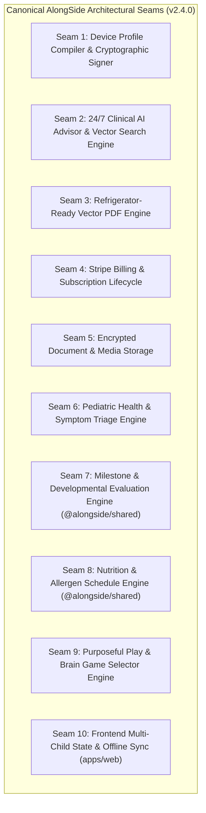
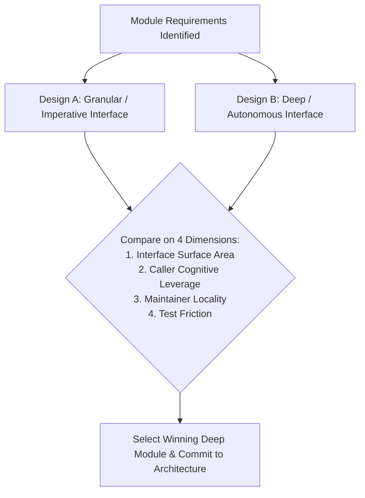

# Alongside — Codebase Design Specification: Deep Modules & Seam Architecture
**Author:** Chief Technology Officer (CTO)  
**Status:** Approved Engineering Standards  
**Version:** 2.4.0 (The Holistic Child Upbringing, Pediatric Health & Lifespan Family OS)  
**Target Audience:** Frontend Engineer, Backend Engineer, Technical Architects, Code Reviewers  
**Companion Documents:**  
- [**System Architecture Specification**](system-architecture.md)  
- [**Technical Roadmap v2.4.0**](technical-roadmap-v2.4.0.md)  
- [**Code Quality, Security & Testing Principles**](code-quality-principles.md)  
- [**Naming Conventions & Code Style Guide**](naming-conventions.md)  
- Active Rule: [`.agents/rules/06-codebase-design.md`](../.agents/rules/06-codebase-design.md)

---

## 1. Executive Summary & Design Mission

In software engineering, architectural decay rarely stems from missing features; it stems from **shallow abstractions**. When a codebase is comprised of thin, single-line pass-through layers, cognitive load explodes. Engineers (and autonomous AI agents) must trace execution across half a dozen files just to understand a simple user action, while changes in one layer trigger cascading ripple effects across all callers.

**Alongside enforces a strict architectural standard: Deep Modules placed at Clean Seams.**

```
┌────────────────────────────────────────────────────────┐
│                    DEEP MODULE                         │
│  Small Interface (Few methods, simple parameters)      │
├────────────────────────────────────────────────────────┤
│                                                        │
│  Deep Implementation (Rich behavior, validation,       │
│  cryptography, state machines, business invariants)    │
│                                                        │
└────────────────────────────────────────────────────────┘
       ▲ High Leverage for Callers | High Locality for Maintainers
```

The mission of this specification is threefold:
1. **Leverage for Callers:** Provide callers with massive capability per unit of interface complexity they must learn. One robust module pays compounding dividends across dozens of call sites and tests.
2. **Locality for Maintainers:** Concentrate domain logic, invariants, error handling, and verification inside the module so bugs are fixed once in one place, rather than scattered across the application.
3. **Effortless Testability:** Establish clean, swappable seams so high-level behavior can be tested through the module's public interface using real in-memory adapters without fragile mock cascades.

---

## 2. Canonical Vocabulary & Glossary

To maintain complete architectural clarity across our multi-agent team, engineers and agents MUST use these terms exactly as defined. Do NOT substitute fuzzy colloquialisms like "component," "service," "API," or "boundary."

| Canonical Term | Strict Definition | Prohibited Substitutes |
| :--- | :--- | :--- |
| **Module** | Anything with an **Interface** and an **Implementation**. Deliberately scale-agnostic: a pure function, a domain class, an npm workspace package (`packages/shared`), or a tier-spanning feature slice (`modules/device-profiles`). | *Unit, component, service* |
| **Interface** | Everything a caller must know to use the module correctly: the TypeScript type signature, but also invariants, ordering constraints, error modes, required configuration, and performance characteristics. | *API, signature* (too narrow; they denote only the type-level syntax) |
| **Implementation** | What is inside a module; its private body of code, internal helper functions, and hidden state. Distinct from **Adapter**. | *Body, logic* |
| **Depth** | Leverage at the interface. The quantity of behavior a caller (or test) can exercise per unit of interface surface they have to learn. A module is **deep** when high behavior sits behind a compact interface; **shallow** when its interface is nearly as complex as its implementation. | *Ratio of lines of code* (rejected: rewards verbose code) |
| **Seam** | *(Michael Feathers)* A place where you can alter behavior without editing in that place; the exact location at which a module's interface lives. Where to place the seam is a first-class architectural decision. | *Boundary* (overloaded with DDD's bounded context) |
| **Adapter** | A concrete artifact that satisfies an interface at a seam. Describes the *role* (what slot it fills), not substance (what is inside). E.g., `AppleMobileConfigSigner` vs `FakeDevProfileSigner`. | *Implementation, plugin* |
| **Leverage** | What callers gain from depth: maximum capability per unit of interface learned. One deep implementation pays back across $N$ call sites and $M$ tests. | *Efficiency, utility* |
| **Locality** | What maintainers gain from depth: change, bugs, invariants, and verification concentrate in one place rather than spreading across callers. Fix once, fixed everywhere. | *Modularity, cohesion* |

### Rejected Framings
- ❌ **Depth as a ratio of implementation lines to interface lines:** Superficial and toxic; it rewards padding implementations with unnecessary boilerplate. We measure depth as **behavioral leverage**.
- ❌ **"Interface" as only the TypeScript `interface` keyword:** Too narrow. An interface includes preconditions, error codes thrown, and ordering rules.
- ❌ **"Boundary":** Overloaded with Domain-Driven Design terminology. Always use **Seam** or **Interface**.

---

## 3. Deep vs. Shallow Modules

### 3.1 The Structural Difference

```
   SHALLOW MODULE (ANTI-PATTERN)                   DEEP MODULE (ALONGSIDE MANDATE)
┌─────────────────────────────────┐             ┌─────────────────────────────────┐
│        Large Interface          │             │         Small Interface         │
│  (Many methods, complex params) │             │  (Single call, intuitive input) │
├─────────────────────────────────┤             ├─────────────────────────────────┤
│  Thin Implementation            │             │  Deep Implementation            │
│  - Merely passes arguments      │             │  - Enforces child age policies  │
│  - Leaks database schemas       │             │  - Validates cryptographic hash │
│  - No invariant enforcement     │             │  - Compiles Apple XML plist     │
│  - Callers must orchestrate     │             │  - Generates PKCS#7 CMS payload │
└─────────────────────────────────┘             └─────────────────────────────────┘
```

When evaluating any proposed module interface, ask three questions:
1. **Can I reduce the number of exposed methods?**
2. **Can I simplify the parameters by encapsulating internal state?**
3. **Can I hide more underlying complexity inside the module implementation?**

---

### 3.2 The Deletion Test

The ultimate heuristic for evaluating module depth is the **Deletion Test**:

> **The Deletion Test:**  
> Imagine deleting the module entirely.  
> - If the complexity of the system simply vanishes, the module was a **shallow pass-through** (it existed only as administrative ceremony).  
> - If that complexity immediately reappears scattered across $N$ callers who now have to reconstruct the logic themselves, the module was **deep and earning its keep**.

---

### 3.3 Concrete Anti-Patterns in Alongside

#### Anti-Pattern A: The Anemic Pass-Through Service
A controller method accepts a request, passes it to a service method with the exact same arguments, which passes it to Prisma with the exact same arguments:
```typescript
// ❌ SHALLOW PASS-THROUGH (BANNED)
export class AgreementService {
  async getAgreement(id: string) {
    return prisma.agreement.findUnique({ where: { id } });
  }
}
```
*Why this fails:* If you delete `AgreementService.getAgreement()`, zero complexity is lost. It is a useless layer that adds latency and maintenance overhead without providing leverage or enforcing domain invariants.

#### Anti-Pattern B: The Leaky Device Profile Compiler
A module forces the caller to understand the internal structure of Apple configuration profiles:
```typescript
// ❌ SHALLOW & LEAKY INTERFACE (BANNED)
export interface ShallowProfileCompiler {
  createPayloadHeader(uuid: string, orgName: string): PlistNode;
  addAppAccessRestrictions(node: PlistNode, ageLimit: number): void;
  addCurfewSchedule(node: PlistNode, startTime: string, endTime: string): void;
  signWithForge(node: PlistNode, cert: forge.pki.Certificate, key: forge.pki.PrivateKey): string;
  createSha256Checksum(payload: string): string;
}
```
*Why this fails:* The caller must know the precise order of operations, manage low-level AST nodes, and handle raw cryptographic keys. The caller has negative leverage.

#### The Deep Alternative:
```typescript
// ✅ DEEP MODULE INTERFACE (MANDATORY)
export interface ProfileCompiler {
  compileAndSign(agreement: BilateralPactDefinition, platform: 'APPLE_IOS' | 'ANDROID_ENTERPRISE'): Promise<SignedDeviceProfileResult>;
}
```
*Why this succeeds:* The caller provides the domain treaty and target OS. Inside the implementation, the compiler:
1. Translates bedtime curfew (e.g. `20:30`) into Apple `com.apple.applicationaccess` restrictions.
2. Injects the Emergency Whitelist (phone calls, emergency services, parent contacts remain open 24/7).
3. Serializes the XML plist structure.
4. Generates a cryptographic PKCS#7 signed CMS message using SHA-256 digest.
5. Computes verification fingerprints and sets the MIME headers.

The caller learns **one method with two clean arguments** and receives a production-ready, signed enrollment payload.

---

## 4. Designing for Testability

Testability is not an afterthought added via dependency mocks; testability is a direct mathematical consequence of clean module design.

### 4.1 Rule 1: Accept Dependencies, Don't Create Them

Modules must accept their external collaborators (adapters at seams) via constructor or parameter injection, rather than instantiating hardcoded singletons internally.

```typescript
// ❌ UNTESTABLE: Instantiates hardcoded external service
export class AiAdvisorEngine {
  private openai = new OpenAI({ apiKey: process.env.OPENAI_API_KEY });
  
  async ask(prompt: string) {
    return this.openai.chat.completions.create({ ... });
  }
}

// ✅ TESTABLE: Accepts adapter interface at the seam
export class AiAdvisorEngine {
  constructor(private readonly llmAdapter: LlmStreamAdapter) {}

  async ask(prompt: string): Promise<AdvisorStreamResponse> {
    return this.llmAdapter.generateStream(prompt);
  }
}
```

### 4.2 Rule 2: Return Results, Don't Produce Hidden Side Effects

Whenever possible, design domain logic as pure functional transformations. Given the same inputs, the module must return the exact same output without mutating external state.

```typescript
// ❌ HARD TO TEST: Mutates database directly as a side effect
export async function applyCurfewViolation(childId: string, violationMinutes: number): Promise<void> {
  const child = await prisma.child.findUnique({ where: { id: childId } });
  await prisma.deviceProfile.update({
    where: { childId },
    data: { lockoutMinutes: child.curfewLockout + violationMinutes }
  });
}

// ✅ CLEAN & TESTABLE: Pure calculation returning an immutable decision
export function calculateCurfewEnforcement(
  currentCurfew: CurfewSchedule, 
  violation: CurfewViolationEvent
): CurfewEnforcementDecision {
  const updatedCurfew = adjustBedtimeForViolation(currentCurfew, violation);
  return {
    shouldLockDevice: violation.isAfterCurfew,
    nextEnforcementTime: updatedCurfew.effectiveLockTime,
    enforcementReason: violation.reason,
  };
}
```

### 4.3 Rule 3: Small Surface Area (The Interface is the Test Surface)

If a module requires 15 test setup fixtures just to invoke a single method, the interface is too wide. 
- Callers and tests cross the **exact same seam**.
- If a test has to reach *past* the interface to inspect private variables or mock internal helper classes, the module's seam is in the wrong place.

---

## 5. The Alongside Canonical Seam Catalog

To guarantee velocity and eliminate merge conflicts across our holistic platform, Alongside defines **10 canonical seams**. Every seam represents a critical architectural boundary with a small public interface, a production adapter, and an in-memory test fake adapter.



---

### Seam 1: Device Profile Compiler & Cryptographic Signer

- **Location:** `apps/api/src/modules/device-profiles/`
- **Responsibility:** Compiles bilateral agreements into Apple `.mobileconfig` XML plists and Android Enterprise JSON policies, applying PKCS#7 cryptographic signing.
- **Interface:**
  ```typescript
  export interface DeviceProfileCompiler {
    compileAndSign(
      agreement: BilateralAgreementRecord, 
      platform: 'APPLE_IOS' | 'ANDROID_ENTERPRISE'
    ): Promise<CompiledProfileResult>;
  }

  export interface CompiledProfileResult {
    payloadBuffer: Buffer;
    mimeType: string;
    profileUuid: string;
    sha256Checksum: string;
    isSigned: boolean;
  }
  ```
- **Adapters:**
  1. `AppleMobileConfigSigner` (Production): Uses `node-forge` to wrap XML plists in PKCS#7 signed CMS envelopes using Apple Developer WWDR certificates.
  2. `AndroidEnterprisePolicyAdapter` (Production): Compiles managed Google Play restrictions and lockout windows.
  3. `FakeDevProfileSigner` (Test Adapter): Emits deterministic mock signed buffers without requiring Apple developer signing keys, enabling sub-second unit and integration testing.

---

### Seam 2: 24/7 Clinical AI Advisor & Vector FAQ Retrieval

- **Location:** `apps/api/src/modules/ai-advisor/`
- **Responsibility:** Ingests parent queries, executes semantic vector retrieval against the 250+ Clinical Parenting FAQ repository in `pgvector`, and streams empathy-first, developmentally grounded guidance with strict medical emergency overrides.
- **Interface:**
  ```typescript
  export interface AiAdvisorEngine {
    generateGuidanceStream(
      query: AdvisorQueryInput, 
      context: ChildDevelopmentalContext
    ): AsyncIterable<AdvisorTokenChunk>;
  }

  export interface VectorSearchAdapter {
    findSimilarFaqs(embedding: number[], topK: number, minSimilarity: number): Promise<FaqSearchResult[]>;
  }

  export interface ClinicalSafeHarborFilter {
    evaluateEmergencyTriage(queryText: string): ClinicalEmergencyCheckResult;
  }
  ```
- **Adapters:**
  1. `MultiLlmCascadeAdapter` (Production): Streams SSE tokens via OpenAI (`gpt-4o-mini`/`gpt-4o`) with automatic failover to Gemini and Mistral (`open-mistral-7b`).
  2. `PgVectorCosineAdapter` (Production): Executes SQL vector similarity queries `1 - (embedding <=> target_vector)`.
  3. `DeterministicAiAdvisorFake` (Test Adapter): Returns canned token streams (e.g. "Take a deep breath...") immediately, preventing expensive LLM API calls in CI.
  4. `InMemoryVectorSearchFake` (Test Adapter): In-memory array cosine calculator for fast Vitest suites.

---

### Seam 3: Refrigerator-Ready Vector PDF Engine

- **Location:** `apps/api/src/modules/agreements/`
- **Responsibility:** Renders high-fidelity, vector-crisp 1-2 page PDF Family Media Agreements containing co-signatures, bilateral clauses, and the "Safe Harbor Guarantee" seal.
- **Interface:**
  ```typescript
  export interface PdfDocumentRenderer {
    renderAgreementPdf(agreement: BilateralAgreementRecord): Promise<Buffer>;
  }
  ```
- **Adapters:**
  1. `ReactPdfRendererAdapter` (Production): Uses `@react-pdf/renderer` to stream vector PDF buffers with custom typography and badge watermarks.
  2. `InMemoryPdfFake` (Test Adapter): Produces a valid, minimal 100-byte PDF stream (`%PDF-1.4...`) to test Fastify download routes, MIME headers, and file transfer speed.

---

### Seam 4: Stripe Billing & Subscription Lifecycle

- **Location:** `apps/api/src/modules/billing/`
- **Responsibility:** Manages 7-day upfront trial activation, $79/year Annual Hero Pass checkout sessions, and asynchronous webhook lifecycle sync.
- **Interface:**
  ```typescript
  export interface BillingGateway {
    createCheckoutSession(userId: string, plan: SubscriptionPlan): Promise<CheckoutSessionResult>;
    handleWebhookEvent(rawBody: string, signature: string): Promise<BillingEventResult>;
    getSubscriptionStatus(userId: string): Promise<UserSubscriptionState>;
  }
  ```
- **Adapters:**
  1. `StripeBillingAdapter` (Production): Connects to Stripe SDK, validates HMAC webhook signatures, and triggers Customer Portal URLs.
  2. `FakeBillingGateway` (Test Adapter): Simulates checkout completion, active trial status, past-due states, and trial cancellation in-memory.

---

### Seam 5: Encrypted Document & Media Storage

- **Location:** `apps/api/src/modules/storage/`
- **Responsibility:** Stores and retrieves signed `.mobileconfig` profiles, agreement PDF exports, and audio recordings.
- **Interface:**
  ```typescript
  export interface StorageEngine {
    upload(key: string, buffer: Buffer, mimeType: string): Promise<string>;
    download(key: string): Promise<Buffer>;
    getSignedDownloadUrl(key: string, expiresInSeconds: number): Promise<string>;
  }
  ```
- **Adapters:**
  1. `EncryptedS3StorageAdapter` (Production): Uploads to S3/Cloud Storage with server-side AES-256 encryption.
  2. `InMemoryStorageFake` (Test Adapter): Stores files in a `Map<string, Buffer>`, eliminating cloud storage dependencies during integration tests.

---

### Seam 6: Pediatric Health & Symptom Triage Engine

- **Location:** `apps/api/src/modules/health/`
- **Responsibility:** Evaluates pediatric symptoms (fever, rashes, breathing, earaches) against Barton Schmitt Pediatric Telephone Protocols and AAP guidelines, producing calibrated Red, Yellow, or Green zone directives.
- **Interface:**
  ```typescript
  export interface PediatricTriageEngine {
    triageSymptom(input: SymptomTriageInput): SymptomTriageResult;
    calculateAntipyreticDosage(childWeightLbs: number, medication: 'ACETAMINOPHEN' | 'IBUPROFEN', ageMonths: number): DosageResult;
  }

  export interface SymptomTriageResult {
    zone: 'RED' | 'YELLOW' | 'GREEN';
    requiresEmergency911: boolean;
    conditionSuspected: string;
    clinicalRationale: string;
    immediateActions: string[];
    homeCareMeasures?: string[];
    pediatricianQuestions?: string[];
    primaryClinicalSource: string;
  }
  ```
- **Adapters:**
  1. `BartonSchmittTriageAdapter` (Production): Deterministic rule engine encoding age-stratified fever cutoffs and respiratory retraction flags.
  2. `FakePediatricTriageAdapter` (Test Adapter): Configurable test fake returning canned triage outcomes for Fastify integration tests.

---

### Seam 7: Milestone & Developmental Evaluation Engine (`@alongside/shared`)

- **Location:** `packages/shared/src/algorithms/milestones.ts`
- **Responsibility:** Pure algorithmic computation assessing child gross motor, fine motor, speech & language bursts, and cognitive milestones from CDC and Bright Futures benchmarks (Ages 0 to 18).
- **Interface:**
  ```typescript
  export function calculateDevelopmentalTier(birthYear: number, birthMonth: number, currentMonthYear?: Date): DevelopmentalTier;
  export function evaluateMilestoneProgress(childAgeMonths: number, achievedMilestoneIds: string[]): MilestoneEvaluationResult;
  export function getMilestoneCatalogByTier(tier: DevelopmentalTier, category?: 'GROSS_MOTOR' | 'FINE_MOTOR' | 'SPEECH' | 'COGNITIVE'): MilestoneDefinition[];
  ```
- **Seam Property:** Pure functional module in `@alongside/shared`. Zero network side effects, 100% unit test coverage in Vitest.

---

### Seam 8: Nutrition & Allergen Schedule Engine (`@alongside/shared`)

- **Location:** `packages/shared/src/algorithms/nutrition.ts`
- **Responsibility:** Pure mathematical and rule-based scheduling for infant feeding transitions (milk/puree/BLW), safe early allergen introduction timelines (4–11 months), and choking hazard screening.
- **Interface:**
  ```typescript
  export function resolveFeedingStage(ageMonths: number): FeedingStageRecommendation;
  export function generateAllergenIntroductionSchedule(childAgeMonths: number, knownAllergies: string[]): AllergenScheduleItem[];
  export function screenChokingHazards(foodDescription: string, childAgeMonths: number): ChokingHazardAssessment;
  ```
- **Seam Property:** Pure functional module in `@alongside/shared`. Shared symmetrically between client UI forms and backend validators.

---

### Seam 9: Purposeful Play & Brain Game Selector Engine

- **Location:** `apps/api/src/modules/brain-games/`
- **Responsibility:** Recommends age-tailored developmental play activities, puppets, sensory bins, and logic puzzles grounded in Harvard Center on the Developing Child ("Serve and Return") research.
- **Interface:**
  ```typescript
  export interface PlayActivityRecommender {
    recommendDailyPlay(childTier: DevelopmentalTier, currentInterests?: string[]): Promise<BrainGameActivityDTO>;
    getPlayCatalog(childTier: DevelopmentalTier, category?: PlayCategory): Promise<BrainGameActivityDTO[]>;
  }
  ```
- **Adapters:**
  1. `DevelopmentalPlayAdapter` (Production): Pulls curated Montessori and sensory activities weighted by developmental tier and season.
  2. `FakePlayRecommender` (Test Adapter): Returns deterministic daily activities for test isolation.

---

### Seam 10: Frontend Multi-Child State & Offline Synchronization (`apps/web`)

- **Location:** `apps/web/src/stores/` & `apps/web/src/hooks/`
- **Responsibility:** Encapsulates global multi-child selection, multi-step pact negotiation, and offline Service Worker caching for symptom guides and slang dictionaries.
- **Interface:**
  ```typescript
  export interface ChildContextStore {
    children: ChildSummaryDTO[];
    activeChildId: string | null;
    activeChild: ChildSummaryDTO | null;
    setActiveChild: (childId: string) => void;
    setChildren: (children: ChildSummaryDTO[]) => void;
  }

  export interface PactWizardStore {
    currentStep: PactWizardStep;
    selectedClauses: Set<string>;
    customClauses: CustomClauseItem[];
    parentSignature: string | null;
    childSignature: string | null;
    toggleClause: (clauseId: string) => void;
    setCoSignature: (role: 'parent' | 'child', signatureDataUrl: string) => void;
  }
  ```
- **Adapters:**
  1. `ZustandChildContextStore` (Production): Client-side reactive store persisted in `localStorage`.
  2. `SerwistPwaAdapter` (Production): Service Worker caching for offline symptom guides, de-escalation scripts, and slang dictionaries.
  3. `MockStores` (Test Adapter): Pre-populated Zustand fixtures for Playwright E2E and Vitest component testing.

## 6. "Design It Twice" Protocol

To prevent accidental shallow architectures, engineers and autonomous agents MUST practice the **"Design It Twice"** protocol whenever introducing a new domain module or refactoring a seam.



### Case Study: Designing AlongSide's `DeviceProfileCompiler`

#### Candidate Interface A (The Granular Builder):
```typescript
// CANDIDATE A: Granular Builder
class MobileConfigBuilder {
  setOrganization(name: string): this;
  setPayloadUuid(uuid: string): this;
  setBedtimeCurfew(start: string, end: string): this;
  setAgeRating(maxRating: number): this;
  addEmergencyBypassApp(bundleId: string): this;
  toXmlPlist(): string;
  signPayload(cert: Certificate, key: PrivateKey): Buffer;
}
```
- *Methods to learn:* 7 methods.
- *Caller burden:* Caller must remember to add emergency bypasses (if forgotten, child cannot call 911!), must manage UUID generation, and must handle certificate cryptography.
- *Locality:* Weak. Any rule change requires editing all callers.

#### Candidate Interface B (The Deep Domain Module):
```typescript
// CANDIDATE B: Deep Domain Module
interface DeviceProfileCompiler {
  compileAndSign(
    agreement: BilateralAgreementRecord, 
    platform: TargetPlatform
  ): Promise<CompiledProfileResult>;
}
```
- *Methods to learn:* **1 method.**
- *Caller burden:* Caller passes the domain agreement and target platform.
- *Locality:* Perfect. Emergency whitelists, XML generation, curfew translation, and cryptographic signing are fully encapsulated and guaranteed by the module.
- **Verdict: Interface B selected.** High leverage, zero leakage, robust invariants.

---

## 7. Refactoring & Deepening Recipes

When an agent or engineer identifies a shallow module during code review or pre-commit verification, use these 3 deepening recipes:

### Recipe 1: Pull Up Caller Orchestration
- **Symptom:** Callers repeatedly execute the same sequence of 3–5 method calls across different parts of the app.
- **Refactoring:** Pull that orchestration sequence inside the module behind a single expressive method. Simplify the parameters to match the caller's true intent.

### Recipe 2: Eliminate Thin Pass-Through Adapters
- **Symptom:** A class or service contains methods that do nothing except forward parameters to another object unchanged (e.g., `service.findById(id)` -> `prisma.child.findById(id)`).
- **Refactoring:** Either:
  1. Deepen the service by giving it real domain responsibilities (e.g. verifying road type transitions, checking subscription limits, asserting parent tenancy).
  2. Or delete the pass-through method entirely if it serves no purpose.

### Recipe 3: Replace Mock-Heavy Layer Tests with Seam-Level Tests
- **Symptom:** Unit tests spend 80% of their lines configuring nested mocks (`vi.spyOn(prisma.child, 'findFirst').mockResolvedValue(...)`).
- **Refactoring:** Test through the module's public interface at the seam. Inject an in-memory adapter (e.g. `InMemoryChildRepository` or `FakeBillingGateway`). The test becomes readable, resilient to refactorings, and verifies true behavior rather than mock interactions.

---

## 8. Architectural Enforcement & Verification Checklist

Before marking any Paperclip task complete or merging code into `main`, verify adherence to this checklist:

- [ ] **Exact Vocabulary Used:** Code comments, PR descriptions, and architecture docs use `Module`, `Interface`, `Implementation`, `Seam`, and `Adapter` strictly.
- [ ] **Deletion Test Passed:** Every newly created module earns its keep; deleting it would scatter real complexity across callers.
- [ ] **No Shallow Pass-Throughs:** No controllers or services exist merely to forward calls to Prisma or downstream libraries without adding domain value.
- [ ] **Dependencies Accepted, Not Created:** External I/O and adapters are accepted via parameters/constructors, enabling easy substitution.
- [ ] **Pure Algorithmic Engines:** Complex rules (Readiness score, Pact presets, Slang evaluator) are pure functions in `packages/shared`.
- [ ] **Test Fakes Provided:** Every new I/O seam includes both a production adapter and an in-memory test fake adapter.
- [ ] **Interface is the Test Surface:** Automated tests cross the module's public interface without reaching into private implementation details.
