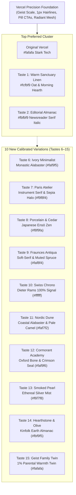

# Vercel + Brand Taste Evolutions — Complete Phase 1 Exploration (15 Variations)
**Product:** AlongSide (The Parent Advisory Sanctuary: Keep Up With Your Child As They Grow, Ages 0–18)  
**Status:** Phase 1 Design Exploration & Isolated Previews  
**Methodology:** [`design-taste-frontend`](file:///C:/Users/souhe/.gemini/antigravity-cli/skills/design-taste-frontend--5b0315d236/SKILL.md) & Vercel Geist Architecture Infusion  

---

## 1. Executive Context & The Calibrated Preference Orbit

During initial Phase 1 evaluations, the user identified that **Vercel** (`DESIGN-vercel.md`) provides the most compelling, disciplined layout foundation. However, copying Vercel 1:1 risks presenting AlongSide as a developer/cloud deployment tool.

When reviewing the initial 5 taste evolutions:
* **The Preferred Cluster:**
  - **Original Vercel:** Stark, razor-sharp monochrome precision, hairline borders (`1px solid #ebebeb`), tight tracking (`-0.04em`), and ambient radiant mesh aura.
  - **Taste 1: Warm Sanctuary Linen:** Organic oat/linen canvas softening (`#fcfbf9`), Morning Hearth sage & amber radiant aura, and bilateral shelter mark.
  - **Taste 2: Editorial Pediatric Almanac:** High-contrast archival ink foundation, refined *Newsreader Serif* italic accents in headlines, and clinical publishing prestige.
* **Rejected Directions (Tastes 3, 4, 5):**
  - Taste 3 (Biophilic Forest), Taste 4 (Clinical Blueprint), and Taste 5 (Terracotta Sunset) were discarded as too saturated, overly specialized, or noisy.
* **The Mandate:**
  - Generate **10 new distinct variations (Tastes 6 through 15)** that strictly orbit around the sweet spot of **Original Vercel, Taste 1 (Warm Linen), and Taste 2 (Editorial Almanac/Serif)**, giving the user a rich spectrum of nuanced, highly tasteful directions to choose wisely.

---

## 2. Directory of the 10 New Variations (Tastes 6–15)

### Taste 6: Ivory Minimalist (Pure Monastic Warmth & Geist Precision)
* **Standalone Prototype:** [`preview-vercel-taste-6-ivory-minimalist.html`](file:///C:/GithubProjects/paper_clip/previews/preview-vercel-taste-6-ivory-minimalist.html)
* **Design Philosophy:** Takes Vercel's stark `#fafafa` and gently warms it to an organic Alabaster Ivory (`#faf9f5`), paired with Carbon Slate (`#141413`) text, pure `#ffffff` cards, and a champagne radial bloom. Pure monastic focus.
* **Tokens:**
  - `canvas`: `#faf9f5` | `canvas-subtle`: `#f3f1ea` | `elevated`: `#ffffff`
  - `ink`: `#141413` | `body`: `#4c4c47` | `mute`: `#82827a`
  - `accent-primary`: `#141413` | `accent-highlight`: `#c7b99c` | `hairline`: `#eae7e0`
* **Typography:** Inter (Display Weight 700, tracking `-2.2px`) + JetBrains Mono.
* **Brand Mark:** Minimalist Double Pillar Shelter (two vertical hairlines with a 45° resting roof beam).
* **Psychological Impact:** Absolute serenity and focus. Zero visual noise or tech coldness; feels like an exclusive architectural studio.

---

### Taste 7: The Paris Atelier (Instrument Serif Italic & Archival Bone)
* **Standalone Prototype:** [`preview-vercel-taste-7-paris-atelier.html`](file:///C:/GithubProjects/paper_clip/previews/preview-vercel-taste-7-paris-atelier.html)
* **Design Philosophy:** The literary salon meets Vercel. Dark obsidian (`#101010`) ink on Archival Bone (`#f9f8f4`), paired with calligraphic *Instrument Serif* italic accents in headlines and an antique sepia & brass halo.
* **Tokens:**
  - `canvas`: `#f9f8f4` | `canvas-subtle`: `#f1efe8` | `elevated`: `#ffffff`
  - `ink`: `#101010` | `body`: `#444340` | `mute`: `#7e7c75`
  - `accent-primary`: `#101010` | `accent-brass`: `#9b7a44` | `hairline`: `#e4e0d6`
* **Typography:** Inter (Weight 700) + Instrument Serif (Italic moments) + JetBrains Mono.
* **Brand Mark:** Calligraphic Folio & Quill Monogram Seal.
* **Psychological Impact:** Commands immense intellectual prestige; reads like a timeless European publication built on Vercel's interaction speed.

---

### Taste 8: Porcelain & Muted Cedar (Japanese Architectural Tranquility)
* **Standalone Prototype:** [`preview-vercel-taste-8-porcelain-cedar.html`](file:///C:/GithubProjects/paper_clip/previews/preview-vercel-taste-8-porcelain-cedar.html)
* **Design Philosophy:** Muji and Kenya Hara's white space philosophy meets Vercel structure. Cool Porcelain White (`#f8f9fa`) with subtle Smoked Cedar Black (`#1b1c1d`) and whispering cedar ash radiant glow.
* **Tokens:**
  - `canvas`: `#f8f9fa` | `canvas-subtle`: `#f1f3f4` | `elevated`: `#ffffff`
  - `ink`: `#1b1c1d` | `body`: `#4b4e52` | `mute`: `#848990`
  - `accent-primary`: `#1b1c1d` | `accent-cedar`: `#735e51` | `hairline`: `#e5e7eb`
* **Typography:** Plus Jakarta Sans (Weight 700, tracking `-1.8px`) + Inter + JetBrains Mono.
* **Brand Mark:** Balanced Ensō Zen Stones (two minimalist balancing stone silhouettes).
* **Psychological Impact:** Soothing on eye fatigue; balanced whitespace eliminates cognitive overload for distracted parents.

---

### Taste 9: Fraunces Modern Antiqua (Warm Soft-Serif & Muted Spruce)
* **Standalone Prototype:** [`preview-vercel-taste-9-fraunces-antiqua.html`](file:///C:/GithubProjects/paper_clip/previews/preview-vercel-taste-9-fraunces-antiqua.html)
* **Design Philosophy:** Contemporary warm publishing (Stripe Press / Substack Reader). Warm Vellum (`#faf8f4`) canvas, Espresso Slate (`#161514`) typography, and Fraunces soft-serif display headlines.
* **Tokens:**
  - `canvas`: `#faf8f4` | `canvas-subtle`: `#f2eee6` | `elevated`: `#ffffff`
  - `ink`: `#161514` | `body`: `#4a4843` | `mute`: `#817e76`
  - `accent-primary`: `#161514` | `accent-spruce`: `#1e3a2f` | `hairline`: `#e8e4da`
* **Typography:** Fraunces (Variable Soft-Serif 600/700, optical size 144) + Inter + JetBrains Mono.
* **Brand Mark:** Botanical Sprout Serif Monogram.
* **Psychological Impact:** Deeply human, warm, and sophisticated without feeling antiquated; bridges tech craft and literary warmth.

---

### Taste 10: Swiss Chrono (Pure Vercel Engineering with Micro Warmth)
* **Standalone Prototype:** [`preview-vercel-taste-10-swiss-chrono.html`](file:///C:/GithubProjects/paper_clip/previews/preview-vercel-taste-10-swiss-chrono.html)
* **Design Philosophy:** Dieter Rams 10 Principles + Vercel pure black/white + Swiss watch precision. Stark Clean White (`#ffffff`) canvas, Pitch Black (`#0a0a0a`) text, and a single warm ochre micro-status indicator (`#d97706`).
* **Tokens:**
  - `canvas`: `#ffffff` | `canvas-subtle`: `#f7f7f8` | `elevated`: `#ffffff`
  - `ink`: `#0a0a0a` | `body`: `#454545` | `mute`: `#858585`
  - `accent-primary`: `#0a0a0a` | `accent-ochre`: `#d97706` | `hairline`: `#e5e5e5`
* **Typography:** Inter (Display Weight 800/900, tight tracking `-2.4px`) + JetBrains Mono.
* **Brand Mark:** Precision Dual-Axis Chrono Compass.
* **Psychological Impact:** Ultimate clarity and speed; parents who value engineering efficiency and zero clutter love this.

---

### Taste 11: Nordic Dune & Soft Sand (Gentle Organic Alabaster & Pale Camel)
* **Standalone Prototype:** [`preview-vercel-taste-11-nordic-dune.html`](file:///C:/GithubProjects/paper_clip/previews/preview-vercel-taste-11-nordic-dune.html)
* **Design Philosophy:** Ferm Living & Scandinavian coastal interior design meets Vercel. Warm Dune Sand canvas (`#faf7f2`), Dark Roast Espresso (`#1f1d1a`), and Pale Camel accents (`#b4783c`).
* **Tokens:**
  - `canvas`: `#faf7f2` | `canvas-subtle`: `#f3eee6` | `elevated`: `#ffffff`
  - `ink`: `#1f1d1a` | `body`: `#524e47` | `mute`: `#888278`
  - `accent-primary`: `#1f1d1a` | `accent-camel`: `#b4783c` | `hairline`: `#e9e4dc`
* **Typography:** Plus Jakarta Sans (Weight 800, tracking `-2.0px`) + Inter + JetBrains Mono.
* **Brand Mark:** Coastal Dune Contour & Sun Arc.
* **Psychological Impact:** Gentle, natural, and welcoming; feels like a sunlit Scandinavian nursery.

---

### Taste 12: Cormorant Academy (Classical Academic Excellence & Harvard Pediatric Prestige)
* **Standalone Prototype:** [`preview-vercel-taste-12-cormorant-academy.html`](file:///C:/GithubProjects/paper_clip/previews/preview-vercel-taste-12-cormorant-academy.html)
* **Design Philosophy:** Ivy League / Oxford University Press academic journals meets Vercel infrastructure. Oxford Bone (`#faf9f6`) canvas, Deep Navy-Charcoal ink (`#0f141c`), Cormorant Garamond serif headers, and crimson seal touch (`#991b1b`).
* **Tokens:**
  - `canvas`: `#faf9f6` | `canvas-subtle`: `#f1f2f5` | `elevated`: `#ffffff`
  - `ink`: `#0f141c` | `body`: `#3c4452` | `mute`: `#737c8e`
  - `accent-primary`: `#0f141c` | `accent-crimson`: `#991b1b` | `hairline`: `#e2e4e8`
* **Typography:** Cormorant Garamond (Weight 700) + Inter + JetBrains Mono.
* **Brand Mark:** Academic Shield & Laurel Branch.
* **Psychological Impact:** Maximum medical authority and clinical trustworthiness; feels like an endowed pediatric medical research center.

---

### Taste 13: Smoked Pearl & Silver Mist (Ethereal Neutral Calm)
* **Standalone Prototype:** [`preview-vercel-taste-13-smoked-pearl.html`](file:///C:/GithubProjects/paper_clip/previews/preview-vercel-taste-13-smoked-pearl.html)
* **Design Philosophy:** High-end architectural photography, Apple Pro packaging, muted luxury. Smoked Pearl (`#f6f7f8`) canvas, Carbon Graphite ink (`#121316`), and diffused silver mist aura.
* **Tokens:**
  - `canvas`: `#f6f7f8` | `canvas-subtle`: `#eeeff1` | `elevated`: `#ffffff`
  - `ink`: `#121316` | `body`: `#464850` | `mute`: `#7c7f8a`
  - `accent-primary`: `#121316` | `accent-silver`: `#64748b` | `hairline`: `#e3e5e8`
* **Typography:** Inter (Display Weight 700/800, tracking `-2.2px`) + JetBrains Mono.
* **Brand Mark:** Minimalist Silver Dual Orbit.
* **Psychological Impact:** Featherweight visual presence; cool, modern, and high-tech without any harshness.

---

### Taste 14: Hearthstone & Olive Leaf (The Refined Earth Almanac)
* **Standalone Prototype:** [`preview-vercel-taste-14-hearthstone-olive.html`](file:///C:/GithubProjects/paper_clip/previews/preview-vercel-taste-14-hearthstone-olive.html)
* **Design Philosophy:** Modern homesteading and organic culinary journals (Kinfolk, Cereal Magazine) meets Vercel card architecture. Hearthstone Chalk (`#fbf9f5`) canvas, Muted Cast-Iron ink (`#181916`), and Muted Olive Leaf (`#3f4f38`).
* **Tokens:**
  - `canvas`: `#fbf9f5` | `canvas-subtle`: `#f4f0e8` | `elevated`: `#ffffff`
  - `ink`: `#181916` | `body`: `#494a45` | `mute`: `#7f817a`
  - `accent-primary`: `#181916` | `accent-olive`: `#3f4f38` | `hairline`: `#e7e4db`
* **Typography:** Newsreader Serif + Plus Jakarta Sans + JetBrains Mono.
* **Brand Mark:** Hearthstone & Olive Sprig.
* **Psychological Impact:** Generational family warmth, wholesome, deeply human, grounded, and mature.

---

### Taste 15: Geist Pure Vercel — Refined for Families
* **Standalone Prototype:** [`preview-vercel-taste-15-geist-family.html`](file:///C:/GithubProjects/paper_clip/previews/preview-vercel-taste-15-geist-family.html)
* **Design Philosophy:** The direct Vercel twin with 1% parental warmth. True Vercel `#fafafa` canvas, `#171717` ink, 6px buttons, and iconic multi-stop radiant mesh hero aura refined into a soft **Dawn Horizon** (soft amber, violet pearl, whisper emerald at 20% opacity).
* **Tokens:**
  - `canvas`: `#fafafa` | `canvas-subtle`: `#f4f4f4` | `elevated`: `#ffffff`
  - `ink`: `#171717` | `body`: `#4d4d4d` | `mute`: `#8f8f8f`
  - `accent-primary`: `#171717` | `accent-amber`: `#f59e0b` | `hairline`: `#eaeaea`
* **Typography:** Inter (Display 700/800, tight tracking `-2.4px`) + JetBrains Mono.
* **Brand Mark:** Vercel Apex Sanctuary Roof (triangle with an open arched portal at the apex).
* **Psychological Impact:** Exactly Vercel's world-class feel, but perfectly attuned for modern family software.

---

## 3. Comprehensive Comparison Matrix: The Core Cluster & 10 New Variations

| System | Canvas | Primary Ink | Key Accent | Typography Display | Visual Character & Vibe |
|---|---|---|---|---|---|
| **Original Vercel** | `#fafafa` | `#171717` | `#0070f3` | Inter / Geist Sans | Crisp monochrome developer flagship |
| **Taste 1: Warm Sanctuary** | `#fcfbf9` | `#191c1b` | `#28543e` (Sage) | Plus Jakarta Sans | Organic Scandinavian sanctuary & hearth |
| **Taste 2: Editorial Almanac** | `#fbfbf9` | `#111413` | `#143d2b` (Spruce) | Newsreader Serif Italic | Harvard/AAP clinical publication prestige |
| **Taste 6: Ivory Minimalist** | `#faf9f5` | `#141413` | `#c7b99c` (Champagne) | Inter Display 700 | Monastic minimalism & architectural calm |
| **Taste 7: Paris Atelier** | `#f9f8f4` | `#101010` | `#9b7a44` (Brass) | Instrument Serif Italic | Literary review prestige & high culture |
| **Taste 8: Porcelain & Cedar** | `#f8f9fa` | `#1b1c1d` | `#735e51` (Cedar) | Plus Jakarta Sans | Japanese Ensō Zen & tranquil space |
| **Taste 9: Fraunces Antiqua** | `#faf8f4` | `#161514` | `#1e3a2f` (Spruce) | Fraunces Soft-Serif | Contemporary publishing & gentle craft |
| **Taste 10: Swiss Chrono** | `#ffffff` | `#0a0a0a` | `#d97706` (Ochre) | Inter Tight 900 | Dieter Rams pure signal & chronometer |
| **Taste 11: Nordic Dune** | `#faf7f2` | `#1f1d1a` | `#b4783c` (Camel) | Plus Jakarta Sans | Coastal Scandinavian warmth & sunlit dune |
| **Taste 12: Cormorant Academy**| `#faf9f6` | `#0f141c` | `#991b1b` (Crimson) | Cormorant Garamond | Endowed medical research & academic seal |
| **Taste 13: Smoked Pearl** | `#f6f7f8` | `#121316` | `#64748b` (Silver) | Inter Display 700 | Apple Pro packaging & featherweight cool |
| **Taste 14: Hearthstone Olive** | `#fbf9f5` | `#181916` | `#3f4f38` (Olive) | Newsreader + Jakarta | Kinfolk organic homestead & mature warmth |
| **Taste 15: Geist Family** | `#fafafa` | `#171717` | `#f59e0b` (Dawn) | Inter Display 800 | 1% Warmth Vercel twin with sanctuary roof |

---

## 4. Master Switcher Hub Access

All 15 variations are fully wired into the interactive [**Master Switcher Hub**](file:///C:/GithubProjects/paper_clip/previews/index.html):
* **Row 1:** ⭐️ **Top Cluster (Preferred):** Original Vercel, Taste 1 (Warm Sanctuary), Taste 2 (Editorial Almanac).
* **Row 2:** ✨ **10 New Variations (Tastes 6 to 15):** Direct switching between all 10 new variations.
* **Row 3:** **Archive / Benchmarks:** Tastes 3–5 and original benchmarks.
* **Viewport Controls:** Live switching between Desktop (100%), Laptop (1024px), Tablet (768px), and Mobile (390px).
* **Live Inspector:** Instant inspection of color swatches, typography stack, border radii, brand marks, and suitability analysis.
