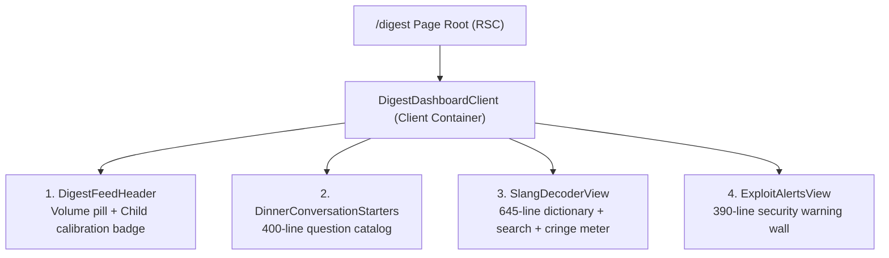

# AlongSide — Culture Digest UX Audit & Architectural Evaluation
**Author:** Frontend Autonomous Systems Engineer  
**Task ID:** SOU-80 (Phase 2 — Page-Level UX Exploration & Design Alternatives)  
**Target Route:** `apps/web/src/app/(dashboard)/digest/page.tsx` & Associated Components  
**Design System Standard:** Taste 2: Editorial Pediatric Almanac (`docs/design-system/MASTER.md`)  
**Status:** Complete Audit & Problem Diagnosis  

---

## 1. Executive Summary & Page Purpose

The **Sunday Youth Culture Digest** is intended to be a weekly parental intelligence briefing. Its stated brand mission is:
> *"Stay fluently ahead of adolescent slang, algorithmic viral trends, and covert device exploits without becoming the family police officer."*

### 1.1 The Customer Problem It Solves
Parents experience acute alienation from their children’s rapidly evolving cultural spheres. As children age through infancy, early childhood, grade school, and adolescence, their language, peer influences, social references, and media habits shift at dizzying speed. 
Parents want:
1. To feel **connected and relevant** to their children rather than alienated or out-of-touch.
2. High-quality **dinner conversation prompts** that prompt spontaneous dialogue rather than defensive, monosyllabic grunts ("Fine", "Good", "Nothing").
3. A sense of **relaxed mastery** ("Parent Calm") over what their kids are encountering, without having to obsessively monitor their screens or decipher TikTok trends alone.

---

## 2. Component Inspection & Current Architecture

The production page at `apps/web/src/app/(dashboard)/digest/page.tsx` renders a single client wrapper `DigestDashboardClient`, which stacks four vertical modules:

### Detailed Component Inventory:
1. **`DigestFeedHeader.tsx` (77 lines):**
   - Renders issue pill (`Volume 42 · Released Sunday 8:00 AM`) and active child badge (`Tailored for Leo (Age 10 · Pre-Teen)`).
   - Headline: *"Sunday Youth Culture Digest — The Living Feed to Keep Up With Your Child"*.
   - Flaw: The calibration badge claims to tailor the page, but the rest of the page remains largely static and irrelevant to the child's actual developmental stage.

2. **`DinnerConversationStarters.tsx` (400 lines):**
   - Groups questions into tiers (`INFANT`, `EARLY`, `ELEMENTARY`, `TWEEN`, `TEEN`).
   - Renders action buttons to shuffle questions, copy to clipboard, and view "Parent Calm" tips.
   - Flaw: Very text-heavy, repetitive layout cards with multiple layers of buttons and badges.

3. **`SlangDecoderView.tsx` (645 lines):**
   - Renders a search input, category filters (`ALL`, `ELEMENTARY`, `TWEEN`, `TEEN`), and cards for terms like *Rizz, Skibidi, Crashout, Cap, Bet, Brainrot, Slay, Fanum Tax, Mewing, Sus, Bop, Ohio*.
   - Includes a 5-bar "Cringe Meter" on every card.
   - **Critical Architectural Flaw:** If the child is an Infant (0–3) or Early Childhood (4–6), `resolveChildSlangTier` defaults to `'ALL'`. Parents of a 14-month-old baby (Mateo) or a 5-year-old kindergartener are immediately greeted with *Skibidi Toilet, Rizz, and Twitch streamer memes*!

4. **`ExploitAlertsView.tsx` (390 lines):**
   - Renders high-alert security warnings:
     - *In-Game Gambling Wheels & Unauthorized Virtual Currency Gifting* (Roblox, Fortnite)
     - *Server Raid Bots & Disappearing Photo Requests* (Discord, Snapchat)
     - *Algorithmic Infinite Scroll & Autoplay Hooks* (TikTok, Reels)
     - *Disguised Calculator Vault Apps & Hidden Storage*
   - Each card contains 4-5 bulleted protocols, platform tags, and "Pact-as-Code" neutral enforcement tips.
   - **Critical Problem:** Takes up over 35% of the page with alarming, wall-of-text cybersecurity advisories regardless of whether the child is a baby, has no phone, or is in grade school.

---

## 3. Critical Critique: Addressing the User's Core Questions

### 3.1 The Slang Problem: Static Words Irrelevant to Lifespan Tiers
Currently, the slang section assumes "youth culture" is exclusively **Gen-Z / Gen-Alpha online brainrot**. 

| Active Child Profile | Age & Road | What the Current Page Shows | Why It Fails the Parent |
| :--- | :--- | :--- | :--- |
| **Mateo** | Age 1 (14 mo) Pre-Device | "Rizz", "Skibidi", "Crashout", "Fanum Tax" | Absurd. Toddlers do not speak internet slang. Toddler culture is sensory play, first gestures, animal sounds, peek-a-boo, and favorite songs (*Wheels on the Bus*, *Ms. Rachel*). |
| **Maya** | Age 8 (3rd Grade) Pre-Device | "Crashout", "Calculator Vaults", "Discord Raid Bots" | Mismatched and alarmist. 8-year-old culture is schoolyard tag, trading cards, Roblox Adopt Me pets, jokes from Captain Underpants, and classroom dynamics. |
| **Julian** | Age 14 (9th Grade) Active Device | Wall of 20+ alphabetized cards with generic cringe meters | Too static and encyclopedic. Teens move past slang words in weeks; parents need conversational translation of how these terms reflect emotional vulnerability or peer belonging. |

#### Root Cause:
"Culture" was conflated solely with "Internet Slang". Real childhood culture is multidimensional:
- **Ages 0–3 (Infant/Toddler):** Emergent gestures, soothing songs, sensory obsessions, tactile play.
- **Ages 4–6 (Early Childhood):** Imaginative storytelling, beloved characters (Bluey, Spidey), playground sharing rules, silly rhymes.
- **Ages 7–9 (Elementary):** Schoolyard games, playground currencies (stickers, cards), Minecraft/Roblox world-building, humor & riddles.
- **Ages 10–12 (Pre-Teen):** Group chat lingo, meme humor, evolving friendship tiers, emerging digital autonomy.
- **Ages 13–18 (Teen):** Subcultural identity, aesthetic tribes, slang nuances, music/creator culture, independence vs. parental oversight.

---

### 3.2 The Exploit Warning Problem: Do We Really Need "Exploit & Dark Pattern Early Warnings"?

The user asked:
> *"also one big question : do we really need Exploit & Dark Pattern Early Warningg ???? i think this is relevant only when the user get a phone or has a phone , think thrrough what we should put there , as the name is releveant , it is culture digest , which makes the parents uptodate with their kids at which age they are at"*

#### Deep Strategic Analysis:
1. **Misplaced Context:**
   - Exploit alerts (e.g. secret calculator vault apps, gray-market Robux gifting, Discord server raids) are **technical device threats**, not cultural celebrations.
   - Placing them directly below dinner conversation starters violently jerks the parent's emotional state from **warm family connection** to **panic-stricken cybersecurity vigilance**.
   
2. **Relevance Gating (Road 1 Pre-Device vs. Road 2 Active-Device):**
   - For a **Pre-Device child** (Road 1, ages 0–9): Reading about hidden calculator vaults creates catastrophic anxiety for an event that is 3–5 years away. It makes parenting feel like an impending war zone.
   - For an **Active-Device child** (Road 2, ages 10–18): The threat is real, but a parent does not want to read an exhaustive technical whitepaper every Sunday morning. They need a single, calm **"Digital Horizon"** or **"Device Watch"** note with a concrete conversational posture.
   - The detailed technical enforcement (Apple MDM profiles, passcode locks, DNS filtering) canonically belongs in the **Devices Management Hub (`/devices`)**, where the parent goes to manage technical pacts and curfews.

3. **Verdict:**
   - **Remove the heavy, permanent Exploit & Dark Pattern warning wall from the Culture Digest entirely.**
   - Replace it with a **developmentally calibrated cultural landscape**:
     - What kids at this age are loving right now (Media, games, playground trends, humor).
     - How to talk about it naturally (Dinner table prompt).
     - The "Why It Matters" developmental translation.
   - For **Active-Device children only**, provide an optional, progressive disclosure badge or compact "Digital Horizon" callout focused on empathy and awareness, directing technical configuration to `/devices`.

---

## 4. Heuristic UX Evaluation & Cognitive Load

| UX Heuristic | Current State | Defect & Cognitive Load Impact | Severity |
| :--- | :--- | :--- | :---: |
| **Cognitive Load & Information Scent** | Overwhelming | Over 1,500 lines of component code and 40+ cards render simultaneously on page load. Parents cannot scan the page in under 30 seconds. | **High** |
| **Relevance & Personalization** | Static / Broken | Selecting a toddler child displays high school gaming lingo and cyber-vault warnings. Breaks user trust in the app's "tailored" claim. | **Critical** |
| **Action Hierarchy** | Ambiguous | No clear primary action. Does the user search a dictionary? Read 40 dinner questions? Configure firewall settings? | **High** |
| **Emotional Posture ("Parent Calm")** | Alarmist | Dark pattern warnings, red/amber alerts, and words like "GAMBLING", "VAULT APPS", and "CRITICAL SEVERITY" trigger parental panic. | **Critical** |
| **Mobile Usability** | Exhausting Scroll | On a 390px mobile viewport, scrolling from top to bottom requires 18–22 screen swipes through endless cards. | **High** |
| **Visual Hierarchy** | Flat & Cluttered | Every card uses similar borders, badges, buttons, and subtext. There is no clear focal point or narrative arc. | **Medium** |

---

## 5. Strategic Recommendations for Phase 2

1. **Reframe "Culture Digest" Around Connection, Not Surveillance:**
   - Culture Digest should be the parent's weekly **cultural compass**—a delightful, reassuring Sunday morning read that equips them to connect with their specific child at their specific age.
2. **Strict Lifespan Calibration Across All 6 Stages:**
   - When Mateo (14 mo) is active, the digest focuses on toddler songs, sensory play, and baby communication.
   - When Maya (8 yrs) is active, the digest focuses on 3rd-grade playground barter, trading cards, school jokes, and co-play.
   - When Julian (14 yrs) is active, the digest focuses on teen slang translation, music/aesthetics, and digital balance.
3. **Purge the 4-Card Exploit Wall:**
   - Reallocate technical device lockdown protocols to `/devices`.
   - In Culture Digest, restrict digital notes to a single, supportive "Digital Horizon" context card visible only when relevant.
4. **Three Distinct UX Directions for Exploration:**
   - **Direction A (Minimal & Focused):** The "Sunday Almanac: 3 Things This Week" (3 cards total, 90-second read).
   - **Direction B (Visual & Interactive):** The "Age-Calibrated Cultural Codex & Interactive Sparring Lab" (Rich visual radar, interactive Cringe-o-Meter, audio pronunciations, live child switcher).
   - **Direction C (Structured & Guided):** The "Sunday Family Table: Understand → Connect → Guide" (A structured 3-step ritual guiding parents through context, dinner table dialogue, and healthy boundaries).

---
*Audit completed and filed under `design-explorations/culture-digest/PAGE_AUDIT.md`.*
