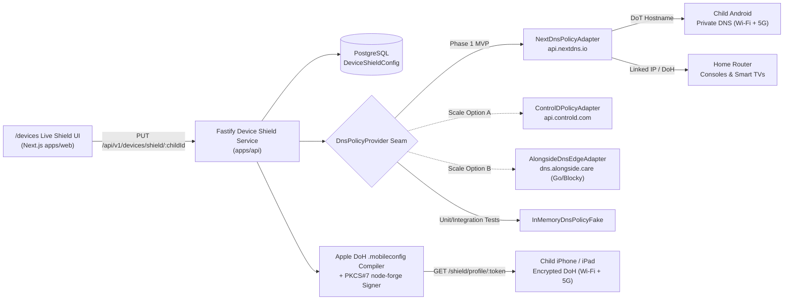

# Alongside Live Network Shield: Dynamic DNS Parental Controls Architecture

**Author:** Chief Technology Officer (CTO)  
**Status:** Approved Architecture Specification (Phase 1 MVP)  
**Target Implementation Plans:** [`PLAN-52`](../plans/52-live-dns-shield-and-mobileconfig-api.md) (Backend & Contracts), [`PLAN-53`](../plans/53-live-dns-shield-and-enrollment-ui.md) (Frontend `/devices` Integration)

---

## 1. Executive Summary

Parents told us clearly that static checklists alone are not enough: when a parent flips a control in Alongside (block adult sites, block TikTok/Snapchat/Discord/Roblox, enforce SafeSearch, block VPN bypasses, or pause entertainment at 8:30 PM), **it should actually take effect on the child's device**—working hand-in-hand with our priority-ranked **Built-in OS & App Parental Controls Blueprints** (Apple Screen Time, Google Family Link, Roblox, YouTube, and Home Safe DNS).

Rather than forcing families to install battery-draining VPN proxies or fighting Apple's closed MDM entitlements on unsupervised consumer phones, Alongside pairs native OS app/download/time-limit blueprints with **zero-app, OS-native Encrypted DNS enforcement** that works across **Wi-Fi and 5G cellular**:

- **iPhone & iPad:** One-tap downloadable, PKCS#7-signed Apple `.mobileconfig` using Apple's official **`com.apple.dnsSettings.managed`** DNS-over-HTTPS (DoH) payload. Works natively on every unsupervised consumer iPhone/iPad (iOS 14+).
- **Android Phones & Tablets:** Copy-paste one unique **Private DNS (DoT)** hostname into `Settings → Network → Private DNS`. Works globally across Wi-Fi and cellular with zero APK required.
- **Home Wi-Fi, Game Consoles & Smart TVs:** Standard router DNS configuration covering Nintendo Switch, PlayStation, Xbox, laptops, and smart TVs automatically.

Once installed once, **every future toggle inside Alongside `/devices` updates the child's active protection in under 30 seconds without touching the child's phone again.**

---

## 2. System Architecture & Provider Seam

To validate fast with zero DNS infrastructure ops while keeping a 1-file migration path for scale, all DNS operations sit behind a strict **`DnsPolicyProvider`** port (`apps/api/src/modules/device-profiles/dns-provider.ts`):

### Why NextDNS First, and How Swapping Works Later

| Stage | Adapter | Effort to Switch | Why |
| :--- | :--- | :--- | :--- |
| **Phase 1 (MVP Validation)** | `NextDnsPolicyAdapter` | Active now | Instant global Anycast DoH (`https://dns.nextdns.io/<id>`) and DoT (`<id>.dns.nextdns.io`), clean REST API (`POST /profiles`, `PATCH /profiles/:id/parentalControl`, `GET /profiles/:id/analytics/status`), $0 dev / $19.90/yr validation cost. |
| **Phase 2A (B2B Zero-Ops Scale)** | `ControlDPolicyAdapter` | 1 new adapter file + env var `DNS_PROVIDER=controld` | Commercial multi-tenant SaaS licensing, 1,000+ blockable apps, flexible multi-slot schedules. |
| **Phase 2B (Zero Marginal Cost Scale)** | `AlongsideDnsEdgeAdapter` | 1 new adapter file + wildcard `*.dns.alongside.care` Go/Blocky server | $0/child marginal cost (~$10/mo VPS for 1,000+ families), 100% owned domain, unlimited custom bedtime/school schedules using daily HaGeZi blocklists. |

Because `DeviceShieldConfig` stores our **provider-neutral canonical policy** (`blockAdultContent`, `safeSearch`, `youtubeRestrictedMode`, `blockBypass`, `blockedServices[]`, `bedtimeEnabled`, `bedtimeStart`, `bedtimeEnd`, `timezone`) alongside `providerType` and `providerProfileId`, **zero frontend UI, zero database schema changes, and zero `.mobileconfig` format changes are needed when switching providers**.

---

## 3. Protocol Specifications

### 3.1 Apple iOS / iPadOS `.mobileconfig` Encrypted DNS (DoH)
Previous legacy code in `profile.compiler.ts` emitted `com.apple.applicationaccess` with custom keys ignored by unsupervised iPhones. Phase 1 upgrades the compiler to emit Apple's official **`com.apple.dnsSettings.managed`** payload:

- **MIME Type:** `application/x-apple-aspen-config; charset=utf-8`
- **Signing:** Signed via existing `AppleMobileConfigSigner` (PKCS#7 CMS / SHA-256 via `node-forge`), with graceful unsigned XML fallback in local dev when `APPLE_MDM_CERT` / `APPLE_MDM_KEY` are unset.
- **Unsupervised Compatibility Rule:** `ProhibitDisablement` MUST be `false` (or omitted) and `PayloadRemovalDisallowed` MUST be `false` on unsupervised consumer devices; setting either to `true` causes iOS installation failure on non-supervised phones.
- **Bootstrap IPs (`ServerAddresses`):** Included so iOS resolves the DoH server cleanly before the encrypted tunnel initializes (NextDNS Anycast bootstrap IPs: `45.90.28.0`, `45.90.30.0`, `2a07:a8c0::`, `2a07:a8c1::`).
- **Scope:** When manually installed via Safari / QR → `Settings → General → VPN & Device Management`, iOS enforces the DoH profile globally across **all Wi-Fi and 5G/LTE cellular connections**.

### 3.2 Android Private DNS (DoT)
Android 9+ natively supports system-wide Encrypted DNS-over-TLS without installing an APK:
- **Hostname format:** `<providerProfileId>.dns.nextdns.io` (or `<deviceLabel>-<providerProfileId>.dns.nextdns.io` to identify the child's device in aggregate status checks).
- **Parent Setup (15 seconds):** `Settings → Network & internet → Private DNS → Private DNS provider hostname` → paste hostname → Save.
- **Scope:** Applies globally across Wi-Fi and cellular networks.

### 3.3 NextDNS API Mapping (Verified Contract)

| Alongside Canonical Field | NextDNS API Endpoint & Payload |
| :--- | :--- |
| Provision child profile | `POST https://api.nextdns.io/profiles` with `{ "name": "Alongside - <ChildFirstName> (<shortId>)" }` |
| `blockAdultContent: true` | `categories`: `[{ id: "porn", active: true }, { id: "gambling", active: true }, { id: "dating", active: true }]` |
| `safeSearch: true` | `parentalControl.safeSearch: true` |
| `youtubeRestrictedMode: true` | `parentalControl.youtubeRestrictedMode: true` |
| `blockBypass: true` | `parentalControl.blockBypass: true` (blocks VPNs, proxies, Tor, and encrypted DNS bypasses) |
| `blockedServices: ["tiktok", "snapchat", ...]` | `parentalControl.services`: `[{ id: "tiktok", active: true, recreation: <bedtimeOnly> }, ...]` |
| `bedtimePause` (`bedtimeStart` → `bedtimeEnd`, `timezone`) | `parentalControl.recreation`: maps allowed daytime window (`bedtimeEnd` → `bedtimeStart`, e.g. `06:30:00` to `20:30:00`) across `monday..sunday` in child's `timezone` for services marked `bedtimeOnly` (recreation-scoped). |
| Active status check (Privacy-Preserving Heartbeat) | `GET https://api.nextdns.io/profiles/:id/analytics/status?from=-24h` — reads **aggregate status counts only** (`allowed`, `blocked`, `default`). Alongside **never fetches, stores, or displays individual visited domains or browsing history**. |

---

## 4. What DNS Enforces vs. What Stays in Built-In OS Controls

Being transparent about what DNS covers vs. what Apple Screen Time / Google Family Link covers builds parent trust and prevents false expectations:

| Protection | Enforced Automatically by Alongside Live Shield (DNS) | Requires 1-Time Apple Screen Time / Family Link Switch |
| :--- | :---: | :---: |
| Adult, explicit & gambling websites (Wi-Fi + 5G) | Yes (Real-time) | Optional backup |
| SafeSearch & YouTube Restricted Mode | Yes (Real-time) | Optional backup |
| Block TikTok, Instagram, Snapchat, Discord, Roblox, YouTube | Yes (Real-time) | Optional backup |
| Block VPN / proxy / alternate DNS bypasses | Yes (Real-time) | Recommended |
| Bedtime pause on social, games & video (Wi-Fi + 5G + Consoles) | Yes (Scheduled) | Recommended backup |
| Prevent child from removing DNS profile / changing settings | No | **Yes (Screen Time Passcode / Family Link)** |
| Approve every new App Store / Play Store download (`Ask to Buy`) | No | **Yes** |
| Blur explicit photos in Messages/FaceTime & restrict Contacts Only | No | **Yes** |

---

## 5. Privacy, Security & Resilience Guarantees

1. **Zero Browsing-History Surveillance:** Alongside NEVER calls NextDNS `/logs` or stores individual domains visited by a child. We only fetch aggregate 24-hour health counts (`isConnected`, `totalQueries24h`, `blockedQueries24h`) to prove the shield is live and working.
2. **Encrypted Enrollment Tokens:** `.mobileconfig` download URLs use unguessable UUIDv4 `enrollmentToken` values with strict rate limiting and `Cache-Control: no-store`.
3. **Graceful Degradation:** If `NEXTDNS_API_KEY` is not set in local dev, `DeviceShieldService` cleanly uses `InMemoryDnsPolicyFake` (when `NODE_ENV !== 'production'`) or returns a clear `503 DNS_PROVIDER_UNCONFIGURED` envelope in production — never crashing the server.
4. **Provider Credential Isolation:** `NEXTDNS_API_KEY` stays strictly server-side in `apps/api`; the frontend only receives the safe DoH URL, DoT hostname, QR code URL, and `.mobileconfig` enrollment URL.
5. **Account Deletion Cleanup:** Deleting a child or parent account calls `dnsProvider.deleteProfile(providerProfileId)` best-effort so no orphaned external DNS profiles remain.
