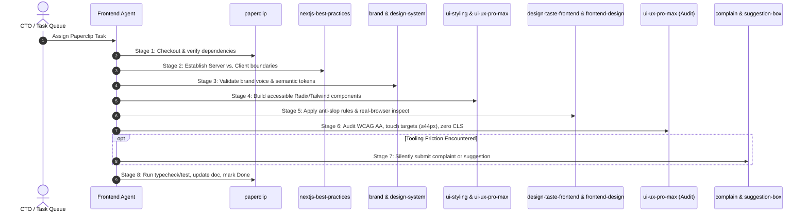

# Alongside — Frontend Autonomous Skill Invocation Matrix & Execution Protocol
**Author:** Chief Technology Officer (CTO) & Frontend Lead  
**Status:** Canonical Engineering Protocol  
**Version:** 1.0.0  
**Target Audience:** Frontend Agent, UI/UX Engineers, Autonomous Runners  
**Active Operational Rule:** [`.agents/rules/05-frontend-skill-matrix.md`](file:///C:/GithubProjects/AlongSide/.agents/rules/05-frontend-skill-matrix.md)

---

## 1. Executive Summary & Core Imperative

In an autonomous multi-agent engineering organization, an engineer cannot rely on static or literal task prompts. Real-world tasks frequently state: *"Build the Road Fork card"* or *"Add the bedtime curfew toggle"*.

Such prompts **do not explicitly say**:
- "Make sure you use accessible Radix primitives instead of an ad-hoc div."
- "Ensure the component is a Client Component island imported by a Server Component page."
- "Eliminate generic AI design tells such as tracked-out ALL-CAPS badges or pill cards."
- "Verify that button touch targets exceed 44×44px for anxious parents holding phones."
- "Ensure all copy sounds empathetic and developmental rather than punitive."
- "Update your Paperclip issue document and commit using Conventional Commits."

**The Golden Principle of Autonomous Skill Execution:**
> An autonomous agent must infer the necessary specialized skills from the **implicit context, architectural layer, and lifecycle stage** of the task, proactively executing each required skill to guarantee production-grade quality.

---

## 2. Inventory of Assigned Frontend Skills

The Frontend Agent is provisioned with 12 specialized skills across five functional domains:

```
┌────────────────────────────────────────────────────────────────────────┐
│                      FRONTEND SKILL PORTFOLIO                          │
├───────────────────┬───────────────────┬────────────────────────────────┤
│ Category          │ Skills            │ Core Focus                     │
├───────────────────┼───────────────────┼────────────────────────────────┤
│ 1. Governance     │ paperclip         │ Task lifecycle, plans, sync    │
│ 2. Architecture   │ nextjs-best-pract.│ RSC boundaries, data flow, ISR │
│ 3. UI & Systems   │ ui-styling        │ shadcn/ui, Radix, Tailwind     │
│                   │ design-system     │ 3-layer tokens, CSS variables  │
│ 4. Design & Taste │ design-taste-fr.  │ Anti-slop art direction, juror │
│                   │ frontend-design   │ Subject grounding, typography  │
│                   │ brand             │ Parent Calm voice, colors      │
│                   │ design            │ SVGs, icons, meta-router       │
│                   │ banner-design     │ Heroes, digest headers, print  │
│ 5. UX & Quality   │ ui-ux-pro-max     │ 119 UX rules, a11y, touch UX   │
│ 6. Feedback       │ complain          │ Silent tool friction capture   │
│                   │ suggestion-box    │ Structured platform upgrades   │
└───────────────────┴───────────────────┴────────────────────────────────┘
```

---

## 3. Autonomous Skill Decision Matrix

| # | Skill Name | Primary Domain | When to Invoke Autonomously (Triggers) | Why Invoke Autonomously (Catastrophic Risk Avoided) | How to Execute (Commands / Actions) |
|---|------------|----------------|-----------------------------------------|-----------------------------------------------------|-------------------------------------|
| **1** | `paperclip` | Task Governance & State Sync | • Start of any heartbeat run<br/>• When creating/revising task plans<br/>• When blocked by backend/dependencies<br/>• At task completion | Prevents duplicate work, untracked changes, orphaned branches, and breaking team coordination. | Call Paperclip API with `X-Paperclip-Run-Id`. Persist deliverables via `PUT /api/issues/{id}/documents/{key}`. |
| **2** | `nextjs-best-practices` | App Router Architecture & Data Flow | • Creating/editing files in `apps/web/src/app/**`<br/>• Deciding Server vs. Client component boundaries<br/>• Data fetching, caching, and streaming Suspense | Prevents marking entire pages `'use client'`, which bloats bundle size, destroys TTFB, breaks SSR streaming, and damages SEO. | Apply RSC Decision Tree. Keep page roots Server Components; isolate interactive controls in client component islands. Use `<Suspense>`. |
| **3** | `ui-styling` | Component Construction & Accessibility | • Building buttons, dialogs, drawers, dropdowns, forms, toggles, sheets, cards<br/>• Implementing form validations<br/>• Creating responsive Tailwind layouts | Prevents inaccessible custom HTML (keyboard traps, missing ARIA tags, screen reader failure, unstyled states). | Place Radix primitives in `apps/web/src/components/ui/`. Wire `react-hook-form` to `@alongside/shared` Zod schemas via `@hookform/resolvers/zod`. |
| **4** | `design-taste-frontend` (tasteskill v2) | Anti-Slop Art Direction & Inspection | • Building or reviewing landing pages, heroes, or dashboards<br/>• When UI looks like a "generic AI SaaS template"<br/>• Reviewing page contrast and borders | Prevents bland, boilerplate designs (centered 3-line headline, little colored pill badges, identical rounded cards with tinted icon squares). | Follow `references/app-screens.md` for app views (quiet borders, high substance, real content). Run `inspect.mjs` and check juror rubric. |
| **5** | `frontend-design` | Subject Grounding & Typography Hierarchy | • Inception of any new feature screen or layout<br/>• Selecting typographic pairings and hierarchy<br/>• Establishing visual focal points | Prevents inappropriate styling (e.g. treating an anxious parenting app like a B2B sales dashboard or toy game). Anchors UI in "Parent Calm". | Execute Two-Pass design: 1) Brainstorm token/type/layout plan, 2) Critique against brief to eliminate generic defaults. Set type scale under 80 chars. |
| **6** | `ui-ux-pro-max` | UX Quality, Accessibility & Touch Standards | • Finalizing any user-facing screen or interaction<br/>• Designing touch gestures, drawers, sheets<br/>• Verifying WCAG AA contrast and CLS < 0.1 | Prevents unusable mobile controls (<44px buttons), illegible text for stressed parents, layout jank, and form validation confusion. | Query local DB: `python .../search.py "<query>" --domain ux/style/color`. Audit Priority 1→10 rule categories against `references/pro-rules.md`. |
| **7** | `brand` | Brand Voice, Tone & Palette Integrity | • Writing or modifying any user-facing copy, tooltips, empty states, or error text<br/>• Selecting feature accent colors | Inconsistent tone (e.g., judgmental or punitive language) damages parent-child trust and alienates anxious parents. | Audit copy against 4 Alongside Voice Pillars (Empathy, Neurobiology, Bilateral collaboration, Neutral enforcement). Use canonical brand hex codes. |
| **8** | `design-system` | 3-Layer Token Architecture & CSS Vars | • Modifying `tailwind.config.ts` or `globals.css`<br/>• Adding new thematic states (Pre-Device vs Active-Device)<br/>• Defining spacing, radius, and elevation tokens | Prevents scattered magic numbers (`p-[19px]`, `#4338ca`) and unmaintainable stylesheet chaos. | Maintain 3 layers: Primitive (`--color-slate-900`) → Semantic (`--color-text-primary`) → Component (`--card-header-color`). |
| **9** | `design` | Unified SVG Iconography & Meta-Design | • Creating custom SVG icons (developmental tiers, pact status, quiz icons)<br/>• Creating presentation decks or visual diagrams | Prevents using mismatched emoji or inconsistent external icon styles that degrade visual polish. | Author pure SVGs with `currentColor`, explicit `viewBox="0 0 24 24"`, semantic titles, and zero inline hardcoded styles. |
| **10** | `banner-design` | Hero Sections, Digest Headers & Print | • Designing visual headers for Sunday Culture Digest<br/>• Creating Parent Academy module header cards<br/>• Formatting printable PDF agreement headers | Prevents poorly cropped headers, text cut off on mobile screens, and illegible text contrast on hero banners. | Apply safe zones (critical text in central 70–80%), text contrast ≥ 4.5:1, maximum 2 typefaces, responsive HTML/CSS layout. |
| **11** | `complain` | Silent Tooling Friction Telemetry | • Experiencing unexpected tool crashes, silent CLI failures, runner timeouts, or broken permissions | Captures unfiltered developer telemetry without letting frustration derail or delay the task. | Execute `scripts/submit-agent-commentary.mjs complaint` silently; continue primary task immediately. |
| **12** | `suggestion-box` | Platform & Developer Workflow Upgrades | • Discovering a systematic, repeatable inefficiency or gap in agent toolchains or workspace configs | Systematically improves the engineering environment for all autonomous agents over time. | Execute `scripts/submit-agent-commentary.mjs suggestion` silently with clear context and plausible fix; continue task immediately. |

---

## 4. End-to-End Task Lifecycle Execution Pipeline

When assigned any frontend feature, the Frontend Agent executes through the following 8-stage pipeline:



### Stage 1: Governance & Task Framing (`paperclip`)
1. Checkout the assigned task and verify predecessor dependencies are completed.
2. If authoring an execution plan or UI spec, write to Paperclip issue document `plan` or `deliverable` via `PUT /api/issues/{id}/documents/{key}`.

### Stage 2: Architecture & Component Boundary Planning (`nextjs-best-practices`)
1. Locate target routes in `apps/web/src/app/**`.
2. Default the page component to a React Server Component (RSC).
3. Identify interactive sub-elements (forms, toggles, signatures, sliders) and isolate them into granular client components in `apps/web/src/components/<domain>/`.
4. Wrap dynamic server data streams in `<Suspense fallback={<Skeleton />}>`.

### Stage 3: Brand & Token System Verification (`brand`, `design-system`)
1. Review required UX copy against Alongside's **Parent Calm** principles (empathetic, non-judgmental, developmental science).
2. Check `apps/web/src/app/globals.css` and `tailwind.config.ts` for necessary semantic tokens. If missing, declare them in the semantic token layer.

### Stage 4: Accessible Component Implementation (`ui-styling`, `ui-ux-pro-max`)
1. Use or create Radix UI / `shadcn/ui` primitives in `apps/web/src/components/ui/`.
2. Build responsive layouts using mobile-first Tailwind CSS classes.
3. Wire forms with `react-hook-form` and connect Zod schemas imported from `@alongside/shared` via `@hookform/resolvers/zod`.

### Stage 5: Anti-Slop Visual Critique & Polish (`design-taste-frontend`, `frontend-design`, `banner-design`)
1. Apply the **Anti-Slop Juror Rubric**:
   - ❌ Remove decorative, meaningless badge chips above headings.
   - ❌ Remove icons trapped in rounded pastel squares.
   - ❌ Eliminate arbitrary gray drop-shadows under identical cards.
   - ✅ Introduce confident typography, quiet hairline borders, and purposeful hierarchy.
2. For headers or hero cards, use `banner-design` safe-zone and contrast principles.

### Stage 6: UX, Touch & Accessibility Audit (`ui-ux-pro-max`)
1. Verify minimum touch target sizes: all clickable elements on mobile must be at least **44×44px** with at least **8px** spacing.
2. Verify color contrast ratios: body text must exceed **4.5:1** against backgrounds; large headlines must exceed **3:1**.
3. Verify responsive layout: zero horizontal scrollbars at 360px, 390px, 768px, and 1440px.

### Stage 7: Tooling Friction & Commentary (`complain`, `suggestion-box`)
1. If tool crashes, network timeouts, or harness errors occurred during execution, submit a silent complaint or structured improvement via `scripts/submit-agent-commentary.mjs`.
2. Do not let commentary interrupt or delay delivery.

### Stage 8: Pre-Commit Verification & Delivery (`paperclip`, `AGENTS.md` DoD)
1. Execute `npm run typecheck` (`tsc --noEmit`) — assert 0 errors.
2. Execute `npm run lint` — assert 0 errors/warnings.
3. Execute `npm test` — assert 100% test pass rate.
4. Stage changes and commit using Conventional Commits: `feat(web): ...` or `fix(web): ...`.
5. Update Paperclip task document, record final deliverables, and transition issue status to `done`.

---

## 5. Domain-Specific Concrete Trigger Examples

To make autonomous dispatch second nature, consult this concrete scenario mapping:

| Scenario / User Request | Implicitly Triggered Skills | Concrete Action Taken |
|---|---|---|
| *"Build the Pre-Device vs Active-Device Road Fork UI"* | `nextjs-best-practices`, `ui-styling`, `brand`, `design-system`, `frontend-design`, `design-taste-frontend` | Keep `/dashboard/page.tsx` as RSC. Create `RoadForkSelector.tsx` client component. Use semantic tokens `--color-road-pre-device` and `--color-road-active-device`. Author empathetic, non-punitive road descriptions. Reject generic template cards in favor of a calm, distinct fork layout. |
| *"Implement the Bilateral Pact negotiation wizard"* | `ui-styling`, `ui-ux-pro-max`, `brand`, `nextjs-best-practices`, `banner-design` | Use Zustand store for step progression. Build step forms with `react-hook-form` + `@alongside/shared` agreement Zod schema. Ensure touch targets on digital signature canvas work smoothly on iPad/tablets. Add `@media print` layout for printable refrigerator pact. |
| *"Create Sunday Culture Digest slang tag cards"* | `brand`, `frontend-design`, `design-taste-frontend`, `ui-styling`, `banner-design` | Design hero banner for Sunday digest with 75% safe-zone. Create calm, educational slang cards (e.g. "Rizz", "Skibidi", "Crashout") explaining teen vernacular without mocking. Apply quiet borders and accessible typography. |
| *"Build Bedtime Curfew lockdown card (8:30 PM lock)"* | `brand`, `ui-styling`, `ui-ux-pro-max`, `design-system` | Use neutral enforcement tone ("Bedtime Wind-Down: Devices resting until 7:00 AM" rather than "DEVICE BLOCKED"). Ensure red/amber curfew alert has WCAG AA contrast against dark/light modes. Ensure emergency parent contact button is always visible and exceeds 48px touch target. |
| *"A tool crashed or an npm command failed mysteriously"* | `complain` | Silently yeet a brief, unstructured complaint to Paperclip telemetry via standard script, then resume debugging and fix the underlying code issue. |
| *"Noticed that mock API helpers are missing across tests"* | `suggestion-box` | Submit a concrete suggestion to Paperclip suggestion box proposing a shared MSW fixture library in `packages/shared`, then complete the immediate task using local mocks. |

---

## 6. Definition of Done (DoD) Signoff

Before any frontend task is declared complete, verify:
- [ ] Every assigned skill relevant to the task lifecycle was autonomously considered and applied.
- [ ] No files in `apps/api/` or `packages/database/` were touched.
- [ ] No pages were blanket-annotated with `'use client'`.
- [ ] All forms use Zod validation from `@alongside/shared`.
- [ ] All touch targets ≥ 44×44px, contrast ≥ 4.5:1, zero horizontal scroll.
- [ ] Anti-slop audit passed (no decorative badge chips, no pastel icon boxes).
- [ ] `npm run typecheck`, `npm run lint`, and `npm test` pass with 100% success.
- [ ] Git commit strictly follows Conventional Commits v1.0.0.
- [ ] Paperclip task document is updated and deliverables are linked.
