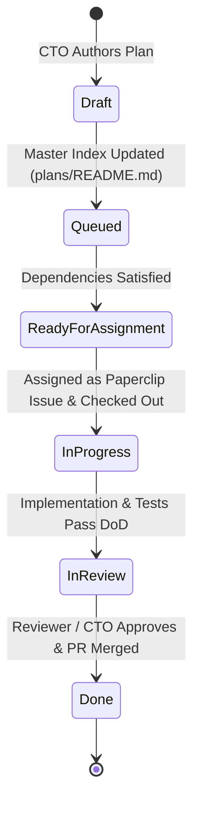

# Alongside — Engineering Plan Authoring & Naming Standards
**Author:** Chief Technology Officer (CTO)  
**Status:** Approved Engineering Standards  
**Version:** 1.0.0  
**Target Audience:** CTO / Technical Planner, Frontend Agent, Backend Agent, QA Agent  

---

## 1. Overview & Purpose

In AlongSide's multi-agent engineering workflow, **Engineering Plans (`plans/*.md`)** serve as the binding technical contract between the **Chief Technology Officer (CTO)** and autonomous executing engineers (**Frontend Agent**, **Backend Agent**). 

Every engineering task executed in the repository must originate from an approved, discrete, and self-contained plan. These standards define the strict authoring rules, naming conventions, mandatory document structure, lifecycle states, and verification criteria for all execution plans.

---

## 2. Plan Naming Conventions

### 2.1 File Naming Syntax
Every execution plan file must reside in the `plans/` root directory and strictly follow this kebab-case naming syntax:

```
plans/[XX]-[short-kebab-case-descriptive-title].md
```

- **`[XX]`**: A two-digit, zero-padded integer representing the sequential execution sequence (e.g. `01`, `02`, `03` ... `99`).
- **`[short-kebab-case-descriptive-title]`**: 2–5 kebab-case words describing the discrete feature, service, or architectural milestone.
- **Extension**: Always `.md` (Markdown).

#### Canonical Examples:
- ✅ `plans/01-project-setup-and-db.md`
- ✅ `plans/02-auth-and-user-profile.md`
- ✅ `plans/03-frontend-scaffolding-and-auth-ui.md`
- ✅ `plans/04-child-profile-and-diagnostic-backend.md`
- ✅ `plans/06-agreement-engine-and-pdf-backend.md`
- ✅ `plans/11-parent-academy-and-quizzes.md`

#### Forbidden Examples:
- ❌ `plans/plan1.md` (Missing zero-padding and descriptive title)
- ❌ `plans/02_auth_and_user_profile.md` (Underscores are forbidden; use hyphens)
- ❌ `plans/AuthBackend.md` (PascalCase is forbidden for plan files)
- ❌ `plans/05-child-profile-and-diagnostic-backend-and-frontend-ui-and-everything.md` (Too broad; violates the discrete boundary rule)

### 2.2 Plan Identifier Format
Within documentation, commit messages, and Paperclip issue descriptions, plans are uniquely referenced by a standardized Plan ID:

```
PLAN-[XX]
```

- Examples: `PLAN-01`, `PLAN-04`, `PLAN-12`.

---

## 3. Mandatory Plan Document Structure

Every plan authored by the CTO or Technical Planner must contain the following standardized sections in exact sequence:

```markdown
# Plan [XX]: [Descriptive Title]
**Plan ID:** `PLAN-[XX]`  
**Assignee:** [Backend Agent | Frontend Agent | Joint (FE & BE)]  
**Dependencies:** [None | PLAN-[YY], PLAN-[ZZ]]  
**Estimated Scope:** [Foundational | Small | Medium | Large]  
**Paperclip Issue:** [SOU-XX] (Optional / assigned)  

---

## 1. Objective & Business Value
[Crisp 2-4 sentence summary of what is being built, why it exists, and how it aligns with PROJECT_SCOPE.md]

---

## 2. Inputs & Architectural References
- **Project Scope:** [`docs/PROJECT_SCOPE.md`](../docs/PROJECT_SCOPE.md)
- **Architecture Specification:** [`docs/system-architecture.md`](../docs/system-architecture.md)
- **API Specification:** [`docs/api-specification.md`](../docs/api-specification.md)
- **Data Models:** [`docs/data-models.md`](../docs/data-models.md)
- **Code Quality & Git Standards:** [`docs/engineering-standards/code-quality-principles.md`](code-quality-principles.md), [`docs/engineering-standards/git-commit-standards.md`](git-commit-standards.md)

---

## 3. Preconditions & Dependency Verification
[Explicit verification that prior required plans are complete and operational before starting]

---

## 4. Step-by-Step Implementation Tasks
### Task 1: [Component / Subsystem Name]
1. [Actionable instruction with exact file paths and code snippets]
2. ...

### Task 2: [Component / Subsystem Name]
1. ...

---

## 5. Specific Deliverables (Files to Create / Modify)
- [ ] `packages/shared/src/...`
- [ ] `apps/api/src/...`
- [ ] `apps/api/tests/...`

---

## 6. Acceptance Criteria & Verification Plan
[Step-by-step commands to run: typecheck, lint, automated tests, Fastify inject, coverage checks]

---

## 7. Role Boundaries & Prohibitions
[Explicit reiteration of AGENTS.md boundaries for the assigned agent]

---

## 8. Definition of Done (DoD) Sign-Off Checklist
- [ ] All deliverables created and located in correct directories.
- [ ] Code strictly follows naming and quality standards.
- [ ] `npm run typecheck` exits with code 0.
- [ ] `npm test` passes with 100% success (unit & integration tests).
- [ ] All commits adhere to Conventional Commits standard.
```

---

## 4. Plan Authoring Principles for Autonomous Agents

### 4.1 Strict Architectural Containment (Single-Agent Ownership)
Whenever possible, a plan must target a **single assigned agent**:
- **Backend Plans (`Backend Agent`):** Strictly restricted to `apps/api/`, `packages/database/`, and `@alongside/shared` schemas.
- **Frontend Plans (`Frontend Agent`):** Strictly restricted to `apps/web/` and `@alongside/shared` consumers.
- **Joint Plans (`Joint (FE & BE)`):** Reserved exclusively for integration, end-to-end verification, or production launch readiness (e.g. `10-billing-nudges-and-polish.md`). When joint plans are used, subtasks must clearly demarcate which agent owns each step.

### 4.2 Executable & Self-Contained Specifications
Autonomous agents cannot guess missing implementation details. Plans must provide:
1. **Exact File Paths:** Always specify full relative paths from the monorepo root (e.g. `packages/database/prisma/schema.prisma`, `apps/api/src/modules/diagnostic/diagnostic-service.ts`).
2. **Schema & Interface Definitions:** Include the Zod schemas or TypeScript interfaces required for contracts.
3. **Mock Payloads & Expected Responses:** Include exact JSON envelopes for success (200/201) and error conditions (400, 401, 404).
4. **Concrete CLI Verification Commands:** Provide verbatim terminal commands (`npm run test:diagnostic`, `npx prisma migrate dev`).

### 4.3 Contract-First Parallelism
To allow the Frontend Agent and Backend Agent to build in parallel without waiting for live deployments:
- Every plan depending on an API endpoint must define the `@alongside/shared` contract and specify the client-side mock implementation (`apps/web/src/lib/api/mocks.ts` or MSW) matching `docs/api-specification.md`.

---

## 5. Plan Lifecycle & Paperclip State Transitions



1. **Draft:** Plan is being drafted by the CTO or Lead Technical Planner. Not yet ready for execution.
2. **Queued:** Plan is reviewed and committed to `plans/` with its entry recorded in `plans/README.md`. Blocked by prerequisite plans.
3. **Ready for Assignment:** All prerequisite dependencies have reached `Done` status. The plan can be assigned to the designated agent.
4. **In Progress:** The assigned agent has checked out the corresponding Paperclip issue, created a feature branch (`feat/SOU-XX-...`), and is executing tasks.
5. **In Review:** All code is written, unit/integration tests pass with 100% success, typechecking passes, and a pull request is submitted.
6. **Done:** CTO or peer reviewer approves the pull request, code is merged, and the Paperclip issue is closed with verified evidence.

---

## 6. Plan Maintenance & Evolution Rules

1. **Never Silently Overwrite Completed Plans:** Once a plan reaches `Done`, its historical record must be preserved. If requirements change or a phase 2 is needed, create an incremental plan (e.g. `11-parent-academy-and-quizzes.md`) or author a clearly documented revision block.
2. **Synchronize Master Roadmap Index:** Whenever a new plan is added or modified, the master roadmap in [`plans/README.md`](../plans/README.md) must be updated immediately with the new Plan ID, Title, Assignee, Dependencies, and Status.
3. **Strict Adherence:** Executing agents must not unilaterally alter the scope or architecture outlined in a plan. If an architectural discrepancy is discovered during implementation, the agent must raise an issue to the CTO before deviating from the plan.
