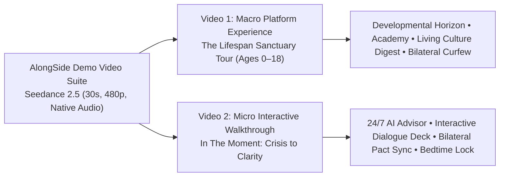

# AlongSide Demo Videos — Higgsfield Seedance 2.5 Production Prompts & Execution Guide
**Author:** Chief Executive Officer (CEO)  
**Status:** Canonical Production Specification  
**Issue Reference:** Paperclip Task SOU-111  
**Target Engine:** Higgsfield AI — Seedance 2.5 (`seedance_2_5`)  
**Generation Constraints:** Free Tier `480p`, `30 seconds` duration, Native Audio Enabled  

---

## 1. Executive Strategy & Creative Vision

### 1.1 Purpose & Objective
This specification establishes the canonical generation prompts, motion choreography, audio directives, and Higgsfield CLI/MCP execution commands for creating two official 30-second product demo videos for **AlongSide (ParentPath)**:
> **"The Parent Advisory Sanctuary: Keep Up With Your Child As They Grow (Ages 0–18)"**

Unlike generic brand commercials or conceptual mood films, these two demo videos are engineered to **showcase the digital platform itself in active motion**. They display the elegance of the "Parent Calm" design system (Archival Linen `#FBFBF9`, Deep Forest Spruce `#143D2B`, Newsreader serif typography), dynamic UI transitions, real-time micro-interactions, and synchronized native audio (spoken voiceover, acoustic background instrumentation, and tactile UI sound effects).

### 1.2 Two Targeted Demo Perspectives



1. **Video 1: "The Complete Parenting Sanctuary (Platform Experience & Lifespan Tour)"**  
   - **Scope:** Macro product showcase. Demonstrates the breadth of AlongSide as a living family operating system that evolves from birth to 18.
   - **Key Highlights:** 3D device perspective fly-through, rotating Developmental Horizon radial arc, Parent Intelligence Academy lesson with pulsing wave audio player, Sunday Youth Culture Digest living feed cards, and the Bilateral Family Pact activation.

2. **Video 2: "In The Moment — Crisis to Clarity Interactive Product Walkthrough"**  
   - **Scope:** Micro interactive deep-dive. Shows an acute real-world parenting crisis (tantrum, door slam, digital friction) resolved in real time through AlongSide's active tools.
   - **Key Highlights:** Fast text query into 24/7 AI Advisor, fluid soundwave animation, 1-click Dialogue Deck ("Say This / Not That") card comparison, dual-device bilateral pact synchronization, and neutral automated 8:30 PM bedtime lock.

---

## 2. Technical Execution Profile: Higgsfield Seedance 2.5

Both videos are tailored for Higgsfield's flagship **Seedance 2.5** model under the free tier specifications:

| Parameter | Value | Rationale |
| :--- | :--- | :--- |
| **Model ID** | `seedance_2_5` | State-of-the-art all-purpose video model; superior multi-shot motion, screen fidelity, and fluid UI animation. |
| **Duration** | `30` | Maximum single-take runtime supported by Seedance 2.5, capturing a complete narrative arc. |
| **Resolution** | `480p` | Standard free tier resolution, ensuring fast generation turnaround and zero paywall blocking. |
| **Aspect Ratio** | `16:9` (`--aspect_ratio 16:9`) | Landscape orientation optimized for website hero banners, YouTube, demo presentations, and investor updates. |
| **Audio Mode** | `Native Audio` (`--generate_audio true`) | Native Seedance 2.5 sound generation synthesizing spoken voiceover, ambient score, and UI foley directly from prompt conditioning. |
| **Generation Mode** | `t2v` (or `omni_reference`) | Can run pure text-to-video or reference-guided from an initial UI screenshot plate. |

---

## 3. Video 1: "The Complete Parenting Sanctuary" (Platform Experience Tour)

### 3.1 Overview & Storyboard Timeline (30 Seconds)

```mermaid
timeline
    title Video 1: Platform Experience & Lifespan Tour (30 Seconds)
    00:00 - 00:07 : Scene 1 - Hero Device & Lifespan Arc : Tablet in sunlit space, Developmental Horizon (0-18) rotates smoothly
    00:07 - 00:15 : Scene 2 - Parent Intelligence Academy : Lesson card slides up, minimalist audio wave pulses with real-time green glow
    00:15 - 00:23 : Scene 3 - Sunday Youth Culture Digest : Living feed cards glide in with slang decode chips ('No Cap', 'Rizz')
    00:23 - 00:30 : Scene 4 - Bilateral Pact & Neutral Curfew : Digital signature draws, 8:30 PM lock badge illuminates, brand seal resolves
```

### 3.2 Shot-by-Shot Visual & Motion Choreography

#### Shot 1: The Sanctuary Reveal & Developmental Horizon Arc (0:00 – 0:07)
- **Visual Subject:** Ultra-crisp modern tablet resting on a warm Scandinavian oak table in soft morning sunlight. The tablet displays AlongSide's Archival Linen canvas (`#FBFBF9`) and the **Developmental Horizon** radial arc.
- **Motion & Camera:** The camera starts in a low-angle diagonal push-in, gently tilting upward. The Developmental Horizon arc smoothly glides across the 8 developmental tiers (Infant 0-1, Toddler 1-3, Early Childhood 3-5, Tween 9-11, Adolescent 12-18). The active child pill (*"Liam • 4y 2m • Early Childhood"*) illuminates with a soft emerald glow.
- **Micro-Interactions:** Light morning dust motes in the sunbeam; crisp digital spring easing as the child profile switches smoothly.

#### Shot 2: Parent Intelligence Academy & Pulsing Wave Audio Player (0:07 – 0:15)
- **Visual Subject:** Seamless camera glide into the **Parent Intelligence Academy** view.
- **Motion & Camera:** Camera glides laterally to the right. A structured lesson card elevates with a soft drop shadow: *"The 10-Second Meltdown Reset"*. Below the headline, the integrated audio narration player opens. A minimalist Deep Spruce (`#143D2B`) audio wave ripples smoothly with dynamic fluid physics.
- **Micro-Interactions:** The 30-Second Crisis Glance drawer peeks into view; the play head moves across the waveform with high precision.

#### Shot 3: Sunday Youth Culture Digest & Slang Decoders (0:15 – 0:23)
- **Visual Subject:** Fluid transition to the **Sunday Youth Culture Digest** living magazine feed.
- **Motion & Camera:** Smooth upward scroll with parallax card motion. Three vibrant slang tag pills glide into focus: `[NO CAP - Truthful / Green]`, `[RIZZ - Charisma / Green]`, and `[CRASH OUT - Loss of Emotional Control / Yellow]`. An elegant Sunday dinner conversation starter card floats to the center: *"Ask This Tonight: If school was a video game, which level is the hardest?"*
- **Micro-Interactions:** Tactile card hover states with delicate border sheen; crisp typography rendering with zero artifacting.

#### Shot 4: Bilateral Family Pact & Bedtime Curfew Lock (0:23 – 0:30)
- **Visual Subject:** The **Bilateral Family Pact** co-negotiation screen.
- **Motion & Camera:** Close-up macro tracking shot as a digital stylus sweeps across the screen, signing the agreement with fluid black ink. A calm green verification card springs into view: `✓ Pact Active • Bedtime Curfew: 8:30 PM Lock • Zero Spyware`. The camera smoothly pulls back as the interface transitions into the clean AlongSide seal: *"Keep Up With Your Child As They Grow (Ages 0–18)"*.
- **Micro-Interactions:** Satisfying ink fluid stroke; soft ambient light reflection on the tablet bezel.

---

### 3.3 Native Audio Design Blueprint (Prompt Conditioned)

- **Spoken Voiceover Script (Calm, Grounded, Pediatrician/Parent Tone):**
  > *"Parenting moves fast. AlongSide gives you the calm ground to keep up. Whole-child guidance, bite-sized neurobiology, and neutral family agreements—from birth to eighteen. Welcome to your parenting sanctuary."*
- **Acoustic Music Bed:** Warm acoustic piano chords (C Major – F Major7) layered with gentle fingerpicked acoustic guitar and a rich, grounded cello swell that builds warmth without tension.
- **Tactile Sound Effects (Foley):**
  - `0:02` — Soft morning birds outside, faint ceramic mug clink.
  - `0:06` — Crisp tactile digital UI swoosh as child profile clicks.
  - `0:11` — Gentle liquid wave flutter and warm audio play tone.
  - `0:18` — Subtle paper card sliding sound and soft haptic pop on slang tags.
  - `0:25` — Smooth glass stylus friction sound followed by a reassuring digital lock chime.
  - `0:28` — Resonant acoustic resolve chord.

---

### 3.4 Canonical Higgsfield Seedance 2.5 Generation Prompt

```text
A sleek 30-second product demo video showing the AlongSide parenting platform on an elegant tablet. Modern Scandinavian oak desk in warm morning sunlight. The camera glides smoothly across the UI in continuous motion: first showing the Developmental Horizon arc rotating smoothly across ages 0 to 18 with archival linen textures and deep spruce badges; next gliding into the Parent Intelligence Academy where a lesson card expands and a minimalist green soundwave player animates in real time; then transitioning to the Sunday Culture Digest with floating youth slang cards 'No Cap' and 'Rizz'; ending on the Bilateral Family Pact as a digital stylus signs the screen and an automated 8:30 PM Bedtime Curfew Lock badge illuminates with calm green light. Smooth 3D camera pan, shallow depth of field, premium Apple-style motion design. Synchronized native audio features a warm, reassuring conversational voiceover: "Parenting moves fast. AlongSide gives you the calm ground to keep up. Whole-child guidance, bite-sized neurobiology, and neutral family agreements—from birth to eighteen. Welcome to your parenting sanctuary." Background music is a gentle, uplifting acoustic piano and cello melody with crisp tactile UI click and chime sound effects.
```

#### Higgsfield CLI Command:
```bash
higgsfield generate create seedance_2_5 \
  --prompt "A sleek 30-second product demo video showing the AlongSide parenting platform on an elegant tablet. Modern Scandinavian oak desk in warm morning sunlight. The camera glides smoothly across the UI in continuous motion: first showing the Developmental Horizon arc rotating smoothly across ages 0 to 18 with archival linen textures and deep spruce badges; next gliding into the Parent Intelligence Academy where a lesson card expands and a minimalist green soundwave player animates in real time; then transitioning to the Sunday Culture Digest with floating youth slang cards 'No Cap' and 'Rizz'; ending on the Bilateral Family Pact as a digital stylus signs the screen and an automated 8:30 PM Bedtime Curfew Lock badge illuminates with calm green light. Smooth 3D camera pan, shallow depth of field, premium Apple-style motion design. Synchronized native audio features a warm, reassuring conversational voiceover: \"Parenting moves fast. AlongSide gives you the calm ground to keep up. Whole-child guidance, bite-sized neurobiology, and neutral family agreements—from birth to eighteen. Welcome to your parenting sanctuary.\" Background music is a gentle, uplifting acoustic piano and cello melody with crisp tactile UI click and chime sound effects." \
  --resolution 480p \
  --duration 30 \
  --aspect_ratio 16:9 \
  --generate_audio true \
  --wait
```

---

## 4. Video 2: "In The Moment — Crisis to Clarity" (Interactive Walkthrough)

### 4.1 Overview & Storyboard Timeline (30 Seconds)

```mermaid
timeline
    title Video 2: Crisis to Clarity Interactive Walkthrough (30 Seconds)
    00:00 - 00:07 : Scene 1 - 24/7 AI Child Advisor : Smartphone query 'Daughter slammed door', pulsing spruce soundwave streams advice
    00:07 - 00:15 : Scene 2 - Interactive Dialogue Deck : 'Say This, Not That' card flips, thumb taps 1-Click Copy with haptic ripple
    00:15 - 00:23 : Scene 3 - Bilateral Pact Synchronization : Dual screen view (Parent + Tween), curfew toggle slides smoothly
    00:23 - 00:30 : Scene 4 - Neutral Automated Lock & Resolution : Device displays 'Curfew Active: 8:30 PM Lock', parent exhales calmly
```

### 4.2 Shot-by-Shot Visual & Motion Choreography

#### Shot 1: The Urgent Query & 24/7 AI Child Advisor (0:00 – 0:07)
- **Visual Subject:** Close-up of a parent's hands holding an iPhone in a cozy evening living room with warm ambient bookshelf lighting. The AlongSide AI Advisor interface is open.
- **Motion & Camera:** Rapid, dynamic punch-in toward the screen. The parent quickly types: *"Daughter slammed her door, says she hates everyone."* A circular Deep Spruce (`#143D2B`) audio soundwave instantly ripples with organic fluid oscillations as thoughtful, empathetic streaming text appears on the screen in real time.
- **Micro-Interactions:** Subtle haptic feedback animations around the text input box; dynamic cursor glow.

#### Shot 2: The Interactive Dialogue Deck ("Say This / Not That") (0:07 – 0:15)
- **Visual Subject:** The **Interactive Dialogue Deck** component expands with spring physics.
- **Motion & Camera:** Macro rack focus directly onto the side-by-side comparison cards:
  - Left Column (Strikethrough / Red Accent): *"Don't you dare talk to me like that!"*
  - Right Column (Highlighted Emerald Card): *"I hear how overwhelmed you are right now. I'm leaving the door cracked. I'm right here whenever you're ready."*
  - The parent's thumb taps the *"Copy Script"* button. It transforms with a cheerful checkmark and soft green ripple: `✓ Copied to Clipboard`.
- **Micro-Interactions:** Tactile card elevation; soft spring bounce on tap.

#### Shot 3: Real-Time Bilateral Pact Synchronization (0:15 – 0:23)
- **Visual Subject:** Split-screen or dual-device layout: parent's smartphone on the left, 12-year-old child's iPad on the right, resting on the kitchen counter.
- **Motion & Camera:** The camera glides from left to right across both screens. The parent slides the toggle switch: *"Bedtime Curfew: 8:30 PM Lock"*. Instantly, without lag, the child's screen reflects the agreement update with a synchronized green checkmark badge: `✓ Bedtime Curfew Agreed`.
- **Micro-Interactions:** Seamless cross-device state update animation; smooth toggle transition.

#### Shot 4: Neutral 8:30 PM Curfew Lock & Emotional Relief (0:23 – 0:30)
- **Visual Subject:** The child's device displays the neutral Apple-enforced bedtime lock screen at 8:30 PM: *"Curfew Active • Restorative Sleep • Goodnight Lucas"*.
- **Motion & Camera:** Camera tilts up from the tablet to reveal the parent in the warm hallway, taking a deep, relaxed breath and smiling gently with renewed confidence. The screen dissolves into the AlongSide seal: *"Clarity in 30 Seconds • Non-Clinical, Neutral, Bilateral"*.
- **Micro-Interactions:** Soft glowing lock icon fade-in; natural warm room lighting.

---

### 4.3 Native Audio Design Blueprint (Prompt Conditioned)

- **Spoken Voiceover Script (Empathetic, Authoritative, Reassuring Tone):**
  > *"When high-stakes moments happen, don't guess. AlongSide gives you real-time neurobiology scripts, interactive dialogue decks, and neutral curfews that protect your relationship. Clarity in thirty seconds."*
- **Acoustic Music Bed:** Focused, contemporary acoustic pulse—warm muted electric piano chords, subtle marimba rhythm, and ascending acoustic cello that resolves into a peaceful, sustained chord.
- **Tactile Sound Effects (Foley):**
  - `0:02` — Rapid soft keyboard typing haptics on glass.
  - `0:05` — Organic low resonant soundwave hum.
  - `0:09` — Crisp card flip swoosh as Dialogue Deck appears.
  - `0:13` — Satisfying tactile "copy" chime (gentle high-frequency bell).
  - `0:19` — Smooth toggle slide click and synchronized dual-device confirmation ping.
  - `0:26` — Peaceful evening ambient room tone and soft deep exhalation.
  - `0:29` — Gentle acoustic logo chime.

---

### 4.4 Canonical Higgsfield Seedance 2.5 Generation Prompt

```text
A dynamic 30-second mobile UI product demo video showcasing the AlongSide parenting app in action during an everyday family moment. Soft evening home office lighting. Handheld smartphone close-up as a parent types into the 24/7 AI Child Advisor: 'Daughter slammed door after school'. A deep spruce circular audio wave pulses fluidly as empathetic advice streams in. The screen smoothly expands into an interactive Dialogue Deck showing a side-by-side 'Say This / Not That' card comparison; a thumb taps the 'Copy Script' button with a tactile green checkmark animation. Camera smoothly transitions to a dual-device view of phone and tablet synchronizing the Bilateral Family Pact; a toggle slides to activate the neutral 8:30 PM Bedtime Curfew Lock with matching green checkmarks. Crisp modern UI animations, spring easing, shallow depth of field, Apple commercial aesthetic. Synchronized native audio includes an empathetic, authoritative voiceover: "When high-stakes moments happen, don't guess. AlongSide gives you real-time neurobiology scripts, interactive dialogue decks, and neutral curfews that protect your relationship. Clarity in thirty seconds." Background audio features an intimate modern acoustic piano rhythm with realistic keyboard typing, card flip swooshes, and a satisfying lock chime.
```

#### Higgsfield CLI Command:
```bash
higgsfield generate create seedance_2_5 \
  --prompt "A dynamic 30-second mobile UI product demo video showcasing the AlongSide parenting app in action during an everyday family moment. Soft evening home office lighting. Handheld smartphone close-up as a parent types into the 24/7 AI Child Advisor: 'Daughter slammed door after school'. A deep spruce circular audio wave pulses fluidly as empathetic advice streams in. The screen smoothly expands into an interactive Dialogue Deck showing a side-by-side 'Say This / Not That' card comparison; a thumb taps the 'Copy Script' button with a tactile green checkmark animation. Camera smoothly transitions to a dual-device view of phone and tablet synchronizing the Bilateral Family Pact; a toggle slides to activate the neutral 8:30 PM Bedtime Curfew Lock with matching green checkmarks. Crisp modern UI animations, spring easing, shallow depth of field, Apple commercial aesthetic. Synchronized native audio includes an empathetic, authoritative voiceover: \"When high-stakes moments happen, don't guess. AlongSide gives you real-time neurobiology scripts, interactive dialogue decks, and neutral curfews that protect your relationship. Clarity in thirty seconds.\" Background audio features an intimate modern acoustic piano rhythm with realistic keyboard typing, card flip swooshes, and a realistic lock chime." \
  --resolution 480p \
  --duration 30 \
  --aspect_ratio 16:9 \
  --generate_audio true \
  --wait
```

---

## 5. Comparative Execution Matrix

| Dimension | Video 1: Platform Experience Tour | Video 2: Crisis to Clarity Walkthrough |
| :--- | :--- | :--- |
| **Primary Theme** | Macro Sanctuary, Lifespan Breadth (0–18) | Micro Friction, Real-Time Emotional Relief |
| **Hero Hardware** | iPad Pro on Scandinavian Oak Desk | iPhone Handheld & Dual Device (Phone + iPad) |
| **Featured Modules** | Developmental Horizon, Academy, Culture Digest, Bilateral Pact | 24/7 AI Advisor, Dialogue Deck ("Say This/Not That"), Curfew Sync |
| **Camera Style** | Smooth diagonal crane, 3D perspective fly-through | Dynamic macro rack focus, tight over-the-shoulder tracking |
| **Lighting Atmosphere** | Warm morning sunlight streaming through sheer linen | Cozy warm evening ambient desk & lamp light |
| **Pacing** | Serene, expansive, dignified (24 fps) | Fast-paced urgent hook resolving into calm certainty |
| **VO Focus** | Whole-child operating system, longevity (birth to 18) | Real-time script guidance, relationship protection, 30s clarity |
| **Audience Hook** | "Parenting moves fast. Keep up with your growing child." | "Don't guess in high-stakes moments. Practice before you speak." |

---

## 6. Higgsfield MCP Tool Invocation JSON Schema

When triggering via an agent with MCP tool capabilities or Claude MCP, format the payload as follows:

### MCP Call for Video 1:
```json
{
  "server": "higgsfield",
  "tool": "generate_create",
  "arguments": {
    "model": "seedance_2_5",
    "prompt": "A sleek 30-second product demo video showing the AlongSide parenting platform on an elegant tablet. Modern Scandinavian oak desk in warm morning sunlight. The camera glides smoothly across the UI in continuous motion: first showing the Developmental Horizon arc rotating smoothly across ages 0 to 18 with archival linen textures and deep spruce badges; next gliding into the Parent Intelligence Academy where a lesson card expands and a minimalist green soundwave player animates in real time; then transitioning to the Sunday Culture Digest with floating youth slang cards 'No Cap' and 'Rizz'; ending on the Bilateral Family Pact as a digital stylus signs the screen and an automated 8:30 PM Bedtime Curfew Lock badge illuminates with calm green light. Smooth 3D camera pan, shallow depth of field, premium Apple-style motion design. Synchronized native audio features a warm, reassuring conversational voiceover: \"Parenting moves fast. AlongSide gives you the calm ground to keep up. Whole-child guidance, bite-sized neurobiology, and neutral family agreements—from birth to eighteen. Welcome to your parenting sanctuary.\" Background music is a gentle, uplifting acoustic piano and cello melody with crisp tactile UI click and chime sound effects.",
    "duration": 30,
    "resolution": "480p",
    "aspect_ratio": "16:9",
    "generate_audio": true
  }
}
```

### MCP Call for Video 2:
```json
{
  "server": "higgsfield",
  "tool": "generate_create",
  "arguments": {
    "model": "seedance_2_5",
    "prompt": "A dynamic 30-second mobile UI product demo video showcasing the AlongSide parenting app in action during an everyday family moment. Soft evening home office lighting. Handheld smartphone close-up as a parent types into the 24/7 AI Child Advisor: 'Daughter slammed door after school'. A deep spruce circular audio wave pulses fluidly as empathetic advice streams in. The screen smoothly expands into an interactive Dialogue Deck showing a side-by-side 'Say This / Not That' card comparison; a thumb taps the 'Copy Script' button with a tactile green checkmark animation. Camera smoothly transitions to a dual-device view of phone and tablet synchronizing the Bilateral Family Pact; a toggle slides to activate the neutral 8:30 PM Bedtime Curfew Lock with matching green checkmarks. Crisp modern UI animations, spring easing, shallow depth of field, Apple commercial aesthetic. Synchronized native audio includes an empathetic, authoritative voiceover: \"When high-stakes moments happen, don't guess. AlongSide gives you real-time neurobiology scripts, interactive dialogue decks, and neutral curfews that protect your relationship. Clarity in thirty seconds.\" Background audio features an intimate modern acoustic piano rhythm with realistic keyboard typing, card flip swooshes, and a realistic lock chime.",
    "duration": 30,
    "resolution": "480p",
    "aspect_ratio": "16:9",
    "generate_audio": true
  }
}
```

---

## 7. Non-Negotiable Brand & Regulatory Guardrails

All generated demo videos must strictly adhere to the company's core governance rules:
1. 🛡️ **Strictly Non-Clinical (SOU-86):** Under no circumstances should the demo display medical diagnosis, fever triage curves, clinical prescriptions, or emergency room prompts. AlongSide is an educational developmental sanctuary.
2. 🤝 **Bilateral Respect, Zero Spyware:** The screen must never depict secret GPS tracking, keystroke logging, or reading a child's private texts. The enforcement is transparent, mutual ("Pact-as-Code"), and centered on circadian rest (8:30 PM bedtime curfew).
3. 👶➡️🧑 **Lifespan Horizon (Ages 0–18):** Visual elements must communicate that AlongSide is not an infant diaper log that parents discard at age 2, but a lifelong operating system.
4. 🌿 **Parent Calm Aesthetic:** No harsh neon cyberpunk lighting, no chaotic spinning icons, no cartoon emojis in pastel circles. Maintain Archival Linen (`#FBFBF9`), Deep Forest Spruce (`#143D2B`), and warm natural textures.
