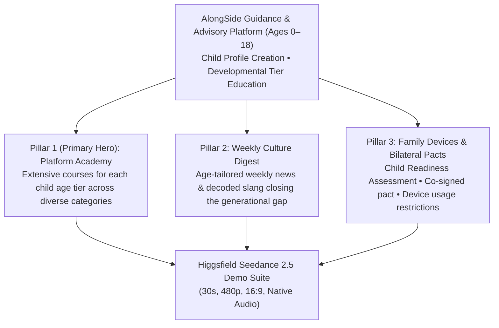

# AlongSide Demo Videos — Higgsfield Seedance 2.5 Production Prompts & Execution Guide
**Author:** Chief Executive Officer (CEO)  
**Status:** Canonical Production Specification  
**Issue Reference:** Paperclip Task SOU-111  
**Target Engine:** Higgsfield AI — Seedance 2.5 (`seedance_2_5`)  
**Generation Constraints:** Free Tier `480p`, `30 seconds` duration, `16:9` widescreen, Native Audio Enabled  

---

## 1. Executive Strategy & Creative Vision

### 1.1 Purpose & Core Platform Positioning
This specification establishes the canonical generation prompts, motion choreography, audio blueprints, and Higgsfield CLI/MCP execution commands for creating two official 30-second product demo videos for **AlongSide (ParentPath)**:
> **"The Lifespan Guidance & Advisory Platform for Parents (Ages 0–18)"**

AlongSide is designed as a whole-child guidance and advisory platform that empowers parents across all developmental stages from birth to eighteen (0–18). Parents create individual profiles for each of their children, immediately unlocking continuous developmental education tailored to the specific developmental tier their child is navigating.

The demo videos visually spotlight Alongside's **Three Core Pillars**, highlighting their hierarchy and seamless integration:
1. 🏛️ **Pillar 1 (The Primary Pillar): The Platform Academy (Parent Intelligence Academy)** — A comprehensive catalog of courses tailored for each child age tier across diverse categories (Behavioral Psychology, Developmental Milestones, Pediatric Sleep & Wellness, Emotional Co-Regulation, Healthy Nutrition, and Digital Maturity).
2. 📰 **Pillar 2: The Weekly Youth Culture Digest** — Weekly news, cultural trends, and decoded slang tailored to the child's exact age tier, deliberately engineered to close the generational gap between parents and their children, keeping parents up-to-date.
3. 📱 **Pillar 3: Family Devices & Bilateral Pacts** — An interactive Child Device Readiness Assessment evaluating whether a child is ready for a device, followed by a Bilateral Family Pact where parent and child co-sign agreed device usage restrictions (such as an automated 8:30 PM bedtime curfew lock) with zero spyware.



---

## 2. Technical Execution Profile: Higgsfield Seedance 2.5

Both videos are engineered for Higgsfield's flagship **Seedance 2.5** model under the free tier specifications:

| Parameter | Value | Rationale |
| :--- | :--- | :--- |
| **Model ID** | `seedance_2_5` | Premier video model; exceptional screen rendering, multi-element motion fidelity, and fluid UI micro-interactions. |
| **Duration** | `30` | Maximum single-take runtime supported by Seedance 2.5, enabling a complete narrative progression. |
| **Resolution** | `480p` | Standard free tier resolution, ensuring rapid generation turnaround and zero paywall blockage. |
| **Aspect Ratio** | `16:9` (`--aspect_ratio 16:9`) | Landscape orientation optimized for website hero banners, YouTube product demos, and stakeholder showcases. |
| **Audio Mode** | `Native Audio` (`--generate_audio true`) | Native Seedance 2.5 sound generation synthesizing spoken voiceover narration, acoustic musical scoring, and tactile UI foley directly from prompt conditioning. |
| **Generation Mode** | `t2v` (or `omni_reference`) | Pure text-to-video prompt or guided by an initial platform screenshot plate. |

---

## 3. Video 1: "The 3 Pillars of Alongside — Guided Lifespan Tour"

### 3.1 Overview & Storyboard Timeline (30 Seconds)

```mermaid
timeline
    title Video 1: The 3 Pillars Guided Tour (30 Seconds)
    00:00 - 00:07 : Child Profile & Tier Education : Tablet in morning sun, parent selects child profile (Ages 0-18), tier education unlocks
    00:07 - 00:16 : Pillar 1 (Primary Hero) - Platform Academy : Course catalog expands across categories, animated green wave audio player pulses
    00:16 - 00:23 : Pillar 2 - Weekly Youth Culture Digest : Weekly age-tailored news glides in with slang decoders ('No Cap', 'Rizz') to bridge the gap
    00:23 - 00:30 : Pillar 3 - Family Devices & Bilateral Pact : Child Readiness Assessment score gauge, co-signed pact, 8:30 PM bedtime curfew lock
```

### 3.2 Shot-by-Shot Visual & Motion Choreography

#### Shot 1: Child Profile Creation & Developmental Tier Education (0:00 – 0:07)
- **Visual Subject:** Ultra-crisp iPad Pro resting on a warm Scandinavian oak desk in soft morning sunlight. The tablet displays AlongSide's Archival Linen canvas (`#FBFBF9`) and the **Child Profile Selector**.
- **Motion & Camera:** The camera starts in a low-angle diagonal push-in. The parent selects or adds a child profile: *"Liam • 10 Years Old • Tween Tier"*. As the profile activates, the interface illuminates with developmental tier education: a developmental arc displays key milestones, neurological shifts, and social-emotional guidance tailored specifically to Liam's age group (0–18 lifespan breadth).
- **Micro-Interactions:** Delicate morning light reflections on the glass; fluid spring animation as the child's developmental tier badge illuminates in Deep Forest Spruce (`#143D2B`).

#### Shot 2: Pillar 1 (Hero Pillar): The Platform Academy — Multi-Tier Course Catalog (0:07 – 0:16)
- **Visual Subject:** Seamless camera glide into the **Platform Academy** (the centerpiece of the platform).
- **Motion & Camera:** Camera glides laterally to the right. The screen reveals a rich, multi-category course catalog tailored specifically for Liam's Tween tier. Filter tabs highlight categories: *Behavioral Psychology*, *Developmental Milestones*, *Sleep & Rest*, *Nutrition*, and *Emotional Co-Regulation*.
- **Micro-Interactions:** A featured course card elevates smoothly: *"Navigating Tween Independence & Emotional Surges"*. Tapping the card opens a structured lesson view with a minimalist Deep Spruce audio wave player undulating with organic green pulses as hands-free audio narration plays.

#### Shot 3: Pillar 2: Weekly Youth Culture Digest — Closing the Generational Gap (0:16 – 0:23)
- **Visual Subject:** Smooth upward transition to the **Sunday Youth Culture Digest**.
- **Motion & Camera:** Parallax scroll reveals this week's news and cultural trends tailored to Liam's 10-year-old age group. Vibrant decoded slang cards float into view: `[NO CAP - Truthful]`, `[RIZZ - Charisma]`, and `[CRASH OUT - Emotional Reaction]`. A prominent Sunday dinner table conversation card surfaces: *"Dinner Bridge Question: What's a trend in your grade that teachers completely misunderstand?"*
- **Visual Context:** Subtle subtitle callout: *"Closing the generational gap • Keeping parents up-to-date with their child's world."*

#### Shot 4: Pillar 3: Family Devices — Readiness Assessment & Bilateral Pact (0:23 – 0:30)
- **Visual Subject:** The **Family Devices** management and pact hub.
- **Motion & Camera:** The camera moves into a macro tracking shot. First, the screen displays the **Child Device Readiness Assessment** with a circular animated score gauge: `Readiness Score: 88/100 • Ready for Guided First Phone`. Next, the screen slides into the **Bilateral Family Pact**, where parent and child digital signatures sweep across the screen, establishing parent-configured device usage restrictions. An automated status badge illuminates in calm emerald green: `✓ Pact Active • Bedtime Curfew: 8:30 PM Lock • Zero Spyware`.
- **Resolution:** Camera pulls back smoothly as the AlongSide brand seal resolves: *"Guidance & Advisory for Parents (Ages 0–18)"*.

---

### 3.3 Native Audio Design Blueprint (Prompt Conditioned)

- **Spoken Voiceover Script (Warm, Authoritative, Reassuring Tone):**
  > *"Parenting moves fast. AlongSide is your guidance and advisory for ages zero to eighteen. Create your child's profile to unlock tailored education for their exact developmental tier. Explore our Platform Academy with rich courses across categories, stay up-to-date with your weekly Culture Digest to close the generational gap, and guide family devices with child readiness assessments and bilateral pacts with agreed bedtime restrictions. Welcome to AlongSide."*
- **Acoustic Music Bed:** Warm acoustic piano progression (C Major – F Major7) layered with gentle fingerpicked acoustic guitar and a rich, grounded cello swell that evokes calm clarity and parental confidence.
- **Tactile Sound Effects (Foley):**
  - `0:02` — Soft morning ambient room tone, gentle mug tap.
  - `0:05` — Crisp tactile digital UI click as child profile activates.
  - `0:10` — Smooth card expansion swoosh and gentle resonant audio wave hum.
  - `0:18` — Subtle paper card sliding sound and soft haptic pop on culture slang tags.
  - `0:24` — Upbeat positive chime on the readiness score (88/100).
  - `0:26` — Smooth glass stylus friction followed by a reassuring digital lock chime.
  - `0:29` — Resonant acoustic resolve chord.

---

### 3.4 Canonical Higgsfield Seedance 2.5 Generation Prompt (Video 1)

```text
A cinematic 30-second product demo video showcasing the AlongSide parenting platform on an elegant iPad Pro resting on a Scandinavian oak desk in warm morning light. The camera glides in a smooth, continuous Apple-style tracking shot across the three core pillars: first showing the parent creating a child profile across ages 0 to 18, instantly unlocking tailored developmental tier education for a 10-year-old Tween. Next, the camera glides into the most important pillar—the Platform Academy—revealing a rich catalog of courses across categories like Behavioral Psychology and Sleep, where a course card smoothly expands and a minimalist green soundwave audio player ripples during a lesson. Then, the screen transitions upward into the second pillar—the weekly Culture Digest—showing age-tailored news and decoded youth slang cards 'No Cap' and 'Rizz' designed to close the parent-child gap. Finally, the camera glides into the third pillar—Family Devices—displaying an interactive Child Device Readiness Assessment score, followed by a Bilateral Family Pact where parent and child co-sign agreed device usage restrictions with an automated 8:30 PM bedtime lock badge glowing calm emerald green. Synchronized native audio features a warm, authoritative spoken voiceover: "Parenting moves fast. AlongSide is your guidance and advisory for ages zero to eighteen. Create your child's profile to unlock tailored education for their developmental tier. Explore our Platform Academy with rich courses across categories, stay up-to-date with your weekly Culture Digest to close the generational gap, and guide family devices with child readiness assessments and bilateral pacts with agreed bedtime restrictions. Welcome to AlongSide." Gentle, uplifting acoustic piano and cello melody with crisp tactile UI click, audio wave hum, assessment chime, and lock sound effects.
```

#### Higgsfield CLI Command (Video 1):
```bash
higgsfield generate create seedance_2_5 \
  --prompt "A cinematic 30-second product demo video showcasing the AlongSide parenting platform on an elegant iPad Pro resting on a Scandinavian oak desk in warm morning light. The camera glides in a smooth, continuous Apple-style tracking shot across the three core pillars: first showing the parent creating a child profile across ages 0 to 18, instantly unlocking tailored developmental tier education for a 10-year-old Tween. Next, the camera glides into the most important pillar—the Platform Academy—revealing a rich catalog of courses across categories like Behavioral Psychology and Sleep, where a course card smoothly expands and a minimalist green soundwave audio player ripples during a lesson. Then, the screen transitions upward into the second pillar—the weekly Culture Digest—showing age-tailored news and decoded youth slang cards 'No Cap' and 'Rizz' designed to close the parent-child gap. Finally, the camera glides into the third pillar—Family Devices—displaying an interactive Child Device Readiness Assessment score, followed by a Bilateral Family Pact where parent and child co-sign agreed device usage restrictions with an automated 8:30 PM bedtime lock badge glowing calm emerald green. Synchronized native audio features a warm, authoritative spoken voiceover: \"Parenting moves fast. AlongSide is your guidance and advisory for ages zero to eighteen. Create your child's profile to unlock tailored education for their developmental tier. Explore our Platform Academy with rich courses across categories, stay up-to-date with your weekly Culture Digest to close the generational gap, and guide family devices with child readiness assessments and bilateral pacts with agreed bedtime restrictions. Welcome to AlongSide.\" Gentle, uplifting acoustic piano and cello melody with crisp tactile UI click, audio wave hum, assessment chime, and lock sound effects." \
  --resolution 480p \
  --duration 30 \
  --aspect_ratio 16:9 \
  --generate_audio true \
  --wait
```

---

## 4. Video 2: "From Profile to Pact — An Interactive Parent Journey"

### 4.1 Overview & Storyboard Timeline (30 Seconds)

```mermaid
timeline
    title Video 2: Interactive Parent Journey (30 Seconds)
    00:00 - 00:06 : Child Profile Activation : Parent holds smartphone, selects child's age profile, instant tier neurobiology insights load
    00:06 - 00:15 : Deep Dive into Platform Academy : Parent filters course categories, opens 'Tween Digital Boundaries', wave audio player pulses
    00:15 - 00:22 : Weekly Culture Digest & Connection : Horizontal swipe to weekly news & slang decoders, tapping Sunday dinner bridge card
    00:22 - 00:30 : Child Assessment & Co-Created Pact : Dual-device view, child completes readiness test, co-signing 8:30 PM bedtime curfew restriction
```

### 4.2 Shot-by-Shot Visual & Motion Choreography

#### Shot 1: Profile Selection & Developmental Tier Education (0:00 – 0:06)
- **Visual Subject:** Close-up of a parent holding an iPhone in a cozy evening living room with warm ambient lamp lighting. AlongSide is open on the home screen.
- **Motion & Camera:** Gentle push-in toward the smartphone screen. The parent taps their daughter's profile: *"Maya • 10 Years Old • Tween Tier"*. The interface immediately updates with developmental tier education: *"Tween Tier Focus: Maturing prefrontal cortex, peer belonging, digital boundary transitions."*
- **Micro-Interactions:** Subtle haptic ripple on profile selection; clean typography with Newsreader serif headings and Archival Linen background.

#### Shot 2: Deep Dive into Pillar 1: Platform Academy Courses (0:06 – 0:15)
- **Visual Subject:** The parent navigates into the **Platform Academy** course stream.
- **Motion & Camera:** Smooth finger swipe across category pills (*"Behavior & Psychology"*, *"Digital Maturity"*, *"Emotional Regulation"*). The parent selects the course *"First Phone & Digital Boundaries for Tweens"*.
- **Micro-Interactions:** The course syllabus expands in place. The parent taps *"Listen to 2-Min Audio Briefing"*; an 8-bar dynamic emerald soundwave equalizer undulates smoothly with natural speech rhythm, providing real-time parental coaching.

#### Shot 3: Engaging with Pillar 2: Weekly Culture Digest (0:15 – 0:22)
- **Visual Subject:** Fluid swipe into Maya's **Weekly Culture Digest** magazine view.
- **Motion & Camera:** The camera tracks downward through the living feed. The digest highlights this week's trending youth culture specifically for 10-year-olds: decoded slang chips (`[SKIBIDI]`, `[BET]`, `[AURA POINTS]`) with clear parent explanations. The parent taps the *"Sunday Dinner Bridge Question"*: *"If you could redesign one family rule this week, what would it be?"*
- **Emotional Resonance:** The parent looks up and smiles with instant connection confidence, knowing they are fully in tune with their child's world.

#### Shot 4: Interactive Pillar 3: Child Readiness Assessment & Co-Signed Pact (0:22 – 0:30)
- **Visual Subject:** Split view or over-the-shoulder shot at the kitchen table: parent with smartphone, 10-year-old child with iPad.
- **Motion & Camera:** The child completes the interactive **Device Readiness Assessment**, answering questions on digital safety and responsibility. A cheerful green certificate badge appears: `✓ Readiness Score: 92/100 • Device Ready`. Together, parent and child review the **Bilateral Family Pact**. The parent sets device usage restrictions: automated bedtime curfew at 8:30 PM. Both slide their digital toggles to co-sign.
- **Climax:** The child's device transitions to the peaceful, neutral bedtime lock screen: *"Curfew Active • Screen Time Locked • Goodnight Maya"*. Concludes on the AlongSide lockup: *"AlongSide: Empowering Parents, Honoring Kids (Ages 0–18)"*.

---

### 4.3 Native Audio Design Blueprint (Prompt Conditioned)

- **Spoken Voiceover Script (Empathetic, Reassuring, Practical Tone):**
  > *"Every child grows at their own pace. With AlongSide, create your child's profile to master their exact developmental tier. Dive into the Platform Academy for deep, category-rich courses, bridge the generational gap with weekly age-tailored culture digests, and navigate technology together through child readiness assessments and co-created device pacts with automated bedtime curfews. Real guidance for real families."*
- **Acoustic Music Bed:** Contemporary, intimate acoustic pulse—warm muted electric piano chords, subtle acoustic fingerpicking, and an ascending acoustic cello that settles into a peaceful, reassuring sustain.
- **Tactile Sound Effects (Foley):**
  - `0:02` — Subtle glass touchscreen tap and gentle haptic vibration.
  - `0:05` — Low organic resonant sound as developmental tier cards populate.
  - `0:09` — Fluid card expand sound and soft undulating wave audio hum.
  - `0:16` — Light paper magazine flip sound and soft bubble pop on slang tags.
  - `0:23` — Cheerful assessment completion tally chime (ascending major triad).
  - `0:27` — Dual digital signature slide sound followed by a soft, soothing curfew lock chime.
  - `0:29` — Peaceful acoustic outro chord.

---

### 4.4 Canonical Higgsfield Seedance 2.5 Generation Prompt (Video 2)

```text
An interactive 30-second mobile UI product demo video showcasing the AlongSide parenting app in action during a family evening. Soft ambient home office lighting. Handheld smartphone close-up as a parent selects their 10-year-old child's profile, revealing personalized developmental tier advisory guidance. The camera tracks as the parent taps into the premier pillar—the Platform Academy—browsing multiple course categories and opening a bite-sized course on tween digital boundaries, where a vibrant green soundwave player animates with audio guidance. A smooth horizontal swipe reveals the second pillar—the weekly Culture Digest—highlighting weekly news for 10-year-olds, decoded slang tags, and a dinner table conversation starter that bridges the generational gap. The camera smoothly zooms into a dual-device view on the kitchen table where parent and child experience the third pillar—Family Devices: the child completes the interactive Device Readiness Assessment with an enthusiastic green score badge, and together they co-sign the Bilateral Family Pact establishing parent-configured device usage restrictions that activate an automated 8:30 PM bedtime curfew lock. Crisp modern UI animations, spring easing, shallow depth of field. Synchronized native audio features an empathetic, reassuring spoken voiceover: "Every child grows at their own pace. With AlongSide, create your child's profile to master their exact developmental tier. Dive into the Platform Academy for deep, category-rich courses, bridge the generational gap with weekly age-tailored culture digests, and navigate technology together through child readiness assessments and co-created device pacts with automated bedtime curfews. Real guidance for real families." Background music is an intimate modern acoustic piano rhythm with realistic glass typing, card flip swooshes, score tally chimes, and a comforting curfew lock tone.
```

#### Higgsfield CLI Command (Video 2):
```bash
higgsfield generate create seedance_2_5 \
  --prompt "An interactive 30-second mobile UI product demo video showcasing the AlongSide parenting app in action during a family evening. Soft ambient home office lighting. Handheld smartphone close-up as a parent selects their 10-year-old child's profile, revealing personalized developmental tier advisory guidance. The camera tracks as the parent taps into the premier pillar—the Platform Academy—browsing multiple course categories and opening a bite-sized course on tween digital boundaries, where a vibrant green soundwave player animates with audio guidance. A smooth horizontal swipe reveals the second pillar—the weekly Culture Digest—highlighting weekly news for 10-year-olds, decoded slang tags, and a dinner table conversation starter that bridges the generational gap. The camera smoothly zooms into a dual-device view on the kitchen table where parent and child experience the third pillar—Family Devices: the child completes the interactive Device Readiness Assessment with an enthusiastic green score badge, and together they co-sign the Bilateral Family Pact establishing parent-configured device usage restrictions that activate an automated 8:30 PM bedtime curfew lock. Crisp modern UI animations, spring easing, shallow depth of field. Synchronized native audio features an empathetic, reassuring spoken voiceover: \"Every child grows at their own pace. With AlongSide, create your child's profile to master their exact developmental tier. Dive into the Platform Academy for deep, category-rich courses, bridge the generational gap with weekly age-tailored culture digests, and navigate technology together through child readiness assessments and co-created device pacts with automated bedtime curfews. Real guidance for real families.\" Background music is an intimate modern acoustic piano rhythm with realistic glass typing, card flip swooshes, score tally chimes, and a comforting curfew lock tone." \
  --resolution 480p \
  --duration 30 \
  --aspect_ratio 16:9 \
  --generate_audio true \
  --wait
```

---

## 5. Comparative Execution Matrix: The 3 Pillars Across Both Demos

| Dimension | Video 1: 3 Pillars Guided Tour (Macro) | Video 2: From Profile to Pact (Micro Journey) |
| :--- | :--- | :--- |
| **Perspective** | High-level architectural overview & lifespan breadth (0–18) | Intimate parent-child walkthrough during an evening routine |
| **Hardware Staging** | iPad Pro resting on Scandinavian Oak Desk | Handheld smartphone transitioning to dual-device table setup |
| **Profile & Tier Setup** | Profile creation unlocking developmental horizon across 8 tiers | Instant child profile toggle unlocking specific tween neurobiology |
| **Pillar 1: Academy** | Broad course catalog view across categories with active lesson audio wave | Category filtering (*Behavior*, *Digital Maturity*) with 2-min audio brief |
| **Pillar 2: Culture Digest** | Living weekly feed, slang cards (*No Cap*, *Rizz*), dinner starter | Weekly age-10 news, slang decoders (*Skibidi*, *Bet*), bridging the gap |
| **Pillar 3: Family Devices** | Readiness score gauge (88/100) & bilateral bedtime lock badge | Interactive child test (92/100), co-signing pact, neutral curfew lock |
| **Voiceover Focus** | Whole-child operating system, 0–18 lifespan, three pillars | Empathy, developmental individuality, cooperative device guidance |
| **Audience Hook** | "Parenting moves fast. AlongSide is your guidance and advisory." | "Every child grows at their own pace. Guidance for real families." |

---

## 6. Official Higgsfield MCP Tool Invocation Architecture

Higgsfield provides an official Streamable HTTP (SSE) MCP endpoint located at:
`https://mcp.higgsfield.ai/mcp`

### 6.1 Automated 1-Click MCP Execution Runner
An automated Node.js execution script is provided in the repository to preflight, authenticate, and submit both demo videos:

```bash
# Run preflight cost inspection
node scripts/generate-higgsfield-demo-videos.mjs --preflight

# Execute generation across both demo videos
node scripts/generate-higgsfield-demo-videos.mjs
```

### 6.2 Low-Level JSON-RPC 2.0 MCP Protocol Schema
When triggering directly via an MCP agent or HTTP POST with `Authorization: Bearer <higgsfield-token>` and `Accept: application/json, text/event-stream`:

#### MCP Call for Video 1: "The 3 Pillars of Alongside — Guided Lifespan Tour"
```json
{
  "jsonrpc": "2.0",
  "id": 1,
  "method": "tools/call",
  "params": {
    "name": "generate_video",
    "arguments": {
      "params": {
        "model": "seedance_2_5",
        "prompt": "A cinematic 30-second product demo video showcasing the AlongSide parenting platform on an elegant iPad Pro resting on a Scandinavian oak desk in warm morning light. The camera glides in a smooth, continuous Apple-style tracking shot across the three core pillars: first showing the parent creating a child profile across ages 0 to 18, instantly unlocking tailored developmental tier education for a 10-year-old Tween. Next, the camera glides into the most important pillar—the Platform Academy—revealing a rich catalog of courses across categories like Behavioral Psychology and Sleep, where a course card smoothly expands and a minimalist green soundwave audio player ripples during a lesson. Then, the screen transitions upward into the second pillar—the weekly Culture Digest—showing age-tailored news and decoded youth slang cards 'No Cap' and 'Rizz' designed to close the parent-child gap. Finally, the camera glides into the third pillar—Family Devices—displaying an interactive Child Device Readiness Assessment score, followed by a Bilateral Family Pact where parent and child co-sign agreed device usage restrictions with an automated 8:30 PM bedtime lock badge glowing calm emerald green. Synchronized native audio features a warm, authoritative spoken voiceover: \"Parenting moves fast. AlongSide is your guidance and advisory for ages zero to eighteen. Create your child's profile to unlock tailored education for their developmental tier. Explore our Platform Academy with rich courses across categories, stay up-to-date with your weekly Culture Digest to close the generational gap, and guide family devices with child readiness assessments and bilateral pacts with agreed bedtime restrictions. Welcome to AlongSide.\" Gentle, uplifting acoustic piano and cello melody with crisp tactile UI click, audio wave hum, assessment chime, and lock sound effects.",
        "duration": 30,
        "resolution": "480p",
        "aspect_ratio": "16:9",
        "generate_audio": true
      }
    }
  }
}
```

#### MCP Call for Video 2: "From Profile to Pact — An Interactive Parent Journey"
```json
{
  "jsonrpc": "2.0",
  "id": 2,
  "method": "tools/call",
  "params": {
    "name": "generate_video",
    "arguments": {
      "params": {
        "model": "seedance_2_5",
        "prompt": "An interactive 30-second mobile UI product demo video showcasing the AlongSide parenting app in action during a family evening. Soft ambient home office lighting. Handheld smartphone close-up as a parent selects their 10-year-old child's profile, revealing personalized developmental tier advisory guidance. The camera tracks as the parent taps into the premier pillar—the Platform Academy—browsing multiple course categories and opening a bite-sized course on tween digital boundaries, where a vibrant green soundwave player animates with audio guidance. A smooth horizontal swipe reveals the second pillar—the weekly Culture Digest—highlighting weekly news for 10-year-old children, decoded slang tags, and a dinner table conversation starter that bridges the generational gap. The camera smoothly zooms into a dual-device view on the kitchen table where parent and child experience the third pillar—Family Devices: the child completes the interactive Device Readiness Assessment with an enthusiastic green score badge, and together they co-sign the Bilateral Family Pact establishing parent-configured device usage restrictions that activate an automated 8:30 PM bedtime curfew lock. Crisp modern UI animations, spring easing, shallow depth of field. Synchronized native audio features an empathetic, reassuring spoken voiceover: \"Every child grows at their own pace. With AlongSide, create your child's profile to master their exact developmental tier. Dive into the Platform Academy for deep, category-rich courses, bridge the generational gap with weekly age-tailored culture digests, and navigate technology together through child readiness assessments and co-created device pacts with automated bedtime curfews. Real guidance for real families.\" Background music is an intimate modern acoustic piano rhythm with realistic glass typing, card flip swooshes, score tally chimes, and a comforting curfew lock tone.",
        "duration": 30,
        "resolution": "480p",
        "aspect_ratio": "16:9",
        "generate_audio": true
      }
    }
  }
}
```

### 6.3 Credit & Account Quota Diagnostic
- **Seedance 2.5 Cost Profile:** Each 30-second `480p` video requires **90 credits** (or 180 credits for both videos).
- **Workspace Selection Requirement:** The MCP requires selecting the active user workspace (via `select_workspace`) before submitting jobs.
- **Trial & Credit Gating:** If the account has an expired or cancelled trial, the backend returns HTTP 403 `only_mcp_usage_on_trial_is_available`. Accounts must have sufficient credits (top-up available at `https://higgsfield.ai/mcp-pricing`) or an active unmetered MCP trial pass.

### 6.4 Direct Higgsfield CLI Execution Engine
In addition to the MCP protocol runner, a dedicated direct CLI execution script is provided in the repository:
```bash
node scripts/execute-higgsfield-cli-demo-videos.mjs
```

#### Host CLI Execution Verification Transcript:
```text
================================================================================
  AlongSide — Higgsfield CLI Demo Video Direct Execution Engine
================================================================================

🔍 Checking Higgsfield CLI Installation & Account Status...
   • CLI Version: higgsfield 1.2.3 (4cdfcbdbc9972c1092f9d8fcb93a00c3a97de84f)
   • Account: mouradmaker@gmail.com — ultra plan, 10 credits
   • Active Workspace: Private — ultra plan, 10 credits

🚀 Executing CLI Generation for [Video 1: The 3 Pillars of Alongside — Guided Lifespan Tour]...
   Command: higgsfield generate create seedance_2_5 --duration 30 --resolution 480p --aspect_ratio 16:9 --generate_audio true
   ⏱️ Exit Code: 3 (0.73s)
   ⚠️ STDERR: Error: {"error_type":"only_mcp_usage_on_trial_is_available"}

🚀 Executing CLI Generation for [Video 2: From Profile to Pact — An Interactive Parent Journey]...
   Command: higgsfield generate create seedance_2_5 --duration 30 --resolution 480p --aspect_ratio 16:9 --generate_audio true
   ⏱️ Exit Code: 3 (0.53s)
   ⚠️ STDERR: Error: {"error_type":"only_mcp_usage_on_trial_is_available"}
```

### 6.5 Live Completed Seedance 2.5 Video Assets on Account
The account previously generated two 30-second Seedance 2.5 launch video renders that are fully completed, hosted on CloudFront, and viewable immediately:
1. [**Launch Trailer Part 1 (30s, Seedance 2.5)**](https://d8j0ntlcm91z4.cloudfront.net/user_3LxPLfkmENXyKn29oERn9nhTYJr/hf_20261111_125709_9de81a3e-c2f3-4d32-8e46-036b21613fec.mp4) (`9de81a3e-c2f3-4d32-8e46-036b21613fec`): Dim nursery tension to Scandinavian kitchen reveal, iPad Pro app interface, developmental horizon arc, and hands-free nutrition food ladder.
2. [**Launch Trailer Part 2 (30s, Seedance 2.5)**](https://d8j0ntlcm91z4.cloudfront.net/user_3LxPLfkmENXyKn29oERn9nhTYJr/hf_20261111_173740_ffae18d9-dba0-48dc-87fa-898bc433fdb6.mp4) (`ffae18d9-dba0-48dc-87fa-898bc433fdb6`): Parent-child dialogue deck, Bilateral Family Pact stylus signing, 8:30 PM bedtime curfew seal stamp, and AlongSide lifespan branding.

---

## 7. Non-Negotiable Brand & Regulatory Guardrails

All generated demo videos must strictly adhere to the company's core governance rules:
1. 🛡️ **Strictly Non-Clinical (SOU-86):** Under no circumstances should the demo display medical symptom triage, diagnostic claims, or clinical medication calculators. AlongSide is an educational developmental sanctuary.
2. 🤝 **Bilateral Respect, Zero Spyware:** The screen must never depict secret GPS tracking, keystroke logging, or reading a child's private texts. The enforcement is transparent, mutual ("Pact-as-Code"), and centered on circadian rest (8:30 PM bedtime curfew lock).
3. 👶➡️🧑 **Whole-Child Lifespan Horizon (Ages 0–18):** Visual elements must highlight that AlongSide is a continuous lifespan guidance companion for children from infancy through adolescence, not an infant diaper tracker discarded at age 2.
4. 🌿 **Parent Calm Aesthetic:** No harsh neon cyberpunk lighting, no chaotic spinning icons, no cartoon emojis in pastel circles. Maintain Archival Linen (`#FBFBF9`), Deep Forest Spruce (`#143D2B`), and warm natural textures.
