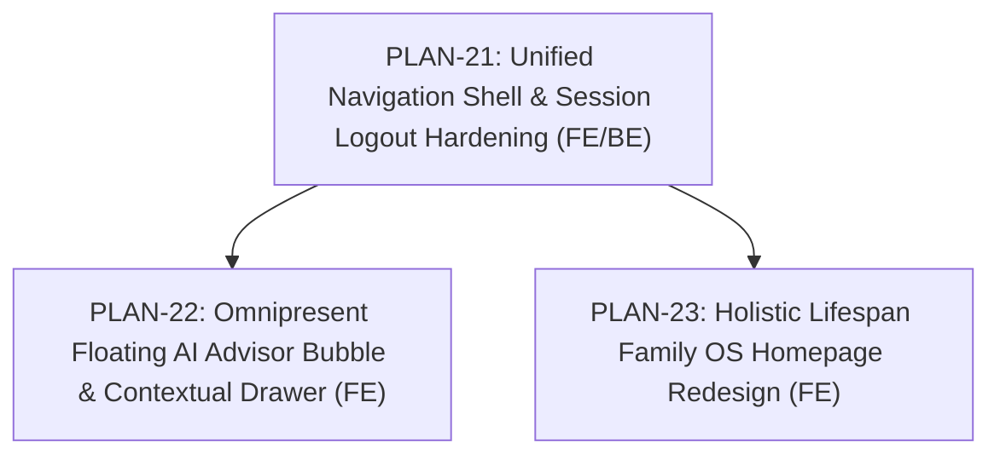

# Alongside — Holistic Redesign & Navigation Architecture Specification
**Author:** Chief Technology Officer (CTO)  
**Status:** Approved Architectural Specification  
**Version:** 2.4.0  
**Target Audience:** Frontend Agent, Backend Agent, Product Leadership  
**Companion Documents:**
- [`docs/PROJECT_SCOPE.md`](PROJECT_SCOPE.md) (Canonical Product Scope v2.4.0)
- [`docs/PAUL_GRAHAM_ROAST.md`](PAUL_GRAHAM_ROAST.md) (YC Strategy Evaluation & Decacorn Pivot)
- [`docs/technical-roadmap-v2.4.0.md`](technical-roadmap-v2.4.0.md) (Technical Roadmap v2.4.0)
- [`docs/codebase-design.md`](codebase-design.md) (Deep Modules & Seam Catalog)
- [`plans/README.md`](../plans/README.md) (Master Engineering Execution Index)

---

## 1. Executive Problem Statement & Context

In Paperclip task **SOU-47**, the leadership team flagged four critical architectural and UX discrepancies in the current AlongSide application:

1. **Outdated Homepage Framing:**  
   The current homepage (`apps/web/src/app/page.tsx`) reflects an obsolete v2.0/v2.1 framing ("Replace screen conflict with calm developmental science", "The Two Roads: Pre-Device vs Active-Device", "smartphone curfews"). It narrows the platform's perceived scope strictly to middle-school phone battles. Meanwhile, the canonical project scope ([`docs/PROJECT_SCOPE.md`](PROJECT_SCOPE.md) v2.4.0) and YC roast review ([`docs/PAUL_GRAHAM_ROAST.md`](PAUL_GRAHAM_ROAST.md)) established that AlongSide is **The Holistic Child Upbringing, Pediatric Health & Lifespan Family OS (Ages 0–18)**, covering infant nutrition, 2:00 AM fever triage, speech/motor milestones, purposeful brain play, and tantrum de-escalation alongside device governance.
2. **AI Advisor Information Architecture (Tab vs. Floating Bubble Chat):**  
   The 24/7 AI Child Advisor currently exists exclusively as a siloed top-level page/tab at `/advisor`. If a parent reviewing a fever in `/health`, a feeding guide in `/nutrition`, or a tantrum de-escalation script in `/behavior` has an immediate question, they must abandon their current view and navigate away.
3. **Dual Stacked Navbars ("Two Navbars for No Reason"):**  
   In the authenticated dashboard layout, the root layout `<Header />` (sticky at `top-0`) and the dashboard layout `<DashboardNav />` (sticky at `top-16`) render the exact same 7 domain destinations (`Today`, `Health`, `Nutrition`, `Play`, `Behavior`, `AI Advisor`, `Devices`). Stacking two identical navigation bars vertically creates visual stutter, wastes 128px+ of screen real estate, and degrades user experience.
4. **Session Logout Teardown Failure:**  
   Clicking "Log out" clears the Fastify backend cookie and sets the single `['auth', 'me']` React Query key to null, but fails to redirect the user away from protected routes, fails to purge the TanStack Query cache, and fails to clear Zustand store state (`useChildContextStore`), leaving the client stranded in an inconsistent, broken state.

---

## 2. Strategic Evaluation & Architectural Decisions

### 2.1 The Homepage Redesign: Transcending the "Device Blinders" Trap

#### Strategic Analysis:
As analyzed in [`docs/PAUL_GRAHAM_ROAST.md`](PAUL_GRAHAM_ROAST.md) Section 11, focusing purely on screens traps AlongSide in the **"App of Parental Guilt"**:
- Screens represent less than 5% of early childhood. Parents of infants, toddlers, and elementary kids are daily concerned with fever triage, safe allergen introduction, speech milestones, puppet play, and handling public meltdowns.
- By framing the homepage strictly around "smartphone curfews" and "The Two Roads", parents of children aged 0–9 assume AlongSide is not for them, artificially slashing the Total Addressable Market (TAM) by over 70% and missing the lowest-CAC acquisition window.

#### Architectural Decision:
Redesign `apps/web/src/app/page.tsx` into a **Lifespan Showcase (Ages 0–18)** highlighting AlongSide as the complete modern family operating system:
1. **Hero Proposition:** "The Complete Operating System for Modern Parenting — From 2:00 AM Fever Triage & Speech Milestones to Brain Play & Healthy Tech (Ages 0–18)."
2. **Interactive Lifespan Stage Selector:** A dynamic, clickable tab bar allowing parents to explore their child's current age bracket:
   - **Infants & Toddlers (Ages 0–3):** 3-zone pediatric fever triage, safe allergen introduction, Baby-Led Weaning, speech/motor milestone tracking, puppet theater games.
   - **Early Childhood (Ages 4–6):** Picky eating Division of Responsibility, HALT tantrum decoding, sensory play, bedtime co-regulation.
   - **Middle Childhood (Ages 7–9):** Brain games & logic puzzles, boredom buster generator, friendship dynamics, healthy screen foundations.
   - **Pre-Teens & Adolescence (Ages 10–18):** First phone readiness diagnostic (0–100), Bilateral Family Pact ("Pact-as-Code"), automated 8:30 PM curfews, Sunday youth culture & slang decoders.
3. **The 5 Balanced Pillars Grid:** Highlighting Pediatric Health ("Safe Resort"), Pediatric Nutrition, Purposeful Play, Behavioral Psychology, and Modern Culture & Devices.
4. **"Thinking About a Device?" Action Hub Spotlight:** Framing device management as an empowering rite of passage rather than the whole product identity.
5. **Trust & Conversion Engine:** 7-day risk-free trial, zero spyware pledge, Barton Schmitt clinical protocols endorsement, and pediatrician network trust signals.

---

### 2.2 AI Advisor Architecture: Tab vs. Floating Bubble Chat

#### The Trade-Off Analysis:

| Architectural Pattern | Advantages | Disadvantages | Verdict |
| :--- | :--- | :--- | :--- |
| **Option A: Tab / Dedicated Page Only** *(Current)* | Ample space for audio controls, waveform visualizers, scenario selectors, and 250+ FAQ vault searching. | Requires navigating away from active context (e.g. leaving health triage or dinner guide); clutters primary navigation. | ❌ Too rigid; increases friction for quick questions. |
| **Option B: Floating Bubble Only** *(Pure Chat Widget)* | Accessible anywhere; zero navigation disruption; familiar modern paradigm (Intercom, Copilot). | Cramped 380px popover is inadequate for 3-minute voice sparring rehearsals, feedback cards, and extensive FAQ filtering. | ❌ Insufficient for high-value voice simulations. |
| **Option C: Hybrid Architecture ("Ubiquitous Bubble + Deep Flight Simulator")** | **Best of both worlds:** Instant floating drawer everywhere + 1-tap "Expand to Full Rehearsal Studio" linking to `/advisor`. | Requires coordinated state between bubble and full-screen view. | ✅ **SELECTED CANONICAL PATTERN** |

#### Hybrid Architectural Specification:
```
┌────────────────────────────────────────────────────────────────────────┐
│                        ALONGSIDE HYBRID AI ARCHITECTURE                │
├────────────────────────────────────────────────────────────────────────┤
│                                                                        │
│   EVERYWHERE FLOATING BUBBLE                DEEP REHEARSAL WORKSPACE   │
│   (Persistent on all routes)                (Dedicated route: /advisor)│
│                                                                        │
│   • Accessible from /dashboard, /health,     • Voice Sparring Simulator│
│     /nutrition, /brain-games, /behavior       (Web Audio, microphone,   │
│   • Context-Aware: Automatically inherits       scenario roleplay, and  │
│     active child name, age & tier               pediatric coach scoring)│
│   • 1-Tap Quick Action Prompts tailored     • 250+ Clinical FAQ Vault  │
│     to the active page domain                 (Categorized search,      │
│   • Instant SSE streaming chat responses        developmental filters)  │
│   • "Open Full Studio" launcher icon        • Full transcript exports  │
│                                                                        │
└────────────────────────────────────────────────────────────────────────┘
```

1. **Global Floating Bubble Component (`FloatingAdvisorBubble.tsx`):**
   - Mounted in the application root/dashboard layout.
   - Fixed at `bottom-6 right-6` on desktop; integrated floating action button (FAB) above mobile nav on mobile.
   - Displays a calming teal badge with pulse indicator when advice is streaming.
   - When opened, expands into a sleek 420px slide-over sheet or floating card.
   - Automatically injects the **current page context** and **active child context** (`useChildContextStore`):
     * On `/health`: Quick prompts = *"Leo has a 101.4°F fever — what should I check?"*, *"Is this rash contagious?"*.
     * On `/nutrition`: Quick prompts = *"How do I introduce peanut butter safely?"*, *"Handling dinner refusal without a battle"*.
     * On `/behavior`: Quick prompts = *"De-escalating a public grocery store meltdown"*, *"Bedtime delay stalling tactics"*.
     * On `/devices`: Quick prompts = *"Is my 10-year-old ready for a phone?"*, *"What does 'crashout' mean in tween slang?"*.
2. **Dedicated Workspace (`/advisor`):**
   - Retains the full-screen "Flight Simulator" environment optimized for real-time voice sparring rehearsals, scenario selection, audio waveform visualization, and multi-tier FAQ vault exploration.
   - Navigation links to `/advisor` are streamlined: moved from the primary desktop navbar into the user/more menu or triggered directly from the floating bubble ("Open Full Studio").

---

### 2.3 Navigation Unification: Eliminating the Dual Stacked Navbars

#### The Current Redundancy:
Currently, when a user is authenticated:
1. `apps/web/src/app/layout.tsx` renders `<Header />` (sticky at `top-0`).
   `Header.tsx` renders 7 desktop links: `Today`, `Health`, `Nutrition`, `Play`, `Behavior`, `AI Advisor`, `Devices`.
2. `apps/web/src/app/(dashboard)/layout.tsx` renders `<DashboardNav />` (sticky at `top-16`).
   `DashboardNav.tsx` renders the SAME 7 desktop links with icons: `Today & Milestones`, `Health Companion`, `Nutrition & Food`, `Brain Games & Play`, `Behavior & Emotion`, `24/7 AI Advisor`, `Modern World & Devices`.

#### Unified Top App Bar Architecture:
```
┌─────────────────────────────────────────────────────────────────────────────────────────────────┐
│                                UNIFIED ALONGSIDE APPLICATION HEADER                             │
├─────────────────────────────────────────────────────────────────────────────────────────────────┤
│                                                                                                 │
│  [Logo] AlongSide  │  [Child: Mateo (14mo) ▼]  │  Today  Health  Nutrition  Play  Behavior  More │ [🔔] [Avatar ▼] │
│                                                                                                 │
└─────────────────────────────────────────────────────────────────────────────────────────────────┘
```

1. **Single Responsive Header (`Header.tsx`):**
   - When **Unauthenticated (Public Visitor):**
     * Brand Logo + "Parent Calm System" tagline.
     * Public Showcase Links: `Lifespan Pillars`, `Pediatric Health`, `Modern Devices & Pacts`, `Pricing`.
     * Actions: `Log in` (Ghost Button) and `Start 7-Day Free Trial` (Primary CTA).
   - When **Authenticated (Family App Mode):**
     * Brand Logo (redirects to `/dashboard`).
     * **Child Profile Selector (`ChildSelector`):** Prominently embedded in the header, displaying avatar initials, child's first name, age badge (e.g. "14 mo" or "8 yrs"), and tier indicator, with 1-click child switching and "Add Child +" action.
     * **Primary Domain Navigation (Desktop):**
       - `Today` (`/dashboard`)
       - `Health` (`/health`)
       - `Nutrition` (`/nutrition`)
       - `Play` (`/brain-games`)
       - `Behavior` (`/behavior`)
       - `Devices & Pacts` (`/devices`)
     * **User Profile & Utility Menu:**
       - Active Parent Name / Email truncate.
       - Dropdown menu with: `Family Settings`, `Parent Intelligence Academy` (`/academy`), `Sunday Culture Digest` (`/digest`), `Stripe Hero Pass Subscription`, and **`Log out`**.
2. **Deprecation of `DashboardNav.tsx`:**
   - Remove `<DashboardNav />` from `apps/web/src/app/(dashboard)/layout.tsx`.
   - Reclaim 64px of vertical viewing space on all dashboard pages, eliminating layout jitter and nested sticky headers.
3. **Streamlined Mobile Navigation (`MobileNav.tsx`):**
   - Fixed bottom navigation bar with 5 thumb-friendly tabs:
     1. `Today` (Compass icon -> `/dashboard`)
     2. `Health` (HeartPulse icon -> `/health`)
     3. `Play` (Puzzle icon -> `/brain-games`)
     4. `Devices` (Smartphone icon -> `/devices`)
     5. `More` (Menu icon -> opens slide-up sheet with Nutrition, Behavior, Academy, Digest, and Settings).
   - The `FloatingAdvisorBubble` floats comfortably at `bottom-20 right-4` above the mobile navigation bar without occluding touch targets.

---

### 2.4 Complete Session Logout Teardown & Lifecycle Hardening

#### Diagnosis of Current Logout Defect:
In `apps/web/src/components/shared/Header.tsx`, `handleLogout` calls `await logout()`.
In `apps/web/src/hooks/useAuth.ts`, `logoutMutation`:
- Dispatches a `POST` to `/api/v1/auth/logout`.
- Executes `queryClient.setQueryData(AUTH_QUERY_KEY, null)`.
- **Root Causes of Failure:**
  1. **No Navigation or Hard Redirect:** The user is left on the current URL (e.g. `/dashboard` or `/health`). Because there is no client-side navigation or redirect, the page component remains mounted and attempts to fetch child-dependent resources.
  2. **TanStack Query Cache Remains Dirty:** Queries for `['children']`, `['active-child']`, `['health-logs']`, `['pacts']`, etc., stay active in React Query memory.
  3. **Zustand Store Remains Dirty:** `useChildContextStore` retains all loaded child profiles and the `activeChildId`.
  4. **Cookie Domain / SameSite Mismatch in Local Development:** Fastify sets `sameSite: 'strict'` on the session cookie. In local cross-origin development (`localhost:3000` to `localhost:4000`), strict cookies may fail to be cleared properly if origin handling or credentials configuration differs.

#### Hardened Logout Protocol:
```mermaid
sequenceDiagram
    autonumber
    actor Parent as Parent User
    participant Header as Header / Avatar Menu
    participant Hook as useAuth Hook
    participant API as Fastify /api/v1/auth/logout
    participant Query as TanStack QueryClient
    participant Store as Zustand ChildStore
    participant Window as Browser Window / Router

    Parent->>Header: Click "Log out"
    Header->>Hook: logout()
    Hook->>API: POST /api/v1/auth/logout (credentials: include)
    API-->>Hook: 200 OK + Set-Cookie: session=; Max-Age=0; Path=/
    Hook->>Query: queryClient.clear() (Full cache eviction)
    Hook->>Store: useChildContextStore.getState().reset() (Purge in-memory profiles)
    Hook->>Window: window.location.href = '/login?logged_out=true' (Hard purge & redirect)
    Window->>Parent: Display clean Login screen with confirmation toast
```

---

## 3. Engineering Plan Portfolio Overview

To execute this architecture with zero regressions, the CTO has authored three discrete, standardized execution plans conforming to [`docs/plan-standards.md`](plan-standards.md):



1. [**`PLAN-21: Unified Navigation Shell & Complete Session Logout Hardening UI`**](../plans/21-unified-navigation-and-session-logout-hardening-ui.md):
   - Consolidate `<Header />` and `<DashboardNav />` into a single, high-leverage Top Application Bar.
   - Deprecate and remove `<DashboardNav />` from `apps/web/src/app/(dashboard)/layout.tsx`.
   - Update `MobileNav.tsx` with 5 thumb-friendly hubs and a clean slide-up "More" menu.
   - Implement the complete session teardown in `useAuth.ts`: backend cookie purge, full React Query cache eviction (`queryClient.clear()`), Zustand store reset, and deterministic redirect to `/login`.
2. [**`PLAN-22: Omnipresent Floating AI Advisor Bubble & Contextual Drawer UI`**](../plans/22-omnipresent-floating-ai-advisor-bubble-ui.md):
   - Implement `<FloatingAdvisorBubble />` mounted globally across all routes.
   - Context-aware quick prompt generation based on current route (`/health`, `/nutrition`, `/behavior`, `/devices`, `/dashboard`) and active child's developmental tier.
   - Slide-over drawer with real-time SSE streaming chat.
   - Seamless "Open Full Studio" link to `/advisor` for voice sparring rehearsals and 250+ FAQ vault exploration.
3. [**`PLAN-23: Holistic Lifespan Family OS Homepage Redesign`**](../plans/23-holistic-lifespan-homepage-redesign.md):
   - Overhaul `apps/web/src/app/page.tsx` to reflect the full 0–18 lifespan scope and Paul Graham Roast insights.
   - Implement the interactive Lifespan Stage Selector (Ages 0–3, 4–6, 7–9, 10–18).
   - Implement the 5 Balanced Pillars showcase with interactive cards.
   - Reposition device governance into the "Thinking About a Device?" celebratory action hub.
   - Deliver mobile-responsive, anti-slop visual design adhering to "Parent Calm" design tokens.

---

## 4. Verification & Definition of Done

This redesign milestone will be verified against:
- [ ] No dual navbars: exactly one navigation header exists on desktop and one tab bar on mobile.
- [ ] Logout works deterministically: clicking log out clears session cookies, empties client cache/stores, and navigates immediately to `/login`.
- [ ] Floating AI Advisor bubble renders on all routes without visual collision or horizontal scroll.
- [ ] Homepage showcases all 5 pillars and ages 0–18, removing the narrow "device-only" framing.
- [ ] TypeScript verification passes with zero errors: `npm run typecheck` exits 0.
- [ ] Ponytail review audit verified: no unnecessary dependencies or speculative bloat added.
