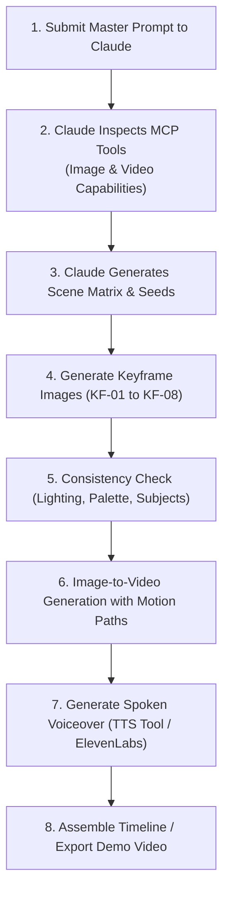

# AlongSide Launch Demo Video — Production Prompt Suite & Claude MCP Specification
**Author:** Chief Technology Officer (CTO)  
**Status:** Canonical Production Specification  
**Document Version:** 1.0.0  
**Target Audience:** Human Founder (Souheil), Product Marketing, Claude MCP Video/Image Generator, Creative Engineers  
**Issue Reference:** Paperclip Task SOU-101  

---

## 1. Executive Summary & Creative Direction

### 1.1 Purpose & Scope
This specification defines the production-grade prompt system, cinematographic storyboard, voiceover scripts, audio engineering blueprints, and Claude MCP execution protocol for creating the official launch demo video for **AlongSide (ParentPath)**.

AlongSide is **The Parent Advisory Sanctuary: Keep Up With Your Child As They Grow (Ages 0–18)**. It unites whole-child upbringing, developmental neurobiology, pediatric wellness habits, nutrition, cognitive play, behavioral emotional decoding, 24/7 AI child advisory with guided dialogue scripts, and modern cultural mentorship (including the Bilateral Family Pact and automated 8:30 PM bedtime curfews) into a single, cohesive family operating system.

### 1.2 The Core Creative Premise: "From Fragmented Panic to Grounded Sanctuary"
Most parenting apps amplify anxiety: late-night symptom paranoia, disjointed toddler blogs, toxic milestone comparisons on social media, or adversarial surveillance spyware (Bark, Qustodio) that destroys parent-child trust. 

The AlongSide launch demo video creates a sharp, emotional contrast between:
1. **The Agony (First 8 Seconds):** The 2:14 AM blue-light exhaustion, contradictory forum threads, baby app churn, and the looming fear of losing connection with your growing child.
2. **The Sanctuary (The Solution):** The quiet, warm, dignified clarity of AlongSide. Editorial elegance (Archival Linen `#FBFBF9`, Deep Spruce `#143D2B`, Newsreader typography), 6 lifespan developmental stages, word-for-word scripts, instant clinical advice, and bilateral pacts signed together with mutual respect.

### 1.3 Four Non-Negotiable Brand Guardrails (Per AGENTS.md & PROJECT_SCOPE.md)
1. 🛡️ **Strictly Non-Clinical (SOU-86):** AlongSide is an educational developmental sanctuary, NOT a medical triage service or Barton Schmitt telephone clinic. Never depict medical diagnoses, prescriptions, or clinical triage emergencies.
2. 🤝 **Bilateral Respect, Zero Spyware:** Reject invasive parental surveillance (keyloggers, secret GPS tracking, reading private chats). Showcase mutual family agreements, transparent curfews, and "Pact-as-Code".
3. 👶➡️🧑 **Whole-Child Lifespan (Ages 0–18):** Not a baby tracker you delete at age two. Emphasize how the cockpit seamlessly reconfigures as the child grows from infant sleep foundations to pre-teen group chat dynamics and adolescent independence.
4. 🌿 **"Parent Calm" Aesthetics (Taste 2: Editorial Pediatric Almanac):** Warm natural lighting, archival paper textures, organic wood and linen interiors, calm cinematic pacing (24 fps), and zero flashy neon "AI tech" cliches.

---

## 2. The Master Claude MCP Prompt (One-Shot Copy-Paste)

> [!TIP]
> **HOW TO USE THIS MASTER PROMPT IN CLAUDE:**  
> Copy the entire code block below and paste it directly into your Claude chat where your video/image creation MCP connector is installed. Claude will inspect its available tools, confirm the generation plan, and systematically execute the scenes.

```text
You are an award-winning creative director, cinematographer, and AI video producer creating the official launch demo video for "AlongSide" (The Parent Advisory Sanctuary, Ages 0–18).

You have access to MCP tools that allow you to generate photorealistic images and cinematic video clips. 

### PROJECT CONTEXT & BRAND IDENTITY:
- Product Name: AlongSide (ParentPath)
- Tagline: "Keep Up With Your Child As They Grow (Ages 0–18)"
- Visual Style: "Taste 2: Editorial Pediatric Almanac" — Natural golden hour and morning window light, warm archival linen surfaces (#FBFBF9), deep forest spruce accents (#143D2B), crisp dark ink typography (#111413), warm cedar wood tones, and hyper-realistic human emotion.
- Tone: Empathetic, grounded, authoritative, calm, and hopeful. Avoid generic stock footage, neon cyberpunk glows, cartoon 3D, and dystopian surveillance tropes.
- Non-Clinical: Emphasize child upbringing, developmental neurobiology, sleep routines, nutrition, brain play, AI child advisory, and bilateral family pacts. No medical emergency triage.

### YOUR PRODUCTION MISSION:
Generate the assets for a high-impact, 60-second flagship launch trailer (16:9 Landscape, 4K resolution, 24fps) composed of 6 tightly choreographed scenes:
1. Scene 1 (0:00-0:08): The 2:14 AM Parenting Crisis & Blue-Light Overwhelm
2. Scene 2 (0:08-0:18): The Sanctuary Reveal — AlongSide Lifespan Horizon (Ages 0–18)
3. Scene 3 (0:18-0:30): Whole-Child Upbringing — Physical Habits, Sleep Architecture & Brain Play
4. Scene 4 (0:30-0:42): 24/7 AI Child Advisor & Guided Dialogue Scripts ("Say This, Not That")
5. Scene 5 (0:42-0:52): The Technology Transition — Bilateral Family Pact & Automated 8:30 PM Lock
6. Scene 6 (0:52-1:00): Climax & Resolution — The Grounded Family & Launch CTA

### EXECUTION INSTRUCTIONS:
1. First, inspect and list the video and image creation MCP tools available in your environment.
2. For each scene:
   a. Generate the keyframe image plate using the detailed prompt provided in the specification below.
   b. Generate the corresponding video motion clip using your video generation tool, applying the exact camera motion, duration, and visual dynamics specified.
   c. Ensure character and environmental consistency across consecutive shots (matching parent and child appearance, natural warm lighting, Archival Linen UI palette).
3. Output the generated asset URLs/paths along with the aligned voiceover script and sound design cues.

Please confirm you understand the brief and begin by executing Scene 1!
```

---

## 3. Format 1: The 60-Second Flagship Launch Trailer (16:9 Landscape)

**Target Channels:** Website Hero, YouTube Official Launch, Product Hunt, Investor & Press Kits  
**Aspect Ratio:** `16:9` (3840×2160 UHD / 1920×1080 FHD)  
**Total Runtime:** Exactly 60 Seconds  
**Audio Architecture:**  
- **0:00–0:08:** Muffled, tense, ticking clock, low resonant drone, subtle smartphone chime.
- **0:08–0:30:** Warm solo acoustic piano intro, ascending melody, gentle cello swell.
- **0:30–0:50:** Rhythmic, confident acoustic percussion and uplifting strings.
- **0:50–1:00:** Grand, calming resolution chord, settling into natural room tone and a gentle logo acoustic ping.

```mermaid
timeline
    title AlongSide 60-Second Launch Video Narrative Arc
    0:00 - 0:08 : Scene 1 - The 2:14 AM Crisis : Blue-light insomnia, fragmented panic, baby app churn
    0:08 - 0:18 : Scene 2 - Sanctuary Reveal : Warm morning light, AlongSide UI, 6 Lifespan stages (0-18)
    0:18 - 0:30 : Scene 3 - Whole-Child Upbringing : Sleep architecture, motor milestones, brain play
    0:30 - 0:42 : Scene 4 - 24/7 AI Child Advisor : Instant guidance & empathy scripts, "Say This / Not That"
    0:42 - 0:52 : Scene 5 - Bilateral Family Pact : Shared digital signature, 8:30 PM curfew, zero spyware
    0:52 - 1:00 : Scene 6 - Resolution & CTA : Connected family, calm sanctuary seal, Start Free Pass
```

---

### Scene 1: The 2:14 AM Crisis & The Fragmented Panic (0:00 – 0:08)

#### Narrative & Visual Action:
In a dimly lit nursery, the camera slowly pushes in past a sleeping toddler's crib toward a tired mother sitting in an armchair. Her face is illuminated only by the harsh, cold blue glow of a smartphone. Close-up on the phone screen reveals an overwhelming blur of conflicting mommy blogs, search queries (*"is 2yo tantrum normal"*, *"melatonin for kids safe?"*), and rigid baby tracking charts with red warning flags. The mother rubs her temples with a deep, exhausted sigh.

#### Diffusion Prompt (Text-to-Image / Image-to-Video):
```text
Cinematic 35mm film still of an exhausted mother in her early 30s sitting in a cozy dim nursery at 2:14 AM, illuminated by the harsh cold blue glow of her smartphone screen. In the soft-focus background, a wooden toddler crib with soft blankets. Shallow depth of field, f/1.8 lens, moody cinematic shadows, realistic skin texture, subtle tired expression, authentic emotional exhaustion. No stylized makeup, natural human vulnerability. Kodak Vision3 500T color grading, 4K photorealistic --ar 16:9 --style raw
```

#### Camera Motion & Video Generation Parameters:
- **Camera Movement:** Slow creeping push-in (dolly-in) toward the subject's face, followed by a slight rack focus down to the smartphone screen.
- **Speed:** Very slow, contemplative, heavy pacing.
- **Motion Dynamics:** Subtle breathing motion, gentle flick of the thumb scrolling on the screen.
- **MCP Tool Parameters:** `duration: 8s`, `camera_motion: "slow dolly push in, rack focus"`, `fps: 24`, `aspect_ratio: "16:9"`.

#### Voiceover (VO) Script:
> *"Every parent knows this feeling. It’s 2:00 in the morning. You’re exhausted, overwhelmed by conflicting advice, and wondering if you’re doing this right."*

#### Sound Design (SFX) & Music:
- **SFX:** Soft ticking wall clock in the distance, quiet nighttime room tone, faint muffled notification ping on phone.
- **Music:** Low melancholic ambient cello drone (D minor), subtle unresolved piano note.
- **Negative Prompt:** `bright lights, daytime, smiling, cartoon, 3d animation, deformed fingers, low resolution, cyberpunk, neon colors, watermark, stock photo look`.

---

### Scene 2: The Sanctuary Reveal — AlongSide Lifespan Horizon (0:08 – 0:18)

#### Narrative & Visual Action:
Warm morning sunlight bursts through linen curtains, dissolving the dark bedroom into a bright, airy Scandinavian kitchen bathed in natural light. On a solid oak dining table rests an iPad Pro displaying the AlongSide application. The interface is stunning: a warm Archival Linen canvas (`#FBFBF9`), crisp editorial serif typography (*Newsreader*), and the **Developmental Horizon** arc sweeping smoothly across 6 developmental lifespan stages (Infant, Toddler, Early Childhood, School Age, Pre-Teen, Adolescent). The mother walks into frame with a warm mug of tea, sitting down with visible relief.

#### Diffusion Prompt (Text-to-Image / Image-to-Video):
```text
Cinematic wide shot of a bright modern minimalist kitchen bathed in soft golden morning sunlight streaming through sheer linen curtains. On a solid white oak breakfast table sits an elegant tablet displaying a refined parenting app with warm linen textures, deep spruce green badges, and a clean developmental timeline. Next to the tablet is a steaming ceramic mug of coffee. An approachable, relaxed mother in a warm knit sweater smiles gently as she looks at the screen. 50mm lens, f/2.8, warm airy atmosphere, architectural digest aesthetic, 4K ultra-detailed --ar 16:9 --style raw
```

#### Camera Motion & Video Generation Parameters:
- **Camera Movement:** Smooth diagonal crane-down from the sunlit window down to a dynamic close-up angle over the tablet screen.
- **Motion Dynamics:** Light steam rising from the coffee mug, UI elements on the screen smoothly sliding into place with soft spring easing.
- **MCP Tool Parameters:** `duration: 10s`, `camera_motion: "smooth crane down to tabletop, subtle forward drift"`, `fps: 24`, `aspect_ratio: "16:9"`.

#### UI Screen Graphic Direction:
- **Primary Canvas:** Archival Linen (`#FBFBF9`).
- **Header:** *"AlongSide — The Parent Advisory Sanctuary"*.
- **Interactive Component:** The Developmental Horizon arc showing 6 stages with active child pill *"Liam • 4y 2m • Early Childhood"*.
- **Sub-cards:** *"Today's Focus: Emotional Regulation & Restorative Sleep Architecture"*.

#### Voiceover (VO) Script:
> *"Meet AlongSide. The first holistic child development and parenting sanctuary built for the entire lifespan—from birth all the way to age 18."*

#### Sound Design (SFX) & Music:
- **SFX:** Warm morning birds outside the window, soft porcelain ceramic clink of the mug touching the table, clean tactile digital UI swoosh.
- **Music:** Music shifts to an uplifting, warm solo acoustic piano melody (A Major), gentle cello harmony joining in.
- **Negative Prompt:** `darkness, clutter, hospital clinic, clinical charts, neon buttons, blurry text, cartoon characters, glitch`.

---

### Scene 3: Whole-Child Upbringing — Habits, Sleep & Play (0:18 – 0:30)

#### Narrative & Visual Action:
Dynamic split-focus montage demonstrating AlongSide's 3 core everyday pillars:
1. **Pillar A (Sleep & Wellness):** A father in a cozy nursery following AlongSide's "10-Second Bedtime Wind-Down Routine" with his toddler, who drifts off peacefully.
2. **Pillar B (Nutrition & Feeding):** Close-up of a colorful, healthy toddler meal with Alongside's "Picky Eater Food Ladder" card visible on a mounted phone.
3. **Pillar C (Brain Play):** An older child (7 years old) engaged in a creative wooden block logic game on the living room rug, building without screens.
Screen transition displays the child profile switching instantly from a 2-year-old toddler to a 10-year-old pre-teen, showing the entire app dynamically re-tailoring its advice.

#### Diffusion Prompt (Text-to-Image / Image-to-Video):
```text
A cinematic three-part lifestyle sequence of mindful modern parenting: first, a loving father gently tucking in a peaceful toddler under soft linen bedding; second, hands preparing vibrant fresh fruit and balanced finger foods on a clean kitchen cutting board; third, a focused 7-year-old child building an intricate geometric wooden tower on a wool rug in soft daylight. Natural documentary cinematography, warm Kodachrome tones, authentic family warmth, shallow depth of field, 4K resolution --ar 16:9
```

#### Camera Motion & Video Generation Parameters:
- **Camera Movement:** Seamless lateral whip-pan from nursery to kitchen, followed by a slow push-in on the child playing on the rug.
- **Motion Dynamics:** Natural human motion, gentle blanket tucking, tactile block placement.
- **MCP Tool Parameters:** `duration: 12s`, `camera_motion: "lateral pan with smooth seamless match-cuts"`, `fps: 24`, `aspect_ratio: "16:9"`.

#### UI Screen Graphic Direction:
- Animated screen overlay showing the AlongSide tab bar: `[Overview] [Milestones] [Wellness] [Play & Brain] [Academy]`.
- Feature callout card: *"10-Second Relief Masthead: The Meltdown Reset Protocol"*.

#### Voiceover (VO) Script:
> *"Not another baby tracker you delete at toddlerhood. AlongSide gives you pediatrician-backed guidance on sleep architecture, nutrition ladders, and screen-free cognitive play—calibrated to your child’s exact age and nervous system."*

#### Sound Design (SFX) & Music:
- **SFX:** Soft sigh of a sleeping toddler, gentle wooden block tap, clean crisp haptic clicks as UI toggles.
- **Music:** Acoustic piano gains rhythmic tempo, accompanied by light fingerpicked acoustic guitar and warm bass notes.
- **Negative Prompt:** `crying baby, stress, junk food, iPad babysitting, mess, low quality, oversaturated colors`.

---

### Scene 4: 24/7 AI Child Advisor & Guided Dialogue Scripts (0:30 – 0:42)

#### Narrative & Visual Action:
The father is sitting in his study before dinner. His 11-year-old daughter is in the other room, upset after a tough day at middle school. The father opens Alongside's **24/7 AI Child Advisor**. He types in his dilemma: *"How do I talk to my daughter when she slams her door and says she hates everyone?"* 
Instantly, the AI Advisor replies with calm, empathetic clinical guidance and generates an interactive **Dialogue Deck** on screen:
- ❌ **Instinctive Mistake:** *"Don't you dare talk to me like that!"*
- ✅ **Empathetic Script:** *"I can hear how overwhelmed you are right now. I'm leaving the door cracked. I'm right here whenever you're ready."*
The father reads the script, exhales, and smiles with renewed confidence.

#### Diffusion Prompt (Text-to-Image / Image-to-Video):
```text
Over-the-shoulder cinematic medium close-up of a thoughtful 38-year-old father consulting his smartphone in a warm home office with bookshelves. The phone screen displays an elegant AI Advisor chat UI with crisp dialogue cards labeled 'Say This / Not That'. Warm ambient desk lamp light, shallow depth of field, focused expression, authentic fatherly care. 85mm portrait lens, f/2.0, 4K cinematic film still --ar 16:9
```

#### Camera Motion & Video Generation Parameters:
- **Camera Movement:** Slow orbital arc around the father, focusing tightly on the phone interface as the text stream reveals.
- **Motion Dynamics:** Fluid streaming text generation, card smoothly expanding with a tactile spring effect.
- **MCP Tool Parameters:** `duration: 12s`, `camera_motion: "slow orbital arc around subject, rack focus to UI"`, `fps: 24`, `aspect_ratio: "16:9"`.

#### UI Screen Graphic Direction:
- AlongSide AI Advisor interface:
  * Consultation Feed: Deep Spruce (`#143D2B`) accents and Archival Linen styling.
  * Tagline: *"Clinical wisdom and exact words when you need them most."*
  * Dialogue Card: One-click *"Copy Script"* button with checkmark animation.

#### Voiceover (VO) Script:
> *"And when high-stakes moments happen, don't guess. Consult our 24/7 AI Child Advisor—grounded in pediatric psychology and developmental neurobiology, so you always know what to say before you walk into the room."*

#### Sound Design (SFX) & Music:
- **SFX:** Soft microphone tap, organic voice resonance waveform hum, crisp "copy to clipboard" tactile chime.
- **Music:** Music drops to a focused, rhythmic pulse—building anticipation and focus.
- **Negative Prompt:** `robot face, sci-fi glowing circuits, unnatural speech, angry screaming, aggressive confrontation, low quality`.

---

### Scene 5: The Technology Transition — Bilateral Family Pact (0:42 – 0:52)

#### Narrative & Visual Action:
The kitchen table in the afternoon. A 12-year-old boy and his mother are sitting side-by-side. On the tablet between them is the **AlongSide Bilateral Family Pact**. Rather than a one-sided surveillance app, both mother and son are smiling as they review clear, mutual commitments (*"Tech-free family dinners"*, *"Homework first"*, *"Automated 8:30 PM Bedtime Curfew"*). The son uses an Apple Pencil to sign his name on the digital canvas, followed by the mother. 
The screen displays a clean confirmation badge:
`✓ Pact Activated • Bedtime Curfew: 8:30 PM Lock • Zero Spyware • Device Protected`.

#### Diffusion Prompt (Text-to-Image / Image-to-Video):
```text
A heartwarming, candid cinematic medium shot of a mother and her 12-year-old son sitting side-by-side at a dining table, sharing an iPad screen. The son is smiling as he signs a digital agreement with a stylus. The mother has her arm gently around the chair, looking proud and supportive. Natural daylight, warm wood kitchen, positive collaborative atmosphere. High-end documentary cinematography, 50mm lens, f/2.2, crisp details, natural skin tones --ar 16:9
```

#### Camera Motion & Video Generation Parameters:
- **Camera Movement:** Smooth tracking push-in from wide two-shot into a high-angle macro shot of the digital stylus signing the pact and the verification seal stamping.
- **Motion Dynamics:** Fluid digital stylus ink stroke flowing across the glass, UI status card animating with a calm green glow.
- **MCP Tool Parameters:** `duration: 10s`, `camera_motion: "smooth tracking push-in to top-down screen macro"`, `fps: 24`, `aspect_ratio: "16:9"`.

#### UI Screen Graphic Direction:
- Canvas: Archival Linen (`#FBFBF9`).
- Card Title: *"The Bilateral Smartphone Agreement"*.
- Key Clause: *"Bedtime Lock at 8:30 PM (Automated via Neutral MDM)"*.
- Seal: *"100% Privacy Protected — No Keystroke Logging, No Secret Surveillance"*.

#### Voiceover (VO) Script:
> *"When it's time for their first phone, replace secret surveillance with mutual respect. A bilateral family pact signed together—enforced with calm, neutral automation and zero spyware."*

#### Sound Design (SFX) & Music:
- **SFX:** Soft glass stylus friction sound, satisfying digital seal "stamp" haptic sound, clean lock confirmation tone.
- **Music:** Music swells into a rich, inspiring orchestral swell—piano, strings, and warm French horn.
- **Negative Prompt:** `handcuffs, police, surveillance camera, creepy spy graphics, sad child, crying, authoritarian, prison imagery`.

---

### Scene 6: Resolution, Brand Lockup & Call to Action (0:52 – 1:00)

#### Narrative & Visual Action:
A rapid, beautiful 3-second montage of healthy, thriving family connection:
- A mother laughing while running through an autumn park with her toddler.
- A father high-fiving his teenage daughter after a soccer game.
- A family having dinner around a sun-drenched table with no phones in sight.
The footage fades gracefully into the central AlongSide brand canvas. 
The official AlongSide logo lockup appears in Deep Spruce (`#143D2B`) on Archival Linen (`#FBFBF9`):
**AlongSide**  
*The Parent Advisory Sanctuary: Keep Up With Your Child As They Grow (Ages 0–18)*  
Button pill: `Start Your Free 7-Day Family Pass →`  
Subtext: `Pediatrician-Backed • Zero Spyware • iOS, Android & Web`

#### Diffusion Prompt (Text-to-Image / Image-to-Video):
```text
A breathtaking, golden hour wide cinematic shot of a happy diverse family laughing together in a meadow of tall grass and wildflowers, backlit by the warm setting sun. Natural lens flare, genuine joy, candid unposed emotion, cinematic anamorphic 2.39:1 letterbox, 4K resolution, ultra-clean commercial production value --ar 16:9
```

#### Camera Motion & Video Generation Parameters:
- **Camera Movement:** Majestic slow pull-back (dolly-out) as golden sunlight flares gently, followed by a clean cross-dissolve to the minimalist brand lockup card.
- **Motion Dynamics:** Slow motion (60fps slowed to 24fps) for the family scene, subtle elegant typography fade-up for the brand card.
- **MCP Tool Parameters:** `duration: 8s`, `camera_motion: "slow cinematic dolly out with golden lens flare dissolve"`, `fps: 24`, `aspect_ratio: "16:9"`.

#### Voiceover (VO) Script:
> *"Stop guessing. Start understanding. Welcome to AlongSide. Start your free family pass today at Alongside.care."*

#### Sound Design (SFX) & Music:
- **SFX:** Wind in the trees, soft distant children's laughter, resonant pure acoustic chime at logo reveal.
- **Music:** Full orchestral resolution chord, sustaining warmly before fading out cleanly.
- **Negative Prompt:** `corny corporate logos, 3d chrome text, neon flash, abrupt cut, dark shadows`.

---

## 4. Format 2: The 30-Second Viral Social Cut (9:16 Vertical)

**Target Channels:** TikTok, Instagram Reels, YouTube Shorts, Meta Mobile Video Ads  
**Aspect Ratio:** `9:16` (1080×1920)  
**Total Runtime:** Exactly 30 Seconds  
**Strategy:** Instant pattern-interrupt hook in the first 2 seconds, rapid value delivery, dynamic on-screen typography, and clear mobile-first CTA.

```mermaid
timeline
    title 30-Second Vertical Social Reel Structure
    0:00 - 0:04 : Beat 1 - Pattern Interrupt : "Stop Googling symptoms at 2 AM"
    0:04 - 0:12 : Beat 2 - The Lifespan Shift : Toddler to Teen in 1 tap (Ages 0-18)
    0:12 - 0:22 : Beat 3 - AI Child Advisor : "Exact empathy scripts before you react"
    0:22 - 0:30 : Beat 4 - Bilateral Pact & CTA : Mutual respect, 8:30 PM lock, Try Free
```

### Shot-by-Shot Vertical Prompts:

#### Shot 1: The High-Contrast Hook (0:00 – 0:04)
- **Visual:** Vertical split-screen. Top: Frantic Google search bar typing *"why won't my 3yo sleep"* with 15 conflicting tabs. Bottom: Exhausted mom rubbing her eyes under blue light.
- **Diffusion Prompt (9:16):**
  ```text
  Vertical 9:16 cinematic close-up of a tired young mother holding her phone in bed in the dark, cold blue light reflecting on her face, exhausted expression, documentary style, shallow depth of field, 4k photorealistic --ar 9:16
  ```
- **Text on Screen:** *"STOP GOOGLING AT 2 AM."* (Bold Newsreader Serif, White on dark backdrop).
- **VO:** *"If you're still panic-Googling parenting advice at 2:00 in the morning, stop."*
- **Camera:** Rapid zoom-in to phone screen.

#### Shot 2: The Lifespan Horizon Shift (0:04 – 0:12)
- **Visual:** Crisp macro video of an iPhone running AlongSide. The user's thumb taps between child avatars: *"Baby Maya (8 months)"* switches instantly to *"Lucas (11 years)"*. The whole feed transforms from sleep regression & infant solids to tween group chats and slang decoders (*skibidi, crashout*).
- **Diffusion Prompt (9:16):**
  ```text
  Vertical 9:16 macro shot of a sleek smartphone held in a clean hand, displaying a beautifully designed modern parenting app with warm linen background and emerald accents. Smooth thumb interaction, buttery UI animations, bright natural lighting --ar 9:16
  ```
- **Text on Screen:** *"ONE APP. AGES 0 TO 18."*
- **VO:** *"AlongSide isn't another baby tracker you delete at age two. It reconfigures across your child's entire life."*
- **Camera:** High-angle top-down macro drift.

#### Shot 3: AI Advisor In Action (0:12 – 0:22)
- **Visual:** Father sitting in his car before walking inside. Taps AlongSide: *"She slammed the door on me."* Screen shows instant guidance + exact script: *"Say: 'I hear how mad you are. I'm right here.'"* Dad reads the line, takes a deep breath.
- **Diffusion Prompt (9:16):**
  ```text
  Vertical 9:16 medium shot of a father sitting in the driver's seat of a parked car at dusk, holding his phone and reading a conversation script, warm dashboard light, natural candid expression, cinematic lighting --ar 9:16
  ```
- **Text on Screen:** *"GET THE SCRIPT BEFORE YOU REACT."*
- **VO:** *"Access clinical scripts tailored to your child with our 24/7 AI Advisor before you react."*
- **Camera:** Front windshield passenger angle, slow drift.

#### Shot 4: The Family Pact & Viral CTA (0:22 – 0:30)
- **Visual:** Mother and pre-teen son doing a fist bump over a signed tablet agreement. Quick flash of AlongSide logo with button: `Start 7-Day Free Trial`.
- **Diffusion Prompt (9:16):**
  ```text
  Vertical 9:16 warm shot of an energetic mother and her 12-year-old son sharing a happy fist-bump across a kitchen counter, sunny bright morning, positive family connection --ar 9:16
  ```
- **Text on Screen:** *"BILATERAL PACTS • ZERO SPYWARE • ALONGSIDE.CARE"*
- **VO:** *"Replace spyware with bilateral agreements. Try AlongSide free today."*
- **Camera:** Quick punch-in to fist bump, cut to branded card.

---

## 5. Format 3: The 45-Second Feature Walkthrough (16:9 / 1:1)

**Target Channels:** Product Hunt Demo, Investor Decks, Live Keynote Presentations, Interactive Web Preview  
**Aspect Ratio:** `16:9` or `1:1` Square  
**Total Runtime:** Exactly 45 Seconds  
**Focus:** Pure product leverage, deep UI walkthrough, and live feature demonstration.

| Beat | Timestamp | Feature Highlighted | Key UI Component Shown | VO Hook |
| :--- | :--- | :--- | :--- | :--- |
| **Beat 1** | 0:00 – 0:10 | **Dynamic Child Cockpit & Road Fork** | `ChildSwitcher`, `DevelopmentalHorizonArc` (6 lifespan tiers), `RoadType` toggle (`PRE_DEVICE` vs `ACTIVE_DEVICE`). | *"Parenting changes every month. AlongSide adapts instantly to where your child is right now."* |
| **Beat 2** | 0:10 – 0:22 | **Parent Intelligence Academy & 10s Relief** | `10SecondReliefMasthead`, `DialogueDeck` (Say This / Not That), 1-click clipboard copy. | *"Bite-sized micro-courses with word-for-word scripts you can read in 30 seconds."* |
| **Beat 3** | 0:22 – 0:34 | **Sunday Culture Digest & Slang Decoders** | Slang translator (`crashout`, `looksmaxing`), dinner conversation starters, exploit alerts. | *"Decode modern youth culture and dinner conversation starters before Sunday night."* |
| **Beat 4** | 0:34 – 0:45 | **Automated 8:30 PM Bedtime MDM Curfew** | QR code enrollment, Apple MDM `.mobileconfig` signed profile, neutral bedtime lock. | *"Pact-as-code: neutral, automated bedtime curfews with zero surveillance."* |

---

## 6. Keyframe Image Asset Generation Suite (Image-to-Video Engine)

For best results with AI video tools (such as Runway Gen-3, Luma Dream Machine, or Kling AI), generating hyper-consistent **Image Keyframes** first and feeding them into Image-to-Video (I2V) generates far superior temporal consistency than raw Text-to-Video.

### Keyframe Library (Ready-to-Run Prompts):

#### Keyframe KF-01: "The 2:00 AM Nightstand"
```text
Photorealistic 35mm photograph of a modern dimly lit master bedroom at 2:15 AM. On the wooden nightstand sits a sleek smartphone displaying a parenting forum with glowing blue-white text, illuminated beside a half-empty glass of water and a baby monitor glowing faint green. Soft textured linen sheets in foreground. Shallow depth of field, f/1.4, cinematic film grain, authentic moody atmosphere, 8k resolution --ar 16:9 --style raw --v 6.1
```

#### Keyframe KF-02: "The Sunlit Scandinavian Sanctuary"
```text
High-end architectural interior photography of a minimalist sun-drenched family dining room. A long natural white oak table features an iPad displaying a refined editorial app with spruce green headers and warm cream paper textures. Off-focus background shows potted olive tree and linen drapery. Crisp morning sunlight casting soft shadows. 50mm lens, f/4.0, Hasselblad H6D-100c medium format look, hyper-clean --ar 16:9 --style raw --v 6.1
```

#### Keyframe KF-03: "Parent & Infant Developmental Bonding"
```text
A tender, candid documentary portrait of a 32-year-old mother cradling her 6-month-old baby in a sunlit nursery rocking chair. Both are calm and peaceful. Natural skin textures, soft cotton fabrics, warm earth tones (sage, cream, oatmeal). No studio lighting, pure soft north window light, 85mm portrait lens, f/1.8, emotional warmth --ar 16:9 --style raw --v 6.1
```

#### Keyframe KF-04: "Tactile Screen-Free Play"
```text
Close-up dynamic angle of a 5-year-old boy's hands carefully placing the final wooden block onto a tall, intricate architectural tower on a beige textured wool rug. Natural daylight from the side, shallow depth of field, focused expression of concentration, authentic childhood play without screens, Leica M11 look, 4k --ar 16:9 --style raw --v 6.1
```

#### Keyframe KF-05: "The Empathetic AI Advisor Guidance"
```text
Cinematic medium shot of an empathetic 39-year-old father standing near a window at twilight, consulting his smartphone screen displaying crisp dialogue cards labeled 'Say This / Not That'. Warm interior tungsten lighting contrasted with cool blue twilight outside. Contemplative, loving facial expression. 35mm anamorphic, f/2.0 --ar 16:9 --style raw --v 6.1
```

#### Keyframe KF-06: "The Bilateral Pact Signing"
```text
Candid, natural-light shot of a 12-year-old boy sitting beside his mother at a dining table, holding a digital pencil and signing his signature onto a tablet screen. Both are smiling with genuine warmth and mutual trust. High key natural lighting, modern Scandinavian interior, crisp details, Kodak Portra 400 aesthetic --ar 16:9 --style raw --v 6.1
```

#### Keyframe KF-07: "Neutral Bedtime Curfew Lock Screen"
```text
Extreme macro photograph of an iPhone screen lying flat on a walnut desk at 8:30 PM. The screen displays a tasteful, calm AlongSide notification: 'Bedtime Curfew Active. See you at 7:00 AM. Sleep well, Lucas.' Muted emerald background, minimal aesthetic, no red warning symbols or scary lock icons. Peaceful bedroom ambient lighting --ar 16:9 --style raw --v 6.1
```

#### Keyframe KF-08: "The AlongSide Official Brand Lockup"
```text
Minimalist graphic composition on an Archival Linen (#FBFBF9) backdrop with subtle paper grain texture. In the center, the AlongSide brand insignia in Deep Forest Spruce (#143D2B) accompanied by the elegant serif wordmark 'AlongSide'. Below: 'The Parent Advisory Sanctuary: Keep Up With Your Child As They Grow (Ages 0-18)'. Underneath, a clean spruce pill CTA: 'Start Your Free Family Pass'. Premium editorial typography, 4K resolution --ar 16:9
```

---

## 7. Voiceover Direction & Sound Engineering Palette

### 7.1 Voice Actor Persona Guidelines
- **Gender / Age:** Either Female or Male (approx. 32–42 years old).
- **Tone:** Grounded, warm, reassuring, authoritative, and deeply empathetic.
- **Cadence:** Unhurried, conversational, and thoughtful. Avoid the high-energy "infomercial hype" or robotic corporate cadence.
- **Micro-Pauses:** Ensure a 0.5s pause after *"Every parent knows this feeling"* and *"Stop guessing. Start understanding."* to let the emotional weight land.

### 7.2 Background Music (BGM) Stems & Cues
- **Track Style:** Neo-classical cinematic acoustic (similar to Max Richter, Ólafur Arnalds, or Dustin O'Halloran).
- **Instrumentation:** Felted upright piano, solo cello, soft violin quartet, and subtle ambient sub-bass.
- **Dynamic Arc:**
  * `0:00 - 0:08`: Minimal piano chords in minor key, creating space and vulnerability.
  * `0:08 - 0:25`: Major key modulation; gentle ascending piano arpeggios bringing optimism.
  * `0:25 - 0:45`: Rhythmic acoustic pulse enters; warm cello counterpoint adds confidence.
  * `0:45 - 0:55`: Full ensemble swell representing family harmony and empowerment.
  * `0:55 - 1:00`: Delicate piano harmonic resolving to silence, followed by a soft acoustic logo bell.

### 7.3 Sound Effects (SFX) Track Layout
```text
[SFX TRACK 1: Ambient]    Nightroom hum (0-8s) ────► Morning birds (8-25s) ────► Living room foley (25-50s) ────► Golden hour breeze (50-60s)
[SFX TRACK 2: Haptics]    Phone ping (4s) ─────────► UI Card Glide (12s) ──────► Dialogue Copy Chime (36s) ───► Pact Stamp Haptic (48s)
[SFX TRACK 3: Tactile]    Mug clink (10s) ─────────► Wooden blocks tap (24s) ──► Stylus glass glide (46s) ─────► Logo Bell (58s)
```

---

## 8. Claude MCP Tool Execution Workflow

When prompting Claude via an MCP connector that supports video/image generation, follow this battle-tested step-by-step pipeline:



### 8.1 Prompting Claude MCP Step-by-Step
1. **Step 1 (Initialize Session):** Paste the Master Prompt from Section 2 into Claude.
2. **Step 2 (Keyframe Generation):** Ask Claude to generate Keyframes `KF-01` through `KF-08` first. This establishes the visual consistency of actors, kitchen, and UI screens.
3. **Step 3 (Motion Clip Synthesis):** For each keyframe, pass the corresponding Scene Motion Prompt to Claude's video tool (e.g. `generate_video` or `create_video`), setting duration, camera motion, and 24fps.
4. **Step 4 (Voiceover Generation):** If your Claude MCP connector includes TTS (e.g., ElevenLabs / Kokoro), provide the exact script from Section 3 with the persona directives from Section 7.
5. **Step 5 (Timeline Assembly):** Stitch the resulting video clips and audio tracks in your video editing software (Premiere, DaVinci Resolve, CapCut) or via an MCP composition tool (e.g., Hyperframes / Remotion).

---

## 9. Verification & Quality Gates

Before rendering or publishing the final video, audit against this Quality Checklist:
- [ ] **No Medical/Clinical Claims:** No mention of ER triage, clinical diagnoses, Barton Schmitt protocols, or medication dosages (compliant with SOU-86).
- [ ] **Zero Surveillance Tropes:** No spy cameras, red lockouts, secret tracking, or adversarial framing (compliant with Project Scope).
- [ ] **Lifespan Range Highlighted:** Video clearly showcases both young children (toddler sleep/play) and older kids/pre-teens (AI advisor scripts, bilateral pacts).
- [ ] **Taste 2 Palette Compliance:** Archival Linen (`#FBFBF9`), Deep Spruce (`#143D2B`), and warm sunlight verified in all rendered frames.
- [ ] **Pacing & Timing:** Total runtime aligns strictly with the target format (60s, 30s, or 45s).
- [ ] **Audio Mix Balance:** Voiceover peaks at -6dB; background music bed dips to -18dB during dialogue.

---
*Authored by Chief Technology Officer (CTO) for AlongSide. Approved for launch production under Paperclip Task SOU-101.*
