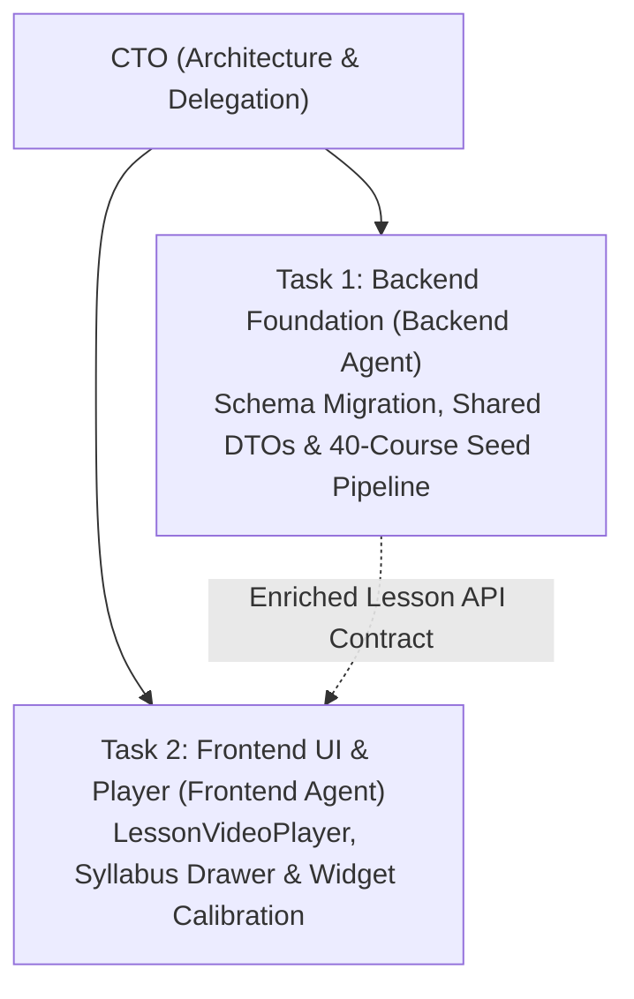

# Alongside — Parent Intelligence Academy: 8-Tier Curriculum Synthesis & Master Video Lecture Specification
**Author:** Chief Technology Officer (CTO)  
**Status:** Canonical Architectural Specification  
**Version:** 2.7.0  
**Target Audience:** Founder & CEO, Product Designers, Frontend Agent, Backend Agent, Curriculum Authors  
**Related Paperclip Issue:** SOU-102  
**Companion Documents:**  
- [`docs/parent-intelligence-academy-course-content-and-format-specification.md`](parent-intelligence-academy-course-content-and-format-specification.md) (Course Anatomy & Tri-Modal Formula)  
- [`docs/parent-intelligence-academy-lesson-experience-and-ux-specification.md`](parent-intelligence-academy-lesson-experience-and-ux-specification.md) (Multi-Modal Lesson Reader Experience)  
- [`docs/system-architecture.md`](system-architecture.md) (System Architecture)  
- [`docs/engineering-standards/codebase-design.md`](engineering-standards/codebase-design.md) (Codebase Design & Seam Catalog)  
- [`docs/research/`](research/) (All 48 Whole-Child Research Documents Across 8 Developmental Tiers)  
- [`plans/39-parent-intelligence-academy-8-tier-curriculum-synthesis-and-video-integration.md`](../plans/39-parent-intelligence-academy-8-tier-curriculum-synthesis-and-video-integration.md) (Engineering Execution Plan)  

---

## 1. Executive Summary & Problem Statement

In Paperclip task **SOU-102**, the leadership mandated the full operational synthesis of Alongside's rich research assets:
> *"in docs/research we collected a lot of informations that are necessary to put the right content in our courses , we have to use the files inside the tiers folders to create our courses , so use the files inside tier-0a-infancy-0-1 , tier-0b-toddler-1-2 , tier-0c-older-toddler-2-3 , tier-1-early-childhood-4-6 , tier-2-middle-childhood-7-9 , tier-3-pre-teen-10-12 , tier-4-early-adolescence-13-15 , tier-5-late-adolescence-16-18 in order to create our courses , delegate the task to the right engineers"*

Prior to this specification, the platform's course seeds were unevenly populated, and the 26 world-class curated master video lectures across the 8 tier vaults were not formally integrated into the schema, API, or lesson reader experience.

This specification establishes the authoritative, end-to-end blueprint to:
1. **Synthesize all 48 primary research documents** from the 8 developmental tier vaults (`tier-0a` through `tier-5`) into **40 full-length, high-conversion Academy courses** (5 categories × 8 lifespan tiers).
2. **Elevate each course to the canonical Tri-Modal MasterClass format**: 4 progressive lessons (16–20 min per course) featuring relatable kitchen-table scenarios, developmental neurobiology mechanisms, side-by-side comparative dialogue decks ("What NOT to Say", "Why It Backfires", "What to Say Instead" with delivery tips), and actionable 3-step household protocols.
3. **Integrate the 26 Curated Master Video Lectures** (Alison Gopnik, Harvey Karp, Nadine Burke Harris, Daniel Siegel, Becky Kennedy, Jonathan Haidt, Matthew Walker, Lisa Damour, Carol Dweck, Angela Duckworth, etc.) with verified YouTube embeds, clinical takeaways, and interactive parent reflection prompts.
4. **Calibrate the 5 Interactive Category Widgets** with tier-specific neurobiological data (`SomaticBreathWidget`, `CircadianTimelineWidget`, `FeedingResponsibilityWidget`, `PurposefulPlayBlueprintWidget`, `PactClauseBridgeWidget`).

---

## 2. The 48-to-40 Curriculum Synthesis Matrix

The AlongSide curriculum is organized as an exhaustive **5-Category by 8-Tier Lifespan Matrix** (40 courses, 120 chapters, 160 lessons). Every course is directly powered by the corresponding research files in `docs/research/`:

```
┌─────────────────────────────────────────────────────────────────────────────────────────────────────────┐
│                                   CANONICAL RESEARCH SOURCE MAPPING                                     │
├──────────────────────────┬──────────────────────────────────────────┬───────────────────────────────────┤
│ Academy Category         │ Primary Research Document Sources        │ Core Scientific Authorities       │
├──────────────────────────┼──────────────────────────────────────────┼───────────────────────────────────┤
│ 1. BEHAVIOR & EMOTIONS   │ • 01-clinical-neurobiology-and-dev.md    │ Dr. Dan Siegel, Dr. Becky Kennedy,│
│                          │ • 02-behavioral-psychology-scripts.md    │ Dr. Ross Greene, Dr. Bruce Perry, │
│                          │ • 06-video-multimedia-curriculum.md      │ Dr. Stephen Porges (Polyvagal)    │
├──────────────────────────┼──────────────────────────────────────────┼───────────────────────────────────┤
│ 2. HEALTH & WELLNESS     │ • 01-clinical-neurobiology-and-dev.md    │ Dr. Harvey Karp, Dr. Matt Walker, │
│                          │ • 03-pediatric-health-routines.md        │ AAP Safe Sleep, Dr. Carskadon     │
│                          │ • 06-video-multimedia-curriculum.md      │ (Circadian Delay), Got Transition®│
├──────────────────────────┼──────────────────────────────────────────┼───────────────────────────────────┤
│ 3. NUTRITION & FEEDING   │ • 03-pediatric-health-routines.md        │ Ellyn Satter (sDoR), AAP/LEAP     │
│                          │ • 01-clinical-neurobiology-and-dev.md    │ Allergen Guidelines, CDC Nutrition│
├──────────────────────────┼──────────────────────────────────────────┼───────────────────────────────────┤
│ 4. DEVELOPMENT & PLAY    │ • 04-milestones-brain-play.md            │ Prof. Alison Gopnik, Dr. Dweck,   │
│                          │ • 01-clinical-neurobiology-and-dev.md    │ Harvard Center on Developing Child│
│                          │ • 06-video-multimedia-curriculum.md      │ CDC Milestone Matrix (75th %ile)  │
├──────────────────────────┼──────────────────────────────────────────┼───────────────────────────────────┤
│ 5. DIGITAL & DEVICES     │ • 05-digital-boundaries-culture-pacts.md │ Jonathan Haidt, Dr. Dimitri       │
│                          │ • 06-video-multimedia-curriculum.md      │ Christakis, Devorah Heitner,      │
│                          │                                          │ Weinstein & James (Harvard Zero)  │
└──────────────────────────┴──────────────────────────────────────────┴───────────────────────────────────┘
```

---

## 3. Complete 40-Course Taxonomy Across All 8 Developmental Tiers

Below is the definitive catalog of all 40 courses across the 8 developmental tiers:

### 3.1 Tier 0A: Infancy (Ages 0–1 / 0–12 Months)
*Foundational Biology: Somatosensory Co-Regulation, Fourth Trimester, Altricial Brain, Melatonin Genesis.*
1. **Behavior & Emotions:** `behavior-infant-coregulation`
   - *Title:* Infant Crying & Somatic Co-Regulation
   - *Relief Subtitle:* Soothe pre-verbal distress, wake-window meltdowns, and purple crying without feeling helpless
   - *Master Video:* "The Calming Reflex & The 5 S's" — Dr. Harvey Karp (`https://www.youtube.com/watch?v=f-m2YcdMdFw`)
   - *Key Research:* `docs/research/tier-0a-infancy-0-1/01-clinical-neurobiology-and-development.md` & `02-behavioral-psychology-and-dialogue-scripts.md`
2. **Health & Wellness:** `health-infant-sleep-foundations`
   - *Title:* Infant Sleep Architecture & Wake Windows
   - *Relief Subtitle:* Navigate sleep regressions, circadian phase consolidation, and nighttime soothing safely
   - *Master Video:* "Protocols for Excellent Parenting & Nervous System Regulation" — Dr. Andrew Huberman & Dr. Becky Kennedy (`https://www.youtube.com/watch?v=XT_6Lvkhxvo`)
   - *Key Research:* `docs/research/tier-0a-infancy-0-1/03-pediatric-health-nutrition-and-routines.md`
3. **Nutrition & Feeding:** `nutrition-infant-first-foods`
   - *Title:* Infant Feeding, Milk Volumes & Early Allergen Introduction
   - *Relief Subtitle:* From breastfeeding and formula to 6-month baby-led weaning and high-risk allergen windows
   - *Key Research:* `docs/research/tier-0a-infancy-0-1/03-pediatric-health-nutrition-and-routines.md`
4. **Development & Play:** `play-infant-sensory-language`
   - *Title:* Serve-and-Return Attunement & Infant Brain Exploration
   - *Relief Subtitle:* Build neural synaptic density through vocal echoing, high-contrast tracking, and tummy time
   - *Master Video:* "What Do Babies Think?" — Prof. Alison Gopnik (`https://www.youtube.com/watch?v=MBqVIBwBgAc`)
   - *Key Research:* `docs/research/tier-0a-infancy-0-1/04-milestones-brain-play-and-enrichment.md`
5. **Digital & Devices:** `digital-infant-zero-screens`
   - *Title:* Zero Screens Under 18 Months & Technoference Defense
   - *Relief Subtitle:* Protect developing optic pathways and maternal-infant gaze attunement from background TV
   - *Master Video:* "How Childhood Trauma Affects Health Across a Lifetime" — Dr. Nadine Burke Harris (`https://www.youtube.com/watch?v=BrnXR5sYWwE`)
   - *Key Research:* `docs/research/tier-0a-infancy-0-1/05-digital-boundaries-culture-and-pacts.md`

### 3.2 Tier 0B: Young Toddler (Ages 1–2 / 12–24 Months)
*Foundational Biology: Locomotion, Receptive/Expressive Gap, Amygdala Explosion, Pre-Verbal Biting/Hitting.*
1. **Behavior & Emotions:** `behavior-toddler-tantrums-co-regulation`
   - *Title:* Toddler Meltdowns & Limbic Flooding
   - *Relief Subtitle:* Calm volcanic tantrums, biting, and emotional dysregulation without yelling or isolating
   - *Master Video:* "The Hand Model of the Brain" — Dr. Daniel Siegel (`https://www.youtube.com/watch?v=gm9CIJ74Oxw`)
   - *Key Research:* `docs/research/tier-0b-toddler-1-2/01-clinical-neurobiology-and-development.md` & `02-behavioral-psychology-and-dialogue-scripts.md`
2. **Health & Wellness:** `health-toddler-sleep-and-nap-transitions`
   - *Title:* The 2-to-1 Nap Transition & Bedtime Boundaries
   - *Relief Subtitle:* Prevent afternoon overtiredness, crib escapes, and midnight wakings during motor leaps
   - *Key Research:* `docs/research/tier-0b-toddler-1-2/03-pediatric-health-nutrition-and-routines.md`
3. **Nutrition & Feeding:** `nutrition-toddler-table-manners-picky-eaters`
   - *Title:* Toddler Self-Feeding, Pincer Mastery & Food Throwing
   - *Relief Subtitle:* Stop high-chair food dumping and establish Ellyn Satter's Division of Responsibility early
   - *Key Research:* `docs/research/tier-0b-toddler-1-2/03-pediatric-health-nutrition-and-routines.md`
4. **Development & Play:** `play-toddler-locomotion-and-sensory-bins`
   - *Title:* Sensory Bins, Heavy Work & Gross Motor Mastery
   - *Relief Subtitle:* Channel endless walking energy, climbing impulses, and sensory exploration into calm play
   - *Master Video:* "Kids Do Well If They Can" — Dr. Ross Greene (`https://www.youtube.com/watch?v=jvzQQDfAL-Q`)
   - *Key Research:* `docs/research/tier-0b-toddler-1-2/04-milestones-brain-play-and-enrichment.md`
5. **Digital & Devices:** `digital-toddler-screen-tantrums-and-coping`
   - *Title:* Fast-Cut Sensory Overload & Screen Crash De-escalation
   - *Relief Subtitle:* Understand why removing the iPad triggers violent tantrums and replace fast-paced cartoons with calm media
   - *Master Video:* "Media and Children's Developing Brains" — Dr. Dimitri Christakis (`https://www.youtube.com/watch?v=BoT7qH_uVNo`)
   - *Key Research:* `docs/research/tier-0b-toddler-1-2/05-digital-boundaries-culture-and-pacts.md`

### 3.3 Tier 0C: Older Toddler (Ages 2–3 / 24–36 Months)
*Foundational Biology: Erikson's Autonomy vs. Shame, The Biology of "NO!", Language Burst, Potty Mastery.*
1. **Behavior & Emotions:** `behavior-older-toddler-defiance-boundaries`
   - *Title:* Autonomy, The Biology of "NO!" & Loving Containment
   - *Relief Subtitle:* De-escalate defiance and grocery store floor tantrums using 2-choice autonomy offers
   - *Master Video:* "Toddler Tantrums: What Is Actually Happening in the Brain?" — Dr. Laura Markham (`https://www.youtube.com/watch?v=Qh_L5S9CqV4`)
   - *Key Research:* `docs/research/tier-0c-older-toddler-2-3/01-clinical-neurobiology-and-development.md` & `02-behavioral-psychology-and-dialogue-scripts.md`
2. **Health & Wellness:** `health-older-toddler-toilet-and-bedtime`
   - *Title:* Potty Learning Without Power Struggles & Night Fears
   - *Relief Subtitle:* Read somatic cues, avoid coercive rewards, and gently navigate emerging toddler nightmares
   - *Master Video:* "Potty Training Without Bribes, Fear, or Pressure" — Dr. Becky Kennedy (`https://www.youtube.com/watch?v=F0V7FqK9a8s`)
   - *Key Research:* `docs/research/tier-0c-older-toddler-2-3/03-pediatric-health-nutrition-and-routines.md`
3. **Nutrition & Feeding:** `nutrition-older-toddler-independence-and-snacking`
   - *Title:* Toddler Neophobia & The "Pick-and-Graze" Trap
   - *Relief Subtitle:* Eliminate constant snack demands and establish calm, seated family dinner rhythms
   - *Key Research:* `docs/research/tier-0c-older-toddler-2-3/03-pediatric-health-nutrition-and-routines.md`
4. **Development & Play:** `play-older-toddler-symbolic-play-and-blocks`
   - *Title:* Symbolic Play, Unit Blocks & Emerging Executive Function
   - *Relief Subtitle:* Foster delayed gratification, spatial planning, and pre-literacy through open-ended loose parts
   - *Master Video:* "How Children Develop Self-Control (Executive Function)" — Harvard Center on the Developing Child (`https://www.youtube.com/watch?v=mD3Y9x2oK9U`)
   - *Key Research:* `docs/research/tier-0c-older-toddler-2-3/04-milestones-brain-play-and-enrichment.md`
5. **Digital & Devices:** `digital-older-toddler-audiobooks-and-co-viewing`
   - *Title:* Intentional Co-Viewing, Audiobooks & Transition Countdowns
   - *Relief Subtitle:* Use gentle visual timers and slow-paced storytelling to prevent dopamine transition spikes
   - *Key Research:* `docs/research/tier-0c-older-toddler-2-3/05-digital-boundaries-culture-and-pacts.md`

### 3.4 Tier 1: Early Childhood & Preschool (Ages 4–6)
*Foundational Biology: Emerging Theory of Mind, Cooperative Play, Left-Right Brain Hemisphere Integration, Growth Mindset.*
1. **Behavior & Emotions:** `behavior-preschool-feelings`
   - *Title:* Name-It-to-Tame-It & Preschool Meltdowns
   - *Relief Subtitle:* Help flooded preschoolers label emotions, resolve sibling rivalry, and repair emotional ruptures
   - *Key Research:* `docs/research/tier-1-early-childhood-4-6/01-clinical-neurobiology-and-development.md` & `02-behavioral-psychology-and-dialogue-scripts.md`
2. **Health & Wellness:** `health-preschool-immunity`
   - *Title:* Preschool Germs, Immunity Anchors & Restful Slumber
   - *Relief Subtitle:* Master fever protocols, earaches, and restorative 10–12 hour nocturnal sleep cycles
   - *Key Research:* `docs/research/tier-1-early-childhood-4-6/03-pediatric-health-nutrition-and-routines.md`
3. **Nutrition & Feeding:** `nutrition-preschool-picky-eating`
   - *Title:* De-escalating Picky Eating & Mealtime Hostility
   - *Relief Subtitle:* Eliminate short-order cooking, respect fullness cues, and expand textures without force
   - *Key Research:* `docs/research/tier-1-early-childhood-4-6/03-pediatric-health-nutrition-and-routines.md`
4. **Development & Play:** `play-preschool-executive-function`
   - *Title:* Executive Function, Cooperative Games & Growth Mindset
   - *Relief Subtitle:* Encourage persistence through frustration, turn-taking, and imaginative roleplay
   - *Master Video:* "The Power of Believing That You Can Improve" — Dr. Carol Dweck (`https://www.youtube.com/watch?v=_X0mgOOSpLU`)
   - *Master Video:* "The Gardener vs. The Carpenter: How Children Learn" — Prof. Alison Gopnik (`https://www.youtube.com/watch?v=w7z3W8sJ5L8`)
   - *Key Research:* `docs/research/tier-1-early-childhood-4-6/04-milestones-brain-play-and-enrichment.md`
5. **Digital & Devices:** `digital-preschool-media-curation`
   - *Title:* Mindful Media Curation & Screen-Free Sacred Zones
   - *Relief Subtitle:* Protect bedrooms and dining tables from screens while selecting slow-paced educational media
   - *Master Video:* "How Screens Stole Childhood — And How to Get It Back" — Jonathan Haidt (`https://www.youtube.com/watch?v=Ilfqpkw7qJc`)
   - *Key Research:* `docs/research/tier-1-early-childhood-4-6/05-digital-boundaries-culture-and-pacts.md`

### 3.5 Tier 2: Middle Childhood (Ages 7–9)
*Foundational Biology: Adrenarche (Adrenal Awakening DHEA-S), Concrete Operational Logic, Peer Comparison, Sports Grit.*
1. **Behavior & Emotions:** `behavior-elementary-impulses`
   - *Title:* Adrenarche, Emotional Volatility & Elementary Impulses
   - *Relief Subtitle:* Guide 7-to-9-year-olds through hormonal mood swings, perfectionism tears, and peer conflict
   - *Key Research:* `docs/research/tier-2-middle-childhood-7-9/01-clinical-neurobiology-and-development.md` & `02-behavioral-psychology-and-dialogue-scripts.md`
2. **Health & Wellness:** `health-elementary-wellness`
   - *Title:* Elementary Sleep Hygiene, Hygiene Habits & Growing Bodies
   - *Relief Subtitle:* Establish independent morning routines, sports recovery sleep, and bodily confidence
   - *Key Research:* `docs/research/tier-2-middle-childhood-7-9/03-pediatric-health-nutrition-and-routines.md`
3. **Nutrition & Feeding:** `nutrition-elementary-fuel`
   - *Title:* Elementary School Lunchboxes, Afternoon Crashes & Fuel
   - *Relief Subtitle:* Stable blood sugar strategies that prevent 4 PM meltdowns and support athletic growth
   - *Key Research:* `docs/research/tier-2-middle-childhood-7-9/03-pediatric-health-nutrition-and-routines.md`
4. **Development & Play:** `play-elementary-logic-maker`
   - *Title:* Concrete Logic, Strategic Board Games & Maker Hobbies
   - *Relief Subtitle:* Nurture grit, spatial problem-solving, and deep focus through chess, coding, and building
   - *Master Video:* "Grit: The Power of Passion and Perseverance" — Dr. Angela Duckworth (`https://www.youtube.com/watch?v=H14bBuluwB8`)
   - *Key Research:* `docs/research/tier-2-middle-childhood-7-9/04-milestones-brain-play-and-enrichment.md`
5. **Digital & Devices:** `digital-elementary-first-gaming`
   - *Title:* First Gaming, Roblox Safety & Algorithmic Guardrails
   - *Relief Subtitle:* Establish healthy gaming limits, chat privacy, and prevent compulsive micro-transaction habits
   - *Master Video:* "Growing Up in Public: Coming of Age in a Digital World" — Dr. Devorah Heitner (`https://www.youtube.com/watch?v=ZfXjLhUq0rE`)
   - *Key Research:* `docs/research/tier-2-middle-childhood-7-9/05-digital-boundaries-culture-and-pacts.md`

### 3.6 Tier 3: Pre-Teen & Tweens (Ages 10–12)
*Foundational Biology: Gonadarche, The Social Brain, dACC Pain Matrix (Exclusion Hurts Like Physical Pain), Group Chats.*
1. **Behavior & Emotions:** `behavior-tween-adrenarche`
   - *Title:* Tween Social Brain, dACC Pain & Amygdala Volatility
   - *Relief Subtitle:* Become an emotional shock absorber when your tween faces middle school exclusion and moodiness
   - *Master Video:* "The Mysterious Workings of the Adolescent Brain" — Dr. Sarah-Jayne Blakemore (`https://www.youtube.com/watch?v=6zVS8HIPUng`)
   - *Master Video:* "The Emotional Lives of Teenagers" — Dr. Lisa Damour (`https://www.youtube.com/watch?v=ObHY7l62otM`)
   - *Key Research:* `docs/research/tier-3-pre-teen-10-12/01-clinical-neurobiology-and-development.md` & `02-behavioral-psychology-and-dialogue-scripts.md`
2. **Health & Wellness:** `health-tween-circadian-leaps`
   - *Title:* Pubertal Changes, Body Image & Sleep Shifts
   - *Relief Subtitle:* Guide tweens through physical changes, hygiene, and the beginning of the delayed sleep phase
   - *Key Research:* `docs/research/tier-3-pre-teen-10-12/03-pediatric-health-nutrition-and-routines.md`
3. **Nutrition & Feeding:** `nutrition-tween-growth-spurts`
   - *Title:* Tween Growth Spurts, Ravenous Appetites & Positive Body Image
   - *Relief Subtitle:* Provide nutrient-dense fuel without triggering body dissatisfaction or restrictive eating
   - *Key Research:* `docs/research/tier-3-pre-teen-10-12/03-pediatric-health-nutrition-and-routines.md`
4. **Development & Play:** `play-tween-flow-hobbies`
   - *Title:* Flow States, Identity Pursuits & Meaningful Hobbies
   - *Relief Subtitle:* Help tweens discover intrinsically motivating passions outside of academic pressure and screens
   - *Key Research:* `docs/research/tier-3-pre-teen-10-12/04-milestones-brain-play-and-enrichment.md`
5. **Digital & Devices:** `digital-tween-smartphone-pacts`
   - *Title:* First Smartphone Readiness & The Bilateral Family Pact
   - *Relief Subtitle:* Co-create enforceable phone curfews, group chat etiquette, and neutral MDM bedtime shutoffs
   - *Master Video:* "Behind Their Screens: What Teens Are Facing" — Emily Weinstein & Carrie James (`https://www.youtube.com/watch?v=jW3jV2l1Wv4`)
   - *Key Research:* `docs/research/tier-3-pre-teen-10-12/05-digital-boundaries-culture-and-pacts.md`

### 3.7 Tier 4: Early Adolescence (Ages 13–15)
*Foundational Biology: Back-to-Front Brain Maturation, +2-Hour Circadian Delay (Mary Carskadon), Risk-Reward Asymmetry, Digital Amnesties.*
1. **Behavior & Emotions:** `behavior-adolescent-identity`
   - *Title:* Adolescent Autonomy: Transitioning from Manager to Consultant
   - *Relief Subtitle:* Stop nagging and build deep influence, mutual trust, and non-defensive communication
   - *Master Video:* "The Teenage Brain: A Neuroscientist's Survival Guide" — Dr. Frances Jensen (`https://www.youtube.com/watch?v=on2iP19NlWc`)
   - *Master Video:* "Age of Opportunity: Lessons From the New Science of Adolescence" — Dr. Laurence Steinberg (`https://www.youtube.com/watch?v=V8vLqQ3E_1w`)
   - *Key Research:* `docs/research/tier-4-early-adolescence-13-15/01-clinical-neurobiology-and-development.md` & `02-behavioral-psychology-and-dialogue-scripts.md`
2. **Health & Wellness:** `health-adolescent-sleep-protection`
   - *Title:* Protecting the +2h Circadian Shift & High School Mental Health
   - *Relief Subtitle:* Align bedtime expectations with biological adolescent melatonin delay and academic stress
   - *Master Video:* "How Do Teenagers Sleep Differently?" — Dr. Matthew Walker (`https://www.youtube.com/watch?v=5MuIMqhT8DM`)
   - *Key Research:* `docs/research/tier-4-early-adolescence-13-15/03-pediatric-health-nutrition-and-routines.md`
3. **Nutrition & Feeding:** `nutrition-adolescent-sports-fuel`
   - *Title:* Adolescent Athletic Nutrition, Hydration & Caloric Demands
   - *Relief Subtitle:* Meet peak pubertal growth requirements, athletic recovery, and maintain a body-positive kitchen
   - *Key Research:* `docs/research/tier-4-early-adolescence-13-15/03-pediatric-health-nutrition-and-routines.md`
4. **Development & Play:** `play-adolescent-critical-thinking`
   - *Title:* Dr. Daniel Siegel's ESSENCE Framework & Strategic Passion
   - *Relief Subtitle:* Harness adolescent emotional spark, social engagement, and novelty seeking for purposeful impact
   - *Key Research:* `docs/research/tier-4-early-adolescence-13-15/04-milestones-brain-play-and-enrichment.md`
5. **Digital & Devices:** `digital-adolescent-algorithmic-feeds`
   - *Title:* Algorithmic Feeds, Doomscrolling & The Digital Amnesty Pact
   - *Relief Subtitle:* Non-punitive protocols for sextortion defense, late-night screen locks, and algorithmic detox
   - *Key Research:* `docs/research/tier-4-early-adolescence-13-15/05-digital-boundaries-culture-and-pacts.md`

### 3.8 Tier 5: Late Adolescence & Launch (Ages 16–18+)
*Foundational Biology: Prefrontal Myelination Peak, Emerging Adulthood (Jeffrey Arnett), Digital Sovereignty, Got Transition® Healthcare.*
1. **Behavior & Emotions:** `behavior-teen-autonomy`
   - *Title:* The Apprenticeship Launchpad: Preparing for True Adulthood
   - *Relief Subtitle:* Transition to a lifelong adult-to-adult relationship without hovering or sudden abandonment
   - *Master Video:* "How to Raise Successful Kids — Without Over-Parenting" — Julie Lythcott-Haims (`https://www.youtube.com/watch?v=CyElHdaqkjo`)
   - *Master Video:* "Emerging Adulthood: A New Phase of the Lifespan" — Dr. Jeffrey Jensen Arnett (`https://www.youtube.com/watch?v=FkWfO7tZ1aE`)
   - *Key Research:* `docs/research/tier-5-late-adolescence-16-18/01-clinical-neurobiology-and-development.md` & `02-behavioral-psychology-and-dialogue-scripts.md`
2. **Health & Wellness:** `health-young-adult-wellness`
   - *Title:* Got Transition® Healthcare, Campus Slumber & Independence
   - *Relief Subtitle:* Equip teens to manage their own medical appointments, prescriptions, sleep, and emotional health
   - *Key Research:* `docs/research/tier-5-late-adolescence-16-18/03-pediatric-health-nutrition-and-routines.md`
3. **Nutrition & Feeding:** `nutrition-teen-food-sovereignty`
   - *Title:* Food Sovereignty: The Independent Kitchen Blueprint
   - *Relief Subtitle:* Budgeting, meal prep, and cooking 10 reliable wholesome meals before leaving home
   - *Key Research:* `docs/research/tier-5-late-adolescence-16-18/03-pediatric-health-nutrition-and-routines.md`
4. **Development & Play:** `play-teen-intellectual-mastery`
   - *Title:* Intellectual Mastery, Deep Work & Financial Literacy
   - *Relief Subtitle:* Cultivate sustained focus, financial habits, and career exploration in a hyper-distracted world
   - *Key Research:* `docs/research/tier-5-late-adolescence-16-18/04-milestones-brain-play-and-enrichment.md`
5. **Digital & Devices:** `digital-teen-digital-independence`
   - *Title:* Digital Sovereignty, Professional Footprint & Digital Minimalism
   - *Relief Subtitle:* Graduate from parental device controls into self-governed digital minimalism and reputation hygiene
   - *Master Video:* "Digital Minimalism & Deep Work in the Modern World" — Cal Newport (`https://www.youtube.com/watch?v=3E7hkPZ-HTk`)
   - *Key Research:* `docs/research/tier-5-late-adolescence-16-18/05-digital-boundaries-culture-and-pacts.md`

---

## 4. Master Video Lecture Multi-Modal Architecture

### 4.1 Data Contract Expansion (`@alongside/shared`)

In `packages/shared/src/schemas/academy.ts` and `packages/shared/src/types/index.ts`, define the first-class `MasterVideoLectureDTO`:

```typescript
export interface MasterVideoLectureDTO {
  videoUrl: string;
  title: string;
  presenter: string;
  channel: string;
  durationMinutes: number;
  parentHook?: string;
  keyTakeaways?: string[];
  actionPrompt?: string;
}

export interface AcademyLessonDTO {
  // Existing fields
  id: string;
  moduleId: string;
  slug: string;
  title: string;
  contentMarkdown: string;
  readingMinutes: number;
  sortOrder: number;
  isCompleted: boolean;
  audioUrl?: string;
  audioDurationSeconds?: number;
  reliefTagline?: string;
  thirtySecondGlance?: ThirtySecondGlanceDTO;
  adaptiveModuleType?: AdaptiveModuleType;
  dialogueCards?: DialogueCardDTO[];
  whatNotToSay?: string;
  deliveryTip?: string;

  // New Master Video Lecture Fields
  videoLecture?: MasterVideoLectureDTO | null;
}
```

### 4.2 Database Schema & Storage

In `packages/database/prisma/schema.prisma`:
Add nullable JSON column `videoLecture Json?` to `AcademyLesson` model:
```prisma
model AcademyLesson {
  id                   String             @id @default(uuid())
  moduleId             String
  module               AcademyModule      @relation(fields: [moduleId], references: [id], onDelete: Cascade)
  chapterId            String?
  chapter              AcademyChapter?    @relation(fields: [chapterId], references: [id], onDelete: Cascade)
  slug                 String
  title                String
  contentMarkdown      String
  readingMinutes       Int                @default(4)
  sortOrder            Int                @default(0)
  audioUrl             String?
  audioDurationSeconds Int?
  whatNotToSay         String?
  deliveryTip          String?
  reliefTagline        String?
  thirtySecondGlance   Json?
  adaptiveModuleType   String?
  dialogueCards        Json?
  videoLecture         Json?              // Stores MasterVideoLectureDTO
  createdAt            DateTime           @default(now())
  updatedAt            DateTime           @updatedAt

  progressRecords      AcademyProgress[]

  @@unique([moduleId, slug])
  @@map("academy_lessons")
}
```

### 4.3 Frontend Responsive Master Video Player (`apps/web`)

Create `apps/web/src/components/academy/reader/LessonVideoPlayer.tsx`:
1. **Responsive 16:9 Aspect Ratio Container:** Uses standard Tailwind `aspect-video rounded-2xl overflow-hidden shadow-sm border border-[#EBE7DF] bg-stone-900`.
2. **Lazy-Loaded Embed / Consent Guard:** Displays video thumbnail with a prominent, elegant play button, presenter badge (`Prof. Alison Gopnik · TED`), and duration pill (`18:27`). Clicking loads the accessible YouTube embed (`iframe` with `loading="lazy"`, `title={video.title}`).
3. **The Parent Hook Callout Strip:** Directly beneath the player, displays the provocative parent hook in Newsreader italic.
4. **Interactive Key Takeaways Accordion:** Expandable 3-point clinical takeaway summary derived from `06-video-multimedia-curriculum-and-lectures.md`.
5. **Parent Action Prompt Trigger:** Button allowing 1-click launch of the AI Advisor (`/advisor`) to roleplay or explore the video's core lesson.

---

## 5. Category-Adaptive Interactive Modules Tier Calibration

Each of the 5 interactive widgets created in Plan 38 receives tier-specific calibration data extracted from `01`–`05`:

1. **`SomaticBreathWidget.tsx` (Behavior & Emotions):**
   - *Tier 0A/0B:* 4s Inhale / 6s Exhale with maternal vagal sync prompt ("Infant autonomic co-regulation rhythm").
   - *Tier 3/4:* Box breathing (4-4-4-4) for tween emotional shock absorber ("Neutral non-defensive response").
2. **`CircadianTimelineWidget.tsx` (Health & Wellness):**
   - *Tier 0A:* 45–90 min wake windows across 24 hours.
   - *Tier 0B:* 1-nap rhythm (12:30 PM to 2:30 PM, 7:30 PM bedtime).
   - *Tier 4:* 2-Hour Biological Circadian Phase Delay (Melatonin onset at 11:00 PM vs. 9:00 PM for adults).
3. **`FeedingResponsibilityWidget.tsx` (Nutrition & Feeding):**
   - *Tier 0A:* Feeding on demand vs. solid introduction at 6 months.
   - *Tier 0B/0C:* Ellyn Satter Division of Responsibility (Parent decides what/when/where, child decides if/how much).
   - *Tier 5:* The Independent Kitchen Blueprint (Budgeting, grocery list & 10 essential meals).
4. **`PurposefulPlayBlueprintWidget.tsx` (Development & Play):**
   - *Tier 0A:* High-contrast black-and-white cards & mirror serve-and-return.
   - *Tier 1:* Cooperative board games & growth mindset scaffolding.
   - *Tier 2:* Maker exploration, chess & robotics logic.
5. **`PactClauseBridgeWidget.tsx` (Digital & Devices):**
   - *Tier 0A/0B:* Screen-free nursery & feeding zone agreement.
   - *Tier 3:* First Smartphone Agreement with 8:30 PM charging dock in kitchen.
   - *Tier 4:* High School Digital Amnesty Clause (Zero device confiscation when teen asks for help with an exploit or harassment).

---

## 6. Engineering Task Allocation & Delegation Plan

The implementation is split into two atomic, parallel tracks adhering to `AGENTS.md`:



1. **Backend Agent (`21d61c16-ef6a-4672-8653-392a8481930a`):**
   - Add `videoLecture Json?` to Prisma schema and generate migration.
   - Update `@alongside/shared` schemas and DTOs (`MasterVideoLectureDTO`, `AcademyLessonDTO`).
   - Populate `packages/database/prisma/seed/academy.seed.ts` with authentic content from all 48 research files and 26 master video lectures across all 40 courses.
   - Update Fastify serialization and integration tests in `apps/api/test/academy.test.ts`.
2. **Frontend Agent (`22c93fdb-52ef-4ea1-b5cb-0ef0fa14d6a8`):**
   - Create `LessonVideoPlayer.tsx` with responsive layout, lazy loading, and parent hook callouts.
   - Integrate `LessonVideoPlayer` into `LessonReaderView.tsx` and `LessonReliefMasthead.tsx`.
   - Update `ModuleCard.tsx` syllabus preview drawer with `[ 🎬 Master Lecture ]` badges.
   - Connect category-adaptive widgets to receive tier-specific parameters.
   - Add frontend Vitest tests in `apps/web/src/components/academy/reader/__tests__/`.
