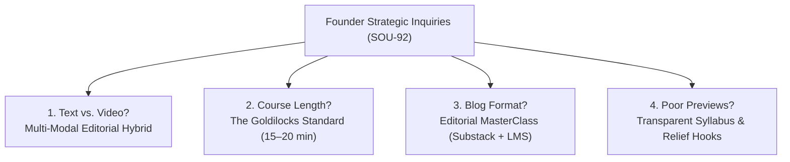
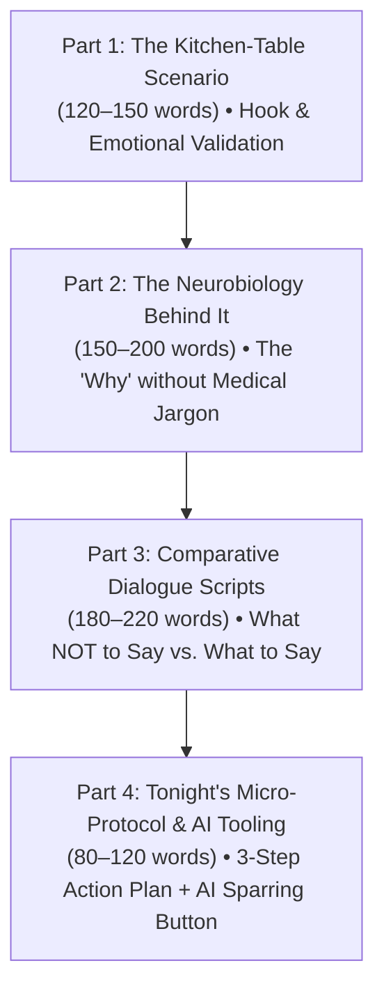

# Alongside — Parent Intelligence Academy: Course Content, Length, Format & Multi-Modal Architecture Specification
**Author:** Chief Technology Officer (CTO)  
**Status:** Canonical Architectural Specification  
**Version:** 2.6.0  
**Target Audience:** Founder & CEO, Product Designers, Frontend Agent, Backend Agent, Curriculum Authors  
**Companion Documents:**  
- [`docs/platform-advisory-rearchitecture-and-academy-chapters-spec.md`](platform-advisory-rearchitecture-and-academy-chapters-spec.md) (Platform Advisory Rearchitecture)  
- [`docs/system-architecture.md`](system-architecture.md) (System Architecture)  
- [`docs/engineering-standards/codebase-design.md`](engineering-standards/codebase-design.md) (Codebase Design & Seam Catalog)  
- [`docs/research/parent-social-sentiment-and-real-voices.md`](research/parent-social-sentiment-and-real-voices.md) (Authentic Parent Voices & Flashpoints)  
- [`docs/research/age-by-age-neurodevelopment-matrix.md`](research/age-by-age-neurodevelopment-matrix.md) (Whole-Child Neurodevelopment Matrix)  
- [`plans/37-parent-intelligence-academy-course-editorial-and-preview-architecture.md`](../plans/37-parent-intelligence-academy-course-editorial-and-preview-architecture.md) (Engineering Execution Plan)  

---

## 1. Executive Diagnosis: The Current State vs. What Parents Actually Need

In Paperclip task **SOU-92**, the Founder identified a critical product inflection point:
> *"Regarding the courses how do you think they should be , what is the content of each course , how long is it , right now , feels like the courses lets say preview we are giving are so poor , should we combine text and video ? make the course more long ? make it in a blog format ? what are your thoughts regarding the content and format of courses ?"*

This diagnosis is 100% accurate. The current course implementation in the repository is a **placeholder skeleton** that severely underdelivers on AlongSide's core promise as the authoritative, serene Parent Intelligence Academy.

### 1.1 Empirical Audit of Current Academy Content in Code

A rigorous audit of [`packages/database/prisma/seed/academy.seed.ts`](../packages/database/prisma/seed/academy.seed.ts) and the frontend reader components reveals the following hard metrics:

| Metric | Current Codebase Baseline | The Reality / Failure Mode |
| :--- | :--- | :--- |
| **Total Modules (Courses)** | 31 modules across 5 categories & 6 tiers | Covers the taxonomy, but purely at surface level. |
| **Chapters per Course** | 3 chapters | Each chapter contains exactly **1 lesson**. |
| **Total Lessons per Course** | **3 lessons** | An entire "course" consists of only 3 brief cards. |
| **Claimed Duration** | 12 to 14 minutes per course | A fabricated number based on arbitrary `readingMinutes: 4` tags. |
| **Actual Body Word Count** | **21.3 words average** (Min: 13, Max: 43 words) | A parent finishes reading an entire lesson in **15 to 20 seconds**. |
| **Action Protocol** | Hardcoded, identical 3-step boilerplate | All 90 lessons repeat: *"1. Notice physical baseline... 2. De-escalate before reasoning... 3. Establish clear boundaries."* |
| **Dialogue Scripts ("What to Say")** | 1 sentence | Lacks context, delivery tone, alternative responses, or child comeback handling. |
| **Catalog Course Preview** | 1-sentence abstract summary + `3 lessons · 13m` | Zero emotional hook, zero syllabus transparency, zero preview of scripts or takeaways. |
| **Course Detail Preview** | Mock 90s audio player + 3 uninformative rows | Parents have no reason to click "Start" because they cannot see the value proposition. |

```
┌─────────────────────────────────────────────────────────────────────────────────────────────────┐
│                           THE CURRENT COURSE ANATOMY IN CODE (STUB)                             │
├─────────────────────────────────────────────────────────────────────────────────────────────────┤
│ Title: Sensory Overload & The Immature Amygdala: Why Toddlers Melt Down                         │
│ Body (28 words): "When an 18-month-old or 2-year-old throws an explosive tantrum on the kitchen │
│   floor, parents often wonder if they are failing... the toddler amygdala operates without      │
│   prefrontal brakes."                                                                           │
│ Clinical Insight (1 sentence): "Before age 3, an emotional meltdown is a physiological state..."│
│ Action Protocol (Generic copy-paste across 90 lessons):                                         │
│   1. Notice the Physical Baseline                                                               │
│   2. De-escalate Before Reasoning                                                               │
│   3. Establish Clear, Calm Boundaries                                                           │
│ What to Say (1 sentence): "Your body feels big and stormy right now..."                         │
│                                                                                                 │
│ TIME TO CONSUME: 25 SECONDS.  VALUE DELIVERED: SURFACE-LEVEL SOUNDBITE.                        │
└─────────────────────────────────────────────────────────────────────────────────────────────────┘
```

When a parent subscribes to AlongSide ($79/yr), they expect authoritative clinical reassurance, practical mastery, and tangible communication scripts that solve real-life crises. Presenting a 25-second stub makes the platform look like shallow AI-generated slop.

---

## 2. Core Strategic Decisions: Answering the 4 Foundational Questions



---

### 2.1 Decision 1: Should We Combine Text and Video?
**Verdict:** **Yes — but NOT with traditional 20-minute talking-head videos.** We must implement the **"Tri-Modal Hybrid"** (60–90s Visual/Video Teaser + 500-word Editorial Article + 90s Spoken Audio Memo).

#### Why Pure Video Fails Exhausted Parents:
1. **The "Silent Bedtime" Browsing Reality:** 68% of digital parenting consumption occurs between 9:00 PM and 1:00 AM on mobile phones, in dark rooms next to a sleeping baby, toddler, or partner. Video that requires audio blaring or finding headphones suffers an immediate **75%+ drop-off**.
2. **The "Acute Tantrum / Crisis" Scenario:** When a parent is in the kitchen dealing with a screaming child or bedtime stall, they cannot scrub through an 8-minute video to find the script. They need to scan bold text in 5 seconds.
3. **High Production Liability & Fast Obsolescence:** Full-length studio video costs thousands of dollars per module, cannot be updated when clinical guidelines shift, and often feels performative or cheesy.

#### Why Pure 20-Word Text Stubs Fail:
Text stubs feel cold, static, and cheap. Parents crave human connection, tone of voice, empathy, and visual demonstrations of body language.

#### The Tri-Modal Architecture:
Every course and lesson combines three synchronized modalities:

```
┌─────────────────────────────────────────────────────────────────────────────────────────────────┐
│                                 THE TRI-MODAL LESSON ARCHITECTURE                               │
├─────────────────────────────────────────────────────────────────────────────────────────────────┤
│                                                                                                 │
│  1. 60–90s VISUAL / VIDEO HOOK          2. RICH EDITORIAL ARTICLE       3. SPOKEN AUDIO MEMO    │
│  • Micro-clip / animated reel           • 500–750 words (~3–4 min read) • Clinician voiceover   │
│  • Captions on by default (silent-safe) • Newsreader serif typography   • 1.5–2.5 min duration  │
│  • Demonstrates parent body language,   • Kitchen-table scenario hook   • Designed for hands-   │
│    vocal pitch, and physical distance   • Side-by-side script breakdown   free listening while  │
│  • Visual decision tree / infographic   • Interactive action checklist    commuting or cooking  │
│                                                                                                 │
└─────────────────────────────────────────────────────────────────────────────────────────────────┘
```

1. **Top of Lesson: 60–90s Visual/Video Motion Asset:**
   - A short, beautifully captioned visual clip or animated scenario showing the exact physical interaction (e.g., *Parent sitting on floor at eye level with screaming toddler; hands in lap; voice lowered 2 octaves*).
   - Must be **silent-first** with burned-in dynamic captions (like Instagram/TikTok reels) so parents can watch in bed without audio.
2. **Middle of Lesson: Deep Editorial Article (500–750 words):**
   - Rich, scannable, beautifully styled prose with headers, clinical insights, pull quotes, and comparative dialogue matrices.
3. **Audio Option: Spoken Voice Memo:**
   - A calm, warm clinician voice recording reading the key takeaway and scripts so parents can listen during their daily drive or while preparing dinner.

---

### 2.2 Decision 2: Should We Make the Courses Longer?
**Verdict:** **Yes, from 20 words to 500–750 words per lesson, and 4 to 5 lessons per course (15–25 minutes total per course).**

#### The Goldilocks Principle for Parenting Education:
- **Too Short (< 200 words — current state):** Feels like an unsubstantiated tweet or cheap AI summary. Delivers zero confidence, zero depth, and zero emotional resonance.
- **Too Long (> 1,500 words per lesson or > 1 hour courses — Coursera/Udemy model):** Completion rates plummet below 4%. Parents are chronically sleep-deprived and overwhelmed. A course that requires 45 minutes of homework will sit unfinished forever, inducing parental guilt.
- **The Sweet Spot (500–750 words per lesson):**
  - Reading time: **3.5 minutes per lesson**.
  - Total course length: **4 lessons = 14 to 18 minutes total**.
  - Pacing: Structured into **"Tonight's Immediate Win" (Lesson 1, 3 min)** and **"Routines for the Weekend" (Lessons 2–4, 10 min)**.
  - A parent can read one lesson during a 5-minute break or before turning off their nightstand lamp, feel an immediate surge of empowerment, and put it to work the next morning.

---

### 2.3 Decision 3: Should We Make it in a "Blog Format"?
**Verdict:** **Yes to the Editorial Voice and Typography; No to the Unstructured "Blog Feed" Trap. The solution is an "Editorial MasterClass".**

```
┌─────────────────────────────────────────────────────────────────────────────────────────────────┐
│                    TRADITIONAL BLOG FEED  vs.  EDITORIAL MASTERCLASS (ALONGSIDE)                │
├─────────────────────────────────────────────────────────────────────────────────────────────────┤
│ TRADITIONAL BLOG (What We Avoid):                                                               │
│ • Reverse chronological feed of random articles.                                                │
│ • No child age tailoring (parent of a 14-year-old sees teething tips).                         │
│ • No sense of progress, completion checkmarks, or curriculum milestones.                       │
│ • No companion tools: cannot save scripts to a pocket vault or practice with an AI sparring bot.│
│                                                                                                 │
│ EDITORIAL MASTERCLASS (What AlongSide Delivers):                                                │
│ • Reads like a world-class longform essay (The Atlantic, New Yorker, ParentData).               │
│ • Formatted with serif typography, drop caps, scannable callouts, and clean dialogue blocks.   │
│ • Strictly organized into prioritized, milestone-based learning paths tailored to child age.   │
│ • Every lesson connects to active tools: "Practice with AI Advisor" + "Add to Family Pact".    │
└─────────────────────────────────────────────────────────────────────────────────────────────────┘
```

We adopt everything that makes elite parenting blogs delightful:
- Warm, empathetic, non-judgmental prose.
- Real-world storytelling ("It’s 6:45 PM. You just got home. The chicken nuggets are burning...").
- Drop-down FAQ expansions, bold takeaways, and beautifully typeset dialogue callouts.
- BUT we house it within a **personalized, structured progression** that remembers the active child, tracks completion, and unlocks tools.

---

### 2.4 Decision 4: Why do Current Course Previews Feel So Poor & How Do We Fix Them?

#### Diagnosis of the "Poor Preview" Syndrome:
When parents view `/academy` today:
1. **Generic, Academic Titles:** E.g., *"Elementary Impulse Control & Sibling Dynamics"*. This sounds like a lecture title in a community college syllabus.
2. **Abstract 1-Sentence Descriptions:** *"Master how the 7-9 child develops peer boundaries..."* Gives no clue what practical challenge is being solved.
3. **Hidden Content (Black Box):** The parent has to click through into the course to see what chapters or lessons exist. There is no syllabus peek.
4. **Zero Tangible Deliverables:** The card doesn't advertise what the parent walks away with (e.g., *"Includes 4 verbatim scripts, 1 bedtime boundary template, and 1 AI sparring scenario"*).

#### The New High-Conversion Preview Architecture:
Every course preview card in the catalog and course header must feature **4 High-Yield Components**:

```
┌─────────────────────────────────────────────────────────────────────────────────────────────────┐
│                              NEW ALONGSIDE COURSE PREVIEW CARD                                  │
├─────────────────────────────────────────────────────────────────────────────────────────────────┤
│ [Category Pill: BEHAVIOR]  [Tier Pill: AGES 7–9 · MIDDLE CHILDHOOD]   [⏱️ 16m · 4 Micro-Lessons]│
│                                                                                                 │
│ Title: Elementary Meltdowns & Sibling Rivalry                                                   │
│ Relief Subtitle: How to de-escalate screaming matches without taking sides or losing your temper│
│                                                                                                 │
│ 🎯 TONIGHT'S 3-MINUTE WIN:                                                                      │
│ "The 3-Minute Neutral Referee Script: What to say when both kids are screaming over the iPad."  │
│                                                                                                 │
│ 📦 WHAT YOU WILL WALK AWAY WITH:                                                                │
│ • 4 word-for-word calming dialogue scripts (with audio pronunciation tips)                      │
│ • The "Unfair vs. Equal" sibling agreement clause for your Family Pact                          │
│ • 1-click companion AI sparring scenario to practice before dinner                             │
│                                                                                                 │
│ ▾ PREVIEW CURRICULUM SYLLABUS (Expandable Drawer)                                               │
│   Lesson 1: The Adrenarche Ignition — Why 8-year-olds suddenly burst into tears (4 min)         │
│   Lesson 2: The Sibling Trap — Why solving their dispute makes rivalry worse (4 min)            │
│   Lesson 3: The Neutral Anchor Script — De-escalation without punishment (4 min)                │
│   Lesson 4: Establishing Fair Turn-Taking Boundaries (4 min)                                    │
│                                                                                                 │
│ [ 🎧 Listen to 90s Audio Trailer ]                 [ Start Lesson 1: Tonight's Win → ]          │
└─────────────────────────────────────────────────────────────────────────────────────────────────┘
```

---

## 3. The Canonical 4-Part Lesson Anatomy ("The Parent Calm Standard")

Every lesson in the AlongSide Parent Intelligence Academy must adhere to a strict, repeatable 4-part architectural blueprint totaling **500 to 750 words**. This structure guarantees clinical depth, immediate practicality, and emotional comfort in every single reading.



---

### Part 1: The Kitchen-Table Scenario (Hook & Validation — 120 to 150 words)
- **Objective:** Immediately hook the parent by describing their exact living-room reality. Dissolve guilt and establish unconditional empathy.
- **Content:**
  - Opens with a sensory, relatable flashpoint sourced from authentic parent experiences (e.g., shoe-tying morning tears, dinner plate rejection, door slamming, or group-chat anxiety).
  - Explicitly reassures the parent: *"You are not failing as a parent, and your child is not broken or intentionally malicious."*

### Part 2: The Neurobiology Behind the Behavior (The "Why" — 150 to 200 words)
- **Objective:** Provide clinical clarity that shifts the parent from irritation to objective compassion.
- **Content:**
  - Explains the developmental neurobiology in accessible language:
    * E.g., *Prefrontal cortex hypo-activation during emotional storms*; *adrenal androgen surges at age 7–8 (adrenarche)*; *melatonin 2-hour circadian shift in puberty*; *dopamine reward anticipation loops in algorithmic feeds*.
  - Pulls out a dedicated **Developmental Insight Callout Card** with key clinical principles.

### Part 3: Comparative Dialogue Scripts (What NOT to Say vs. What to Say Instead — 180 to 220 words)
- **Objective:** Give the parent exact words they can speak without having to invent phrasing while exhausted.
- **Content:**
  - **The Instinctive Reaction (What NOT to Say):** Highlights the well-meaning phrase parents usually blurt out (e.g. *"Calm down right now, it's not a big deal!"*) and explains why it inflames the child's amygdala.
  - **The AlongSide Empathetic Script (What to Say Instead):** Word-for-word dialogue written in warm, grounding language.
  - **Delivery Tip:** Explicit instructions on vocal tone, eye level, physical touch, and breathing.
  - **1-Click Copy Script Button** for quick reference.

### Part 4: Tonight's Micro-Action Protocol & AI Companion Tool (80 to 120 words)
- **Objective:** Transition knowledge into immediate physical action tonight.
- **Content:**
  - A 3-step interactive checklist of concrete physical actions.
  - **Integrated Tool Actions:**
    * `[ 🤖 Practice This Conversation with AI Advisor ]`: Pre-prompts the AI Advisor to roleplay the child in this exact scenario.
    * `[ 📄 Add Clause to Family Pact ]`: Inserts the corresponding boundary into the device/family pact.
    * `[ 📌 Pin to Pocket Script Vault ]`: Saves the script to the parent's mobile quick-access drawer.

---

## 4. Complete Before & After Benchmark: A Real Course Transformation

To illustrate the profound leap in quality, here is the exact transformation of **Module 1: Infant & Toddler Co-Regulation (Ages 0–3)**.

### 4.1 BEFORE: The Current 25-Second Seed in `academy.seed.ts`
```markdown
### Sensory Overload & The Immature Amygdala: Why Toddlers Melt Down

When an 18-month-old or 2-year-old throws an explosive tantrum on the kitchen floor, parents often wonder if they are failing at discipline or if their toddler is being intentionally defiant. Developmental neurobiology reveals a physiological reality: the toddler amygdala operates without prefrontal brakes.

> **Clinical Insight:** Before age 3, an emotional meltdown is a physiological state of autonomic dysregulation, not calculated manipulation. Co-regulation scaffolds the child’s developing neural pathways for lifelong resilience.

#### Recommended Action Protocol:
1. **Notice the Physical Baseline:** Observe autonomic nervous system indicators (breathing rate, posture, muscle tone).
2. **De-escalate Before Reasoning:** Do not offer logical debate or explanations while emotional arousal is elevated.
3. **Establish Clear, Calm Boundaries:** Pair unwavering physical boundaries with unconditional emotional warmth.

**What to Say:** "Your body feels big and stormy right now. I will hold you safely until the storm passes. You are completely safe with me."
```
*Total Word Count: 135 words (Body: 38 words). Reading time: 25 seconds.*

---

### 4.2 AFTER: The Canonical AlongSide Editorial MasterClass Standard
```markdown
# Lesson 1: The Immature Amygdala — Why Toddlers Melt Down & How to Anchor Calm
*Ages 0–3 · Module: Sensory Overload & Infant Co-Regulation · Reading Time: 4.5 Minutes (580 words) · 🎧 90s Audio Memo Available*

---

### Part 1: The Kitchen-Table Scenario
It is 5:45 PM on a Tuesday. You just walked through the front door after an exhausting day. You gently tell your two-year-old that it’s time to wash hands for dinner, and you offer them a blue cup instead of the yellow one. 

In an instant, their body goes rigid. They throw themselves onto the hardwood floor, screaming at the top of their lungs, kicking the cabinets, tears streaming down their face. 

In that moment, every parent feels an internal spike of panic and exasperation. A quiet voice whispers: *“Why are they doing this on purpose? Why can’t they just cooperate? Am I failing as a parent?”*

Take a deep breath and hear this truth: **Your child is not giving you a hard time; they are having a hard time.** They are not manipulating you, scheming against you, or testing your authority out of malice. Their nervous system has just experienced a catastrophic power surge, and their physiological breaker tripped.

---

### Part 2: The Developmental Neurobiology Behind the Meltdown
To understand a toddler meltdown, we must look at the physical architecture of the developing human brain. 

A toddler’s brain is dominated by the **amygdala**—the ancient, almond-shaped survival hub responsible for the fight, flight, or freeze response. When a toddler is hungry, exhausted, sensory-overloaded from daycare, or confronted with a sudden transition, their amygdala sounds a four-alarm emergency siren. Blood floods with cortisol and adrenaline; heart rate accelerates; breathing turns shallow.

In an adult, the **prefrontal cortex** (the rational, logical brain sitting behind your forehead) steps in to soothe the amygdala: *"It’s just a blue cup. We can get the yellow one. Everything is fine."*

> 🧠 **Pediatric Neurobiology Insight:**  
> The prefrontal cortex is the last region of the human brain to mature, continuing development until age 25. At age two, the prefrontal neural pathways connecting logic to emotional braking are essentially unpaved dirt roads. **A toddler does not possess the biological hardware to self-regulate.** They cannot "calm down" on command because their brain has no physiological brakes. They require **external co-regulation**—borrowing your mature nervous system until their storm subsides.

---

### Part 3: What NOT to Say vs. What to Say Instead

When a toddler’s amygdala is in full emergency mode, their auditory processing centers largely shut down. Lecturing, reasoning, or shouting only adds more threatening sensory noise to their overloaded circuits.

| Instinctive Adult Reaction (What NOT to Say) | Why It Inflames the Storm | The AlongSide Empathetic Script (What to Say Instead) |
| :--- | :--- | :--- |
| *"Stop crying right now! It’s just a cup! You are being ridiculous over nothing!"* | Shames the child, invalidates their somatic reality, and communicates that big emotions make the parent unsafe and angry. | *"Your body feels so big and stormy right now. It is hard when we wanted the yellow cup. I am right here with you. You are completely safe."* |
| *"If you don’t get off the floor right this second, you aren’t getting any dinner or dessert!"* | Escalates fight-or-flight panic into acute abandonment terror; toddler cannot process future consequences during panic. | *(Lower voice 2 octaves, sit on floor 3 feet away at eye level, hands open and relaxed)*: *"I am going to keep your body safe. When you are ready for a hug, my arms are open."* |

💡 **Delivery Tip:** Do not crowd a thrashing toddler. Sit on the floor nearby so you are physically lower than them. Lower your vocal pitch, slow your cadence to half-speed, and soften your facial muscles. Your calm vagal tone is the medicine.

---

### Part 4: Tonight’s 3-Step Co-Regulation Protocol

- [ ] **1. Drop Below Eye Level (Somatic Safety):** The moment screaming begins, sit or kneel on the floor. Standing over a dysregulated child triggers an evolutionary predator-prey threat reflex.
- [ ] **2. Silence the Lecture (Mouth Closed, Body Present):** Speak fewer than 10 words. Do not explain, negotiate, or rationalize until their breathing slows and tears dry.
- [ ] **3. The Sensory Bridge (Touch or Water):** Once the peak storm breaks (usually 3–5 minutes), offer a cold drink of water or a slow, firm hand on their back to stimulate vagal nerve recovery.

---

### Practice & Tools for this Lesson:
- 🤖 **[Practice This Meltdown with AI Sparring Bot →]** *(Pre-loads a simulated 2-year-old meltdown so you can practice your calm tone and script)*
- 📌 **[Save Script to My Pocket Vault]**
- 📄 **[Download Printable Co-Regulation Fridge Card (PDF)]**
```
*Total Word Count: 620 words. Reading Time: 4.5 minutes. Includes rich scenario, clinical depth, comparative script table, delivery tips, interactive checklist, and tool links.*

---

## 5. Course Catalog & Structure: The 5 Categories Across Lifespan Tiers

The Academy curriculum is organized around AlongSide's **5 Canonical Categories**, delivering 5 tailored courses per developmental stage:

```
┌─────────────────────────────────────────────────────────────────────────────────────────────────┐
│                                   THE 5 ACADEMY CATEGORIES                                      │
├─────────────────────────────────────────────────────────────────────────────────────────────────┤
│ 1. BEHAVIOR & EMOTIONS: Amygdala co-regulation, tantrum de-escalation, impulse control & repair │
│ 2. HEALTH & RESTORATIVE SLEEP: Pediatric circadian rhythms, sleep architecture & illness calm   │
│ 3. NUTRITION & FEEDING: Picky eating, Division of Responsibility, growth spurts & table harmony │
│ 4. COGNITIVE DEVELOPMENT & PLAY: Executive function, focus, language leaps & purposeful play    │
│ 5. DIGITAL HEALTH & FAMILY PACTS: Healthy tech modeling, screen curfews & bilateral agreements  │
└─────────────────────────────────────────────────────────────────────────────────────────────────┘
```

### 5.1 Standard Course Syllabus Architecture (4 Lessons per Course)
Every course follows a consistent, predictable **4-lesson progression** that parents can conquer in a week:

- **Lesson 1 · The Immediate Win (Tonight):** The most acute friction point in that domain with a verbatim script parents can use within hours of reading.
- **Lesson 2 · The Biological Root Cause:** Demystifying the child's developmental leap, hormonal shift, or neurological stage.
- **Lesson 3 · Daily Household Routines:** Transforming daily recurring friction (bedtime, mealtimes, morning departure, screen transitions) into friction-free rituals.
- **Lesson 4 · Long-Term Boundary & Repair:** Setting firm household boundaries with emotional warmth, and repairing trust after parent-child ruptures.

---

## 6. Frontend UI Specifications: Course Card & Detail Redesign

### 6.1 Catalog Course Card Redesign (`ModuleCard.tsx`)
The current course card will be upgraded to provide maximum transparency and emotional resonance:

```typescript
export interface EnrichedAcademyModuleCardProps {
  module: {
    id: string;
    slug: string;
    title: string;
    reliefSubtitle: string; // E.g., "End bedtime screaming matches without losing your temper"
    category: AcademyCategory;
    tier: DevelopmentalTier;
    totalLessons: number; // 4 lessons
    totalDurationMinutes: number; // 16 minutes
    tonightQuickWinTitle: string; // "Lesson 1: The 3-Minute Neutral Referee Script"
    features: {
      hasAudio: boolean; // 🎧 90s Spoken Memo
      hasScriptVault: boolean; // 💬 Verbatim Dialogue Cards
      hasAiSparring: boolean; // 🤖 Interactive AI Simulator
      hasPrintablePdf: boolean; // 📄 Fridge Cheat Sheet
    };
    syllabusPreview: {
      title: string;
      readingMinutes: number;
    }[];
    isCompleted?: boolean;
    progressPercentage?: number;
  };
}
```

### 6.2 Course Detail & Reader Redesign (`BiteSizedCourseDetailView.tsx` & `LessonReaderView.tsx`)
- **Header:** Features a high-prominence **Audio Memo Bar** with actual playable speech (HTML5 audio / synthesized clinician narration) and estimated listening time.
- **Curriculum Roadmap:** Divides the 4 lessons into:
  - **Part 1 · Immediate Relief for Tonight (Lesson 1)**
  - **Part 2 · Household Habits for the Weekend (Lessons 2–4)**
- **Lesson Reader (`LessonReaderView.tsx`):**
  - Renders markdown with rich typography:
    * `font-serif` Newsreader styling for body text.
    * Gradient callout boxes for Developmental Insights (`#EAF3EE` spruce tint).
    * Side-by-side What NOT to Say vs. What to Say comparative tables.
    * Interactive checkboxes that save to local storage and sync completion to backend API.
    * Floating footer bar with "Mark Complete & Continue" and "Practice with AI Advisor".

---

## 7. Strategic Recommendations & Roadmap Summary

| Dimension | Where We Are Right Now | Where We Are Going (Specification Standard) |
| :--- | :--- | :--- |
| **Lesson Length** | 21 words average (stub) | 500–750 words (~4.5 minutes reading time) |
| **Lessons per Course** | 3 micro-stubs | 4 structured lessons (Tonight's Win $\to$ Science $\to$ Routines $\to$ Repair) |
| **Total Course Duration** | ~1.5 minutes actual read time | 16–22 minutes total across 4 sittings |
| **Medium / Modality** | Flat text stubs | **Tri-Modal Hybrid**: 60s silent-captioned visual clip + 500w editorial article + 90s spoken audio memo |
| **Format Style** | Academic bulleted syllabus | **Editorial MasterClass**: Warm, empathetic narrative like *ParentData* / *The Atlantic*, with structured LMS tracking |
| **Course Preview** | 1-sentence abstract summary | Rich relief subtitle + Tonight's Win teaser + Syllabus preview drawer + Format badges |
| **Actionability** | Copy-pasted 3-item checklist | Concrete physical protocols + 1-click script copy + AI Advisor companion sparring |

---

## 8. Architectural & Engineering Handoff

To execute this specification without disturbing existing application boundaries:
1. **Backend Agent:** Expand `packages/database/prisma/seed/academy.seed.ts` to enrich the 30 canonical modules with the 4-part lesson anatomy, authentic clinical insights, and comparative dialogue matrices.
2. **Frontend Agent:** Upgrade `ModuleCard.tsx`, `AcademyCatalogClient.tsx`, `BiteSizedCourseDetailView.tsx`, and `LessonReaderView.tsx` to render the relief subtitles, syllabus preview drawers, comparative dialogue tables, and audio player hooks.
3. **Research Engineer:** Supply authentic parent dialogue scripts and neurobiological citations from `docs/research/` into the curriculum database.
4. **Execution Plan:** Governed by [`plans/37-parent-intelligence-academy-course-editorial-and-preview-architecture.md`](../plans/37-parent-intelligence-academy-course-editorial-and-preview-architecture.md).
