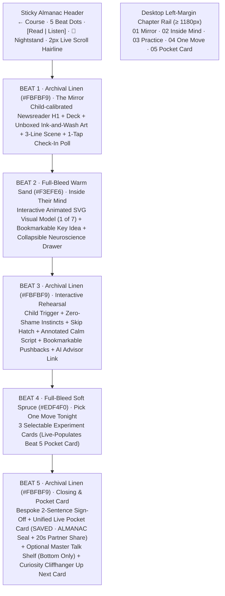

# Parent Intelligence Academy — Interactive Almanac v2 Specification
**Author:** Chief Technology Officer (CTO) & Product Design  
**Status:** Approved Canonical Specification (v3.0 — Interactive Almanac v2)  
**Supersedes:** `docs/parent-intelligence-academy-lesson-content-audit-and-architecture.md` (v2.0 Blog Post) & `docs/parent-intelligence-academy-lesson-experience-and-ux-specification.md` (v2.7)  
**Approved Visual Prototype:** [`docs/design/academy-lesson-interactive-beats/indexv2.html`](design/academy-lesson-interactive-beats/indexv2.html)  
**Design System Authority:** [`docs/design-system/MASTER.md`](design-system/MASTER.md) (*Taste 2: Editorial Pediatric Almanac*)  
**Companion Curriculum Audit:** [`docs/academy-curriculum-relevance-audit.md`](academy-curriculum-relevance-audit.md)  
**Execution Plans:** [`PLAN-46`](../plans/46-academy-interactive-almanac-v2-schema-and-api.md), [`PLAN-47`](../plans/47-academy-zero-bluff-curriculum-tailoring-and-seed.md), [`PLAN-48`](../plans/48-academy-interactive-almanac-v2-reader-ui.md)

---

## 1. Strategic Product Philosophy & Separation of Intent

Alongside serves parents across two distinct real-world mental states. Each product surface owns **one clear job**:

| Product Surface | Real-World Moment | Primary Job | Experience Model |
| :--- | :--- | :--- | :--- |
| **24/7 AI Advisor (`/advisor` & Floating Bubble)** | In-the-moment tactical need ("She just threw her plate—what do I do right now?") | Immediate, personalized 2-sentence situational guidance | Conversational, instant, context-aware |
| **Parent Intelligence Academy (`/academy`)** | Calm pockets of intentional time (couch after bedtime, morning coffee, stroller walk, Sunday morning) | Deeply fascinating mental-model building, active rehearsal, and lasting family habits | **Interactive Almanac v2** — calm, unspoiled 3-minute guided beats |

### Core Design Mandates (Founder-Approved)
1. **Zero Top Spoilers / No `30s Rescue` Mode:** Permanently retire [`LessonThirtySecondGlance.tsx`](../apps/web/src/components/academy/reader/LessonThirtySecondGlance.tsx) and top badge clutter. Spoiling the takeaway and exact script above sentence one destroys narrative curiosity and duplicates content. The recap belongs at the **finish line** as a **Sealed Pocket Card** (Beat 5).
2. **Zero Bluffing — Flexible 3–4 Episode Courses:** Courses run **3 or 4 episodes** naturally. Never invent a padded 4th lesson to fill a symmetric matrix. Every lesson must pass the **5-Point Parent Relevance Gate** ([`academy-curriculum-relevance-audit.md`](academy-curriculum-relevance-audit.md)).
3. **Strict Non-Clinical Advisory Boundary (SOU-86):** Zero medical symptom triage, zero diagnostic screening, zero medication dosing. All health/wellness lessons focus strictly on sleep architecture, home comfort habits, preventive daily routines, and clear guidance on when to partner with a pediatrician.
4. **Interactive-First, Video-Strategic (Bottom Only):** Lessons stand 100% complete as a 3-minute interactive experience (`Read` or hands-free `Listen`). Curated external Master Talks (7–18 min YouTube talks with verified 2–3 min timestamp jump chips) live **strictly at the bottom** (Course Arc shelf and/or below Beat 5 on the single episode where they deepen the concept), never blocking the opening screen and never duplicated across episodes.
5. **Active Child Calibration:** Every lesson dynamically personalizes headlines, stories, annotations, and Pocket Cards to the active child (`useChildContextStore` — name, exact age, pronouns) with graceful neutral fallbacks when no child is selected.

---

## 2. Course Architecture: The 3–4 Episode Narrative Arc

When a parent opens `/academy/[courseSlug]`, they encounter a purposeful mini-series rather than four cloned essays:

| Episode Role (`EpisodeRole`) | Emotional Goal | Signature Interactive Beat | Target Duration |
| :--- | :--- | :--- | :--- |
| **`FAST_WIN`** (Ep. 1) | *"Give me calm relief at my next hard moment."* | Annotated Rehearsal Card + Tappable Pushbacks + Core Visual | ~2.5–3 min |
| **`BRAIN_DECODER`** (Ep. 2) | *"Whoa—now I actually understand my child's brain!"* | Animated Visual Mental Model (`BrainBridge`, `LensExposureMatrix`, `CircadianCurve`) + Optional Neuroscience Drawer | ~3–3.5 min |
| **`RHYTHM_RESET`** (Ep. 3) | *"Stop this daily fight before it starts."* | Visual Daily/Evening Rhythm Timeline (`RoutineTimeline` or `HabitGuardrail`) + Boundary Script | ~3 min |
| **`LONG_TERM_BOND`** (Ep. 4, *Optional — only when high-impact*) | *"Build lifelong skill, curiosity, and trust together."* | Play/Co-Design Loop (`ServeReturnLoop` or `HabitGuardrail`) + Course Capstone Playbook | ~3 min |

- **Course Master Talk Shelf:** Anchors **at most 1 curated expert talk per course** beneath the episode list (`featuredVideoLecture`), complete with clickable timestamp jump chips (`start=seconds`) and a collapsible 3-core-ideas skim.

---

## 3. Inside-Lesson Architecture: The 5-Beat Tonal Canvas

Every lesson renders as **five rhythm-alternating full-bleed tonal bands**—eliminating card-box monotony and alternating reading with lightweight tactile participation every ~20 seconds:

### Detailed Beat Rules
- **Navigation & Progress (`AlmanacReaderNav` + `AlmanacMarginRail`):**
  - Clean sticky bar with `← Course Name`, 5 interactive beat dots (desktop), `Read | Listen` toggle (docking the companion narrator with synchronized beat highlighting only when toggled on), Nightstand warm charcoal dim toggle (`#151412`), and a **live `2px` Spruce scroll-progress hairline** along the bottom border (essential for mobile orientation).
  - **No 6-second tone preview button** inside Beat 3; audio lives exclusively in the clean top `Listen` companion.
- **Beat 1 (`AlmanacMirrorBeat`):**
  - Metadata line: `Episode X of Y · [Role] · For Maya (2 yrs 6 mos) · 3 min read` (+ quiet `7 min talk below ↓` anchor link ONLY if the lesson has a bottom Master Talk).
  - Unboxed editorial ink-and-wash SVG spot art (`EditorialSpotArt.tsx`) — never trapped inside circular icon badges.
  - 1-tap micro-check-in poll (`"Does this sound like your week?"`) returning immediate empathetic validation.
- **Beat 2 (`AlmanacBrainBeat`):**
  - Renders **1 of 7 reusable interactive visual primitives** parameterized per lesson:
    1. `SENSORY_LADDER` — Live evolving overhead plate SVG + 5 ascending stepped rungs (`Table → Plate → Touch → Smell → Taste`).
    2. `LENS_EXPOSURE_MATRIX` — `Adult Lens ↔ Brain Lens` toggle + tactile 20-sighting dot matrix.
    3. `BRAIN_BRIDGE` — Animated upstairs-brakes vs. downstairs-alarm SVG (`Calm ↔ Storm` / lid-flipped).
    4. `CIRCADIAN_CURVE` — Interactive wake-window / melatonin / sleep-pressure curve calibrated by child age.
    5. `ROUTINE_TIMELINE` — Visual daily or evening transition rhythm map (e.g., snack windows, bedtime wind-down, after-school decompression).
    6. `SERVE_RETURN_LOOP` — Interactive 3-step reciprocal connection loop (`Serve → Pause → Echo` or bilateral teen conversation).
    7. `HABIT_GUARDRAIL` — Interactive comparison contrasting `Parent Policing / Willpower` vs. `Neutral Environment / Bilateral Pact`.
  - Bookmarkable `Key Idea to Keep` Amber-accent pull-quote (`Save idea` → syncs with Pocket Card).
  - Collapsible `"Curious about the neuroscience behind this?"` disclosure holding all clinical/brain terminology.
- **Beat 3 (`AlmanacRehearsalBeat`):**
  - Child trigger quote in warm sand header (`#F5EFE3`) + 2 zero-shame instinctive parent options + quiet `"Neither sounds like me — jump straight to the calm reframe →"` escape hatch.
  - **Annotated Calm Script:** 2–3 key phrases subtly underlined as tappable inline buttons (`aria-pressed`), revealing crisp 1-line coaching badges (`Drops Alarm`, `Safe Anchor`, `Body Trust`) explaining *why* those exact words work.
  - **Tappable Pushback Chips:** 2–3 real-world twists with 1-tap `Add phrase to Pocket Card` bookmarking.
  - **Contextual AI Advisor Handoff:** Quiet link pre-loading the active child + lesson scenario into Alongside's AI Advisor for live twists.
- **Beat 4 (`AlmanacMoveBeat`) → Beat 5 (`AlmanacPocketBeat`):**
  - Picking 1 of 3 micro-experiments in Beat 4 live-updates Beat 5's **Unified Pocket Card** (eliminating double-button confirmation fatigue).
  - Clicking **Seal & Save to [Child]'s Playbook** stamps `SAVED · ALMANAC`, persists `isCompleted`, `chosenMoveId`, `bookmarkedTruth`, and `savedPushbackIds` via API, and offers the **20-Second Partner Share Modal**.
  - Pocket Card remains cleanly scoped inside `/academy` (identical to [`indexv2.html`](design/academy-lesson-interactive-beats/indexv2.html)).
  - **Curiosity Cliffhanger `Up Next` Card:** Frames the next episode as an open mystery question rather than a dry syllabus title.

---

## 4. Visual Token Extensions (`MASTER.md` Compliant)

All components strictly consume semantic CSS custom properties (zero hardcoded generic Tailwind `teal-700`, `rose-50`, `emerald-50`, and zero emoji UI icons):

| Token | Light Almanac (`#FBFBF9`) | Nightstand Warm Dim (`#151412`) | Usage |
| :--- | :--- | :--- | :--- |
| `--canvas` | `#FBFBF9` | `#151412` | Beats 1, 3, 5 background |
| `--band-sand` | `#F3EFE6` | `#1B1915` | Beat 2 full-bleed tonal chapter band |
| `--band-spruce` | `#EDF4F0` | `#161C18` | Beat 4 full-bleed tonal chapter band |
| `--elevated` | `#FFFFFF` | `#221F1B` | Visual stage, Rehearsal card, Pocket card |
| `--spruce` | `#143D2B` | `#72BC94` | Primary calm accent, progress hairline, seals |
| `--amber` | `#B45309` | `#E5A657` | Pull-quote rule, scene timestamps, gentle contrast |

---

## 5. Phased Delivery Roadmap (Option A — Approved)

1. **Phase 0 (Complete):** Official v2 Spec (`docs/parent-intelligence-academy-interactive-almanac-v2-spec.md`) + Full 40-Course Zero-Bluff Relevance Audit (`docs/academy-curriculum-relevance-audit.md`) + Formal Execution Plans (`PLAN-46`, `PLAN-47`, `PLAN-48`).
2. **`PLAN-46` (Shared + DB + API):** Zod/TS `AlmanacLessonPayload`, `interpolateChildCopy()`, backward-compatible fallback adapter, additive Prisma migration, Fastify Playbook + Completion endpoints.
3. **`PLAN-48` (Frontend `apps/web`):** Interactive Almanac v2 Course Arc & 5-Beat Reader UI (immediately renders all 40 courses cleanly via bespoke payloads + fallback adapter).
4. **`PLAN-47` (Curriculum Tailoring Waves 1 → 3):**
   - **Wave 1 (Flagship Launch):** Hand-tailor all **15 courses in Ages 0–3** (`TIER_0A`, `TIER_0B`, `TIER_0C`) + automated Zero-Bluff CI Guard tests.
   - **Wave 2 (Childhood):** Hand-tailor all **10 courses in Ages 4–9** (`TIER_1`, `TIER_2`).
   - **Wave 3 (Pre-Teen & Teen):** Hand-tailor all **15 courses in Ages 10–18** (`TIER_3`, `TIER_4`, `TIER_5`).
