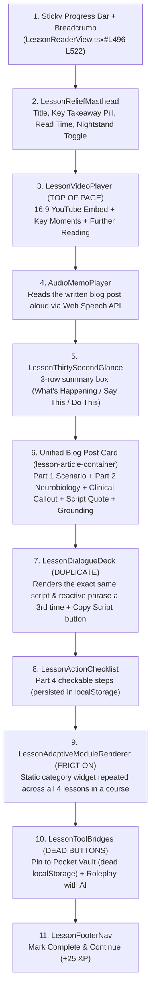
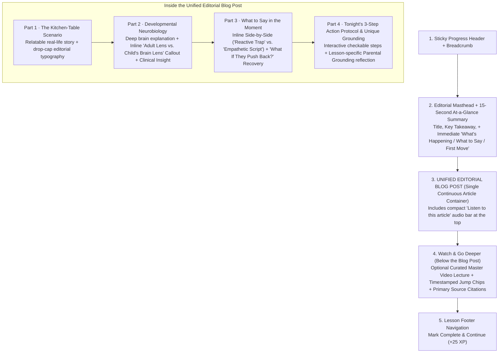

# Parent Intelligence Academy — Lesson Content Audit & Unified Rich Blog Post Architecture

**Author:** Chief Technology Officer (CTO)  
**Status:** Canonical Architecture & UX Specification (v2.0 — Unified Editorial Blog Post)  
**Target Modules:** `apps/web/src/components/academy/`, `apps/api/src/modules/academy/`, `packages/database/prisma/seed/`  
**Visual Prototype:** [`docs/design/academy-lesson-before-after/index.html`](file:///C:/GithubProjects/AlongSide/docs/design/academy-lesson-before-after/index.html)

---

## 1. Executive Summary

This specification audits the current lesson content format and component hierarchy in the **Parent Intelligence Academy** across all 8 child developmental tiers (`INFANT_0_1` through `LATE_TEEN_16_18`) and defines the **Unified Rich Editorial Blog Post Architecture** (`v2.0`).

### Key Takeaways
1. **The Heart of Every Lesson Is the Unified Editorial Blog Post:** Parents come to a lesson to read (or listen to) a rich, cohesive, deeply empathetic clinical article about their child's brain and behavior—not to click through fragmented cards, gimmicky widgets, or dead-end buttons.
2. **Video Moves Below the Blog Post (Not Above It):** Placing a 10–60 minute YouTube embed at the very top of the page (`LessonReaderView.tsx#L533-L542`) blocks the parent from reaching the written lesson and repeats the same course-level video across multiple lessons (`academyVideos.seed.ts`). Moving the video *below* the unified blog post as an optional **"Watch & Go Deeper: Master Video Lecture"** lets parents get immediate clarity in 3 minutes of reading first.
3. **Eliminate Gimmicky Widgets & Dead-End Action Buttons:**
   - **Remove `LessonAdaptiveModuleRenderer` (Interactive Lab widgets):** Category-level widgets (`SomaticBreathWidget`, `FeedingResponsibilityWidget`, `PurposefulPlayBlueprintWidget`, `PactClauseBridgeWidget`) repeat the exact same static component across all 4 lessons in a course, return `null` for `HEALTH_AND_WELLNESS`, and add unnecessary friction.
   - **Remove `Copy Script`, `Pin to Pocket Vault`, and `Roleplay with AI` buttons:** Parents speak to their children face-to-face rather than copying/pasting scripts into a chat; `Pin to Pocket Vault` (`LessonToolBridges.tsx#L32-L52`) writes to a `localStorage` key (`alongside-script-vault`) that has no reader UI anywhere in the app; and AI roleplay is unnecessary when the global floating AI Advisor bubble (`FloatingAdvisorBubble.tsx`) is already available on every screen.
4. **Enrich the Blog Post Inside One Continuous Reading Flow:** Instead of breaking the page into separate boxes, weave high-curiosity neurobiology and practical parenting tools directly into the **4-part Editorial Blog Post**:
   - **Part 1 — The Kitchen-Table Scenario:** Vivid, relatable real-life moment + *"Why Your Child Does This"* hook.
   - **Part 2 — Developmental Neurobiology & "Adult Lens vs. Child's Brain Lens":** Deep clinical explanation paired with an inline side-by-side comparison contrasting how an adult misinterprets the behavior vs. what is actually firing inside the child's nervous system.
   - **Part 3 — Empathetic Dialogue Scripts & "What If They Push Back?":** Side-by-side comparison (`Reactive Trap` vs. `Empathetic Script`) plus a realistic **Pushback & Recovery** branch inside the article.
   - **Part 4 — Tonight's 3-Step Action Protocol & Unique Parental Grounding:** Concrete behavioral steps and a **lesson-specific** parental grounding anchor (replacing the copy-pasted boilerplate currently duplicated across all 192 lessons).

---

## 2. Codebase Audit: What a Lesson Currently Renders (`Before`)

### 2.1 Current DOM Order in `LessonReaderView.tsx`
In [`apps/web/src/components/academy/LessonReaderView.tsx`](file:///C:/GithubProjects/AlongSide/apps/web/src/components/academy/LessonReaderView.tsx#L495-L760), when a user opens `/academy/[courseSlug]/[lessonSlug]`, the page currently renders the following stack from top to bottom:

### 2.2 Critical Codebase Deficiencies Identified

| # | Deficiency | Exact Source Location | User Impact |
| :--- | :--- | :--- | :--- |
| **1** | **Heavy Video Blocks the Written Blog Post** | [`LessonReaderView.tsx#L533-L542`](file:///C:/GithubProjects/AlongSide/apps/web/src/components/academy/LessonReaderView.tsx#L533-L542) & [`academyVideos.seed.ts`](file:///C:/GithubProjects/AlongSide/packages/database/prisma/seed/academyVideos.seed.ts#L15-L210) | A 16:9 YouTube embed sits above the article. Furthermore, `COURSE_CURATED_VIDEOS` maps **1 or 2 videos per course**, so Lessons 1 & 3 (or all 4 lessons) show the **exact same YouTube video** at the top of the page. |
| **2** | **Quadruple Repetition of the Same Script** | [`LessonThirtySecondGlance.tsx`](file:///C:/GithubProjects/AlongSide/apps/web/src/components/academy/reader/LessonThirtySecondGlance.tsx), [`LessonReaderView.tsx#L636-L654`](file:///C:/GithubProjects/AlongSide/apps/web/src/components/academy/LessonReaderView.tsx#L636-L654), [`LessonDialogueDeck.tsx`](file:///C:/GithubProjects/AlongSide/apps/web/src/components/academy/reader/LessonDialogueDeck.tsx) | The exact same `scriptExample` string is rendered in the 30-Second Glance, inside the Blog Post blockquote, and again in `LessonDialogueDeck`. |
| **3** | **Interactive Lab Widget Adds Friction (`LessonAdaptiveModuleRenderer`)** | [`LessonAdaptiveModuleRenderer.tsx`](file:///C:/GithubProjects/AlongSide/apps/web/src/components/academy/reader/LessonAdaptiveModuleRenderer.tsx#L41-L82) | Switches only on `courseCategory` + `ageTier`, rendering the **exact same generic widget** (`SomaticBreathWidget`, `FeedingResponsibilityWidget`, etc.) on all 4 lessons of a course, and returning `null` for `HEALTH_AND_WELLNESS`. |
| **4** | **Dead / Unnatural Utility Buttons (`Copy Script`, `Pin to Vault`, `Roleplay`)** | [`LessonDialogueDeck.tsx#L39-L51`](file:///C:/GithubProjects/AlongSide/apps/web/src/components/academy/reader/LessonDialogueDeck.tsx#L39-L51) & [`LessonToolBridges.tsx#L32-L88`](file:///C:/GithubProjects/AlongSide/apps/web/src/components/academy/reader/LessonToolBridges.tsx#L32-L88) | Parents talk to their child rather than copying text; `alongside-script-vault` in `localStorage` is never read anywhere else in `apps/web`; and AI roleplay duplicates the global floating AI Advisor bubble. |
| **5** | **Copy-Pasted "Parental Grounding" Across All 192 Lessons** | [`academy.seed.ts#L168-L185`](file:///C:/GithubProjects/AlongSide/packages/database/prisma/seed/academy.seed.ts#L168-L185) | `buildRichLessonMarkdown` appends the **identical** paragraph (*"When caregivers execute predictable, somatic co-regulation... in moments of distress"*) to every single lesson in the database—even lessons about grocery shopping or infant peek-a-boo. |
| **6** | **Every Lesson Is Forced Into a "Crisis / Problem" Template** | [`LessonReaderView.tsx#L645-L649`](file:///C:/GithubProjects/AlongSide/apps/web/src/components/academy/LessonReaderView.tsx#L645-L649), [`LessonThirtySecondGlance.tsx#L76-L106`](file:///C:/GithubProjects/AlongSide/apps/web/src/components/academy/reader/LessonThirtySecondGlance.tsx#L76-L106) | The UI hardcodes `"Real Family Friction"`, `"30-Second Crisis Glance"`, `"Tonight's 10-Second Emergency Protocol"`, `"💡 Why this happens"`, and `"What NOT to Say"` on **all 192 lessons**—even when the lesson is purely explaining a developmental concept (e.g., *Shared Attention*, *How Food Affects Mood*, *4-Month Sleep Maturation*) or a positive play activity (*The Vocal Echo Game*). |
| **7** | **Over-Clinical / Medical Textbook Jargon Alienates Parents** | [`LessonReaderView.tsx#L667-L720`](file:///C:/GithubProjects/AlongSide/apps/web/src/components/academy/LessonReaderView.tsx#L667-L720) & [`academy.seed.ts`](file:///C:/GithubProjects/AlongSide/packages/database/prisma/seed/academy.seed.ts) | Headings like `"Developmental Neurobiology"`, `"Clinical Neurobiology Takeaway"`, `"Clinical Implementation"`, and body text stuffed with Latin medical terms (*"ventromedial prefrontal cortex"*, *"periaqueductal gray"*, *"Meissner corpuscles"*, *"oral stereognosis"*) make an advisory parenting platform sound like a cold hospital textbook. |

---

## 3. Each Lesson Belongs to 1 of 3 Lesson Archetypes

Not every lesson is about a child misbehaving or having a crisis. Across the 5 Academy categories (`BEHAVIOR_AND_EMOTIONS`, `DEVELOPMENT_AND_PLAY`, `NUTRITION_AND_FEEDING`, `HEALTH_AND_WELLNESS`, `DIGITAL_AND_DEVICES`), every lesson belongs to one of **3 Lesson Archetypes**, and its blog post headings and callouts adapt accordingly:

| Element Inside the Blog Post | Archetype 1: Everyday Behavior *(When a challenging behavior is happening)* | Archetype 2: Child Growth & Concept *(Explaining how your child grows, learns, or plays)* | Archetype 3: Practical Family Guide *(Health care, sleep routines, or family habits)* |
| :--- | :--- | :--- | :--- |
| **Examples in Codebase** | • *Calming a Toddler Meltdown* • *Sibling Conflict at Home* | • *The Vocal Echo Game (First Sounds)* • *Playing With Puppets & Shared Focus* • *How Food Shapes Your Teen's Mood* | • *Baby & Toddler Fever Guide* • *Safe Sleep & Bedtime Routines* • *The 20-Minute Budget Grocery Run* |
| **Top Highlight Banner** | **💡 Why This Happens:** Reassures the parent why this behavior is normal for their child's age. | **🌱 How Your Child Grows:** Summarizes what new skill or milestone is blossoming right now. | **🧭 Parent's Guide:** States the core practical rule or peace-of-mind principle upfront. |
| **Quick Summary Drawer** | **⚡ Quick 30-Sec Read** (*What's Going On · Your Best First Move · What to Say*) | **⚡ Quick 30-Sec Read** (*The Milestone · Why It Matters · How to Spark It*) | **⚡ Quick 30-Sec Read** (*The Golden Rule · What to Watch For · What to Do*) |
| **Part 1 Heading** | `Part 1 · A Moment Every Parent Knows` **What It Looks Like at Home** | `Part 1 · What You'll Notice` **A New Stage of Growth** | `Part 1 · Why Clear Guidance Matters` **The Everyday Family Decision** |
| **Part 2 Heading & Inline Callout** | `Part 2 · Understanding Your Child` **What's Going On Inside Their Growing Mind** + *👁️ How It Feels to Us vs. 💛 How It Feels to Your Child* | `Part 2 · Why This Milestone Matters` **How This Builds Confidence & Connection** + *💭 Common Parenting Myth vs. ✨ What Really Helps Them Thrive* | `Part 2 · What Every Parent Should Know` **The "Why" Behind the Rule** + *🚨 When to Act Right Away vs. 🟢 When Home Comfort Is Enough* |
| **Part 3 Heading & Comparison** | `Part 3 · Words That Help` **What to Say (and What If They Push Back?)** + *🛑 Common Reaction vs. ✅ Try Saying This Instead* | `Part 3 · Encouraging Their Curiosity` **How to Spark It Together** + *⚠️ What Gets in the Way vs. ✨ What Helps Them Learn* | `Part 3 · Common Myths vs. Helpful Habits` **What to Avoid & What Helps Most** |
| **Part 4 Heading** | `Part 4 · Putting It Into Practice` **3 Simple Steps to Try at Home** | `Part 4 · Fun Ideas for This Week` **3 Simple Ways to Practice Together** | `Part 4 · Your Home Checklist` **3 Simple Steps to Keep Handy** |
| **Closing Reflection** | **A Note for You as a Parent** | **A Note for You as a Parent** | **A Note for You as a Parent** |

---

## 4. Tone & Voice: Warm, Educated Parent Advisor (Not a Medical Textbook)

AlongSide is an **advisory and educational platform for parents**, not a neurology journal. Parents want to understand *why* their child thinks, feels, and acts the way they do—explained in **plain, warm, memorable human language**.

| ❌ Current Over-Clinical / Textbook Language | ✅ Target Warm, Educated Parent Advisory Language |
| :--- | :--- |
| `"Developmental Neurobiology"` | `"What's Going On Inside Their Growing Mind"` |
| `"Clinical Neurobiology Takeaway"` | `"The Key Takeaway to Remember"` |
| `"Tonight's 10-Second Emergency Protocol"` | `"Quick 30-Second Read"` |
| `"Tonight's 3-Step Action Protocol"` | `"3 Simple Steps to Try at Home"` |
| `"Clinical Implementation & Parental Grounding"` | `"A Note for You as a Parent"` |
| *"The ventromedial prefrontal cortex is unmyelinated while noradrenaline floods the periaqueductal gray and shuts down Wernicke's area."* | *"Think of a toddler's mind like a brand-new car with a supercharged gas pedal (big feelings) but bicycle brakes (patience and calming down). When they get overwhelmed, the thinking and listening part of their mind temporarily goes offline."* |
| *"Oral stereognosis via Merkel discs, Meissner corpuscles, and Pacinian corpuscles in the postcentral gyrus."* | *"For babies, their mouth and hands are their best tools for discovering how the world works—exploring whether a spoon is cool and smooth or a cloth is soft and crinkly."* |

---

## 5. How the Audio Player Works (`Listen to Article`)

In [`LessonReaderView.tsx#L160-L245`](file:///C:/GithubProjects/AlongSide/apps/web/src/components/academy/LessonReaderView.tsx#L160-L245) and [`AudioMemoPlayer.tsx`](file:///C:/GithubProjects/AlongSide/apps/web/src/components/academy/reader/AudioMemoPlayer.tsx#L68-L152):
- When the parent clicks **Play** on the Audio bar, it reads the **entire written blog post sequentially from top to bottom** (`buildSequentialLessonSpokenText`):
  1. **Lesson Title**
  2. **Part 1: The Kitchen-Table Scenario**
  3. **Part 2: Developmental Neurobiology**
  4. **Clinical Takeaway**
  5. **Part 3: Empathetic Script to Use**
  6. **Part 4: Parental Grounding**
- If a studio MP3 file (`lesson.audioUrl`) is not present on the CDN, `AudioMemoPlayer` automatically falls back to `window.speechSynthesis` (selecting a natural browser voice and tracking real-time progress across the spoken text).
- **UX Upgrade:** Place a clean, compact **"Listen to this article (3 min audio)"** bar directly inside the top of the Unified Editorial Blog Post header so a parent with their hands full (cooking, folding laundry, or sitting beside a child's bed) can listen to the written article word-for-word.

---

## 4. Target Architecture: The Unified Rich Editorial Blog Post (`After`)

Instead of chopping the lesson into 7 separate boxes and widgets, the entire lesson experience centers on **one cohesive, richly formatted Editorial Blog Post** (`lesson-article-container`), followed by the optional Master Video Lecture and the completion footer.

### 4.1 What Appears Inside Each Section of the Unified Blog Post

#### Top of Page: Masthead + 15-Second At-a-Glance Strip
- **Editorial Masthead:** Shows Course Badge, Age Tier (`TODDLER · 1–3 YRS`), Lesson X of 4, Title, Key Clinical Takeaway, and the Nightstand Mode toggle.
- **15-Second At-a-Glance Strip:** Three scannable columns right above the article for urgent moments:
  1. **What's Happening:** One-sentence neurobiological summary.
  2. **Say This Tonight:** The primary empathetic script line.
  3. **Your First Move:** Step 1 of the action protocol.

#### Inside the Unified Blog Post (`lesson-article-container`)
- **Inline Audio Reader Bar:** Compact bar at the top of the article that reads Parts 1–4 of the blog post aloud from start to finish.
- **Part 1 — The Kitchen-Table Scenario:**
  - Rich narrative prose describing the exact moment the parent recognizes in their own home (with editorial drop-cap styling).
- **Part 2 — Developmental Neurobiology:**
  - Deep explanation of the brain structures involved (e.g., HPA axis, amygdala hijack, vagal brake, prefrontal myelination).
  - **Embedded "Adult Lens vs. Child's Brain Lens" Table:** Contrasts *What It Looks Like to an Adult* (e.g., *"Manipulative screaming over a wrong-colored cup"*) against *What's Actually Happening in Their Brain* (e.g., *"Subcortical amygdala alarm; zero prefrontal inhibition until age 4"*).
  - **Embedded Clinical Neurobiology Callout:** Highlights the specific mechanism (e.g., postural vagal co-regulation).
- **Part 3 — What to Say in the Moment:**
  - **Side-by-Side Script Comparison:** Contrasts the **Common Reactive Trap** (and why it escalates the child's nervous system) against the **Empathetic Neuro-Script** (and why it restores safety)—integrated directly inside the blog post so it is never repeated in a separate card.
  - **"What If They Push Back?" Follow-Up Box:** Addresses the #1 parent skepticism (*"What if my child yells louder or hits when I try this script?"*) with the exact second-turn boundary response.
- **Part 4 — Tonight's 3-Step Action Protocol & Lesson-Specific Grounding:**
  - **3 Checkable Action Steps:** Concrete physical actions the parent can check off as they read.
  - **Unique Lesson-Specific Parental Grounding:** A closing reflection tailored specifically to this lesson's scenario (replacing the repetitive boilerplate).

#### Below the Blog Post: Watch & Go Deeper (Optional Master Video Lecture)
- Placed **after** the written blog post so it never blocks reading.
- Clearly labeled with context on why this specific timestamp (`startSeconds`) matters for the lesson, interactive timestamp jump chips, and collapsible **Primary Clinical Sources & Further Reading** (`furtherReading`).

---

## 5. Summary of Removals & Simplifications

| Removed Element | Why It Was Removed |
| :--- | :--- |
| **Top-of-Page Video Embed** | Moved **below** the blog post so parents immediately enter the written lesson without a heavy video player pushing the article below the fold. |
| **Stage 5 · Interactive Lab (`LessonAdaptiveModuleRenderer`)** | Removed entirely. Static category widgets added friction, interrupted the reading experience, and repeated the same box across all 4 lessons in a course. |
| **Duplicate `LessonDialogueDeck` Component** | Merged into **Part 3 of the Unified Blog Post** so the script comparison appears once inside the natural reading flow instead of repeating 3 times. |
| **`Copy Script` Button** | Removed. Parents speak to their child aloud in real life; they do not copy-paste parenting scripts into a clipboard. |
| **`Pin to Pocket Vault` Button (`LessonToolBridges`)** | Removed. Wrote to an orphaned `localStorage` key (`alongside-script-vault`) with no UI reader in the application. |
| **`Roleplay with AI Advisor` Button (`LessonToolBridges`)** | Removed. Unnatural for toddler/child scenarios and redundant with the global floating AI Advisor bubble (`FloatingAdvisorBubble.tsx`). |
| **Boilerplate Parental Grounding Paragraph** | Replaced with a unique, lesson-specific closing reflection inside Part 4 of the blog post. |
