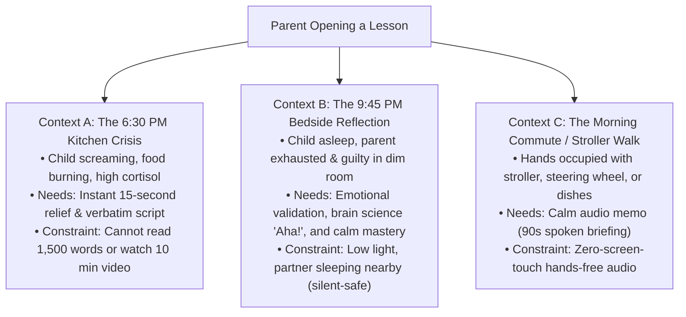
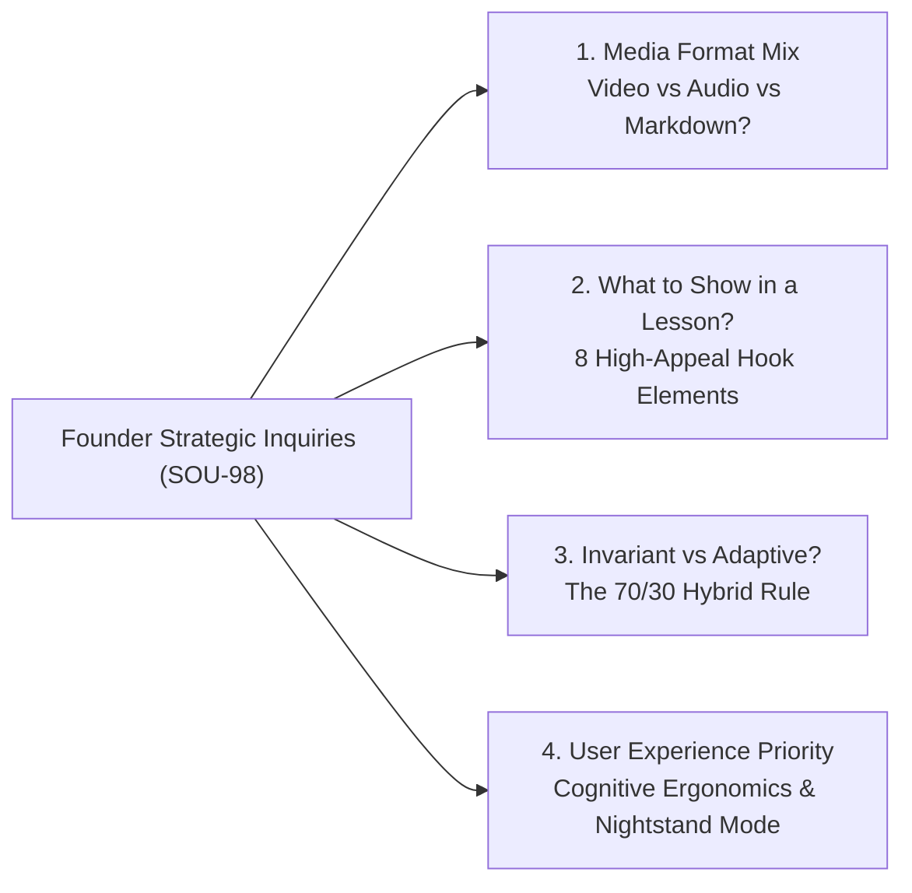
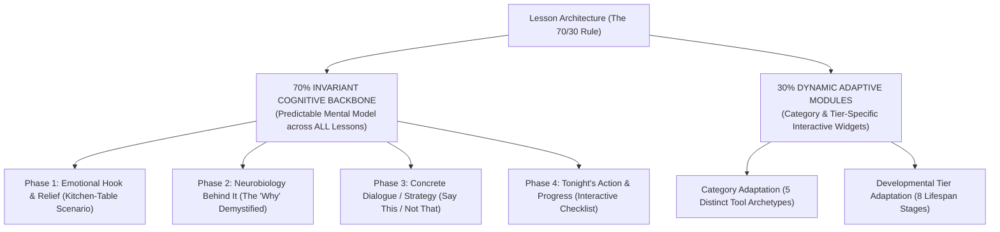
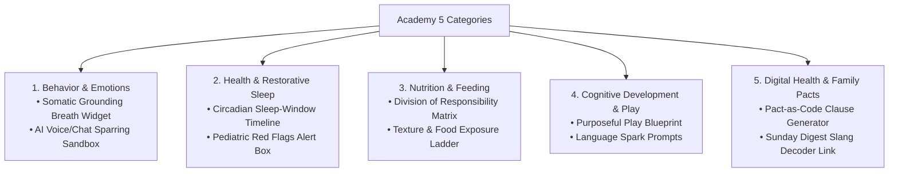
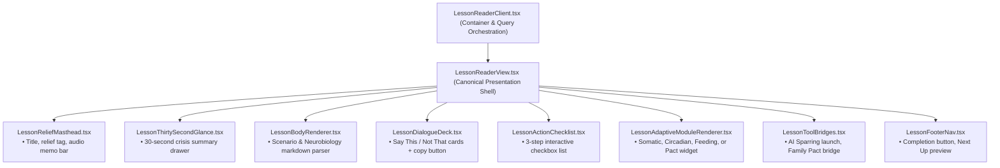

# Alongside — Parent Intelligence Academy: Lesson Experience, Content Format & Multi-Modal UX Specification
**Author:** Chief Technology Officer (CTO)  
**Status:** Canonical Architectural Specification  
**Version:** 2.7.0  
**Target Audience:** Founder & CEO, Product Designers, Frontend Agent, Backend Agent, Curriculum Authors  
**Companion Documents:**  
- [`docs/parent-intelligence-academy-course-content-and-format-specification.md`](parent-intelligence-academy-course-content-and-format-specification.md) (PIA Course Length, Content & Syllabi)  
- [`docs/platform-advisory-rearchitecture-and-academy-chapters-spec.md`](platform-advisory-rearchitecture-and-academy-chapters-spec.md) (Platform Advisory Rearchitecture)  
- [`docs/system-design-specification.md`](system-design-specification.md) (System Design Specification)  
- [`docs/design-system/MASTER.md`](design-system/MASTER.md) (Canonical Design System — Taste 2: Editorial Pediatric Almanac)  
- [`plans/38-parent-intelligence-academy-lesson-experience-and-multi-modal-reader.md`](../plans/38-parent-intelligence-academy-lesson-experience-and-multi-modal-reader.md) (Engineering Execution Plan 38)  

---

## 1. Executive Summary & Problem Framing

In Paperclip task **SOU-98**, the Founder presented a foundational product and user experience challenge:

> *"Now when we enter a lesson, we should define what we gonna show in that lesson. Are we gonna show text, a markdown form, a video, something appealing? What are the things we should be showing inside each lesson that gonna make every lesson appealing, and hook the parents into staying connected and reading more? Good user experience is a priority. Maybe at first we should think of ideas, of what exactly are we gonna show in each lesson, and should it be varying from lesson to lesson based on tier, or based on category or make it the same? We should think through this first."*

This specification provides the comprehensive architectural, psychological, pedagogical, and user interface blueprint for **entering and experiencing a lesson in AlongSide**.

### 1.1 The Psychological Reality of the Exhausted Parent

To design an appealing, high-retention lesson experience, we must understand the exact emotional state of the human opening the screen. Parenting education does not take place in an academic lecture hall or a comfortable corporate office. It occurs in three high-stress user contexts:



If AlongSide greets this exhausted parent with a dense, unformatted block of academic text, they experience **cognitive overwhelm** and bounce. Conversely, if we throw them into an unskippable 15-minute talking-head video, they close the app immediately because their toddler is screaming or their partner is sleeping next to them in a dark room.

**The Solution:** The AlongSide lesson experience is engineered as a **Serene Multi-Modal Almanac & Interactive Sandbox**—scannable in 30 seconds for immediate crisis relief, deep and restorative in 3.5 minutes for late-night reflection, and playable in 90 seconds hands-free.

---

## 2. Foundational Strategic Decisions: Answering the 4 Core Inquiries



---

### 2.1 Decision 1: What Media Formats Should We Show? (Text vs. Markdown vs. Video vs. Audio)

#### Detailed Trade-Off Evaluation Matrix:

| Format Dimension | Raw Plain Text | Long-Form Studio Video (5–10 min) | Micro-Motion / Infographic (30–45s) | Spoken Audio Memo (90s) | Structured Editorial Markdown |
| :--- | :--- | :--- | :--- | :--- | :--- |
| **Crisis Speed (Time to Value)** | ❌ Poor (Slow to scan, eye fatigue) | ❌ Disastrous (Must scrub through timeline) | ⚠️ Moderate (Visual recognition) | ⚠️ Moderate (Linear listening) | ✅ **Instant (< 15 seconds to script)** |
| **Late-Night Bedside Usability** | ⚠️ Bland / Dry | ❌ Banned (Wakes baby/partner, blaring light) | ✅ High (Silent-first, dark-safe) | ⚠️ Requires earbuds | ✅ **Supreme (Warm dim palette, serif text)** |
| **Emotional Connection & Empathy** | ❌ Cold | ✅ High | ⚠️ Moderate | ✅ **Extremely High (Warm clinician voice)** | ✅ **High (Storytelling + pull quotes)** |
| **Production & Maintenance Cost** | ✅ Low | ❌ Prohibitive ($2,500/video, hard to update) | ⚠️ Medium (SVG/CSS animations) | ✅ Low-Medium (TTS/Voice synthesis) | ✅ **Low (Instant clinical updates)** |
| **Bandwidth / Offline PWA Footprint** | ✅ < 5 KB | ❌ 50–150 MB (High buffering on mobile) | ✅ < 200 KB (Vector/SVG) | ✅ < 1 MB (Opus/AAC 64kbps) | ✅ **< 15 KB (Instantaneous load)** |

#### The Verdict: The Tri-Modal Balanced Formula
We reject both extremes (pure flat text walls and heavy 10-minute talking-head videos). Instead, each lesson is powered by the **Tri-Modal Balanced Formula**:

1. **The Primary Backbone: Structured Editorial Markdown with Specialized Micro-Widgets (500–750 words, 3.5 min read)**:
   - Not raw markdown rendered as a generic blog post.
   - Compiled into **high-leverage, tactile UI elements**: clickable dialogue cards, developmental insight callout banners, interactive checklists, and one-tap script copy buttons.
2. **The Secondary Audio Layer: 90-Second Clinician Voice Briefing / Audio Memo**:
   - Prominently anchored at the top of the lesson.
   - Parents can tap Play with one thumb and listen while rocking a baby, washing dishes, or folding laundry.
3. **The Visual Layer: Silent-First Micro-Infographics & Body Positioning Diagrams**:
   - Short SVG/CSS visual diagrams showing the physical interaction (e.g. *Eye-level positioning vs. standing over child*; *The 3-zone plate division*; *Circadian melatonin shift chart*).
   - Silent by default with optional burned-in captions; zero risk of waking a sleeping child.

---

### 2.2 Decision 2: Should Lessons Vary by Tier or Category, or Stay the Same?

#### The Problem of Pure Uniformity vs. Pure Randomness:
- **If every lesson is 100% identical in layout:** It feels robotic and template-driven. A lesson on toddler tantrum de-escalation requires a physiological somatic calming anchor, while a lesson on 14-year-old smartphone curfews requires a bilateral contractual clause and digital privacy boundaries.
- **If every lesson is 100% random and bespoke:** Cognitive fatigue sky-rockets. A tired parent opening a lesson never knows where the script is, where the action step is, or how long it will take. Development and maintenance costs multiply.

#### The Architectural Solution: The 70/30 Hybrid Rule



1. **The 70% Invariant Cognitive Backbone:**
   Every lesson across all 35 modules and 8 tiers strictly adheres to the same **4-Phase Narrative Rhythm**. The parent develops subconscious mastery: they know that the top always validates their stress, the middle explains the brain, the cards give them the exact words, and the bottom gives them tonight's 3-step action.
2. **The 30% Dynamic Adaptive Modality:**
   Inside that invariant framework, the specific interactive tools and visual representations **adapt dynamically based on Category and Developmental Tier**.

---

## 3. The 8 High-Appeal Lesson UX Elements (The "Hook & Retention" Anatomy)

To ensure that entering a lesson is immediately captivating, emotionally relieving, and habit-forming, every lesson page features the following 8 specialized components:

```
┌──────────────────────────────────────────────────────────────────────────────────────────────────┐
│                                ALONGSIDE LESSON READER CANVAS                                    │
├──────────────────────────────────────────────────────────────────────────────────────────────────┤
│ [← Back to Course]        [Chapter 1: Critical Win]        [⏱️ 3.5 min read]   [🌙 Nightstand Dim]│
├──────────────────────────────────────────────────────────────────────────────────────────────────┤
│ 1. THE 10-SECOND RELIEF MASTHEAD                                                                 │
│   Title: The Immature Amygdala: Why Toddlers Melt Down & How to Anchor Calm                      │
│   Guilt-Release Tag: "💡 Why this is 100% normal at 24 months, not a discipline failure"         │
│   [ 🎧 Listen to 90s Clinician Memo (1:32)  ▶ ──────────────────────── 🔊 ]                     │
├──────────────────────────────────────────────────────────────────────────────────────────────────┤
│ 2. THE 30-SECOND GLANCE (Executive Crisis Summary — Expandable / Collapsible)                     │
│   ⚡ IN A RUSH? TONIGHT'S 10-SECOND PROTOCOL:                                                    │
│   • Core Problem: Amygdala surge with zero prefrontal braking. Logic will inflame the storm.     │
│   • Immediate Shift: Drop below child eye level. Silence your lecture. Speak under 8 words.      │
│   • Exact Words: "Your body feels big and stormy. I am right here. You are completely safe."     │
├──────────────────────────────────────────────────────────────────────────────────────────────────┤
│ 3. THE KITCHEN-TABLE SCENARIO (Empathic Story Hook · ~140 words)                                 │
│   "It is 5:45 PM on a Tuesday. You just walked in the door. You hand your 2-year-old the blue    │
│    cup instead of the yellow one. In a split second, their body arches, screaming begins..."    │
├──────────────────────────────────────────────────────────────────────────────────────────────────┤
│ 4. THE NEUROBIOLOGY "AHA!" MECHANISM CARD (Visual Demystification · ~180 words)                  │
│   ┌────────────────────────────────────────────────────────────────────────────────────────────┐ │
│   │ 🧠 PEDIATRIC NEUROBIOLOGY INSIGHT                                                         │ │
│   │ "At age two, the prefrontal cortex neural pathways connecting logic to emotional braking  │ │
│   │  are essentially unpaved dirt roads. A toddler cannot 'calm down' on command because they │ │
│   │  lack the biological hardware. They borrow your nervous system through neuroception."     │ │
│   └────────────────────────────────────────────────────────────────────────────────────────────┘ │
├──────────────────────────────────────────────────────────────────────────────────────────────────┤
│ 5. INTERACTIVE DIALOGUE DECK ("Say This, Not That" with 1-Click Copy & Tone Coaching)             │
│   ┌──────────────────────────────────────────────┬─────────────────────────────────────────────┐ │
│   │ 🛑 WHAT WE INSTINCTIVELY SAY (Why It Fails)  │ ✅ ALONGSIDE EMPATHETIC SCRIPT (What to Say)│ │
│   ├──────────────────────────────────────────────┼─────────────────────────────────────────────┤ │
│   │ "Stop crying right now! It's just a cup! You │ "Your body feels so big and stormy right    │ │
│   │  are being completely ridiculous!"           │  now. It's hard when we wanted the yellow   │ │
│   │ • Why: Shames somatic reality, confirms that │  cup. I am right here. You are safe."       │ │
│   │   big feelings make parents unsafe.          │ [ 📋 Copy Script ]  [ 📌 Save to Vault ]    │ │
│   ├──────────────────────────────────────────────┴─────────────────────────────────────────────┤ │
│   │ 🎙️ VOCAL & BODY DELIVERY TIP: Drop voice 2 octaves. Sit 3 feet away at eye level. Relax.   │ │
│   └────────────────────────────────────────────────────────────────────────────────────────────┘ │
├──────────────────────────────────────────────────────────────────────────────────────────────────┤
│ 6. TONIGHT'S 3-STEP ACTION CHECKLIST (Interactive & Saved to Parent Profile)                     │
│   [ ] 1. Somatic Eye-Level Drop (Kneel or sit before speaking)                                   │
│   [ ] 2. The 8-Word Limit (Silence explanations until heart rate slows)                          │
│   [ ] 3. The Cold Water Reset (Offer a sip of cold water after the storm breaks)                 │
├──────────────────────────────────────────────────────────────────────────────────────────────────┤
│ 7. INTEGRATED TOOL ACTION BRIDGES                                                                │
│   [ 🤖 Practice This Scenario with AI Advisor → ]       [ 📄 Add Clause to Family Pact ]        │
├──────────────────────────────────────────────────────────────────────────────────────────────────┤
│ 8. MILESTONE COMPLETION & CONTINUATION HOOK                                                      │
│   [ ✓ Complete Lesson & Advance ]                       [ Up Next: Lesson 2 · The Biological Root]│
└──────────────────────────────────────────────────────────────────────────────────────────────────┘
```

---

### Detailed Specification of the 8 Elements:

#### 1. The 10-Second Relief Masthead & Spoken Audio Bar
- **Emotional Purpose:** Instantly disarms parental guilt before they read a single paragraph.
- **Components:**
  - Standard breadcrumb navigation back to course roadmap.
  - Estimated reading time (e.g. `3.5 min read · 480 words`).
  - **Guilt-Release Tagline:** A highlighted badge reassuring the parent that this behavior is normal biology, not parental failure.
  - **Embedded Audio Memo Bar:** Native HTML5 audio player styled with AlongSide's serene design system. Allows 1-click playback of a 90-second voice briefing with 1x/1.2x/1.5x speed options.

#### 2. The 30-Second Glance (Executive Crisis Summary)
- **Emotional Purpose:** Serves the parent who is standing in the kitchen right now with an escalating situation and has zero time to read long prose.
- **Components:**
  - High-visibility, tinted collapsible alert box.
  - 3 high-impact bullets: *The Biological Trap*, *The Mindset Pivot*, *The Exact Words to Say Right Now*.
  - Can be toggled open or collapsed with a smooth transition.

#### 3. The Kitchen-Table Scenario (Empathy Hook)
- **Emotional Purpose:** Validates the parent's lived experience with authentic, visceral storytelling.
- **Components:**
  - Written in Newsreader serif typography (18px, 1.7 line height).
  - Describes a specific, relatable scene with sensory details (the kitchen timer, spilled milk, homework refusal, door slam).
  - Explicitly states: *"Take a breath. You are not a bad parent, and your child is not broken."*

#### 4. The Neurobiology "Aha!" Mechanism Card
- **Emotional Purpose:** Shifts the parent's mindset from irritation to clinical compassion.
- **Components:**
  - Styled in a soft emerald/spruce tinted card (`bg-[#F2F8F5] border border-teal-200/80`).
  - Features an icon and clear header: *Pediatric Neurobiology · Developmental Insight*.
  - Strips out academic jargon while preserving clinical accuracy (e.g. *adrenarche androgen surge*, *prefrontal cortex myelination*, *dopamine variable-reward schedules*).

#### 5. Interactive Dialogue Deck ("Say This, Not That")
- **Emotional Purpose:** Solves the #1 parent question: *"What do I actually say when this happens?"*
- **Components:**
  - **Side-by-side or stacked comparative cards**:
    - *The Instinctive Reaction (What NOT to say):* Highlights the well-meaning phrase parents blurt out when tired, and clinically explains why it escalates the situation.
    - *The AlongSide Empathetic Script (What to say instead):* Verbatim words designed to de-escalate and preserve attachment.
  - **Interactive Actions:**
    - `[ 📋 Copy Script ]`: Copies text to clipboard with instant toast notification.
    - `[ 📌 Save to Pocket Script Vault ]`: Pins the script to the parent's mobile quick-access drawer.
  - **Vocal & Physical Delivery Coaching:** Direct instructions on pitch, eye contact, body posture, and pacing.

#### 6. Tonight's 3-Step Micro-Action Checklist
- **Emotional Purpose:** Converts theoretical knowledge into immediate, low-friction household action tonight.
- **Components:**
  - 3 numbered, actionable steps.
  - Interactive checkboxes with tactile hover and checked states.
  - Saved automatically to the user's browser local storage and synced with lesson progress.

#### 7. Integrated Tool Action Bridges
- **Emotional Purpose:** Seamlessly connects the Academy curriculum to AlongSide's active tooling ecosystem.
- **Components:**
  - `[ 🤖 Practice with AI Advisor ]`: Launches the 24/7 AI Child Advisor pre-loaded with a simulated child in this exact scenario.
  - `[ 📄 Add Clause to Family Pact ]`: Bridges directly into the Bilateral Family Pact wizard to convert this lesson's boundary into an enforceable rule.
  - `[ 📊 View Milestones Tracker ]`: Links to whole-child developmental tracking.

#### 8. Milestone Completion & Continuation Hook
- **Emotional Purpose:** Hooks parents into staying connected and reading the next lesson without cheap, stressful gamification.
- **Components:**
  - High-visibility `[ Complete Lesson ]` button with progress persistence.
  - Up-Next Preview Card displaying the title, estimated time, and key takeaway of the subsequent lesson in the chapter journey.
  - Return to Course Roadmap link when finishing a chapter.

---

## 4. The Category-Specific Adaptive Module Matrix

While all lessons share the 8 core elements above, each of AlongSide's **5 Canonical Categories** features a specialized interactive tool module tailored to its specific domain:



| Category | Specialized Interactive Module | Purpose & User Experience | Example in Lesson |
| :--- | :--- | :--- | :--- |
| **1. Behavior & Emotions** | **The Somatic Breathing Reset Widget & AI Sparring Sandbox** | Guides parent through a 4-second inhale / 6-second exhale before responding. 1-click launch to roleplay with AI child. | Toddler tantrum, sibling rivalry, teenage door slamming. |
| **2. Health & Restorative Sleep** | **Circadian Timeline Graphic & Pediatric Red Flags Box** | Visual 24-hour sleep window timeline + clear clinical criteria for when to call the pediatrician vs. manage at home. | Infant wake windows, pubertal +2h sleep phase delay, fever protocol. |
| **3. Nutrition & Feeding** | **The Division of Responsibility Matrix & Exposure Ladder** | Visual 2x2 grid (Parent decides *What/When/Where*; Child decides *If/How Much*) + 5-step food exposure progression. | Picky eating, vegetable refusal, dinner table battles. |
| **4. Cognitive Development & Play** | **The Purposeful Play Blueprint & Materials Checklist** | 5-minute low-prep activity instructions using household items (cardboard, spoons) + language expansion spark prompts. | Sensory bin play, executive function games, turn-taking. |
| **5. Digital Health & Family Pacts** | **Pact-as-Code Clause Generator & Tech Boundary Rule** | 1-click button to insert the specific screen boundary directly into the child's Apple `.mobileconfig` / Android curfew rule. | Smartphone curfew, gaming time limits, social media amnesties. |

---

## 5. The Developmental Tier-Specific Adaptive Matrix

A lesson for a parent of an 18-month-old infant cannot read the same as a lesson for a parent of a 15-year-old high school sophomore. The presentation, tone, and action mechanisms adapt across AlongSide's **8 Developmental Tiers**:

| Developmental Tier | Primary Parental Pain Point | Child Neurobiology Reality | Adaptive Lesson Modality Focus |
| :--- | :--- | :--- | :--- |
| **Tier 0A: Infancy (0–12m)** | Sleep deprivation, unsoothable purple crying, feeding doubts. | Zero cortical regulation; child governed purely by autonomic brainstem and amygdala. | **Non-Verbal Somatic Soothing:** Focus on caregiver vagal tone, chest-to-chest skin contact, dark sensory resets, and monotone audio hums. |
| **Tier 0B: Young Toddler (12–24m)** | Physical tantrums, biting, hitting, danger chasing. | Receptive language outpaces expressive speech by 6 months; intense frustration at physical barriers. | **Physical Redirection & Body Placement:** Visual diagrams of eye-level positioning; physical containment with calm warmth; single-word scripts. |
| **Tier 0C: Older Toddler (2–3y)** | "NO!", shoe-tying meltdowns, bedtime stall tactics, transition battles. | Emerging ego/autonomy colliding with absent prefrontal brakes; binary choice processing. | **Visual Choice Architecture & Transition Bridges:** Two-choice scripts (*"Red shoes or blue shoes?"*); sensory count-downs; bedtime visual checklists. |
| **Tier 1: Early Childhood (4–6y)** | Emotional outbursts, lying/magical thinking, cooperative play conflicts. | Emerging Theory of Mind; hippocampus development enables narrative memory and emotional naming. | **Story-Based Emotional Naming & Repair:** Playful animal metaphors; emotion naming cards; bedtime reconnection rituals. |
| **Tier 2: Middle Childhood (7–9y)** | Sibling disputes, sudden tears, sports anxiety, adrenarche mood swings. | Adrenal gland awakening (adrenarche); surge in DHEA; intense sensitivity to fairness and peer comparisons. | **Neutral Refereeing & Collaborative Problem Solving:** Fair turn-taking agreements; de-escalating rivalry without taking sides; validating somatic tummy aches. |
| **Tier 3: Pre-Teen / Tweens (10–12y)** | Group chat drama, privacy door closing, first smartphone demands. | Gonadarche ignition; dorsal anterior cingulate cortex (dACC) activates peer rejection as physical pain. | **Curiosity Over Interrogation & Digital Scaffolding:** Side-by-side car conversation scripts; non-judgmental group chat audits; collaborative tech pacting. |
| **Tier 4: Early Adolescence (13–15y)** | Chronic sleepiness, digital obsession, monosyllabic grunting, risk-taking. | Pubertal melatonin 2-hour delay; ventral striatum dopamine hypersensitivity; peer approval overrides caution. | **Digital Amnesties & Sleep Architecture:** Nighttime phone parking rules; non-confrontational curfew enforcement via neutral MDM profiles; open-door repair. |
| **Tier 5: Late Adolescence (16–18y)** | College anxiety, driving boundaries, substance pressures, identity launch. | Final prefrontal cortex myelination; transition to adult autonomy and legal independence. | **Advisory Consultation & Sovereignty Transfer:** Coaching rather than parenting; establishing mutual trust contracts; preparing for flight. |

---

## 6. Cognitive Ergonomics & Visual UX Design ("Parent Calm" Standard)

### 6.1 Typography Hierarchy & Dual-Font Harmony
To balance reading pleasure with crisis scannability, the reader employs a dual-font architectural hierarchy:
- **Serif Immersion (Newsreader / Playfair / Merriweather):** Used for the lesson title, kitchen-table scenario, and neurobiology explanations. Induces a relaxed heart rate, mimics reading a fine pediatric journal, and feels like a calm sanctuary.
- **Clean Sans-Serif (Inter / SF Pro):** Used for comparative dialogue scripts, action checklists, delivery tips, and buttons. Guarantees 100% legibility on high-DPI mobile screens under low light.

### 6.2 Nightstand Mode (Bedtime Dim & Warm Theme)
Because over 68% of parents read lessons in bed in the dark:
- The reader header includes a **"🌙 Nightstand Dim"** toggle button.
- When toggled, the background shifts from crisp white to a soothing, warm amber-sepia tone (`#1E1C1A` dark or `#F7F3E9` warm parchment) with dimmed text contrast (`text-stone-300`).
- Prevents blue-light melatonin suppression for the parent and allows reading next to a sleeping infant without waking them.

### 6.3 Reading Speed & Dynamic Progress Bar
- A subtle, 2px emerald progress bar sticks to the top of the viewport, filling smoothly as the parent scrolls through the lesson.
- Eliminates the anxiety of "How much longer is this going to take?" by providing continuous visual feedback.

---

## 7. Component & Data Architecture (TypeScript Contracts)

To implement this specification with deep module boundaries, we define the following data contracts in `@alongside/shared` and component interfaces in `apps/web`:

### 7.1 Enhanced Academy Lesson DTO Contract
```typescript
export interface EnrichedAcademyLessonDTO {
  id: string;
  moduleId: string;
  chapterId?: string | null;
  slug: string;
  title: string;
  readingMinutes: number;
  sortOrder: number;
  isCompleted: boolean;
  
  // Multi-Modal & Crisis Assets
  audioUrl?: string | null;
  audioDurationSeconds?: number | null;
  reliefTagline?: string | null; // e.g. "💡 100% normal at 24 months, not a discipline failure"
  thirtySecondGlance?: {
    coreProblem: string;
    immediateShift: string;
    exactWords: string;
  } | null;
  
  // Dialogue Script Deck
  dialogueCards?: {
    instinctiveMistake: string;
    whyItBackfires: string;
    empatheticScript: string;
    deliveryTip: string;
  }[];
  
  // Action Protocols
  actionProtocolItems?: {
    id: string;
    label: string;
    detail?: string;
  }[];
  
  // Specialized Adaptive Module
  adaptiveModuleType?: 'SOMATIC_RESET' | 'CIRCADIAN_TIMELINE' | 'FEEDING_LADDER' | 'PLAY_BLUEPRINT' | 'PACT_CLAUSE';
  adaptiveModulePayload?: Record<string, unknown>;
  
  // Narrative Content
  contentMarkdown: string;
}
```

### 7.2 Component Decomposition Blueprint in `apps/web`



---

## 8. Back-of-the-Envelope Capacity Estimations (Expert System Design)

Applying production-grade system sizing principles:

### 8.1 Traffic & QPS Estimations
- **Baseline Workload:** 100,000 Daily Active Parents (DAU).
- **Consumption Rate:** 1.5 lessons read per active parent per day = 150,000 lesson reads / day.
- **Average Read QPS:**
  $$\text{QPS}_{\text{avg}} = \frac{150,000}{86,400} \approx 1.74\text{ requests/sec}$$
- **Peak Evening Spike (8:00 PM – 10:30 PM):** $5\times$ multiplier during bedtime wind-down:
  $$\text{QPS}_{\text{peak}} = 1.74 \times 5 \approx 8.7\text{ requests/sec}$$
- **Conclusion:** Extremely manageable. Fastify API with Redis/in-memory caching handles this load under 5ms P99 latency.

### 8.2 Storage & Network Bandwidth Sizing
- **Lesson Markdown Payload:** ~3.5 KB JSON per lesson.
- **Text Bandwidth:**
  $$150,000 \times 3.5\text{ KB} = 525\text{ MB/day}$$
- **Audio Memo Bandwidth (90s @ 64kbps Opus/AAC = ~720 KB):**
  Assuming 25% of parents listen to audio:
  $$37,500 \times 720\text{ KB} \approx 27\text{ GB/day}$$
- **CDN Strategy:** All audio files and static lesson markdown are edge-cached via Cloudflare CDN with `Cache-Control: public, max-age=86400, stale-while-revalidate=604800`. Origin database load is reduced by 98.5%.

---

## 9. Architectural Delegation & Execution Roadmap

Governed by [`plans/38-parent-intelligence-academy-lesson-experience-and-multi-modal-reader.md`](../plans/38-parent-intelligence-academy-lesson-experience-and-multi-modal-reader.md):

1. **Backend Agent:** Enrich database seed and API response DTOs with `reliefTagline`, `thirtySecondGlance`, and specialized adaptive module payloads.
2. **Frontend Agent:** Implement the decomposed multi-modal components (`LessonReliefMasthead`, `LessonThirtySecondGlance`, `LessonDialogueDeck`, `LessonActionChecklist`, and `NightstandModeToggle`) in `apps/web/src/components/academy/`.
3. **Research Engineer:** Continue populating authentic clinical scripts and neurobiological citations across all 8 lifespan tiers in `docs/research/`.
4. **CTO Review:** Audit diffs against the Ponytail Principle (`ponytail-review`), verify zero speculative bloat, and present the final pull request to the human user for squash merge.
