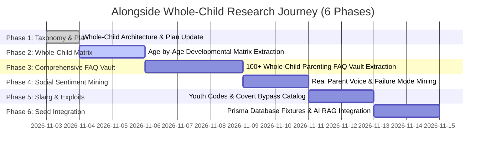

# Alongside — Whole-Child Development & Modern Parenting Research Journey Plan
**Document Version:** 2.0.0  
**Author:** Research Engineer  
**Status:** Canonical Whole-Child Research Plan  
**Target Audience:** CTO, Product Team, AI Advisor Prompt Engineers, Academy Curriculum Creators  
**Related Paperclip Issue:** SOU-14  

---

## 1. Executive Summary & Research Mandate

### 1.1 The Whole-Child Philosophy: Understanding the Child Before the Device
Alongside is not a simplistic screen-time tracker, spyware utility, or hardware restriction app. It is a **comprehensive parent intelligence platform and family operating system**. 

A core failure of existing parenting apps is that they treat children strictly as "device consumers" or "potential rule-breakers," reducing complex adolescent behavior to hours on an iPad or blocked app categories. In reality, **technology and devices are merely one modern environmental amplifier in a child's life**. 

To build tools that truly transform family life, Alongside must **understand the whole child first at every age**:
- **How they think:** Their evolving cognitive architecture, theory of mind, abstract reasoning capacity, mental flexibility, and time perception.
- **Their changing comportment & behaviors:** How emotional dysregulation manifests—from early childhood floor-thrashing tantrums to middle school somatic stomach aches, door-slamming, and adolescent silent withdrawal.
- **Their hormones & physical biology:** The silent hormonal awakening of **adrenarche** (adrenal DHEA production at ages 6–8 before visible puberty), the seismic shifts of **gonadarche & puberty** (testosterone, estrogen, Tanner stages, body awkwardness, dysmorphia), and the biological **2-hour circadian melatonin phase delay**.
- **Their environmental transitions & systemic pressures:** The jarring systemic leaps from Kindergarten into structured Elementary desks, the brutal social cliff of Middle School, the academic high-stakes tracking of High School, extracurricular hyper-scheduling, shifting birth-order roles, and the vanishing of unstructured neighborhood play.
- **Their social life & peer dynamics:** The progression from parallel play to exclusive "best friend" dyads, playground hierarchies, the acute neurobiological pain of social exclusion (dACC activation), friendship breakups, cliques, and first romantic intimacies.
- **Where digital media intersects biology:** Only after grounding in the child's biological and emotional reality do we examine how modern platforms (Roblox, group chats, Snapchat, TikTok) exploit these exact developmental vulnerabilities (belonging, status, competence, autonomy).

```
┌──────────────────────────────────────────────────────────────────────────────────────────────────┐
│                               THE WHOLE-CHILD RESEARCH FOUNDATION                                │
├──────────────────────────────────────────────────────────────────────────────────────────────────┤
│                                                                                                  │
│   1. HOW THEY THINK          2. HORMONES & BIOLOGY     3. BEHAVIOR & COMPORTMENT                 │
│   • Theory of mind           • Adrenarche (DHEA, 6–8)  • Dysregulation vs Defiance               │
│   • Concrete vs abstract     • Gonadarche & Puberty    • Tantrums, somatic pain, withdrawal      │
│   • Metacognition & time     • +2h Circadian delay     • Lying (fantasy vs privacy defense)      │
│                                                                                                  │
│   4. ENVIRONMENTAL SHIFTS    5. SOCIAL LIFE & PEERS    6. MODERN DIGITAL INTERSECTION            │
│   • School transitions       • Friendship evolution    • Devices as status & connection arena    │
│   • Academic & sports load   • dACC social pain        • Group chats as lunchroom 24/7           │
│   • Vanishing free play      • Cliques & first romance • Nighttime screens colliding with clock  │
│                                                                                                  │
└──────────────────────────────────────────────────────────────────────────────────────────────────┘
```

---

## 2. The 6 Whole-Child Developmental Cohorts (Ages 5–18+)

Each cohort is analyzed across the 6 foundational dimensions to provide a 360-degree biological, cognitive, emotional, social, and digital profile.

```mermaid
timeline
    title Whole-Child Developmental Journey Across 6 Cohorts
    section Early Foundation (Ages 5-7)
        Cognitive : Pre-Operational to Concrete : Magical Thinking : Literal Truth
        Biological : Rapid Motor Wiring : Immature Inhibitory Control : 10-12h Sleep Need
        Comportment : Floor Tantrums : Physical Lashing : Dopamine Cliff Crashes
        Social & Context : Kindergarten Transition : Parallel to Cooperative Play : Fear of Separation
    section Tier 1 (Ages 8-9)
        Cognitive : Concrete Operational : Rigid Sense of Fairness : Rule Enforcement
        Biological : Adrenarche Spark (DHEA) : Early Sebum/Odor : Physical Coordination Surge
        Comportment : Pre-Pubertal Moodiness : Defensive Lying : Sibling Competition
        Social & Context : Elementary Routines : Best Friend Loyalty : Playground Status Games
    section Tier 2 (Ages 10-11)
        Cognitive : Emerging Abstract Thought : Saliency Network Shift : Perspective-Taking
        Biological : Early Pubertal Awakening : Circadian Shift Begins : Physical Self-Consciousness
        Comportment : Eye-Rolling : Door-Slamming : Somatic Complaints (Stomach Aches)
        Social & Context : Middle School Cliff : Peer Social Reorientation : Terror of Lunchroom Isolation
    section Tier 3 (Ages 12-13)
        Cognitive : Hypocrisy Detection : Egocentric Imaginary Audience : High Reward Valuation
        Biological : Peak Gonadarche : HPG Axis Activation : +2hr Melatonin Sleep Delay
        Comportment : Silent Bedroom Withdrawal : Monosyllabic Grunts : Acute Irritability
        Social & Context : Cliques & Social Sorting : Relational Aggression : First Crushes & Romantic Rumination
    section Tier 4 (Ages 14-15)
        Cognitive : Formal Operations : Complex Moral Questioning : Identity Exploration
        Biological : Secondary Sexual Maturation : Height/Muscle Spurts : Chronic Adolescent Sleep Debt
        Comportment : Autonomy Defense : Risk Experimentation : Resistance to Authoritarian Control
        Social & Context : High School Transition : Academic & Athletic Stakes : Deep Intimate Friendships
    section Tier 5 (Ages 16-18+)
        Cognitive : Prefrontal Myelination : Long-Range Consequence Planning : Metacognitive Maturity
        Biological : Adult Circadian Stabilization : Hormonal Equilibrium : Physical Maturation Peak
        Comportment : Individuation : Pragmatic Cooperation : Emotional Self-Management
        Social & Context : College/Career Launch : Driving & Legal Autonomy : Mentorship Parent Relationship
```



---

### 2.1 Early Foundation Cohort: Ages 5–7 (The Sensory, Concrete & Transition Stage)

#### 1. How They Think (Cognitive Architecture & Mental Models)
- **Piagetian Stage:** Transitioning from Pre-Operational to Early Concrete Operational thought.
- **Magical Thinking & Literalism:** Children mix fantasy with reality. They take metaphors literally ("Wait a second" literally means one tick of a clock).
- **Theory of Mind in Budding State:** They are beginning to realize other people have different thoughts, but default to assuming adults know what they know.
- **Time Perception:** They have no concept of abstract future time ("In 15 minutes" is meaningless; only physical landmarks make sense: "After this sandwich" or "When the timer beeps").
- **Working Memory:** Limited to 1–2 sequential steps. Complex adult directives ("Go upstairs, brush your teeth, pick up your shoes, and get your backpack") cause cognitive overload and defiance.

#### 2. Hormones, Physical Biology & Maturation
- **Nervous System Wiring:** High synaptic density with unmyelinated prefrontal pathways; the ventral striatum (sensory reward) is active, while the prefrontal braking system is barely online.
- **Sleep Architecture:** Biologically programmed for 10–12 hours of sleep. Circadian chronotype is early-bird (melatonin surges early, ~7:30 PM–8:00 PM).
- **Physical Maturation:** Loss of baby teeth, fine-motor coordination developing (shoe-tying, pencil grip). Bladder control consolidating nocturnal dryness.

#### 3. Behavioral Comportment & Emotional Regulation
- **Floor-Thrashing Tantrums & Sensory Meltdowns:** Meltdowns occur when nervous systems are flooded by sensory overstimulation, low blood sugar, exhaustion, or rapid dopamine depletion.
- **Externalized Regulation Need:** The child cannot internally self-regulate; they require a calm adult nervous system to "borrow" regulation through co-regulation.
- **Wishful & Fantasy Lying:** Lying is not malicious deception; it represents wish-fulfillment ("I didn't break the vase, a dragon flew in!") or panic over parental displeasure.
- **Separation & Transition Anxiety:** Clinging to parents during morning drop-offs or bedtime handoffs.

#### 4. Environmental Changes & Systemic Transitions
- **The Kindergarten / 1st Grade Shift:** Moving from play-based nursery to sitting quietly at desks, obeying collective rules, and facing early evaluation.
- **Extracurricular Initiation:** First exposure to structured sports, dance, or martial arts where they are no longer the exclusive center of attention.
- **Sibling Competition:** Extreme vigilance regarding perceived unfairness in snacks, physical space, and parental warmth ("His cup has more juice!").

#### 5. Social Life & Peer Dynamics
- **Parallel to Associative Play:** Transitioning from playing alongside peers to true cooperative games with simple rules (tag, hide-and-seek, building blocks).
- **Proximity Friendships:** Friendships are based entirely on proximity and shared physical toys rather than psychological intimacy.
- **Tattle-Telling:** Acts as a vital psychological check to confirm that classroom rules are safe, predictable, and universally applied.

#### 6. Modern Digital Intersection (Where Tech Meets Biology)
- Family shared iPads, smart TVs, YouTube Kids, early Minecraft Creative Mode.
- **The "Screen Crash":** Severe screaming fit when devices are powered off, caused by the violent drop in dopamine from hyper-stimulating rapid-cut videos.

#### 7. Core Parental Dilemmas & Clinical Guidance
- *"How do I stop morning leaving-the-house screaming matches?"*
- *"Why does my child hit or kick when told 'no'?"*
- **Clinical Scripting Anchor:** Connection before direction. Get on eye level, use physical touch, validate the feeling first, and give 1 concrete physical choice.

---

### 2.2 Tier 1: Ages 8–9 (Early Curiosity, Adrenarche Spark & Rule Rigidity)

#### 1. How They Think (Cognitive Architecture & Mental Models)
- **Concrete Operational Mastery:** Understands conservation of volume, hierarchical classification, and reversibility.
- **Rigid Moral Black-and-White Thinking (Kohlberg Stage 1–2):** Rules are absolute, unalterable laws. Fairness is defined as exact mathematical equality.
- **Emerging Metacognition:** Beginning to think about what they are good at versus what others are good at.
- **Executive Function Expansion:** Can follow 3-step tasks, but easily defeated by tasks requiring sustained frustration tolerance.

#### 2. Hormones, Physical Biology & Maturation
- **The Biological Spark of Adrenarche:** The adrenal cortex begins producing DHEA (dehydroepiandrosterone) and androgens around ages 6–8/9. This is the **silent hormonal awakening** before visible puberty:
  - First onset of adult-like apocrine sweat glands and underarm body odor.
  - Increased sebum production leading to greasy hair and early micro-comedones on the nose.
  - Rapid, unpredictable emotional volatility (unprovoked weepiness, irritability).
- **Physical Growth:** Growth spurts in long bones; temporary physical awkwardness as the brain recalibrates spatial proprioception.

#### 3. Behavioral Comportment & Emotional Regulation
- **Pre-Pubertal Moodiness & Door Slamming:** Sudden flashes of defensive anger or despair that catch parents off guard.
- **Defensive Lying:** Lying evolves into a calculated defense mechanism to protect self-esteem and avoid punishment ("I already finished all my reading homework").
- **Frustration Meltdowns & Perfectionism:** Tearing up drawing pages when lines aren't straight; throwing board games or controllers upon losing.
- **Sibling Territoriality:** Bitter disputes over physical bedroom boundaries, personal possessions, and fairness.

#### 4. Environmental Changes & Systemic Transitions
- **The 3rd/4th Grade Academic Escalation:** The academic transition from "learning to read" to "reading to learn." Introduction of letter grades, timed math tests, and standardized assessments.
- **Recess Reduction:** Curtailment of unstructured playground time collides with the biological need for motor discharge.
- **Hyper-Scheduled Afternoons:** Structured sports leagues, music lessons, and tutoring displacing unstructured neighborhood exploration.

#### 5. Social Life & Peer Dynamics
- **The Rise of "Best Friends" & Secret Clubs:** Intense formation of exclusive best-friend dyads; playground clubs with elaborate rules, secret handshakes, and exclusionary boundaries.
- **Gender Segregation:** Sharp playground tribalism between boys' and girls' social circles.
- **Playground Status Awareness:** Heightened awareness of physical capital: athletic prowess, fashionable sneakers, or having desirable trading cards.

#### 6. Modern Digital Intersection (Where Tech Meets Biology)
- Roblox, Minecraft Multiplayer, Nintendo Switch, early cellular smartwatches (Gabb, Gizmo, Apple Watch Family Setup).
- Playground status mapped to virtual tokens (Robux, V-Bucks, avatar skins).
- Sneaking devices at 5:30 AM on weekends to play before parents wake up.

#### 7. Core Parental Dilemmas & Clinical Guidance
- *"Why has my sweet 8-year-old suddenly become so irritable and argumentative?"*
- *"How do I handle relentless begging for Robux without feeling like the bad guy?"*
- **Clinical Scripting Anchor:** De-escalate rule battles. Acknowledge adrenarche physical changes (deodorant, hygiene). Maintain warm, firm boundaries.

---

### 2.3 Tier 2: Ages 10–11 (Tween Awakening, Social Reorientation & The Middle School Cliff)

#### 1. How They Think (Cognitive Architecture & Mental Models)
- **Early Formal Operations:** Grasping hypothetical possibilities, abstract symbolism, irony, and sarcasm.
- **The "Imaginary Audience":** Egocentrism peaks in a social form—the tween genuinely believes that an imaginary spotlight follows them everywhere, and that peers notice and judge every flaw, outfit choice, and speech pattern.
- **Saliency Network Shift:** The brain’s reward system fundamentally decouples from parental praise and locks onto **peer status, inclusion, and social hierarchy**.

#### 2. Hormones, Physical Biology & Maturation
- **Onset of Gonadarche (Early Pubertal HPG Axis Activation):**
  - Girls: Hypothalamic-Pituitary-Gonadal axis triggers pulsatile GnRH release; thelarche (breast budding), rapid pelvic widening, peak height velocity spurt.
  - Boys: Testicular volume enlargement (>4mL), scrotal pigmentation, early growth spurts.
  - Accelerated body odor, apocrine gland activation, oily skin, comedonal acne.
- **Physical Self-Consciousness:** Intense bodily embarrassment; hiding under oversized hoodies even in summer, refusing to shower or undress in communal school locker rooms.
- **Circadian Clock Shift Begins:** Pubertal melatonin secretion naturally delays by 30–60 minutes, pushing natural sleepiness past 9:30 PM.

#### 3. Behavioral Comportment & Emotional Regulation
- **Somatic Stress Manifestations:** Sunday evening stomach aches, morning nausea, mystery headaches before school—the somatic nervous system expressing severe unspoken social anxiety.
- **The Monosyllabic Wall & Eye-Roll:** Queries like *"How was your day?"* are met with *"Fine,"* *"Whatever,"* or silence. Parents experience this as cold rejection; biologically, it is healthy individuation.
- **Fierce Demands for Physical Privacy:** Closed and locked bedroom doors, furious anger if a parent enters without knocking, tilting screens away instantly.

#### 4. Environmental Changes & Systemic Transitions
- **The Middle School Cliff (Grade 5/6 Transition):** One of the most violent systemic disruptions of childhood:
  - Moving from 1 nurturing elementary classroom teacher to 6–7 departmentalized teachers who judge solely on academic deliverables.
  - Crowded hallways, changing classes in 3-minute bells, locker combinations.
  - Mixing with children from multiple elementary schools, annihilating established playground safety and hierarchy.

#### 5. Social Life & Peer Dynamics
- **The Neurobiology of Social Exclusion (dACC Activation):** fMRI studies demonstrate that peer exclusion activates the **dorsal anterior cingulate cortex (dACC)**—the exact neural pain matrix that registers physical burning or tissue injury. To an 11-year-old, social rejection *is* physical pain.
- **The Lunchroom Table Existential Crisis:** Panic over where to sit and fear of being visibly isolated in front of peers.
- **Relational Aggression & Friendship Churn:** Elementary best friends drift away; covert bullying through whispering, exclusion, and group chat shunning.

#### 6. Modern Digital Intersection (Where Tech Meets Biology)
- First smartphone pressure; massive class iMessage / WhatsApp group chats.
- YouTube Shorts, Duolingo streaks, Discord servers for gaming.
- Group chat toxicity: 400 messages per evening; exclusion memes, screenshots leaked to embarrass.

#### 7. Core Parental Dilemmas & Clinical Guidance
- *"My child used to tell me everything. Now they shut their door and hate when I ask questions."*
- *"They have a stomach ache every single Sunday night before school. What is happening?"*
- **Clinical Scripting Anchor:** Become a "consultant" rather than a manager. Validate social pain without minimizing.

---

### 2.4 Tier 3: Ages 12–13 (Pubertal Surge, Amygdala Reactivity & Circadian Delay)

#### 1. How They Think (Cognitive Architecture & Mental Models)
- **Amygdala Dominance over Prefrontal Control:** The limbic system and emotional amygdala are operating at full adult capacity, while the prefrontal cortex (executive impulse braking) is still undergoing heavy synaptic pruning. High emotional reactivity, low impulse control.
- **Hypocrisy Radar:** Hyper-acute sensitivity to adult double standards ("You tell me to put my phone away, but you're checking work emails right now").
- **Reward-Biased Sensation Saliency:** The teenage brain weighs immediate social rewards (peer applause, likes, laughs) roughly 3x more heavily than long-term risks (punishment, danger, embarrassment).

#### 2. Hormones, Physical Biology & Maturation
- **Peak Pubertal Gonadarche:**
  - Girls: Menarche (onset of menstruation), dysmenorrhea (painful cramps), fluid retention, intense cyclical mood shifts.
  - Boys: Massive surge in testosterone (up to 30-fold increase); voice cracking, spontaneous erections, nocturnal emissions (spermarche), physical restlessness.
- **The 2-Hour Biological Circadian Phase Delay:**
  - Clinical sleep studies (Dr. Mary Carskadon, Brown University) prove that adolescent melatonin secretion delays by approximately **2 full hours**. Melatonin does not release until 10:30 PM–11:15 PM.
  - Asking a 13-year-old to sleep at 9:00 PM is the biological equivalent of asking an adult to sleep at 6:30 PM.
  - Early middle/high school start times (7:30 AM) enforce **chronic adolescent REM sleep debt**, driving morning depressive symptoms, anxiety, and cognitive fog.

#### 3. Behavioral Comportment & Emotional Regulation
- **The Bedroom Cave Retreat:** Retreating to bedrooms for hours with headphones on; complete withdrawal from family common areas.
- **The "Crashout" Phenomenon:** Small frustrations (a misplaced hoodie, an interruption) trigger dramatic explosions of shouting, weeping, or slamming items.
- **Lying for Autonomy:** Lying becomes a conscious strategic tool to preserve personal boundaries and prevent parental intrusion.
- **Body Dysmorphia & Acne Insecurity:** Fixation on facial blemishes, body hair, weight, and muscle tone; avoidance of family photographs.

#### 4. Environmental Changes & Systemic Transitions
- **Middle-to-High School Runway:** Increasing pressure regarding academic tracks (honors, advanced placement), sports tryouts, and arts auditions.
- **Evaporation of Adult Surveillance:** Parents can no longer observe their child's social interactions; the adolescent social realm moves entirely underground.
- **First Exposure to Vaping & Substances:** Encountering drugs, alcohol, and nicotine in school bathrooms and weekend gatherings.

#### 5. Social Life & Peer Dynamics
- **Cliques, Tribes & Subcultural Signaling:** Deep identification with specific subcultures; clothing, music, and slang become vital identity markers.
- **First Romantic Crushes & Yearning:** Intense emotional infatuation; analyzing message syntax, typing bubbles, and response latency.
- **Co-Rumination & Emotional Contagion:** Spending hours texting peers about emotional pain, inadvertently amplifying anxiety across the friend group.

#### 6. Modern Digital Intersection (Where Tech Meets Biology)
- Snapchat (Snap streaks, Snap Map ghost mode), TikTok FYP algorithm, Discord voice channels, anonymous feedback apps (Sendit, NGL).
- Covert bypass vectors: Calculator vault apps, incognito browsing, proxy servers, midnight phone smuggling to cope with biological sleeplessness.

#### 7. Core Parental Dilemmas & Clinical Guidance
- *"Why does my 13-year-old treat me like the enemy when I only ask how their day went?"*
- *"How do I handle the biological reality that they can't fall asleep until 11:00 PM without letting them scroll all night?"*
- **Clinical Scripting Anchor:** Offer a "neutral third party" boundary. Never engage when their amygdala is flooded; wait for a 20-minute biological cooldown.

---

### 2.5 Tier 4: Ages 14–15 (Adolescent Autonomy, High School Identity & Peer Hierarchy)

#### 1. How They Think (Cognitive Architecture & Mental Models)
- **Advanced Formal Operational Thought (Piaget):** Capable of abstract moral reasoning, counterfactual thinking, and systemic analysis.
- **Identity Exploration (Erikson: Identity vs. Role Confusion):** Actively testing personal identities, political views, and cultural expressions.
- **Metacognitive Questioning & Existential Anxiety:** Intense reflection on self-worth, future trajectory, and belonging.

#### 2. Hormones, Physical Biology & Maturation
- **Secondary Sexual Maturation:** Adult physical stature and voice; increased physical strength; rapid bone density development.
- **Metabolic Surges:** Massive caloric requirements; insatiable appetite following school and sports.
- **Severe Cumulative Sleep Deficit:** The combination of pubertal circadian delay, 2–3 hours of nightly homework, and 7:15 AM bus schedules produces dangerous chronic sleep deprivation.

#### 3. Behavioral Comportment & Emotional Regulation
- **Autonomy Defense as a Moral Mandate:** Teens view parental searches of their backpacks, rooms, or messages as serious violations of human rights.
- **Sensation Seeking & Risk Experimentation:** Reward circuits seek novel, intense experiences (vaping, sneaking out, speeding) to stimulate ventral striatal dopamine.
- **Emotional Compartmentalization:** Concealing acute distress, romantic heartbreak, or academic panic from parents while appearing indifferent.

#### 4. Environmental Changes & Systemic Transitions
- **High School Freshman/Sophomore Shock:**
  - High school transcripts and GPA permanently impact future college or trade opportunities.
  - Massive student bodies (1,500–3,000 students); feeling anonymous or alienated.
  - Intense competition for varsity athletic spots, leadership roles, and honors courses.

#### 5. Social Life & Peer Dynamics
- **Deep Intimate Confidants:** Friendships based on shared psychological vulnerability, mutual defense, and private secrets.
- **Dating, Hookups & First Heartbreak:** Navigating romantic interest, consent, awkwardness, and the intense grief of first relationship breakups.
- **Social Stratification & Cancellation:** The threat of being ostracized through leaked screenshots, rumors, or social media callouts.

#### 6. Modern Digital Intersection (Where Tech Meets Biology)
- Instagram Reels, TikTok, BeReal, Life360 location tracking battles, club Discord servers.
- High vulnerability to online exploitation: financial sextortion schemes targeting teenage boys on Instagram/Snapchat.

#### 7. Core Parental Dilemmas & Clinical Guidance
- *"They want to go out with friends I don't know well. How do I balance safety with letting them grow up?"*
- *"How do I talk about alcohol, vaping, and parties without giving permission or preaching?"*
- **Clinical Scripting Anchor:** The "No-Questions-Asked Rescue Code" (e.g., text the letter "X" for an immediate pickup with zero interrogation that night). Restorative pacts over punitive grounding.

---

### 2.6 Tier 5: Ages 16–18+ (Executive Consolidation, Emerging Adulthood & Digital Sovereignty)

#### 1. How They Think (Cognitive Architecture & Mental Models)
- **Prefrontal Cortex Myelination Accelerates:** The rational brain's white matter tracts finalize connections with the emotional limbic system. Long-term consequence calculation stabilizes.
- **Post-Conventional Moral Reasoning (Kohlberg):** Ethics based on internalized principles of justice, human dignity, and personal responsibility.
- **Pragmatic Perspective-Taking:** Beginning to understand parents as flawed, complex human beings with their own anxieties and financial burdens.

#### 2. Hormones, Physical Biology & Maturation
- **Endocrine Stabilization:** Sex hormones reach adult baseline plateaus.
- **Physical Maturation Finalized:** Growth plates fuse, wisdom teeth emerge, adult metabolic equilibrium.
- **Circadian Rhythms Begin Normalizing:** Melatonin onset begins shifting earlier toward the adult window (~10:00 PM–10:30 PM).

#### 3. Behavioral Comportment & Emotional Regulation
- **Individuation & Pre-Launch Friction:** Subconscious emotional distancing to prepare for leaving home (often picking arguments to make physical departure less painful).
- **Pragmatic Cooperation:** High willingness to negotiate family agreements when treated as an adult partner.
- **Existential Future Paralysis:** Overwhelmed by college applications, career choices, financial independence, and adult expectations.

#### 4. Environmental Changes & Systemic Transitions
- **Driving & Physical Sovereignty:** Earning a driver's license transforms physical independence; unsupervised mobility in the adult world.
- **Employment & Financial Logistics:** Handling jobs, paychecks, bank accounts, taxes, and independent expenses.
- **The Launch Runway:** Senior year milestones: standardized tests, prom, graduation, moving out, starting college, trade school, or employment.

#### 5. Social Life & Peer Dynamics
- **Long-Term Romantic Relationships:** Serious intimate partnerships, navigating emotional vulnerability, physical intimacy, and communication.
- **Pruning the Peer Network:** Shifting from large, noisy peer groups to an intimate circle of 2–3 deeply trusted lifelong friends.
- **Peer Divergence:** Watching childhood friends embark on radically different life paths.

#### 6. Modern Digital Intersection (Where Tech Meets Biology)
- LinkedIn, driving GPS navigation, digital banking (Apple Pay, Venmo), university student portals.
- Awareness of digital footprint and employer background checks.
- Full graduation from parental monitoring to self-governed digital sovereignty.

#### 7. Core Parental Dilemmas & Clinical Guidance
- *"How do I let go and trust them when they drive off alone at night?"*
- *"How do we transition from family rules to an adult roommate dynamic?"*
- **Clinical Scripting Anchor:** Complete transition from supervisor to trusted mentor. Express pride in their judgment and leave the door open for advice without unsolicited critique.

---

## 3. Comprehensive Source Taxonomy & Research Methodology

To guarantee that Alongside's intelligence reflects both the gold standard of clinical science and the raw, unvarnished realities of modern parenting, the research journey mines four rigorous source tiers:

```
┌──────────────────────────────────────────────────────────────────────────────────────────────────┐
│                                   WHOLE-CHILD SOURCE TAXONOMY                                    │
├──────────────────────────────────────────────────────────────────────────────────────────────────┤
│                                                                                                  │
│   TIER A: CLINICAL & DEVELOPMENTAL SCIENCE   TIER B: SOCIOLOGICAL & ADOLESCENT HEALTH            │
│   • American Academy of Pediatrics (AAP)     • Jonathan Haidt (The Anxious Generation)           │
│   • American Psychological Association (APA) • Lisa Damour (Untangled, Emotional Lives)          │
│   • NIH Adolescent Brain Study (ABCD)        • Daniel Siegel (Brainstorm, The Whole-Brain Child) │
│   • Jean Piaget, Lev Vygotsky, Erik Erikson  • Becky Kennedy (Good Inside)                       │
│   • Mary Carskadon (Pubertal Sleep Biology)  • Adele Faber & Elaine Mazlish (How to Talk)        │
│                                                                                                  │
│   TIER C: REAL PARENT SOCIAL MINING          TIER D: YOUTH CULTURE & DIGITAL MECHANICS           │
│   • r/Parenting (5.8M parents)               • Urban Dictionary & Know Your Meme                 │
│   • r/daddit (1M+ active fathers)            • Roblox & Gaming Economies                         │
│   • r/ParentingTeens & r/teenagers           • Hardware bypass communities                       │
│   • Substack (Techno Sapiens, ParentData)    • Anonymous apps (Sendit, NGL, Discord)             │
│                                                                                                  │
└──────────────────────────────────────────────────────────────────────────────────────────────────┘
```

---

## 4. Multi-Phase Research Execution Roadmap



---

## 5. Downstream Product Engineering Integration

The whole-child intelligence produced under this plan feeds directly into AlongSide's core application pillars:
1. **The Parent Intelligence Academy (`PLAN-08` & `PLAN-09`):** Powers age-specific courses covering neurobiology, adrenarche, school transition anxiety, and de-escalation communication.
2. **24/7 AI Child Advisor & Voice Sparring (`PLAN-10` & `PLAN-11`):** Powers the RAG vector database with 100+ clinical scenario scripts, allowing parents to practice tough conversations (puberty talks, school refusal, meltdowns) before facing their child.
3. **Interactive Quizzes (`PLAN-12`):** Powers diagnostic rubrics for First-Phone Readiness, Parenting Styles, and Tween Cultural Fluency.
4. **Bilateral Family Pacts (`PLAN-06`):** Ground contract clauses in real child capacities, establishing developmental step-ladders and bedtime curfews aligned with biological circadian rhythms.
