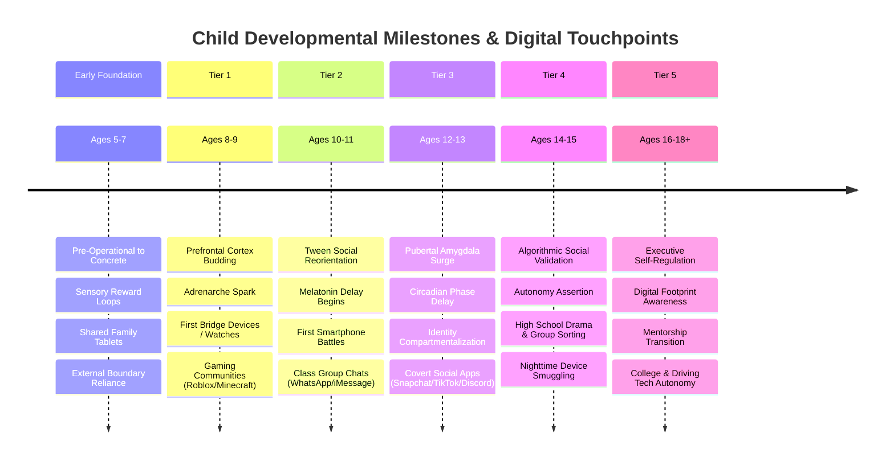

# Alongside — Age-by-Age Child Development & Modern Parenting Research Journey Plan
**Document Version:** 1.0.0  
**Author:** Research Engineer  
**Status:** Approved Research Plan  
**Target Audience:** CTO, Product Team, AI Advisor Engineers, Academy Content Creators  
**Related Paperclip Issue:** SOU-14  

---

## 1. Executive Summary & Research Mandate

### 1.1 The Strategic Purpose
Alongside is not a simplistic device blocker or surveillance spyware platform. It is a **comprehensive parent intelligence platform and family operating system**. The platform's efficacy hinges upon an authoritative, evidence-based, and emotionally resonant understanding of children's developmental psychology, neurobiology, and lived digital experiences across every age from childhood through late adolescence (Ages 5–18+).

This document establishes the **Canonical Research Journey Plan**: an exhaustive, multi-phase investigation roadmap designed to systematically mine academic literature, pediatric guidelines, real-world parent communities (Reddit, X, parent blogs), and youth digital culture. 

The resulting intelligence will power:
1. **The Parent Intelligence Academy (Pillar 1):** Age-specific neurobiology modules, emotional language decoders, and empathy-first communication frameworks.
2. **Interactive Quizzes & Assessments (Pillar 2):** Cultural fluency quizzes (*"Do You Speak Tween?"*), parenting style profilers, and first-phone readiness diagnostics.
3. **24/7 AI Child Advisor & Modern Parenting FAQ Vault (Pillar 3):** 100+ clinical and pediatric-grounded scenario scripts, RAG vector embeddings, and real-time voice sparring simulations.
4. **Weekly Youth Culture & Exploit Digest (Pillar 4):** Real-time slang definitions, hidden bypass alerts (calculator vaults, proxy browsers), and Sunday dinner conversation prompts.
5. **Bilateral Family Pacts (Pillar 5):** Developmentally calibrated contract clauses, earned autonomy step-ladders, and bedtime hardware curfews.

```
┌──────────────────────────────────────────────────────────────────────────────────────────────────┐
│                                 THE RESEARCH-TO-PRODUCT PIPELINE                                 │
├──────────────────────────────────────────────────────────────────────────────────────────────────┤
│                                                                                                  │
│   PRIMARY RESEARCH SOURCES                SYNTHESIS & EXTRACTION             ALONGSIDE PLATFORM  │
│                                                                                                  │
│   ┌──────────────────────────┐          ┌───────────────────────────┐      ┌──────────────────┐  │
│   │ Academic Neurobiology    │          │ Age-by-Age Neuro Profiles │      │ Academy Modules  │  │
│   │ (NIH ABCD, fMRI studies) │          │ • Dopamine & Impulses     │─────▶│ (Pillar 1)       │  │
│   │ AAP / APA Guidelines     │          │ • Melatonin & Circadian   │      └──────────────────┘  │
│   └────────────┬─────────────┘          └─────────────┬─────────────┘                            │
│                │                                      │                                          │
│   ┌────────────▼─────────────┐          ┌─────────────▼─────────────┐      ┌──────────────────┐  │
│   │ Real Parent Voices       │          │ 100+ FAQ Vault & Scripts  │      │ 24/7 AI Advisor  │  │
│   │ (r/Parenting, r/daddit,  │─────────▶│ • Word-for-Word Scripts   │─────▶│ & Voice Sparring │  │
│   │ X, Substack confessionals│          │ • De-escalation Cooldowns │      │ (Pillar 3)       │  │
│   └────────────┬─────────────┘          └─────────────┬─────────────┘      └──────────────────┘  │
│                │                                      │                                          │
│   ┌────────────▼─────────────┐          ┌─────────────▼─────────────┐      ┌──────────────────┐  │
│   │ Youth Culture & Platforms│          │ Slang, Memes & Exploits   │      │ Sunday Digest &  │  │
│   │ (Roblox, TikTok, Discord,│─────────▶│ • Secret Vault Bypass     │─────▶│ Fluency Quizzes  │  │
│   │ Sendit, TikTok trends)   │          │ • Algorithmic Dark Loops  │      │ (Pillars 2 & 4)  │  │
│   └──────────────────────────┘          └───────────────────────────┘      └──────────────────┘  │
│                                                                                                  │
└──────────────────────────────────────────────────────────────────────────────────────────────────┘
```

---

## 2. Age-Tier Developmental Matrix (Ages 5–18+)

The research journey investigates 6 discrete developmental cohorts. Each cohort represents a distinct neurobiological, social, emotional, and digital milestone.



### 2.1 Early Foundation Cohort: Ages 5–7 (The Sensory Reward & Boundary Genesis Stage)
- **Cognitive & Neurobiological Profile:**
  - Concrete thinking; minimal impulse inhibition (ventral striatum outpaces prefrontal regulation).
  - Rapid sensory habituation; high vulnerability to variable-ratio visual reinforcement (YouTube Kids auto-play, colorful hyper-stimulation).
- **Behavioral Manifestations & Emotional Language:**
  - Severe transition meltdowns when screens are powered off ("screen crash").
  - Externalized emotional regulation: children cannot self-soothe when dopamine drops rapidly; requires physical proximity and structured routines.
- **Digital Touchpoints & Platform Culture:**
  - Shared family iPads, smart TVs, PBS Kids, early Minecraft Creative Mode, YouTube Kids.
- **Core Parental Dilemmas & Acute Questions:**
  - *"How do I stop the 45-minute screaming fit when the iPad turns off?"*
  - *"Is YouTube Kids actually safe, or is it algorithmic brain rot?"*
  - *"Should I give my 6-year-old a tablet on long car rides, or is it ruining their attention span?"*
- **Primary Research Focus:**
  - Pediatric screen time thresholds (AAP Council on Communications and Media).
  - Transition bridge rituals (visual countdown timers, auditory chimes, replacement dopamine activities).

---

### 2.2 Tier 1: Ages 8–9 (Early Curiosity, Executive Function & The Gaming Gateway)
- **Cognitive & Neurobiological Profile:**
  - Beginning of adrenarche (early adrenal androgen secretion); emergence of peer comparison.
  - Prefrontal cortex begins basic rule abstraction, but cognitive fatigue sets in quickly during prolonged screen sessions.
  - Hyper-sensitivity to virtual achievement, status symbols, and digital badges.
- **Behavioral Manifestations & Emotional Language:**
  - *"Everyone at school has Roblox Robux except me!"* (Translation: *"I feel excluded from playground social currency."*)
  - Sneaking device usage under blankets or early in the morning before parents awake.
- **Digital Touchpoints & Platform Culture:**
  - Roblox, Minecraft Multiplayer, Nintendo Switch, early smartwatches (Gabb, Gizmo, Apple Watch Family Setup).
  - Microtransactions, digital currencies (Robux, V-Bucks), early online friend requests.
- **Core Parental Dilemmas & Acute Questions:**
  - *"How do I explain that Robux isn't real money without making them feel poor?"*
  - *"Are strangers on Roblox actually dangerous, and how do predators operate in kid games?"*
  - *"Is a smartwatch a safe bridge device before a phone?"*
- **Primary Research Focus:**
  - In-game predatory monetization patterns and dark UX loops targeting under-10s.
  - Hardware specifications and parental control boundaries for GPS/cellular smartwatches.

---

### 2.3 Tier 2: Ages 10–11 (Tween Awakening, Adrenarche & The Peer Social Shift)
- **Cognitive & Neurobiological Profile:**
  - Full onset of adrenarche; profound neurological reorientation toward peer status. The brain values peer social approval higher than adult praise.
  - Saliency network reorganization: social rejection triggers physiological pain pathways (anterior insula and dorsal anterior cingulate cortex).
- **Behavioral Manifestations & Emotional Language:**
  - Sudden secrecy around screens: tilting phones away, quickly minimizing tabs.
  - *"You don't trust me!"* (Translation: *"I feel infantilized compared to my peers and terrified of social incompetence."*)
  - Irritability, eye-rolling, defensiveness following digital interaction.
- **Digital Touchpoints & Platform Culture:**
  - First personal smartphone pressure (transition to middle school); WhatsApp / iMessage school group chats.
  - YouTube Shorts, Duolingo streaks, Discord servers for gaming, early FaceTime marathons.
- **Core Parental Dilemmas & Acute Questions:**
  - *"All the 5th graders are in a class group chat that is getting toxic. Do I take their phone away or leave them in?"*
  - *"Why is my child suddenly distant and treating me like an annoyance?"*
  - *"How do I evaluate if my 10-year-old is mature enough for their first smartphone?"*
- **Primary Research Focus:**
  - First-Phone Readiness diagnostic rubrics (executive function, emotional regulation, boundary compliance).
  - Group chat dynamics: ghosting, exclusion drama, passive-aggressive meme bullying.

---

### 2.4 Tier 3: Ages 12–13 (Pubertal Shift, Circadian Delay & Identity Compartmentalization)
- **Cognitive & Neurobiological Profile:**
  - Peak pubertal surge (gonadarche); amygdala reactivity reaches lifetime high while prefrontal connectivity is still unpruned.
  - **Biological Circadian Delay:** Pubertal melatonin secretion shifts by 2+ hours forward. Melatonin does not release until 10:30 PM–11:00 PM, creating genuine biological wakefulness late at night that collides with early school bells.
- **Behavioral Manifestations & Emotional Language:**
  - Compartmentalized digital lives: "Finstas" (fake Instagram accounts), alt TikTok profiles, hidden apps.
  - Acute FOMO (Fear Of Missing Out): anxiety spikes if away from their phone for >30 minutes during evening chat peak (7:00 PM–10:00 PM).
  - Slang-heavy communication (*crashout, cooked, looksmaxing, rizz*) used as cultural shibboleths to exclude adults.
- **Digital Touchpoints & Platform Culture:**
  - Snapchat (Snap streaks, Snap Map ghost mode), TikTok FYP algorithm, Discord voice channels, anonymous Q&A apps (Sendit, NGL).
  - Bypass apps: "Calculator Vaults", hidden photo vaults, VPN proxies, Google Translate stealth browsers.
- **Core Parental Dilemmas & Acute Questions:**
  - *"I found a calculator app that asked for a passcode—what do I do?"*
  - *"How do I stop them from sneaking the phone into their bedroom at 1:00 AM?"*
  - *"My 13-year-old was sent an inappropriate photo in a group chat. How do I respond without destroying their trust?"*
- **Primary Research Focus:**
  - Sleep neurobiology and screen-light melatonin suppression during puberty.
  - Neutral hardware-level curfew enforcement vs parental policing.
  - Secret bypass mechanisms and app camouflage techniques.

---

### 2.5 Tier 4: Ages 14–15 (Early High School, Algorithmic Echo Chambers & Autonomy Wars)
- **Cognitive & Neurobiological Profile:**
  - Maturing formal operational thought; heightened capacity for abstract moral reasoning and hypocrisy detection.
  - Dopaminergic reward sensitivity remains high; vulnerability to algorithmic rabbit holes (gym/looksmaxing culture, doomscrolling, anxiety-amplifying content).
- **Behavioral Manifestations & Emotional Language:**
  - Intense resistance to authoritarian control: treats parental restrictions as human rights violations.
  - High risk of digital burnout and chronic sleep debt leading to morning depressive inertia.
  - Reluctance to confess online mistakes (predatory blackmail, sextortion) due to terror of phone confiscation.
- **Digital Touchpoints & Platform Culture:**
  - Instagram Reels, TikTok, BeReal, Life360 location tracking battles, high school sports/club Discord servers, online dating curiosity.
- **Core Parental Dilemmas & Acute Questions:**
  - *"If I confiscate their phone, they won't be able to communicate with sports teams or school project groups. How do I discipline them?"*
  - *"How do I protect my teen from financial sextortion or aggressive online predators without spying on their DMs?"*
  - *"How do we renegotiate the family rules now that they are in high school?"*
- **Primary Research Focus:**
  - Sextortion prevention protocols (NCMEC / Thorn guidelines).
  - Restorative digital agreements: transition from parental supervision to transparent mentorship.

---

### 2.6 Tier 5: Ages 16–18+ (Late Adolescence, Digital Footprint & Launch Preparation)
- **Cognitive & Neurobiological Profile:**
  - Prefrontal cortex myelination accelerates; long-term consequence evaluation stabilizes.
  - Internalization of personal values and digital self-regulation skills.
- **Behavioral Manifestations & Emotional Language:**
  - Emerging awareness of digital footprint, college admissions scrutiny, and employment ramifications.
  - Shift toward collaborative adult peer dialogue with parents when treated with respect.
- **Digital Touchpoints & Platform Culture:**
  - LinkedIn, college portal apps, driving GPS, digital wallets (Apple Pay), independent financial apps (Venmo, Cash App).
- **Core Parental Dilemmas & Acute Questions:**
  - *"How do I prepare them to manage their own digital habits when they go to college?"*
  - *"Should I still have location tracking on my 17-year-old who drives?"*
  - *"How do we transition from family parental controls to full adult device autonomy?"*
- **Primary Research Focus:**
  - Graduated digital sovereignty step-ladders.
  - Family digital handoff charters and lifelong tech hygiene.

---

## 3. Comprehensive Source Taxonomy & Research Repositories

To ensure the highest scientific veracity combined with raw, unvarnished parent realities, the research plan establishes four authoritative source tiers:

```
┌──────────────────────────────────────────────────────────────────────────────────────────────────┐
│                                    AUTHORITATIVE SOURCE MATRIX                                   │
├──────────────────────────────────────────────────────────────────────────────────────────────────┤
│                                                                                                  │
│   TIER A: CLINICAL & ACADEMIC          TIER B: SOCIOLOGICAL & PEDAGOGIC                          │
│   • AAP Center of Excellence on Youth  • Pew Research Center (Teens & Tech)                      │
│     Mental Health                      • Jonathan Haidt (The Anxious Generation)                 │
│   • APA Health Advisory on Youth Tech  • Jean Twenge (iGen, Generations)                         │
│   • NIH Adolescent Brain (ABCD Study)  • Lisa Damour (Untangled, The Emotional Lives)            │
│   • CDC Youth Risk Surveillance (YRBSS)• Dan Siegel (Brainstorm: Power of Teen Brain)            │
│   • Harvard Center on the Developing   • Becky Kennedy (Good Inside)                             │
│     Child                              • Adele Faber & Elaine Mazlish                            │
│                                                                                                  │
│   TIER C: REAL PARENT SOCIAL MINING    TIER D: YOUTH PLATFORMS & EXPLOITS                        │
│   • Reddit Communities:                • Urban Dictionary & Know Your Meme                       │
│     - r/Parenting (5.8M parents)       • TikTok Creative Center & Algorithmic Trends             │
│     - r/daddit (1M+ dads)              • Roblox Developer Forum & Economy Specs                  │
│     - r/Mommit (800k+ moms)            • App Store Hidden Vault & Bypass Trackers                │
│     - r/ParentingTeens                 • Anonymous App Ecosystems (Sendit, NGL)                  │
│   • X (Twitter) Parent Sentiment       • Screen Time Workaround Communities                      │
│   • Substack Thought Leaders           • Apple Developer Family Controls Specifications          │
│     (Techno Sapiens, ParentData)                                                                 │
│                                                                                                  │
└──────────────────────────────────────────────────────────────────────────────────────────────────┘
```

### 3.1 Tier A: Clinical, Neurobiological & Academic Primary Sources
1. **American Academy of Pediatrics (AAP):**
   - *Center of Excellence on Social Media and Youth Mental Health:* Policy statements on digital media limits, family media plans, and pediatric depression screenings.
   - *AAP Digital Media Guidelines for Children and Adolescents (2016–2024 updates).*
2. **American Psychological Association (APA):**
   - *APA Health Advisory on Social Media Use in Adolescence (May 2023 / 2024):* 10 clinical recommendations for adolescent social platform engagement and parental role boundaries.
3. **National Institutes of Health (NIH) — ABCD Study (Adolescent Brain Cognitive Development):**
   - The largest long-term longitudinal neuroimaging study of brain development and child health in the US (11,880 children tracked from age 9 to adulthood).
   - Structural and functional MRI data on screen time vs prefrontal cortical thinning and dopamine receptor density.
4. **Centers for Disease Control and Prevention (CDC):**
   - *Youth Risk Behavior Surveillance System (YRBSS):* Longitudinal trends in adolescent mental health, sleep deprivation, and digital persistent sadness.
5. **Harvard University:**
   - *Center on the Developing Child:* Executive function architecture, serve-and-return interaction dynamics, toxic stress buffers.
   - *Making Caring Common Project:* Relationship-building over surveillance in digital households.

### 3.2 Tier B: Sociological, Behavioral & Pedagogic Authorities
1. **Dr. Jonathan Haidt (NYU Stern):**
   - *The Anxious Generation: How the Great Rewiring of Childhood Is Causing an Epidemic of Mental Illness (2024).*
   - The four core norms: No smartphones before high school, no social media before 16, phone-free schools, far more unsupervised play.
2. **Dr. Jean M. Twenge (San Diego State University):**
   - *iGen (2017)* & *Generations (2023):* Empirical demographic shifts in sleep hours, physical socialization vs screen hours, and adolescent independence markers.
3. **Dr. Lisa Damour (Clinical Psychologist & Adolescent Specialist):**
   - *Untangled: Guiding Teenage Girls Through the Seven Transitions into Adulthood (2016).*
   - *The Emotional Lives of Teenagers (2023):* How to navigate tween mood swings, withdrawal, and peer friction without escalating parent defensiveness.
4. **Dr. Daniel J. Siegel (UCLA School of Medicine):**
   - *Brainstorm: The Power and Purpose of the Teenage Brain (2014):* The "ESSENCE" of adolescence (ES: Emotional Spark, SE: Social Engagement, N: Novelty, CE: Creative Exploration).
5. **Dr. Becky Kennedy (Clinical Psychologist):**
   - *Good Inside (2022):* Connection before correction, emotional regulation for parents, boundary enforcement with deep validation.
6. **Adele Faber & Elaine Mazlish:**
   - *How to Talk So Kids Will Listen & Listen So Kids Will Talk:* Foundational conversational blueprints that form AlongSide's de-escalation scripts.

### 3.3 Tier C: Real Parent Voices, Confessionals & Social Sentiment
To prevent sanitized academic detachment, Alongside mines real, unfiltered parent distress:
1. **Reddit Communities (Target Subreddits):**
   - `r/Parenting`: Everyday tech friction, screen-time tantrums, school phone policies, co-parent disputes.
   - `r/daddit`: Fathers' perspectives on setting tech boundaries, Minecraft/Roblox safety, and staying calm during tantrums.
   - `r/Mommit`: Mothers' discussions on social isolation, group chat drama, and emotional burnout.
   - `r/ParentingTeens`: Bedroom phone curfews, academic decline, secret social accounts, and de-escalation scripts.
   - `r/teenagers`: Direct youth perspectives on parental controls, surveillance resentment, bypass pride, and privacy boundaries.
2. **X (Twitter) Discourse & Parent Thought Leaders:**
   - Queries: `#ParentingInTheDigitalAge`, `#ScreenTimeBattles`, `"found phone under pillow"`, `"calculator vault"`, `"5th grade group chat"`.
   - Sentiment analysis of parents seeking immediate crisis advice from pediatricians and psychologists.
3. **Substack Newsletters & Modern Digital Parenting Publications:**
   - *Techno Sapiens* by Dr. Jacqueline Nesi (Brown University professor on child psychology and digital health).
   - *ParentData* by Dr. Emily Oster (data-driven parenting breakdowns).
   - *Wait Until 8th* campaign research and parent testimonials.
   - *Screen Strong* family stories and habit restoration protocols.

### 3.4 Tier D: Youth Platform Mechanics, Vernacular & Security Exploits
1. **Youth Slang & Cultural Vernacular Tracking:**
   - *Urban Dictionary & Know Your Meme:* Real-time lexicon tracking.
   - Tone classification: Classifying slang as (A) harmless playful vernacular (*rizz, cap, bet, gyatt*), (B) emotional distress signifiers (*crashout, cooked*), or (C) toxic misogynistic/incel subculture gateways (*looksmaxing, sigma, mogging*).
2. **Gaming Economy & Microtransaction Mechanics:**
   - Roblox Developer documentation, Robux conversion rates, marketplace trading scams, Discord trade groups.
   - Fortnite V-Bucks battle passes and psychological loss aversion hooks.
3. **Hardware Bypass Techniques & Exploit Databases:**
   - Covert vault apps (disguised as functional calculators, unit converters, or battery managers).
   - Stealth web browsing methods (opening links inside Apple Notes, Google Translate, or Wi-Fi captive login screens to bypass Safari limits).
   - Anonymous harassment vectors (Sendit, NGL, Tellonym, Yolo clones).
   - Device restart glitches and time-zone spoofing tricks that bypass standard Apple Screen Time.

---

## 4. Multi-Phase Research Execution Roadmap

```mermaid
gantt
    title Alongside Child Development Research Journey (6 Phases)
    dateFormat  YYYY-MM-DD
    section Phase 1: Taxonomy & Architecture
    Phase 1: Knowledge Base Taxonomy & Tooling Setup       :done, p1, 2026-11-03, 1d
    section Phase 2: Neurobiology Deep Dive
    Phase 2: Age-by-Age Neurodevelopmental Extraction     :active, p2, 2026-11-04, 3d
    section Phase 3: Parent FAQ & Flashpoint Mining
    Phase 3: 100+ FAQ Vault & Crisis Scripts Extraction    :p3, 2026-11-07, 3d
    section Phase 4: Social Sentiment & Real Voices
    Phase 4: Reddit, X & Substack Parent Voice Mining      :p4, 2026-11-10, 3d
    section Phase 5: Youth Culture & Exploit Catalog
    Phase 5: Slang Lexicon & Hidden Exploit Security Audit :p5, 2026-11-13, 2d
    section Phase 6: Synthesis & Seed Artifacts
    Phase 6: Prisma Seed Data & AI Prompt RAG Integration  :p6, 2026-11-15, 2d
```

### Phase 1: Knowledge Base Taxonomy & Tooling Infrastructure (COMPLETE)
- **Goal:** Author canonical research plan, establish research repository structure in `docs/research/`, configure primary source URLs and search query templates.
- **Deliverables:**
  - `docs/research/child-development-research-journey-plan.md` (This document).
  - `plans/15-child-development-research-and-knowledge-base.md` (CTO Engineering Plan).
  - Updated `docs/README.md` and `plans/README.md`.

### Phase 2: Age-by-Age Neurodevelopmental Extraction
- **Goal:** Extract peer-reviewed neuroimaging, endocrine, and cognitive research for each developmental cohort (Ages 5–7, 8–9, 10–11, 12–13, 14–15, 16–18+).
- **Core Investigation Tasks:**
  1. Map dopaminergic reward circuitry and executive function myelination across each age tier using NIH ABCD study publications.
  2. Synthesize pubertal circadian phase delay research (Carskadon et al., sleep medicine guidelines) to prove biological wakefulness and the imperative of 8:30 PM–9:00 PM neutral hardware lockdowns.
  3. Compile the "Age-by-Age Emotional Language Decoder": a lookup matrix translating 25+ tween behaviors (slamming doors, "you don't trust me", "everyone has it", monosyllabic grunting) into their neurochemical and emotional root causes.
- **Deliverable:** `docs/research/age-by-age-neurodevelopment-matrix.md`.

### Phase 3: The 100+ Modern Parenting FAQ & Crisis Script Extraction
- **Goal:** Curate and write 100+ clinical and pediatric-reviewed modern parenting questions and word-for-word conversational scripts.
- **Categorical Breakdown (20 FAQs per category):**
  1. *Category 1: First Phone & Hardware Dilemmas* (smartwatches, flip phones, hand-me-downs, payment models).
  2. *Category 2: Social Media, Group Chats & FOMO* (Snapchat, Discord, toxic class chats, being excluded).
  3. *Category 3: Gaming, Robux & Digital Economies* (Roblox scams, gaming addictions, in-game purchase begging).
  4. *Category 4: Scary Content, Pornography & Grooming* (debombing accidental exposure, sextortion response, predator awareness without shaming).
  5. *Category 5: Sleep Hygiene, Bedtime Battles & Resetting Habits* (bedroom phones, midnight smuggling, co-parenting discrepancies).
- **Deliverable:** `docs/research/modern-parenting-faq-vault-100.md`.

### Phase 4: Social Sentiment & Real Parent Voice Mining (Reddit, X, Substack)
- **Goal:** Capture the authentic emotional tone, vocabulary, and acute desperation of real parents.
- **Execution Methodology:**
  1. Use the `firecrawl` skill to search and extract highly-upvoted threads from `r/Parenting`, `r/daddit`, `r/ParentingTeens` on topics: "phone curfew", "caught child sneaking tablet", "middle school group chat nightmare", "Roblox scam meltdown".
  2. Analyze parent comments for the primary failure modes of existing solutions (Bark sending 50 false alarm alerts a day, Apple Screen Time being easily bypassed with time-zone changes, refrigerator contracts being torn down after 3 days).
  3. Extract direct quotes and parent pain points to inform the voice sparring simulator and Academy lesson tone.
- **Deliverable:** `docs/research/parent-social-sentiment-and-real-voices.md`.

### Phase 5: Youth Vernacular, Platform Mechanics & Exploit Catalog
- **Goal:** Build a continuously verifiable lexicon of youth culture and security bypass vulnerabilities.
- **Execution Methodology:**
  1. Compile 50+ trending slang terms with definition, age distribution, phonetic pronunciation, example sentence, and safety classification (Green: harmless slang, Yellow: contextual distress, Red: toxic/hate subculture).
  2. Document 15+ real-world parental control bypass mechanisms used by tweens and teens (Calculator vaults, Apple Notes stealth browsing, captive portal exploits, screen-recording passcodes, burner SIM cards).
  3. Formulate Alongside's zero-spyware countermeasures: hardware-level configuration profiles (`.mobileconfig` and Knox Device Admin) that eliminate bypass vectors at the OS kernel level.
- **Deliverable:** `docs/research/youth-slang-and-device-exploit-catalog.md`.

### Phase 6: Synthesis into Production Seed Artifacts & AI Knowledge Base
- **Goal:** Transform raw research into structured TypeScript seed scripts and JSON fixtures ready for immediate ingestion by Backend Agent (`PLAN-08`, `PLAN-10`) and AI RAG pipelines.
- **Deliverables:**
  - `packages/shared/src/constants/developmental-milestones.ts`
  - `packages/database/prisma/seed/academy-content.json`
  - `packages/database/prisma/seed/faq-vault-content.json`
  - `packages/database/prisma/seed/slang-dictionary.json`

---

## 5. Standardized Research Extraction Templates

To guarantee uniform quality and developer leverage across the engineering team, all research findings must be recorded using these structured templates.

### 5.1 Age Cohort Profile Template
```markdown
# Age Cohort: [Ages X–Y] — [Cohort Subtitle]

## 1. Neurodevelopmental Profile
- **Brain Maturation Stage:** [PFC, Limbic, Amygdala, Synaptic Pruning]
- **Neurochemical Drivers:** [Dopamine sensitivity, Adrenarche, Gonadarche, Melatonin timing]
- **Cognitive Capacity:** [Abstract reasoning, impulse inhibition, working memory limits]

## 2. Emotional Language & Behavioral Decoder
| Observed Child Behavior / Phrase | Internal Neurochemical & Emotional Need | Recommended Parent Response (Empathy First) | What NOT to Do (Escalation Trigger) |
| :--- | :--- | :--- | :--- |
| e.g. "You're ruining my life!" | Social embarrassment / FOMO | "I hear how important this is to you. Let's figure out a way you can stay in touch without..." | "Stop being dramatic, you don't need a phone." |

## 3. Digital Ecosystem & Platform Milestones
- **Hardware Profile:** [Recommended device, unadvised devices]
- **Dominant Platforms:** [Roblox, Discord, Snapchat, TikTok]
- **Vulnerability Surface:** [Predatory loops, group chat ghosting, secret vaults]

## 4. Key Scientific Citations
- [Primary Author, Year, Study Title, Key Quantitative Finding]
```

### 5.2 FAQ Item Schema Template
```json
{
  "faqId": "FAQ-AGE11-001",
  "category": "SOCIAL_MEDIA_GROUP_CHATS",
  "developmentalTier": "TIER_2_AGES_10_11",
  "roadType": "ACTIVE_DEVICE",
  "question": "My 11-year-old was added to a class WhatsApp chat with inappropriate memes. How do I intervene without making them an outcast?",
  "clinicalRationale": "At age 11, social belonging is paramount. Confiscating the phone or lecturing the child causes shame and drives communication underground. The goal is empowering the child to self-differentiate.",
  "wordForWordScript": {
    "step1_empathy": "Maya, I know being in the class chat is how everyone stays connected, and it feels good to be included.",
    "step2_boundary": "At the same time, some of the memes being shared cross into things that aren't okay for our family values.",
    "step3_collaboration": "Let's look at it together. You don't have to leave the group, but we are going to mute it during homework and sleep, and practice what to say if someone asks you to forward something sketchy."
  },
  "deEscalationTimerMinutes": 10,
  "sources": [
    "Lisa Damour, The Emotional Lives of Teenagers (2023)",
    "AAP Center of Excellence on Youth Social Media"
  ]
}
```

### 5.3 Slang & Exploit Catalog Template
```json
{
  "term": "crashout",
  "phonetic": "/ˈkræʃ.aʊt/",
  "ageCohort": "Ages 11–15",
  "definition": "To have an explosive, uncontrollable emotional or physical reaction to a minor inconvenience; losing all composure.",
  "exampleSentence": "Bro had a full crashout after his mom shut off the Wi-Fi during the ranked match.",
  "classification": "YELLOW_EMOTIONAL_DISTRESS",
  "parentGuidance": "When your teen uses this word, they are identifying severe emotional dysregulation. Use it as an empathy bridge: 'Sounds like they were really overwhelmed. Have you ever felt close to crashing out?'"
}
```

---

## 6. Live Web Scraping & Firecrawl Execution Plan

To execute live web research autonomously using the `firecrawl` CLI and API tools, the Research Engineer will execute the following queries across primary source repositories:

| Target Domain | Tooling & Query | Target Extraction Outcome |
| :--- | :--- | :--- |
| **AAP Guidelines** | `firecrawl search "AAP Center of Excellence social media youth mental health 2024 guidance"` | Extract 2024 clinical recommendations on screen limits, bedtime separation, and algorithmic protection. |
| **APA Advisory** | `firecrawl scrape "https://www.apa.org/topics/social-media-internet/health-advisory-adolescent-social-media-use"` | Extract the 10 evidence-based recommendations for psychological safety in teens. |
| **NIH ABCD Study** | `firecrawl search "NIH ABCD study screen media activity brain development fMRI findings"` | Capture quantitative fMRI findings on cortical thickness and dopamine reward centers. |
| **Pew Research Center** | `firecrawl search "Pew Research teens social media and technology 2023 2024 full report"` | Gather statistical data on smartphone ownership by age (8, 10, 12, 14) and platform adoption (TikTok vs Snap). |
| **Reddit Parenting Mining** | `firecrawl search "site:reddit.com/r/Parenting 'screen time' 'group chat' advice"` | Discover the top 20 real parent flashpoints and emotional pain points. |
| **Device Bypass Exploit Audit** | `firecrawl search "site:reddit.com/r/teenagers 'bypass apple screen time' 'calculator vault' tricks"` | Uncover the latest 2025/2026 bypass techniques actively used by adolescents. |

---

## 7. Downstream Engineering Handoff & Definition of Done

This research plan guarantees seamless technical integration across AlongSide's development roadmap:

```
┌────────────────────────────────────────────────────────────────────────┐
│                      RESEARCH INTEGRATION MATRIX                       │
├────────────────────────────────────────────────────────────────────────┤
│ • PLAN-04 (Child Profiles): Injects developmental tier boundaries.    │
│ • PLAN-06 (Bilateral Pact): Injects age-calibrated contract clauses.  │
│ • PLAN-08 (Academy & Digest): Injects seeders for modules & slang.     │
│ • PLAN-10 (AI Advisor & FAQs): Injects vector embeddings & FAQ vault.  │
│ • PLAN-12 (Quiz Suite): Injects scoring rubrics & cultural questions. │
└────────────────────────────────────────────────────────────────────────┘
```

### Acceptance Criteria:
- [x] Canonical research journey plan authored and saved to `docs/research/child-development-research-journey-plan.md`.
- [x] Engineering execution plan authored conforming to `docs/plan-standards.md` at `plans/15-child-development-research-and-knowledge-base.md`.
- [x] Master indexes updated: `docs/README.md` and `plans/README.md`.
- [x] Age-by-age developmental matrix spans early childhood (ages 5–7) through adolescence (ages 18+).
- [x] Source taxonomy integrates clinical primary sources (AAP, APA, NIH, CDC), pedagogical authorities (Haidt, Damour, Twenge, Siegel), parent communities (Reddit, X, Substack), and youth exploit mechanics.
- [x] Deliverable registered with Paperclip issue SOU-14 document storage.
