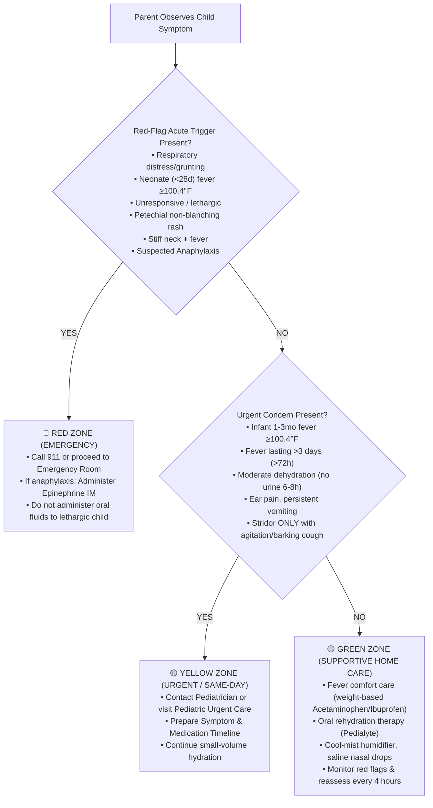

# Alongside — Pediatric Health & Symptom Triage Protocols: Clinical Decision Trees, Fever Thresholds & Emergency Guardrails

> [!WARNING]
> **RETIRED & DEPRECATED IN SOU-86 (Non-Clinical Platform Transition):**
> Alongside has permanently transitioned away from being a clinical symptom triage platform. AlongSide is strictly an educational child development, neurobiology, and family communication operating system (Ages 0–18). This document is retained solely for historical audit purposes. AlongSide does NOT provide clinical symptom triage, Barton Schmitt decision trees, emergency medical triage, or antipyretic dosing calculators.

**Document Version:** 1.0.0 (RETIRED)  
**Author:** Research Engineer  
**Status:** Retired Specification (Replaced by Non-Clinical Child Development OS)  
**Target Audience:** CTO, Backend Engineer (Seed Data & RAG), Frontend Engineer, AI Advisor Prompt Engineers, Pediatric Advisory Board  
**Primary Clinical Authorities:** American Academy of Pediatrics (AAP / HealthyChildren.org), Barton Schmitt Pediatric Telephone Protocols (Children's Hospital Colorado), National Health Service (NHS UK) Paediatric Clinical Practice Guidelines, World Health Organization (WHO) Integrated Management of Childhood Illness (IMCI)  
**Related Paperclip Issue:** SOU-39  

---

## 1. Executive Summary & Clinical Safety Architecture

The modern parent faces an acute information crisis when a child falls ill: late-night panic Googling leads to catastrophic worst-case scenarios, unnecessary and traumatic emergency room visits, or conversely, dangerous delays in seeking critical intervention for true medical emergencies.

This specification establishes **Alongside's Canonical Pediatric Symptom Triage Protocol**. It provides a scientifically validated, medically conservative, three-tier clinical triage architecture (Red Zone, Yellow Zone, Green Zone) grounded in the Barton Schmitt Pediatric Telephone Protocols—the clinical gold standard utilized by over 95% of North American pediatric triage call centers.

### 1.1 Core Safety Mandate: The Clinical Safe Harbor
Alongside is an empowering educational companion and clinical decision-support system, **NOT a replacement for emergency medical personnel or direct pediatric diagnosis**. All platform interactions, AI Advisor responses, and triage flows must strictly adhere to the following non-negotiable safety guardrails:

```
┌──────────────────────────────────────────────────────────────────────────────────────────────────┐
│                             ALONGSIDE CLINICAL SAFE HARBOR ARCHITECTURE                          │
├──────────────────────────────────────────────────────────────────────────────────────────────────┤
│                                                                                                  │
│   1. IMMEDIATE RED-FLAG ESCALATION (EMERGENCY OVERRIDE):                                         │
│      • Any user query presenting an acute life-threat trigger immediately halts conversational   │
│        exploration and presents high-contrast, one-click 911 / Emergency Services dialing UI.     │
│                                                                                                  │
│   2. ZERO SPECULATIVE DIAGNOSIS:                                                                 │
│      • Alongside NEVER asserts a definitive medical diagnosis (e.g., "Your baby has pneumonia"). │
│        It categorizes symptoms by acuity, explains physiological mechanisms, and directs care.   │
│                                                                                                  │
│   3. PEDIATRIC CONTRAINDICATION SHIELD:                                                          │
│      • Strict programmatic prevention of contraindicated medications (e.g., Aspirin in <19y,     │
│        Ibuprofen in infants <6 months, OTC cough/cold preparations in children <4–6 years).      │
│                                                                                                  │
│   4. PEDIATRICIAN CONTINUITY OF CARE:                                                            │
│      • Every Yellow-Zone triage recommendation generates an exportable "Pediatric Visit Summary" │
│        (symptom timeline, max temperatures, fluid intake, medication log) to hand to the doctor.  │
│                                                                                                  │
└──────────────────────────────────────────────────────────────────────────────────────────────────┘
```

---

## 2. Evidence-Based Fever Triage Protocol

Fever is a **protective physiological immune response**, mediated by endogenous pyrogens acting on the anterior hypothalamus. Fever itself does not cause brain damage (which occurs only at environmental hyperthermic temperatures >108°F / 42.2°C). However, the clinical significance of a fever is **strictly age-dependent**.

### 2.1 Age-Stratified Clinical Fever Thresholds

| Age Group | Temperature Threshold (Rectal Preferred) | Clinical Classification | Mandatory Action & Rationale |
| :--- | :--- | :--- | :--- |
| **Neonate (< 28 Days)** | **≥ 100.4°F (38.0°C)** OR **< 97.0°F (36.1°C)** | **RED ZONE (Emergency)** | **Immediate Emergency Room Transfer.** Immature blood-brain barrier and blunted immune response mean high risk of invasive bacterial infection (GBS, *E. coli*, Listeria, HSV). Full sepsis evaluation required. |
| **Infant (29 to 90 Days)** | **≥ 100.4°F (38.0°C)** | **RED ZONE (Emergency)** | **Immediate Medical Evaluation within 2–4 hours.** Hospital ED or Urgent Care pediatric protocol (Rochester/Philadelphia criteria for infant bacteremia). |
| **Infant (3 to 6 Months)** | **≥ 101.0°F (38.3°C)** | **YELLOW ZONE (Urgent)** | **Contact Pediatrician Same-Day.** Evaluate for occult UTI, otitis media, or early respiratory syncytial virus (RSV). If child is lethargic or vomiting, escalate to Red Zone. |
| **Infant (6 to 24 Months)** | **≥ 102.0°F (38.9°C)** | **YELLOW ZONE (Standard)** | **Evaluate Total Clinical Picture.** If fever lasts >48 hours without identifiable focus (viral exanthem vs. ear infection), pediatrician visit is required. |
| **Child (2 Years to 18 Years)** | **≥ 102.0°F (38.9°C)** (or lasting >72h) | **GREEN to YELLOW** | **Behavior Over Numbers.** If child is alert, hydrated, interactive between spikes, manageable with supportive home care. If fever persists >3 days (72h) or exceeds 104°F (40.0°C), pediatrician exam needed. |

### 2.2 Pediatric Antipyretic Medication Standards & Dosing Matrix

> [!CAUTION]
> **NEVER ADMINISTER ASPIRIN** (acetylsalicylic acid) to infants, children, or teenagers recovering from viral infections (influenza, varicella). Aspirin is clinically linked to **Reye's Syndrome**—a catastrophic, life-threatening condition characterized by acute non-inflammatory encephalopathy and fatty liver failure with 30–40% mortality.

> [!IMPORTANT]
> **NEVER ADMINISTER IBUPROFEN TO INFANTS UNDER 6 MONTHS OF AGE.** Infant renal tubular function and glomerular filtration rates are immature before 6 months; ibuprofen can induce acute renal impairment and gastrointestinal bleeding. Acetaminophen is the exclusive antipyretic approved from birth.

#### Safe Weight-Based Pediatric Dosing Table

| Medication | Approved Age | Single Dose (Weight-Based) | Dosing Interval | Maximum Daily Dose | Concentration Standards |
| :--- | :--- | :--- | :--- | :--- | :--- |
| **Acetaminophen** (Tylenol) | **0+ Months** | **10 to 15 mg/kg** | Every **4 to 6 hours** PRN | **75 mg/kg/day** (or max 5 doses in 24 hours; absolute max 3,000 mg/day) | Universal liquid concentration: **160 mg / 5 mL** (Do not use obsolete infant drop concentrations). |
| **Ibuprofen** (Motrin / Advil) | **6+ Months** | **5 to 10 mg/kg** | Every **6 to 8 hours** PRN | **40 mg/kg/day** (absolute max 1,200 mg/day) | Infant drops: **50 mg / 1.25 mL**; Children's suspension: **100 mg / 5 mL**. Always verify concentration. |

#### Antipyretic Safety Rules
1. **Always Dose by Weight, Never by Age:** Age-based charts lead to severe underdosing (ineffective fever control) or overdosing (hepatic toxicity).
2. **Use the Dedicated Measuring Syringe:** Kitchen teaspoons vary by up to 200% in volume; always use the milliliter (mL) syringe provided with the product.
3. **Alternating Dosing Caution:** Alternating acetaminophen and ibuprofen every 3 hours is NOT routinely recommended by the AAP due to a high rate of caregiver calculation errors; reserve alternating regimens only for persistent high distress under direct pediatrician guidance.
4. **Fevers Do Not Need to Be Reduced to 98.6°F:** The clinical goal of antipyretics is **child comfort and hydration**, not total temperature normalization.

---

## 3. High-Acuity Symptom Triage Protocols

### 3.1 Respiratory Distress & Work of Breathing (WOB)

Respiratory illnesses (RSV, bronchiolitis, croup, asthma, pneumonia) are the leading cause of emergency pediatric admission. Parents often cannot distinguish mild nasal congestion from life-threatening respiratory compromise.

```
┌──────────────────────────────────────────────────────────────────────────────────────────────────┐
│                            THE RESPIRATORY DISTRESS TRIAGE PYRAMID                               │
├──────────────────────────────────────────────────────────────────────────────────────────────────┤
│                                                                                                  │
│   RED ZONE: IMPENDING RESPIRATORY FAILURE (CALL 911 / GO TO ED NOW)                              │
│   • Grunting: Involuntary rhythmic grunt on exhalation (vocal cords slamming to maintain PEEP).  │
│   • Severe Retractions: Deep chest cave-in (subcostal, intercostal, substernal, supraclavicular).│
│   • Cyanosis / Pallor: Blue, purple, or ghostly ashen tint around mouth, lips, tongue, or nails. │
│   • Nasal Flaring: Nostrils visibly widening with every breath to pull in oxygen.                 │
│   • Head Bobbing: Head falls forward on exhalation in infants due to accessory neck muscle use.  │
│   • Stridor at Rest: High-pitched whistling sound when inhaling while sitting quietly or resting.│
│                                                                                                  │
│   YELLOW ZONE: ELEVATED WORK OF BREATHING (SAME-DAY PEDIATRIC EVALUATION)                        │
│   • Tachypnea: Rapid breathing persisting while calm and afebrile.                               │
│   • Wheezing: High-pitched musical whistling on expiration (lower airway bronchospasm).          │
│   • Persistent "Barking Seal" Cough without stridor at rest (croup).                             │
│   • Feeding Impairment: Infant cannot nurse or take bottle for >3 sucks without stopping to pant.│
│                                                                                                  │
│   GREEN ZONE: MILD UPPER AIRWAY SYMPTOMS (SUPPORTIVE HOME CARE)                                  │
│   • Clear or colored runny nose, sneezing, loose cough without labored breathing.                │
│   • Child plays, smiles, speaks full sentences without pausing to catch breath.                  │
│                                                                                                  │
└──────────────────────────────────────────────────────────────────────────────────────────────────┘
```

#### Age-Specific Tachypnea Thresholds (WHO / Barton Schmitt)
Measured over **60 full seconds** while the child is **quiet and resting** (fever elevates baseline heart rate and respiration; evaluate respirations after reducing fever):
- **0 to 2 Months:** > 60 breaths per minute
- **2 to 12 Months:** > 50 breaths per minute
- **1 to 5 Years:** > 40 breaths per minute
- **5 to 12 Years:** > 30 breaths per minute
- **> 12 Years:** > 20 breaths per minute

---

### 3.2 Pediatric Dehydration & Gastrointestinal Triage

Dehydration from acute gastroenteritis (viral rotavirus, norovirus) or persistent vomiting progresses rapidly in young children due to their high ratio of surface area to body mass and higher metabolic turnover.

#### Clinical Dehydration Scale (CDS) & Action Protocol

| Clinical Parameter | Mild Dehydration (3–5% Deficit) | Moderate Dehydration (6–9% Deficit) | Severe Dehydration (≥10% Deficit) — **RED ZONE** |
| :--- | :--- | :--- | :--- |
| **Mental Status** | Alert, active, consolable | Irritable, fussy, fatigued | **Lethargic, stuporous, unarousable** |
| **Eyes & Tears** | Normal tears when crying | Decreased tears | **Deeply sunken eyes, zero tears** |
| **Mucous Membranes** | Moist lips and tongue | Dry, tacky tongue/lips | **Parched, cracked lips and oral mucosa** |
| **Fontanelle (Infants)** | Flat, soft | Slightly sunken | **Markedly sunken / depressed fontanelle** |
| **Urine Output** | Normal wet diapers | No wet diaper in 6–8 hours | **No urination in >8–12 hours; dark amber** |
| **Capillary Refill** | < 2 seconds (normal pink) | 2 to 3 seconds | **> 3 seconds; cool, mottled extremities** |
| **Action Pathway** | **Green Zone:** Oral Rehydration Therapy (ORT) at home. | **Yellow Zone:** Call clinic for antiemetic evaluation (e.g. Ondansetron) or nurse check. | **RED ZONE:** Emergency Department for immediate IV isotonic crystalloid bolus. |

#### Home Oral Rehydration Therapy (ORT) Protocol
- **Do NOT use plain water, juice, or soda:** Plain water lacks sodium and can cause hyponatremic seizures; sugary juices draw water into the intestinal lumen via osmosis, exacerbating diarrhea.
- **Use Oral Rehydration Salts (ORS):** Pedialyte, Enfamil Enfalyte, or WHO formulation (sodium 45–75 mEq/L, glucose 2%).
- **The "Teaspoon Method" for Active Vomiting:** Offer 5 mL (1 teaspoon) via syringe every 5 minutes. If no emesis for 30 minutes, double to 10 mL every 5 minutes. Small frequent volumes bypass gastric distension triggers.

---

### 3.3 Acute Allergic Reactions & Anaphylaxis Protocol

Anaphylaxis is a rapidly progressing, systemic, life-threatening allergic reaction involving two or more organ systems or immediate airway/cardiovascular compromise.

#### Anaphylaxis Emergency Criteria (NIAID / AAP)
**IMMEDIATE EPINEPHRINE INJECTION (AUVI-Q / EPIPEN) REQUIRED IF:**
1. **Any sudden throat tightness, hoarse voice, barking cough, or difficulty swallowing/breathing.**
2. **Skin hives or facial/lip swelling COMBINED WITH vomiting, diarrhea, or dizziness.**
3. **Sudden limpness, pale/blue skin, or loss of consciousness following allergen ingestion or insect sting.**

#### Pediatric Epinephrine Auto-Injector Dosing
- **Child 7.5 kg to 14 kg (16.5–30 lbs):** Epinephrine **0.1 mg** auto-injector (Auvi-Q 0.1 mg).
- **Child 15 kg to 29 kg (33–64 lbs):** Epinephrine **0.15 mg** auto-injector (EpiPen Jr).
- **Child ≥ 30 kg (≥ 66 lbs):** Epinephrine **0.3 mg** auto-injector (EpiPen Adult).
- **Injection Site:** Anterolateral aspect of the middle third of the thigh (vastus lateralis) intramuscularly. Hold for 3 seconds. Call 911 immediately after administration due to the risk of a biphasic anaphylactic reaction (secondary surge 4–8 hours later).

---

## 4. The 3-Zone Pediatric Action Matrix (Home vs. Urgent vs. 911)



---

## 5. Ready-to-Seed JSON Data Fixtures

These fixtures provide structured, type-safe data for backend database seeding (`packages/database`), powering Fastify API routes and vector search embeddings for the 24/7 AI Clinical Advisor.

```json
{
  "$schema": "https://alongside.care/schemas/v1/pediatric-triage-fixtures.json",
  "version": "1.0.0",
  "protocols": [
    {
      "id": "triage-fever-neonate",
      "symptom": "fever",
      "ageRangeMonths": { "min": 0, "max": 1 },
      "triageLevel": "RED",
      "title": "Neonatal Fever (< 28 Days)",
      "temperatureThresholdF": 100.4,
      "clinicalRationale": "Immature neonatal immune system and permeable blood-brain barrier carry high risk of life-threatening invasive bacterial illness (GBS, Listeria, E. coli, HSV).",
      "immediateAction": "Call 911 or take infant to nearest Pediatric Emergency Department immediately. Do NOT administer fever reducers before medical evaluation.",
      "redFlags": [
        "Rectal temperature >= 100.4°F (38.0°C) or < 97.0°F (36.1°C)",
        "Poor feeding or weak suck",
        "Lethargy or difficult to arouse",
        "Moaning, grunting, or rapid breathing",
        "Full or bulging fontanelle"
      ],
      "primarySources": ["AAP Pediatric Sepsis Guidelines", "Barton Schmitt Pediatric Protocols"]
    },
    {
      "id": "triage-respiratory-retractions",
      "symptom": "respiratory_distress",
      "ageRangeMonths": { "min": 0, "max": 216 },
      "triageLevel": "RED",
      "title": "Severe Respiratory Retractions & Work of Breathing",
      "temperatureThresholdF": null,
      "clinicalRationale": "Accessory muscle use (subcostal, intercostal, supraclavicular retractions) indicates impending respiratory fatigue and hypoxemic failure.",
      "immediateAction": "Call 911 immediately. Keep child upright and calm. Do not force fluids or medication.",
      "redFlags": [
        "Skin sucking deeply beneath ribs, between ribs, or at the base of the throat",
        "Expiratory grunting (audible short groan with each breath)",
        "Nasal flaring on inhalation",
        "Bluish, purple, or gray discoloration of lips, gums, or tongue",
        "Head bobbing in rhythm with breathing"
      ],
      "primarySources": ["AAP Clinical Practice Guideline: Bronchiolitis", "WHO IMCI Guidelines"]
    },
    {
      "id": "triage-fever-toddler-standard",
      "symptom": "fever",
      "ageRangeMonths": { "min": 6, "max": 36 },
      "triageLevel": "GREEN",
      "title": "Standard Childhood Viral Fever (6–36 Months)",
      "temperatureThresholdF": 102.5,
      "clinicalRationale": "Fever is a physiological immune defense against common viral pathogens. In vaccinated children who remain alert and hydrated, home supportive care is safe.",
      "immediateAction": "Offer frequent fluids, dress in single layer of breathable clothing. Dose weight-based Acetaminophen or Ibuprofen if child is uncomfortable.",
      "redFlags": [
        "Fever persisting longer than 72 hours (3 full days)",
        "Child becomes lethargic or unresponsive when temperature is reduced",
        "Signs of moderate to severe dehydration (no urination in 8 hours)",
        "Purple or blood-red non-blanching spots on the skin"
      ],
      "primarySources": ["AAP HealthyChildren Fever Protocols", "NHS UK Fever in Children"]
    },
    {
      "id": "triage-anaphylaxis-acute",
      "symptom": "allergic_reaction",
      "ageRangeMonths": { "min": 0, "max": 216 },
      "triageLevel": "RED",
      "title": "Systemic Allergic Reaction / Anaphylaxis",
      "temperatureThresholdF": null,
      "clinicalRationale": "Rapid systemic mast cell and basophil degranulation causing vascular collapse, laryngeal edema, and bronchoconstriction.",
      "immediateAction": "Administer intramuscular Epinephrine auto-injector immediately into outer thigh. Call 911. Lay child flat with legs elevated (unless breathing is difficult).",
      "redFlags": [
        "Swelling of tongue, lips, throat, or uvula",
        "Stridor, wheezing, hoarse voice, or severe cough",
        "Hives or flushing accompanied by vomiting or abdominal cramps",
        "Dizziness, faintness, or sudden collapse"
      ],
      "primarySources": ["AAP Allergy & Anaphylaxis Guidelines", "NIAID Food Allergy Guidelines"]
    }
  ],
  "medicationFormulas": [
    {
      "drug": "Acetaminophen",
      "minAgeMonths": 0,
      "doseMgPerKg": 12.5,
      "doseRangeMgPerKg": { "min": 10, "max": 15 },
      "frequencyHours": 4,
      "maxDosesPer24h": 5,
      "maxDailyMgPerKg": 75,
      "absoluteMaxMgPerDay": 3000,
      "standardLiquidConcentration": "160 mg / 5 mL",
      "contraindications": ["Severe hepatic impairment", "Known acetaminophen hypersensitivity"]
    },
    {
      "drug": "Ibuprofen",
      "minAgeMonths": 6,
      "doseMgPerKg": 10.0,
      "doseRangeMgPerKg": { "min": 5, "max": 10 },
      "frequencyHours": 6,
      "maxDosesPer24h": 4,
      "maxDailyMgPerKg": 40,
      "absoluteMaxMgPerDay": 1200,
      "standardLiquidConcentration": "100 mg / 5 mL",
      "contraindications": [
        "Infants under 6 months of age",
        "Dehydration with impaired renal perfusion",
        "Active gastrointestinal bleeding",
        "Severe thrombocytopenia"
      ]
    }
  ]
}
```

---

## 6. Actionable Implementation Recommendations for CTO & Engineering Team

1. **Fastify Backend Domain Plugin (`apps/api/src/modules/health/`):**
   - Implement route `POST /api/v1/health/triage` accepting `{ childAgeMonths: number, symptoms: string[], temperatureF?: number, durationHours?: number }`.
   - Validate payloads using `@alongside/shared` Zod schemas. Enforce automated Red Zone overrides that return HTTP 200 with `{ triageLevel: "RED", emergencyActionRequired: true, immediateSteps: [...] }`.
2. **AI Advisor Prompt Guardrail Ingestion:**
   - Ingest Section 1.1 Clinical Safe Harbor and Section 4 Decision Matrix into system instructions.
   - For queries with red-flag symptoms (retractions, infant <3mo fever, anaphylaxis), mandate that the AI Advisor output begins with the Red Zone Emergency Alert template before any explanatory prose.
3. **Frontend Triage UI Primitives (`apps/web/src/components/health/`):**
   - Provide a high-contrast visual "Symptom Checker" with emergency 911 quick-call banner, interactive weight-based dose slider (displaying exact mL and mg), and exportable doctor visit summary.
