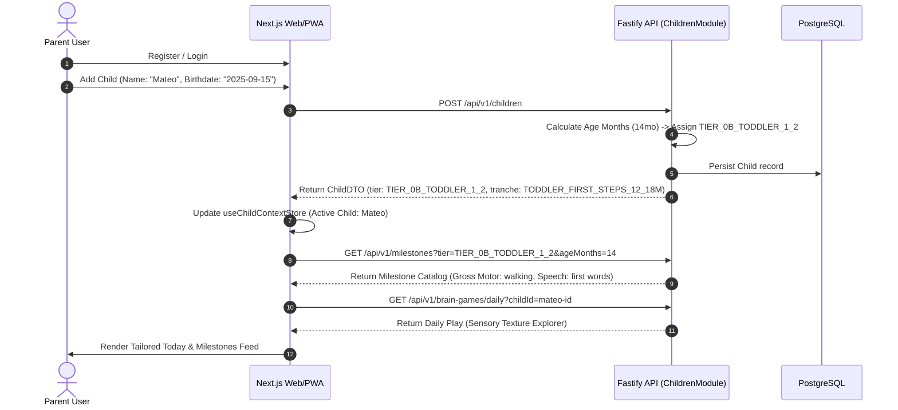
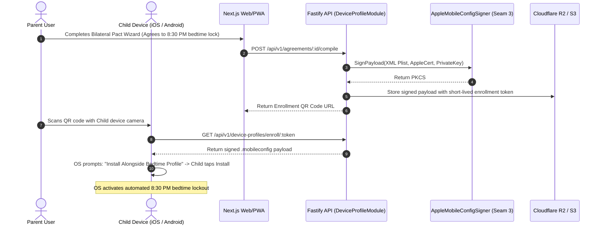

# Alongside — Canonical System Architecture & Design Specification

**Author:** Chief Technology Officer (CTO)  
**Status:** Approved Canonical Architectural Specification  
**Version:** 2.5.0 (The Holistic Lifespan Family OS & Parent Advisory Sanctuary)  
**Target Scale:** Baseline 100,000 DAU (~500,000 Registered Families, 700,000 Children) | Scalable to 1,000,000+ DAU  
**Primary SLA:** 99.95% Availability (< 4.38 hours downtime/year)  
**Latency Targets:** Read P95 < 50ms (P99 < 100ms) | Write P95 < 150ms (P99 < 300ms) | AI Advisor TTFT < 800ms  
**Target Audience:** Frontend Engineer, Backend Engineer, DevOps, Technical Architects, Security Auditors  
**Companion Documents:**  
- [**Codebase Design Specification**](engineering-standards/codebase-design.md) (`docs/engineering-standards/codebase-design.md` — Deep Modules, Seam Catalog & In-Memory Test Fakes)  
- [**Platform Advisory Rearchitecture Spec**](platform-advisory-rearchitecture-and-academy-chapters-spec.md) (`docs/platform-advisory-rearchitecture-and-academy-chapters-spec.md` — Navigation Streamlining & Prioritized Academy Chapters)  
- [**Master Design System**](design-system/MASTER.md) (`docs/design-system/MASTER.md` — Taste 2: Editorial Pediatric Almanac)  
- [**REST API Specification**](api-specification.md) (`docs/api-specification.md`)  
- [**Database Models & Prisma Schema**](data-models.md) (`docs/data-models.md`)  

---

## 1. Executive Summary & Product Mission

**Alongside** is a category-defining parent intelligence platform and family operating system engineered for families raising children from birth to adulthood (Ages 0–18).

Historically, parenting technology suffers from two fatal dichotomies:
1. **The "Device-Only / Invasive MDM" Extreme:** Coercive surveillance tools (Bark, Qustodio) that install covert root certificates, scrape private text messages, log keystrokes, and track stealth GPS. These tools treat children like criminals, destroy household trust, ignite teenage rebellion, and face perpetual regulatory risk.
2. **The "Baby App Churn Cliff" / Advice Blog Extreme:** Baby trackers (Huckleberry, BabyCenter) capture infant sleep and feeding, but churn 90% of parents at age 2 when bottles end. Static blogs and printable refrigerator PDFs are consulted only in acute panic and abandoned within 30 days.

**Alongside synthesizes The Mind (Parent Education, Neurobiology & Cultural Mentorship) with The Hand (Operational Peace via Pact-as-Code Device Governance and Pediatric Advisory Hubs):**
- **Developmental Milestones & Growth ("When He Moves, When He Talks"):** Pediatrician-backed tracking across gross motor, fine motor, speech acquisition, and cognitive stages (Ages 0–18).
- **Pediatric Nutrition, Feeding & Dietary Safety ("What to Eat"):** Infant solids (BLW vs purees), safe allergen introduction schedules (LEAP trial), choking hazard prevention, and conquering toddler picky eating.
- **Brain Games, Sensory Play & Cognitive Enrichment:** Purposeful, offline developmental play—from early animal puppets and high-contrast sensory cards to symbolic block play, LEGO building, and strategic logic chess.
- **Behavioral Psychology & The Modern Cultural Advisor:** Translating confusing behaviors (tantrums, biting, defiance, lying) into unmet nervous system needs, fostering authoritative warmth with firm boundaries.
- **24/7 AI Child Advisor & Clinical FAQ Vault:** Multi-child contextual AI guidance for acute dilemmas and a living clinical FAQ vault to navigate high-stakes parenting conversations.
- **Modern Culture, Multi-Device Ecology & The "Thinking About a Device?" Solution Hub:** Sunday slang decoders (*skibidi, crashout, looksmaxing*), exploit alerts, and an intentional milestone transition pipeline featuring the **Bilateral Family Pact ("Pact-as-Code")** and **Automated 8:30 PM Bedtime Lockdown** with zero spyware.

---

## 2. High-Level Architecture & End-to-End System Blueprint

Alongside is engineered as a type-safe, decoupled monorepo separating the user-facing web/PWA presentation layer from the core domain API service.

```mermaid
graph TD
    subgraph ClientLayer ["Client Layer (apps/web - Next.js 15 App Router & React 19)"]
        Browser["Parent Mobile Browser / Mobile PWA"]
        ServiceWorker["Service Worker (Serwist Offline Cache)"]
        ChildSwitcher["Global Multi-Child Switcher (Zustand Context)"]
        DashboardHub["Today & Milestones Home Feed"]
        HealthHub["Pediatric Health & 3-Zone Symptom Triage UI"]
        NutritionHub["Nutrition, BLW & Allergen Scheduler UI"]
        PlayHub["Brain Games, Sensory Toys & Puppets Hub"]
        BehaviorHub["Behavioral Translation & Co-Regulation UI"]
        AdvisorChat["24/7 Clinical AI Advisor & Sparring Simulator"]
        DevicesHub["Modern Culture & Device Governance Hub"]
        AcademyUI["Parent Intelligence Academy Player"]
        TanStackCache["TanStack Query Cache (v5)"]
    end

    subgraph SharedLayer ["Shared Contract Layer (packages/shared)"]
        ZodSchemas["Zod Request / Response Schemas"]
        DomainEnums["Domain Enums (8 Macro Tiers, Tranches, Triage Zones)"]
        ClinicalAlgorithms["Pure Algorithmic Engines (Readiness, Milestones)"]
        DTOs["TypeScript DTO Interfaces & Contracts"]
    end

    subgraph ServiceLayer ["API Service Layer (apps/api - Fastify LTS 22)"]
        FastifyServer["Fastify HTTP Server (TypeScript)"]
        AuthModule["Auth & Session Guard (Argon2id + JWT Cookie)"]
        ChildrenModule["Child Profiles & 8-Tier Developmental Engine"]
        MilestonesModule["Milestone Catalog & Achievement Service"]
        HealthModule["Pediatric Health & Barton Schmitt Triage Engine"]
        NutritionModule["Nutrition Guides, BLW & Allergen Service"]
        BrainGamesModule["Purposeful Play & Toy Catalog Service"]
        BehaviorModule["Behavioral Translation & Script Service"]
        AcademyModule["Parent Intelligence Academy Controller"]
        QuizModule["Interactive Assessment & Scoring Controller"]
        AiAdvisorModule["24/7 Clinical AI Advisor & Streaming RAG Engine"]
        AgreementModule["Bilateral Family Pact Controller"]
        DeviceProfileModule["Pact-as-Code Compiler & PKCS#7 Signer"]
        DigestModule["Weekly Slang & Exploit Alert Controller"]
        BillingModule["Stripe Billing & 7-Day Trial Controller"]
    end

    subgraph DataLayer ["Data & Persistence Layer"]
        PostgresDB[("PostgreSQL 16 + pgvector (Relational & Clinical Embeddings)")]
        RedisCache[("Redis (Session Revocation, Cache & BullMQ Queue)")]
        AppleSigningCert[("Apple WWDR & Dev Signing Certificates")]
        ObjectStorage[("Encrypted Object Storage (PDF Agreements & Profiles)")]
    end

    Browser --> ServiceWorker
    Browser --> ChildSwitcher
    ChildSwitcher --> DashboardHub
    ChildSwitcher --> HealthHub
    ChildSwitcher --> NutritionHub
    ChildSwitcher --> PlayHub
    ChildSwitcher --> BehaviorHub
    ChildSwitcher --> AdvisorChat
    ChildSwitcher --> DevicesHub
    ChildSwitcher --> AcademyUI

    DashboardHub --> TanStackCache
    HealthHub --> TanStackCache
    NutritionHub --> TanStackCache
    PlayHub --> TanStackCache
    BehaviorHub --> TanStackCache
    DevicesHub --> TanStackCache
    AcademyUI --> TanStackCache
    AdvisorChat -- "Server-Sent Events (SSE)" --> AiAdvisorModule

    TanStackCache -- "HTTPS / JSON API" --> FastifyServer
    TanStackCache -. "Type Safety" .-> ZodSchemas
    FastifyServer -. "Schema Validation" .-> ZodSchemas

    FastifyServer --> AuthModule
    FastifyServer --> ChildrenModule
    FastifyServer --> MilestonesModule
    FastifyServer --> HealthModule
    FastifyServer --> NutritionModule
    FastifyServer --> BrainGamesModule
    FastifyServer --> BehaviorModule
    FastifyServer --> AcademyModule
    FastifyServer --> QuizModule
    FastifyServer --> AiAdvisorModule
    FastifyServer --> AgreementModule
    FastifyServer --> DeviceProfileModule
    FastifyServer --> DigestModule
    FastifyServer --> BillingModule

    ChildrenModule --> PostgresDB
    MilestonesModule --> PostgresDB
    HealthModule --> PostgresDB
    NutritionModule --> PostgresDB
    BrainGamesModule --> PostgresDB
    BehaviorModule --> PostgresDB
    AcademyModule --> PostgresDB
    QuizModule --> PostgresDB
    AiAdvisorModule -- "Vector Cosine Similarity (HNSW)" --> PostgresDB
    AgreementModule --> PostgresDB
    DeviceProfileModule --> AppleSigningCert
    DeviceProfileModule --> PostgresDB
    DigestModule --> PostgresDB
    BillingModule --> PostgresDB

    FastifyServer --> RedisCache
    AgreementModule --> ObjectStorage
    DeviceProfileModule --> ObjectStorage
```



---

## 3. Quantitative Capacity Estimations & Infrastructure Sizing

### 3.1 Traffic Volume Sizing (Baseline 100k DAU vs. 10x Scale)

| Metric | Derivation Formula | Baseline (100k DAU) | 10x Scale (1M DAU) |
| :--- | :--- | :--- | :--- |
| **Daily Active Users (DAU)** | Target Parent Active Cohort | **100,000** | **1,000,000** |
| **Total Registered Families** | $\text{DAU} \times 5.0$ | **500,000** | **5,000,000** |
| **Total Registered Children** | $1.4 \text{ children per household}$ | **700,000** | **7,000,000** |
| **Daily Sessions per User** | Morning digest + Evening curfew/bedtime check | **2.5 sessions/day** | **2.8 sessions/day** |
| **Daily API Requests** | $\text{DAU} \times \text{Sessions} \times 6.8\text{ reqs}$ | **~1,700,000 reqs/day** | **~19,000,000 reqs/day** |
| **Average QPS** | $\text{Total Requests} / 86,400\text{ sec}$ | **~20 QPS** | **~220 QPS** |
| **Peak QPS (Evening Curfew Surge)** | $\text{Average QPS} \times 4.0$ | **~80 QPS** | **~880 QPS** |
| **Read vs. Write Split** | Read-Heavy Architecture | **85% Read / 15% Write** | **85% Read / 15% Write** |
| **Peak Read QPS** | $\text{Peak QPS} \times 0.85$ | **~68 QPS** | **~748 QPS** |
| **Peak Write QPS** | $\text{Peak QPS} \times 0.15$ | **~12 QPS** | **~132 QPS** |

### 3.2 Storage Capacity Sizing

```
User Record + Settings:                   ~1.5 KB
Child Profile + Road State + Tranche:     ~1.2 KB
Bilateral Pact + Clauses + Signatures:    ~15.0 KB
Compiled Signed .mobileconfig Payload:     ~8.0 KB
Exported Vector PDF Pact (Object Storage):~120.0 KB (Cloudflare R2 / S3)
Quiz Attempt + Dimension Breakdown:       ~3.0 KB
AI Chat Message (Prompt + Response):      ~1.2 KB
Culture Digest + Slang Terms:             ~25.0 KB (Shared weekly catalog)
```

- **Daily Data Ingestion (Database Write Volume):**
  - $\text{Daily Writes} \approx 1,700,000 \times 0.15 = 255,000\text{ write events/day}$
  - Average write payload in DB: ~2.5 KB (excluding PDF binaries stored in R2/S3)
  - $\text{Daily DB Ingestion} = 255,000 \times 2.5\text{ KB} \approx 637.5\text{ MB/day} \approx \mathbf{0.64\text{ GB/day}}$
- **5-Year Persistent Relational Storage:**
  - $\text{Annual DB Volume} = 0.64\text{ GB} \times 365 \approx 233.6\text{ GB/year}$
  - $5\text{-Year DB Storage} = 233.6 \times 5 \times 1.25\text{ (25\% indexing \& WAL overhead)} \approx \mathbf{1.46\text{ TB}}$
- **Object Storage Sizing (Encrypted PDFs & Mobileconfigs):**
  - Average 1 signed pact PDF (120 KB) per active child per year:
  - $100,000 \times 120\text{ KB} \approx 12\text{ GB/year} \implies 5\text{-Year Total} \approx \mathbf{60\text{ GB}}$
- **Vector Embedding Sizing (`pgvector`):**
  - 100+ FAQ items + 50 clinical guidelines + slang definitions = ~500 text chunks.
  - Model: OpenAI `text-embedding-3-small` (1,536 dimensions, 4 bytes/float = ~6.14 KB per vector).
  - $500 \times 6.14\text{ KB} \approx \mathbf{3.07\text{ MB}}$.
  - The entire vector index fits comfortably in PostgreSQL RAM buffer cache.

### 3.3 Memory & Cache Sizing (Redis)
Applying the **80/20 Pareto Rule**: 20% of content accounts for 80% of read traffic.
- Hot read data includes: User session tokens, Academy course curriculum, 10-dimension quiz trees, weekly Sunday Culture Digest, and active child curfew metadata.
- Total active daily working set: $\approx 10\text{ GB}$.
- 20% Cache Requirement: $10\text{ GB} \times 0.20 = \mathbf{2.0\text{ GB RAM}}$.
- Adding a $2\times$ safety buffer for BullMQ queue operations, rate limiter sliding windows, and Redis memory fragmentation:
- **Recommended Cache Allocation:** **4.0 GB to 8.0 GB RAM**.

### 3.4 Network Bandwidth & Hardware Instance Sizing
- **Network Egress Throughput:**
  - Peak Read QPS = ~68 QPS (Baseline) / ~748 QPS (10x).
  - Average response size = ~25 KB (JSON DTOs, compressed with Gzip/Brotli).
  - $\text{Peak Egress (Baseline)} = 68 \times 25\text{ KB} = 1,700\text{ KB/s} \approx \mathbf{13.6\text{ Mbps}}$.
  - $\text{Peak Egress (10x Scale)} = 748 \times 25\text{ KB} = 18,700\text{ KB/s} \approx \mathbf{149.6\text{ Mbps}}$.
- **Application Server Nodes:**
  - Fastify on Node.js LTS 22 handles **1,500 to 3,000 simple I/O QPS per 2-vCPU core**.
  - Peak load is ~80 QPS (Baseline) and ~880 QPS (10x).
  - Sizing for N+1 high availability: **2 application server instances (2 vCPU, 4 GB RAM each)** operating at < 5% CPU utilization at baseline, gracefully absorbing sudden spikes.
- **Database Nodes:**
  - Primary Database: PostgreSQL 16 on **4 vCPU, 16 GB RAM SSD (Provisioned IOPS)**.
  - Read Replicas: **1 Read Replica (4 vCPU, 16 GB RAM)** for offloading Academy lesson reads, FAQ searches, and analytics.

---

## 4. Monorepo Directory Structure & Workspace Boundaries

```
AlongSide/
├── apps/
│   ├── web/                      # Frontend Application (Next.js 15, React 19, Tailwind v3.4)
│   │   ├── public/               # Static assets, PWA icons, manifest.json
│   │   └── src/
│   │       ├── app/              # Next.js App Router (RSC pages, layouts, route handlers)
│   │       ├── components/       # UI components & Parent Calm design system
│   │       ├── hooks/            # Custom hooks (useChildContext, useAiChat, useChildAge)
│   │       ├── lib/              # API client, PDF export, local storage
│   │       └── stores/           # Zustand stores (child context, pact wizard, quiz runner)
│   │
│   └── api/                      # Backend API Server (Node.js LTS 22, Fastify, TypeScript)
│       └── src/
│           ├── config/           # Environment variables, logger, cert paths
│           ├── plugins/          # Fastify plugins (JWT, CORS, SSE, Database, Error Handler)
│           └── modules/          # Deep domain feature modules (auth, children, academy, etc.)
│
├── packages/
│   ├── shared/                   # Shared TypeScript contracts and pure algorithmic engines
│   │   └── src/
│   │       ├── schemas/          # Zod validation schemas across all domain entities
│   │       ├── types/            # Domain interfaces and DTOs
│   │       ├── constants/        # Enums (8 Macro Tiers, Tranches, Triage Zones, Feeding Stages)
│   │       └── algorithms/       # Pure scoring math, readiness checks, age-tier derivation
│   │
│   └── database/                 # Prisma ORM & PostgreSQL Database Layer
│       └── prisma/
│           ├── schema.prisma     # Canonical database schema (with pgvector)
│           ├── migrations/       # SQL migration history
│           └── seed/             # Seed scripts (Academy courses, CDC milestones, FAQs)
│
├── docs/                         # Canonical Architecture, Standards & Specifications
│   ├── engineering-standards/    # Deep modules, skill matrices, plan & git standards
│   ├── design-system/            # Master design tokens & rules (MASTER.md)
│   ├── design/                   # Design inspirations, alternatives & culture digest prototypes
│   ├── research/                 # Developmental research, neurobiology matrices & FAQ vaults
│   ├── system-architecture.md    # THIS DOCUMENT (Canonical System Architecture & Design)
│   ├── data-models.md            # Canonical database schema and entity relationships
│   └── api-specification.md      # Authoritative REST API contract catalog
│
├── plans/                        # Discrete Agent Execution Plans (Numbered 01–37)
├── .agents/                      # AI Agent Governance & Machine-Enforceable Rules
├── AGENTS.md                     # Engineering team responsibilities and boundaries
├── PROJECT_SCOPE.md              # Canonical Product Scope v2.4.0 (CEO)
├── README.md                     # Monorepo Executive Overview & Architecture
├── package.json                  # Root npm workspace definition
└── tsconfig.base.json            # Base TypeScript configuration
```

---

## 5. Canonical Developmental Lifespan Tiers (8 Macro Tiers) & Micro-Tranche Engine

### 5.1 The Deconstruction of Early Childhood (0–3 Years)

In the first 36 months of life, the human brain forms over 1 million new neural connections per second. A 2-month-old infant and a 34-month-old toddler are biologically, cognitively, nutritionally, and medically completely different human beings. Grouping them into a single monolithic bucket degraded parent confidence: parents of infants saw toddler tantrum advice and felt alienated, while parents of toddlers saw infant sleep-sack advice and felt infantilized.

AlongSide resolves this through a **Dual-Resolution Architecture**:
1. **8 Macro Lifespan Tiers** for clean curricular navigation, Academy categorization, and dashboard state.
2. **An Intra-Tier Micro-Tranche Engine** operating on birthdate in months (`targetAgeMonths`) for clinical, feeding, and safety precision.

### 5.2 Canonical Lifespan Tier Matrix (8 Macro Tiers)

| Tier | Enum Identifier | Age Bracket | Neurobiological & Developmental Focus | Primary Features & Clinical Guidance |
| :--- | :--- | :--- | :--- | :--- |
| **Tier 0A** | `TIER_0A_INFANCY_0_1` | **Ages 0–1** (0–12m) | Somatic regulation, primary sensory wiring, synaptogenesis (>1M/sec), rolling $\to$ crawling $\to$ cruising, cooing to first words. | Neonatal fever triage (ER if $\ge 100.4^\circ\text{F}$ under 90d), 100% milk to early peanut/egg allergen intro (LEAP), 4-month sleep regression, zero screens. |
| **Tier 0B** | `TIER_0B_TODDLER_1_2` | **Ages 1–2** (12–24m) | Locomotion explosion (independent walking $\to$ running), 50-word language burst, 2-word combinations, limbic reactivity surges. | 2-to-1 nap transition, physiological toddler anorexia reassurance, table solids transition, non-punitive physical co-regulation for first tantrums. |
| **Tier 0C** | `TIER_0C_OLDER_TODDLER_2_3` | **Ages 2–3** (24–36m) | Autonomy vs. Shame (Erikson), 200–500+ words, "Why?" questions, nascent Theory of Mind, parallel to associative play. | Potty training readiness, boundary testing ("No!"), bedtime stalling & night terrors, picky eating & division of responsibility, intentional co-viewing. |
| **Tier 1** | `TIER_1_EARLY_CHILDHOOD_4_6` | **Ages 4–6** | Rapid language expansion, Theory of Mind emergence, cooperative play, fine motor dexterity (scissors, drawing). | Picky eating solutions, wooden block building, dramatic roleplay, bedtime rituals, co-viewing screen rules. |
| **Tier 2** | `TIER_2_MIDDLE_CHILDHOOD_7_9` | **Ages 7–9** | Concrete operational thought, peer friendship navigation, rule comprehension, reading fluency, physical sports. | School lunchbox nutrition, logic puzzles, chess, boredom busters, shared family tablet limits. |
| **Tier 3** | `TIER_3_PRE_TEEN_10_12` | **Ages 10–12** | Adrenarche onset, prepubertal growth, heightened peer sensitivity, early abstract reasoning, dopamine novelty seeking. | "Thinking About a Device?" diagnostic, smartwatch bridge, slang decoders, group chat exclusion coaching. |
| **Tier 4** | `TIER_4_EARLY_ADOLESCENCE_13_15` | **Ages 13–15** | Peak pubertal transformation, circadian sleep delay (melatonin shifted ~2 hours), identity exploration, social comparison. | Bilateral Family Pact, automated 8:30 PM bedtime lock, body image nutrition, teen clinical advisory guidance. |
| **Tier 5** | `TIER_5_LATE_ADOLESCENCE_16_18` | **Ages 16–18** | Prefrontal cortex maturation, impulse control calibration, executive autonomy, long-term consequences, future orientation. | Autonomy upgrade ceremonies, athletic nutrition, college/career stress navigation, independent self-regulation. |

*(Note: Legacy alias `TIER_0_INFANCY_TODDLER_0_3` is retained in database enums and shared schemas for zero-downtime backward compatibility, dynamically resolving to `TIER_0A`, `TIER_0B`, or `TIER_0C` based on birthdate).*

### 5.3 Intra-Tier Micro-Tranche Engine (Sub-Tier Resolution)
To prevent database enum bloat while preserving clinical safety in Year 1 (0–12 months) and Toddlerhood, the system derives runtime **`EarlyChildhoodTranche`** attributes from `Child.birthDate` and `calculateChildAgeMonths()`:
- **`INFANT_FOURTH_TRIMESTER_0_3M` (0–3m):** Neonatal emergency fever protocols, 100% milk feeding, wake windows 45–60m.
- **`INFANT_AWAKENING_4_6M` (4–6m):** 4-month sleep architecture reorganization, early allergen introduction window (LEAP trial), rolling safety.
- **`INFANT_MOBILE_EXPLORER_7_12M` (7–12m):** Baby-Led Weaning vs purees, gagging vs choking mastery, cruising, stranger anxiety, babbling.
- **`TODDLER_FIRST_STEPS_12_18M` (12–18m):** Independent walking, 1-nap drop, table solids, first 10 words.
- **`TODDLER_LANGUAGE_BURST_18_24M` (18–24m):** 50+ words, 2-word sentences, limbic tantrums requiring calm nervous system anchors.
- **`OLDER_TODDLER_AUTONOMY_24_30M` (24–30m):** "No!" boundary testing, spoon mastery, parallel play.
- **`OLDER_TODDLER_PRESCHOOL_PREP_30_36M` (30–36m):** Potty readiness, 300+ words, associative play, "Why?" chains.

---

## 6. Core System Data Flows

### 6.1 Multi-Child Onboarding & Context Synchronization Flow


### 6.2 24/7 Clinical AI Advisor Streaming RAG Flow


### 6.3 Pact-as-Code Mobile Profile Generation & Enrollment


---

## 7. Deep-Dive Architectural Trade-Off Decisions ("Why X Over Y")

### 7.1 Storage Selection: PostgreSQL 16 + `pgvector` vs. MongoDB + Pinecone
- **Selected:** **PostgreSQL 16 with native `pgvector` extension (via Prisma ORM)**.
- **Alternative Considered:** MongoDB (for document flexibility) + Pinecone or Qdrant (for vector search).
- **Architectural Rationale:**
  - *Single Operational Footprint:* AlongSide is a highly relational domain. A parent owns children; a child is governed by an agreement; an agreement compiles into a device profile; a quiz attempt evaluates a child. Splitting this data across MongoDB and a dedicated vector database introduces distributed transaction failure modes, two-phase commits, and multi-vendor operational overhead.
  - *Transactional Relational Integrity:* With `pgvector`, the AI Advisor can execute a single ACID query that filters by the child's exact developmental tier (`WHERE target_tier = child.developmental_tier`) while simultaneously ranking vector cosine distance.
  - *Zero Sync Lag:* FAQ updates or clinical guideline additions are instantly searchable without asynchronous vector ETL pipeline delays.
- **Trade-off Accepted:** HNSW vector index builds consume dedicated PostgreSQL RAM. Sizing the DB node with 16 GB RAM mitigates this cleanly given our compact ~500 FAQ chunk dataset.

### 7.2 Communication Protocol: Fastify REST + Server-Sent Events (SSE) vs. WebSockets
- **Selected:** **Standard HTTP/2 REST for CRUD + Server-Sent Events (SSE) for AI Advisor Streaming**.
- **Alternative Considered:** Full-duplex WebSockets (`ws://`).
- **Architectural Rationale:**
  - *Simplicity & Firewall Traversal:* Server-Sent Events operate over standard HTTPS (Port 443). They traverse strict school Wi-Fi networks, cellular carrier proxies, and enterprise VPNs without connection drops or proxy blocking that frequently sever long-lived WebSocket handshakes.
  - *Automatic Reconnection:* SSE includes native browser reconnection semantics (`EventSource` auto-reconnects and sends `Last-Event-ID`).
  - *Unidirectional Stream Fit:* AI Advisor token streaming is fundamentally unidirectional (server to client). The parent asks a question via standard `POST`, and the server streams tokens back. WebSockets' full-duplex capability is unnecessary overhead here.
- **Trade-off Accepted:** Token streaming uses standard text/event-stream over HTTPS with lightweight client consumption.

### 7.3 Device Management Strategy: Transparent "Pact-as-Code" (.mobileconfig) vs. Invasive MDM Agent
- **Selected:** **Apple Declarative Management / `.mobileconfig` Profiles & Android Enterprise Policies**.
- **Alternative Considered:** Proprietary background agent / VPN proxy with deep packet inspection (Bark, Qustodio).
- **Architectural Rationale:**
  - *Zero Spyware Guarantee:* Invasive monitoring tools require installing a root SSL certificate on the child's phone to decrypt private traffic. This breaks child trust, introduces catastrophic security vulnerabilities, and violates AlongSide's foundational brand ethos.
  - *Zero App Store Rejection Risk:* Apple aggressively terminates third-party apps that abuse screen recording or enterprise MDM certificates for consumer snooping. Standard `.mobileconfig` profiles are native Apple configuration files installed through standard iOS Settings.
  - *Hardware-Level Bedtime Lock:* At 8:30 PM, the operating system neutrally disables non-whitelisted apps. Parents are not the "bad guys" policing bedroom doors; the OS enforces the pact the child co-signed.
- **Trade-off Accepted:** Installing an Apple `.mobileconfig` requires the parent to tap "Allow" in Safari and "Install" in iOS Settings (a 30-second multi-step OS prompt). AlongSide mitigates this with an interactive 3-step visual enrollment guide.

### 7.4 Client Delivery: Progressive Web App (PWA) vs. Pure Native iOS/Android Apps
- **Selected:** **Next.js 15 PWA (`@ducanh2912/next-pwa` Serwist) + Mobile QR Code Profile Enrollment**.
- **Alternative Considered:** Native Swift (iOS) and Kotlin (Android) App Store applications.
- **Architectural Rationale:**
  - *Zero Friction Immediate Access:* When an exhausted parent encounters AlongSide at 10:00 PM during a family conflict, an instant web app eliminates the friction of App Store search, 100MB download, and Apple ID password prompts.
  - *Avoidance of 30% App Store Tax:* Apple charges 30% on digital subscriptions. A web-first subscription model preserves unit economics ($79/year Annual Hero Pass remains 100% net revenue to the business).
  - *Unified Codebase Velocity:* The single TypeScript / Next.js monorepo allows the Frontend Agent to deliver features simultaneously across desktop and mobile browsers.
- **Trade-off Accepted:** PWA push notifications on iOS require the user to tap "Add to Home Screen". We prompt parents during onboarding to install the PWA shortcut to receive their Sunday morning Culture Digest.

### 7.5 Concurrency, Locking & Idempotency: Optimistic Locking + Distributed Idempotency Keys
- **Selected:** **Optimistic Concurrency Control (Version Counters) + Redis Distributed Idempotency Keys**.
- **Alternative Considered:** Pessimistic Database Row Locking (`SELECT FOR UPDATE`).
- **Architectural Rationale:**
  - *Non-Blocking High Read Performance:* In consumer family applications, concurrent write conflicts on the same agreement are rare. Pessimistic row locking introduces database lock contention and deadlocks under concurrent reads.
  - *Stripe Webhook Idempotency:* Stripe sends webhooks asynchronously with potential retries. Every incoming Stripe event is checked against an `idempotency_keys` table inside a database transaction. If the `event.id` was already processed, the worker immediately returns `200 OK` without re-processing subscription state.
- **Trade-off Accepted:** If both parents edit the same agreement simultaneously, the second save receives a `409 Conflict` error and is prompted to merge changes.

### 7.6 Session Security: Argon2id + HttpOnly Secure Cookie JWT vs. LocalStorage Tokens
- **Selected:** **Argon2id Password Hashing + `HttpOnly`, `Secure`, `SameSite=Strict` Cookie JWT Rotation**.
- **Alternative Considered:** Storing Bearer JWTs in browser `localStorage`.
- **Architectural Rationale:**
  - *Immunity to XSS Token Theft:* Storing tokens in `localStorage` allows any injected third-party JavaScript or compromised npm dependency to extract parent authentication tokens. `HttpOnly` cookies cannot be accessed via JavaScript.
  - *State-of-the-Art Password Protection:* `argon2id` is the winner of the Password Hashing Competition (PHC), providing maximal resistance against GPU/ASIC brute-force cracking compared to legacy bcrypt.
- **Trade-off Accepted:** Fastify must validate CSRF tokens on state-changing requests (`POST`, `PUT`, `DELETE`) via double-submit cookie verification.

---

## 8. Failure Modes, Resiliency Protocols & Bottlenecks

### 8.1 Comprehensive Failure Mode Analysis Matrix

| Failure Scenario | Severity | Detection Mechanism | Mitigation & Recovery Procedure |
| :--- | :--- | :--- | :--- |
| **1. Primary PostgreSQL Node Crash** | Critical | Automated health check probe (HTTP 500 spike, DB heartbeat failure > 10s) | Cloud managed failover (Neon/AWS RDS) automatically promotes standby read replica to primary within 30 seconds. Fastify connection pool reconnects with exponential backoff. |
| **2. Redis Cache Cluster Collapse** | High | Redis connection timeout error logged by Pino logger | Application falls back to direct database reads with circuit breaker throttling. Stale-while-revalidate pattern prevents DB saturation. Jittered TTLs ($TTL \pm 15\%$) prevent cache avalanche upon Redis restart. |
| **3. Apple Signing Certificate Expiration** | Critical | Daily automated cron check alert 30 days prior to expiry | Fastify monitoring fires alert to DevOps. PKCS#7 signing service hot-reloads renewed `.p12` certificates from encrypted vault without server restart. Existing installed profiles remain active on devices. |
| **4. AI Provider (OpenAI) Outage / Latency** | Medium | OpenAI API timeout (> 5,000ms) or HTTP 503 response | Circuit breaker trips to OPEN state after 5 consecutive failures. Fastify returns curated static clinical pediatric guidance and conversation scripts matching the child's tier from local database. |
| **5. Stripe Webhook Replay or Out-of-Order** | Medium | Stripe webhook handler detects existing `event.id` in `webhook_events` table | Strict idempotency enforcement: Each webhook is processed inside a PostgreSQL serializable transaction. Duplicate events return immediate `200 OK` with zero duplicate subscription state changes. |
| **6. Child Attempts Profile Removal / Bypass** | Medium | Apple APNs MDM unenrollment notification webhook received | Device status immediately changes to `REVOKED`. Fastify dispatches an empathetic, non-punitive notification to the parent dashboard with a restorative conversation guide: *"Maya removed the profile—here's how to talk about it."* |
| **7. Sunday Morning Digest Surge (10x Spike)** | Medium | Cloudflare CPU/Bandwidth metrics & Fastify request rate spike | Cloudflare CDN edge caches the compiled Sunday Culture Digest with `stale-while-revalidate=86400`. 95% of digest reads never hit origin Fastify servers. Background worker push notifications are throttled over 45 minutes via BullMQ. |
| **8. Slow Database Queries / Pool Exhaustion** | High | Prisma query duration metric exceeds 500ms; connection timeout | Strict statement timeout (2,000ms) prevents runaway queries from starving pool. Read-heavy routes (Academy, Digest) explicitly route to read replica. PgBouncer manages pooled connections. |

### 8.2 Cache Collapse Mitigations: Detailed Strategies
1. **Cache Avalanche Prevention:**
   - When thousands of cached items expire simultaneously, database read load spikes exponentially.
   - *Mitigation:* All Redis cache keys use **Jittered Expiration** ($TTL \pm 15\%$). For example, a 24-hour TTL is randomized between 20.4 and 27.6 hours.
2. **Cache Stampede (Thundering Herd) Protection:**
   - When a popular key (e.g. Sunday Culture Digest) expires, multiple concurrent requests attempt to query the database and re-populate the cache simultaneously.
   - *Mitigation:* We employ **Probabilistic Early Recomputation (XFetch algorithm)** or distributed mutex locking in Redis. A single background worker computes the new digest while current readers receive the existing cached payload via `stale-while-revalidate`.

---

## 9. Privacy, Security & Clinical Safe Harbor Architecture

1. **The Clinical Safe Harbor Guarantee:**
   - Alongside is an empowering educational companion and clinical decision-support system, **NOT a direct replacement for emergency medical care**.
   - **Zero Speculative Diagnosis:** Alongside never asserts absolute diagnoses; it categorizes symptom severity, explains physiological mechanisms, and provides clear triage directives.
   - **Pediatric Contraindication Shield:** Programmatic validation strictly prohibits contraindicated recommendations (e.g., Aspirin under age 19, Ibuprofen under 6 months, OTC cough medicines under 4–6 years).
2. **Zero-Spyware Guarantee:**
   - Alongside **never** logs keystrokes, personal chats, camera feeds, or stealth GPS tracks.
   - Device governance operates strictly at the OS perimeter (bedtime curfews, App Store age gating).
   - **Emergency Exemption:** 911 emergency calls and parent communications are never locked.
3. **Data Protection & Encryption:**
   - Minor data is strictly minimized (first name, birth month/year).
   - Passwords hashed using `argon2id`.
   - Apple `.mobileconfig` profiles signed via PKCS#7 using strict SHA-256 certificate chains.
   - Multi-tenant data segregation enforced at the ORM layer (`where: { userId: currentParentId }`).
