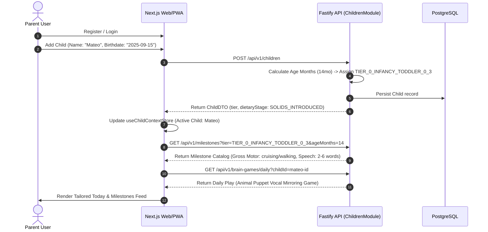
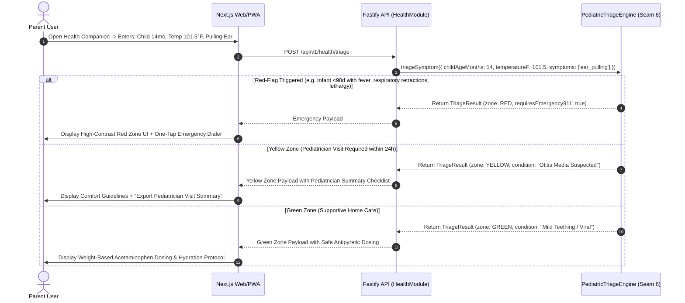
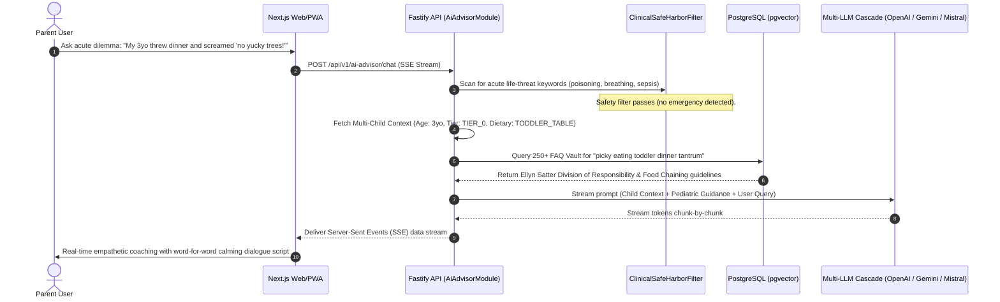

# Alongside — System Architecture Specification
**Author:** Chief Technology Officer (CTO)  
**Status:** Approved for Engineering Implementation  
**Version:** 2.4.0 (The Holistic Child Upbringing, Pediatric Health & Lifespan Family OS)  
**Target Audience:** Frontend Engineer, Backend Engineer, DevOps, Stakeholders  
**Companion Deep-Dive:** [**Expert System Design Specification**](system-design-specification.md) (Capacity estimations, trade-off matrices, resilience protocols)  
**Deep Module & Seam Architecture:** [**Codebase Design Specification**](codebase-design.md) (Module depth, 10 canonical seams, test fake adapters, and Deletion Test)  
**Technical Roadmap:** [**Technical Roadmap v2.4.0**](technical-roadmap-v2.4.0.md)

---

## 1. High-Level Architecture Overview

Alongside is engineered as a type-safe, decoupled monorepo separating the user-facing web/PWA presentation layer from the core domain API service. Transcending narrow screen-time utilities, Alongside v2.4.0 establishes **The Universal Family Operating System (Ages 0–18)**, uniting:
1. **Developmental Milestones & Growth ("When He Moves, When He Talks")**
2. **Pediatric Health & Symptom Guidance ("The Safe Resort")**
3. **Pediatric Nutrition, Feeding & Dietary Safety ("What to Eat")**
4. **Brain Games, Sensory Play & Early Toys ("Puppets & Brain Games")**
5. **Behavioral Psychology, Emotional Decoding & Cultural Mentorship**
6. **24/7 Clinical AI Advisor & Voice Sparring Simulator**
7. **Modern Culture, Multi-Device Ecology & "Thinking About a Device?" Hub**

```mermaid
graph TD
    subgraph ClientLayer ["Client Layer (apps/web - Next.js 15 App Router & React 19)"]
        Browser["Parent Mobile Browser / Mobile PWA"]
        ServiceWorker["Service Worker (Serwist Offline Cache)"]
        ChildSwitcher["Global Multi-Child Switcher (Zustand Context)"]
        DashboardHub["Today & Milestones Home Feed"]
        HealthHub["Pediatric Health & 3-Zone Symptom Triage UI"]
        NutritionHub["Nutrition, BLW & Allergen Scheduler UI"]
        PlayHub["Brain Games, Sensory Toys & Puppets Hub"]
        BehaviorHub["Behavioral Translation & Co-Regulation UI"]
        AdvisorChat["24/7 Clinical AI Advisor & Sparring Simulator"]
        DevicesHub["Modern Culture & Device Governance Hub"]
        TanStackCache["TanStack Query Cache (v5)"]
    end

    subgraph SharedLayer ["Shared Contract Layer (packages/shared)"]
        ZodSchemas["Zod Request / Response Schemas"]
        DomainEnums["Domain Enums (6 Tiers, Triage Zones, Feeding Stages)"]
        ClinicalAlgorithms["Clinical Triage & Milestone Evaluators"]
        DTOs["TypeScript DTO Interfaces & Contracts"]
    end

    subgraph ServiceLayer ["API Service Layer (apps/api - Fastify LTS 22)"]
        FastifyServer["Fastify HTTP Server (TypeScript)"]
        AuthModule["Auth & Session Guard (Argon2id + JWT Cookie)"]
        ChildrenModule["Child Profiles & Developmental Tier Engine"]
        MilestonesModule["Milestone Catalog & Achievement Service"]
        HealthModule["Pediatric Health & Barton Schmitt Triage Engine"]
        NutritionModule["Nutrition Guides, BLW & Allergen Service"]
        BrainGamesModule["Purposeful Play & Toy Catalog Service"]
        BehaviorModule["Behavioral Translation & Script Service"]
        AcademyModule["Parent Intelligence Academy Controller"]
        QuizModule["Interactive Assessment & Scoring Controller"]
        AiAdvisorModule["24/7 Clinical AI Advisor & Streaming RAG Engine"]
        AgreementModule["Bilateral Family Pact Controller"]
        DeviceProfileModule["Pact-as-Code Compiler & PKCS#7 Signer"]
        DigestModule["Weekly Slang & Exploit Alert Controller"]
        BillingModule["Stripe Billing & 7-Day Trial Controller"]
    end

    subgraph DataLayer ["Data & Persistence Layer"]
        PostgresDB[("PostgreSQL 16 + pgvector (Relational & Clinical Embeddings)")]
        RedisCache[("Redis (Session Revocation & BullMQ Queue)")]
        AppleSigningCert[("Apple WWDR & Dev Signing Certificates")]
        ObjectStorage[("Encrypted Storage (PDF Agreements & Profiles)")]
    end

    Browser --> ServiceWorker
    Browser --> ChildSwitcher
    ChildSwitcher --> DashboardHub
    ChildSwitcher --> HealthHub
    ChildSwitcher --> NutritionHub
    ChildSwitcher --> PlayHub
    ChildSwitcher --> BehaviorHub
    ChildSwitcher --> AdvisorChat
    ChildSwitcher --> DevicesHub

    DashboardHub --> TanStackCache
    HealthHub --> TanStackCache
    NutritionHub --> TanStackCache
    PlayHub --> TanStackCache
    BehaviorHub --> TanStackCache
    AdvisorChat -- "Server-Sent Events (SSE)" --> AiAdvisorModule
    DevicesHub --> TanStackCache

    TanStackCache -- "HTTPS / JSON API" --> FastifyServer

    TanStackCache -. "Type Safety" .-> ZodSchemas
    FastifyServer -. "Schema Validation" .-> ZodSchemas

    FastifyServer --> AuthModule
    AuthModule --> ChildrenModule
    AuthModule --> MilestonesModule
    AuthModule --> HealthModule
    AuthModule --> NutritionModule
    AuthModule --> BrainGamesModule
    AuthModule --> BehaviorModule
    AuthModule --> AcademyModule
    AuthModule --> QuizModule
    AuthModule --> AiAdvisorModule
    AuthModule --> AgreementModule
    AuthModule --> DeviceProfileModule
    AuthModule --> DigestModule
    AuthModule --> BillingModule

    ChildrenModule --> PostgresDB
    MilestonesModule --> PostgresDB
    HealthModule --> PostgresDB
    NutritionModule --> PostgresDB
    BrainGamesModule --> PostgresDB
    BehaviorModule --> PostgresDB
    AcademyModule --> PostgresDB
    QuizModule --> PostgresDB
    AiAdvisorModule -- "Vector Similarity (Cosine)" --> PostgresDB
    AgreementModule --> PostgresDB
    DeviceProfileModule --> AppleSigningCert
    DeviceProfileModule --> PostgresDB
    DigestModule --> PostgresDB
    BillingModule --> PostgresDB

    FastifyServer --> RedisCache
    DeviceProfileModule --> ObjectStorage
```



---

## 2. Monorepo Directory Structure

The repository is structured as standard npm workspaces with rigid architectural boundaries:

```
AlongSide/
├── .github/                      # CI/CD Workflows (Lint, Typecheck, Test, Build)
├── .agents/                      # AI Agent Governance & Machine-Enforceable Rules
│   └── rules/                    # Canonical engineering rules
├── apps/
│   ├── web/                      # Frontend Application (Next.js 15, React 19, Tailwind v3.4)
│   │   ├── public/               # Static assets, PWA icons, manifest.json
│   │   ├── src/
│   │   │   ├── app/              # Next.js App Router (pages and layouts)
│   │   │   │   ├── (auth)/       # Authentication (login, register, forgot-password)
│   │   │   │   ├── (dashboard)/  # Authenticated holistic parent application
│   │   │   │   │   ├── dashboard/    # Today & Milestones (Home Feed with Child Switcher)
│   │   │   │   │   ├── health/       # Pediatric Health & 3-Zone Symptom Triage ("Safe Resort")
│   │   │   │   │   ├── nutrition/    # Nutrition, Solids, BLW & Allergen Hub
│   │   │   │   │   ├── brain-games/  # Brain Games, Sensory Play & Early Toys (Puppets)
│   │   │   │   │   ├── behavior/     # Behavioral Translation & Emotional Co-Regulation
│   │   │   │   │   ├── advisor/      # 24/7 Clinical AI Advisor & Voice Sparring Simulator
│   │   │   │   │   ├── devices/      # Modern Culture, Device Readiness & Family Pacts
│   │   │   │   │   ├── academy/      # Parent Intelligence Academy (neurobiology lessons)
│   │   │   │   │   ├── quizzes/      # Interactive assessments (Readiness, Style, Slang)
│   │   │   │   │   ├── digest/       # Sunday youth culture & exploit early warnings
│   │   │   │   │   └── settings/     # Account, billing, trial status & co-parents
│   │   │   │   ├── layout.tsx    # Root layout with providers, fonts & PWA service worker
│   │   │   │   └── page.tsx      # Landing page / marketing hero
│   │   │   ├── components/       # Reusable UI components
│   │   │   │   ├── ui/           # Radix / shadcn/ui primitives (button, dialog, tabs)
│   │   │   │   ├── dashboard/    # Today feed cards, milestone tracker widgets
│   │   │   │   ├── health/       # Triage runner, red-flag banners, dosing calculator
│   │   │   │   ├── nutrition/    # Feeding stage tabs, allergen checklist, BLW safety cards
│   │   │   │   ├── brain-games/  # Toy matrix cards, puppet game guides, boredom busters
│   │   │   │   ├── behavior/     # Tantrum decoder cards, script dialogs, HALT diagnostic
│   │   │   │   ├── advisor/      # Streaming chat feed, quick-prompts, sparring simulator
│   │   │   │   ├── devices/      # QR enrollment card, pact wizard, curfew status
│   │   │   │   └── shared/       # ChildSelector, ParentCalm header, navigation
│   │   │   ├── hooks/            # Custom hooks (useChildContext, useAiChat, useTriage)
│   │   │   ├── lib/              # API client, PDF export, local storage
│   │   │   ├── stores/           # Zustand stores (child context, pact wizard, quiz runner)
│   │   │   └── styles/           # Tailwind config & ParentCalm design tokens
│   │   ├── package.json
│   │   └── tsconfig.json
│   │
│   └── api/                      # Backend API Server (Node.js LTS 22, Fastify, TypeScript)
│       ├── src/
│       │   ├── config/           # Environment variables, logger, cert paths
│       │   ├── plugins/          # Fastify plugins (JWT, CORS, SSE, Database, Swagger)
│       │   ├── modules/          # Deep domain feature modules
│       │   │   ├── auth/         # Register, login, session refresh
│       │   │   ├── children/     # Child CRUD & 6-tier developmental calculation
│       │   │   ├── milestones/   # Milestone catalog & achievement tracking
│       │   │   ├── health/       # Pediatric health & Barton Schmitt triage engine
│       │   │   ├── nutrition/    # Nutrition guides, BLW protocols & allergen schedules
│       │   │   ├── brain-games/  # Purposeful play activities & toy matrix
│       │   │   ├── behavior/     # Behavioral translation guides & de-escalation scripts
│       │   │   ├── academy/      # Neurodevelopmental modules & lessons
│       │   │   ├── quizzes/      # Assessment runner & scoring engine
│       │   │   ├── ai-advisor/   # 24/7 Clinical AI chat, streaming SSE, vector RAG
│       │   │   ├── faqs/         # 250+ Clinical Parenting FAQ repository & search
│       │   │   ├── agreements/   # Bilateral Family Pact generator & PDF export
│       │   │   ├── device-profiles/# Apple .mobileconfig & Android compiler + PKCS#7 signer
│       │   │   ├── digest/       # Sunday culture briefing, slang decoders, exploit alerts
│       │   │   └── billing/      # Stripe Checkout, 7-day trials, webhooks
│       │   ├── common/           # HTTP responses, domain errors, pagination
│       │   ├── index.ts          # Server entry point
│       │   └── app.ts            # Fastify application factory
│       ├── package.json
│       └── tsconfig.json
│
├── packages/
│   ├── shared/                   # Shared TypeScript contracts and pure algorithmic engines
│   │   ├── src/
│   │   │   ├── schemas/          # Zod validation schemas across all domain entities
│   │   │   ├── types/            # Domain interfaces and DTOs
│   │   │   ├── constants/        # Enums (6 Developmental tiers, Triage zones, Feeding stages)
│   │   │   ├── algorithms/       # Triage logic, milestone checks, allergen timing, readiness
│   │   │   └── index.ts
│   │   ├── package.json
│   │   └── tsconfig.json
│   │
│   └── database/                 # Prisma ORM & PostgreSQL Database Layer
│       ├── prisma/
│       │   ├── schema.prisma     # Canonical database schema (with pgvector)
│       │   ├── migrations/       # SQL migration history
│       │   └── seed/             # Seed scripts (AAP triage, CDC milestones, Solid Starts BLW, FAQs)
│       ├── src/
│       │   ├── client.ts         # Singleton Prisma client export
│       │   └── index.ts
│       ├── package.json
│       └── tsconfig.json
│
├── docs/                         # Canonical Architecture, Standards & Specifications (CTO)
├── plans/                        # Discrete Agent Execution Plans (CTO)
├── AGENTS.md                     # Engineering team responsibilities and boundaries
├── PROJECT_SCOPE.md              # Canonical Product Scope v2.4.0 (CEO)
├── README.md                     # Monorepo Executive Overview & Architecture
├── package.json                  # Root npm workspace definition
└── tsconfig.base.json            # Base TypeScript configuration
```

---

## 3. The 6 Canonical Developmental Tiers

AlongSide v2.4.0 maps childhood development across 6 distinct neurodevelopmental and physical phases:

| Tier | Enum Identifier | Age Bracket | Neurobiological & Developmental Focus | Primary Features & Concerns |
| :--- | :--- | :--- | :--- | :--- |
| **Tier 0** | `TIER_0_INFANCY_TODDLER_0_3` | **Ages 0–3** | High-contrast visual stim, sensory somatosensory integration, mirror neurons, speech bursts (50 words at 24mo), gross motor (tummy time -> walking). | Pediatric fever triage, BLW solids & allergen intro, animal puppets, sleep regressions, tantrum co-regulation. |
| **Tier 1** | `TIER_1_EARLY_CHILDHOOD_4_6` | **Ages 4–6** | Rapid language expansion, Theory of Mind emergence, cooperative play, fine motor dexterity (scissors, drawing). | Picky eating solutions, wooden block building, dramatic roleplay, bedtime rituals, co-viewing screen rules. |
| **Tier 2** | `TIER_2_MIDDLE_CHILDHOOD_7_9` | **Ages 7–9** | Concrete operational thought, peer friendship navigation, rule comprehension, reading fluency, physical sports. | School lunchbox nutrition, logic puzzles, chess, boredom busters, shared family tablet limits. |
| **Tier 3** | `TIER_3_PRE_TEEN_10_12` | **Ages 10–12** | Adrenarche onset, prepubertal growth, heightened peer sensitivity, early abstract reasoning, dopamine novelty seeking. | "Thinking About a Device?" diagnostic, smartwatch bridge, slang decoders, group chat exclusion coaching. |
| **Tier 4** | `TIER_4_EARLY_ADOLESCENCE_13_15` | **Ages 13–15** | Peak pubertal transformation, circadian sleep delay (melatonin shifted ~2 hours), identity exploration, social comparison. | Bilateral Family Pact, automated 8:30 PM bedtime lock, body image nutrition, teen voice sparring simulator. |
| **Tier 5** | `TIER_5_LATE_ADOLESCENCE_16_18` | **Ages 16–18** | Prefrontal cortex maturation, impulse control calibration, executive autonomy, long-term consequences, future orientation. | Autonomy upgrade ceremonies, athletic nutrition, college/career stress navigation, independent self-regulation. |

---

## 4. Core System Data Flows

### 4.1 Holistic Multi-Child Onboarding & Development Flow


### 4.2 Pediatric Health Triage & Clinical Safe Harbor Flow


### 4.3 24/7 Clinical AI Advisor Whole-Child Streaming RAG Flow


---

## 5. Privacy, Security & Clinical Safe Harbor Architecture

1. **The Clinical Safe Harbor Guarantee:**
   - Alongside is an empowering educational companion and clinical decision-support system, **NOT a direct replacement for emergency medical care**.
   - **Zero Speculative Diagnosis:** Alongside never asserts absolute diagnoses; it categorizes symptom severity, explains physiological mechanisms, and provides clear triage directives.
   - **Pediatric Contraindication Shield:** Programmatic validation strictly prohibits contraindicated recommendations (e.g., Aspirin under age 19, Ibuprofen under 6 months, OTC cough medicines under 4–6 years).
2. **Zero-Spyware Guarantee:**
   - Alongside **never** logs keystrokes, personal chats, camera feeds, or stealth GPS tracks.
   - Device governance operates strictly at the OS perimeter (bedtime curfews, App Store age gating).
   - **Emergency Exemption:** 911 emergency calls and parent communications are never locked.
3. **Data Protection & Encryption:**
   - Minor data is strictly minimized (first name, birth month/year).
   - Passwords hashed using `argon2id`.
   - Apple `.mobileconfig` profiles signed via PKCS#7 using strict SHA-256 certificate chains.
   - Multi-tenant data segregation enforced at the ORM layer (`where: { userId: currentParentId }`).
