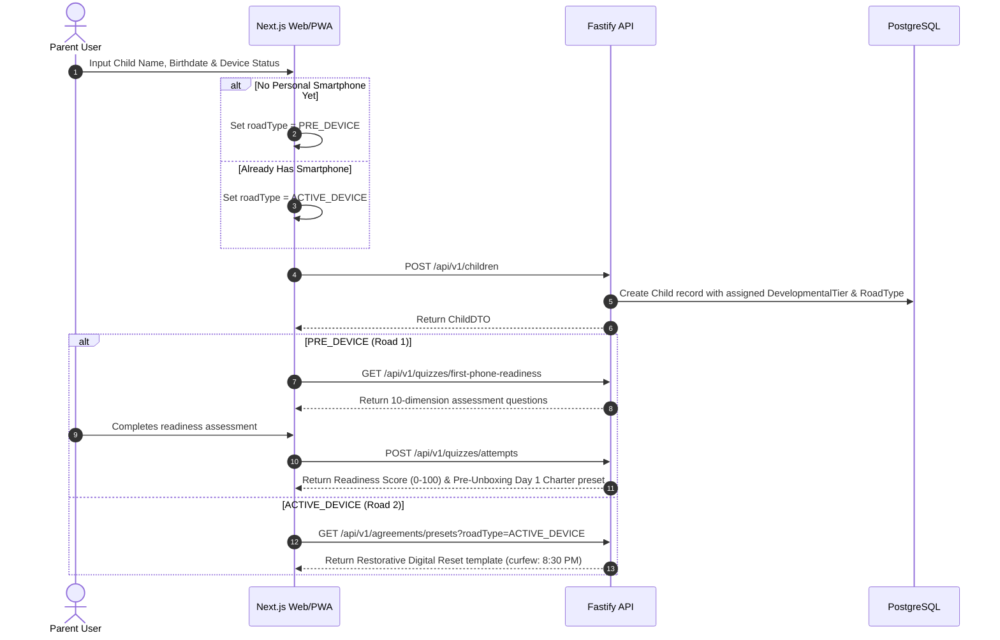
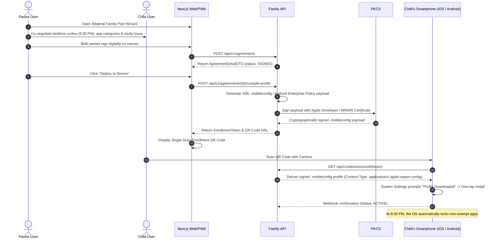
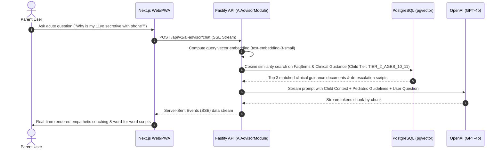
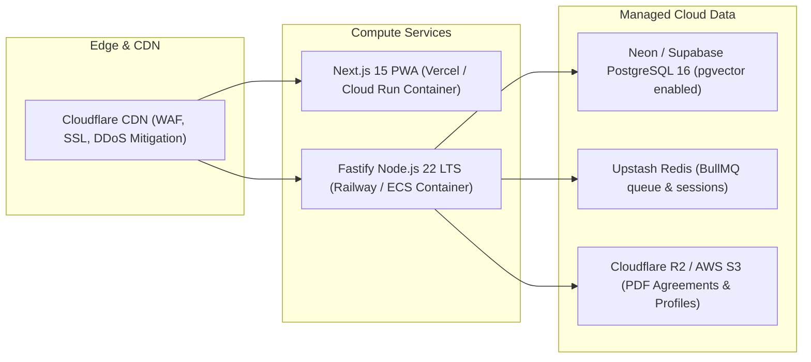

# Alongside — System Architecture Specification
**Author:** Chief Technology Officer (CTO)  
**Status:** Approved for Engineering Implementation  
**Version:** 2.2.0 (The Comprehensive Parent Intelligence & Family Operating System)  
**Target Audience:** Frontend Engineer, Backend Engineer, DevOps, Stakeholders  
**Companion Deep-Dive:** [**Expert System Design Specification**](system-design-specification.md) (Capacity estimations, trade-off matrices, resilience protocols)  
**Deep Module & Seam Architecture:** [**Codebase Design Specification**](codebase-design.md) (Module depth, 7 canonical seams, test fake adapters, and Deletion Test)

---

## 1. High-Level Architecture Overview

AlongSide is engineered as a type-safe, decoupled monorepo separating the user-facing web/PWA presentation layer from the core domain API service. It unites **Parent Education & Awareness (The Mind)** with **Signed Device Governance (The Hand)**. For full quantitative capacity sizing (QPS, storage, bandwidth), trade-off analyses, and failure mitigation strategies, see the companion [**System Design Specification**](system-design-specification.md).

```mermaid
graph TD
    subgraph ClientLayer ["Client Layer (apps/web - Next.js 15 PWA)"]
        Browser["Parent Mobile Browser / Mobile PWA"]
        ServiceWorker["Service Worker (Serwist Offline Cache)"]
        AcademyPlayer["Academy Course & Lesson Player"]
        QuizRunner["Interactive Quiz & Assessment Runner"]
        AdvisorChat["24/7 AI Child Advisor & Sparring UI"]
        PactWizard["Bilateral Family Pact Wizard (Zustand)"]
        DeviceEnrollmentUI["One-Tap QR Code Enrollment Screen"]
        TanStackCache["TanStack Query Cache (v5)"]
    end

    subgraph SharedLayer ["Shared Contract Layer (packages/shared)"]
        ZodSchemas["Zod Request / Response Schemas"]
        DomainEnums["Domain Enums (RoadType, 4 Tiers, QuizTypes)"]
        ScoringEngines["Shared Assessment Scoring Algorithms"]
        DTOs["TypeScript DTO Interfaces & Contracts"]
    end

    subgraph ServiceLayer ["API Service Layer (apps/api - Fastify LTS 22)"]
        FastifyServer["Fastify HTTP Server (TypeScript)"]
        AuthModule["Auth & Session Guard (Argon2id + JWT Cookie)"]
        ChildrenModule["Child Profiles & Road Fork Controller"]
        AcademyModule["Parent Intelligence Academy Controller"]
        QuizModule["Interactive Quiz & Scoring Controller"]
        AiAdvisorModule["24/7 AI Advisor & Streaming RAG Engine"]
        AgreementModule["Bilateral Family Pact Controller"]
        DeviceProfileModule["Pact-as-Code Compiler & Cryptographic Signer"]
        DigestModule["Weekly Slang & Exploit Alert Controller"]
        BillingModule["Stripe Billing & 7-Day Trial Controller"]
    end

    subgraph DataLayer ["Data & Persistence Layer"]
        PostgresDB[("PostgreSQL 16 + pgvector (Relational & Embeddings)")]
        RedisCache[("Redis (Session Revocation & BullMQ Queue)")]
        AppleSigningCert[("Apple WWDR & Dev Signing Certificates")]
        ObjectStorage[("Encrypted Storage (PDF Agreements & Profiles)")]
    end

    Browser --> ServiceWorker
    Browser --> AcademyPlayer
    Browser --> QuizRunner
    Browser --> AdvisorChat
    Browser --> PactWizard
    Browser --> DeviceEnrollmentUI
    
    AcademyPlayer --> TanStackCache
    QuizRunner --> TanStackCache
    AdvisorChat -- "Server-Sent Events (SSE)" --> AiAdvisorModule
    PactWizard --> TanStackCache
    DeviceEnrollmentUI --> TanStackCache

    TanStackCache -- "HTTPS / JSON API" --> FastifyServer

    TanStackCache -. "Type Safety" .-> ZodSchemas
    FastifyServer -. "Schema Validation" .-> ZodSchemas

    FastifyServer --> AuthModule
    AuthModule --> ChildrenModule
    AuthModule --> AcademyModule
    AuthModule --> QuizModule
    AuthModule --> AiAdvisorModule
    AuthModule --> AgreementModule
    AuthModule --> DeviceProfileModule
    AuthModule --> DigestModule
    AuthModule --> BillingModule

    ChildrenModule --> PostgresDB
    AcademyModule --> PostgresDB
    QuizModule --> PostgresDB
    AiAdvisorModule -- "Vector Similarity (Cosine)" --> PostgresDB
    AgreementModule --> PostgresDB
    DeviceProfileModule --> AppleSigningCert
    DeviceProfileModule --> PostgresDB
    DigestModule --> PostgresDB
    BillingModule --> PostgresDB

    FastifyServer --> RedisCache
    DeviceProfileModule --> ObjectStorage
```



---

## 2. Monorepo Directory Structure

The repository is structured as standard npm workspaces. Each package maintains clear ownership boundaries.

```
AlongSide/
├── .github/                      # CI/CD Workflows (Lint, Typecheck, Test, Build)
├── .agents/                      # AI Agent Governance & Machine-Enforceable Rules
│   └── rules/                    # High-priority rules for autonomous agents
├── apps/
│   ├── web/                      # Frontend Application (Next.js 15, Tailwind, shadcn/ui)
│   │   ├── public/               # Static assets, PWA icons, manifest.json
│   │   ├── src/
│   │   │   ├── app/              # Next.js App Router (pages and layouts)
│   │   │   │   ├── (auth)/       # Authentication (login, register, forgot-password)
│   │   │   │   ├── (dashboard)/  # Authenticated parent application routes
│   │   │   │   │   ├── dashboard/    # Primary parent hub & contextual road view
│   │   │   │   │   ├── children/     # Child onboarding, road selection & profiles
│   │   │   │   │   ├── academy/      # Parent Intelligence Academy (lessons by tier)
│   │   │   │   │   ├── quizzes/      # Interactive assessment suite (Tween slang, style)
│   │   │   │   │   ├── advisor/      # 24/7 AI Child Advisor chat & voice sparring
│   │   │   │   │   ├── pacts/        # Bilateral Family Pact builder & signatures
│   │   │   │   │   ├── devices/      # Signed profile enrollment, QR code & 8:30 PM lock
│   │   │   │   │   ├── digest/       # Sunday youth culture & exploit early warnings
│   │   │   │   │   ├── library/      # Scripts, platform decoders & offline reference
│   │   │   │   │   └── settings/     # Account, billing, trial status & co-parents
│   │   │   │   ├── api/          # Minimal frontend route proxies (if needed)
│   │   │   │   ├── layout.tsx    # Root layout with providers & fonts
│   │   │   │   └── page.tsx      # Landing page / marketing hero & road overview
│   │   │   ├── components/       # Reusable UI components
│   │   │   │   ├── ui/           # Radix / shadcn/ui primitives (button, dialog, tabs)
│   │   │   │   ├── academy/      # Course cards, lesson reader, progress tracker
│   │   │   │   ├── quizzes/      # Quiz card, multi-choice question, score summary
│   │   │   │   ├── advisor/      # Chat feed, streaming bubble, quick-prompts, sparring
│   │   │   │   ├── pacts/        # Clause checklist, trade-off sliders, co-signature pad
│   │   │   │   ├── devices/      # QR enrollment card, curfew countdown, lock status
│   │   │   │   ├── digest/       # Weekly briefing card, slang tags, exploit alert badges
│   │   │   │   └── shared/       # ParentCalm header, navigation, modals, error boundaries
│   │   │   ├── hooks/            # Custom hooks (useAuth, useQuizRunner, useAiChat)
│   │   │   ├── lib/              # API client (Ky/fetch), PDF export, local storage
│   │   │   ├── stores/           # Zustand stores (pact builder draft, quiz runner state)
│   │   │   └── styles/           # Tailwind config & ParentCalm design tokens
│   │   ├── package.json
│   │   └── tsconfig.json
│   │
│   └── api/                      # Backend API Server (Node.js LTS 22, Fastify, TypeScript)
│       ├── src/
│       │   ├── config/           # Environment variables, logger, cert paths
│       │   ├── plugins/          # Fastify plugins (JWT, CORS, SSE, Database, Swagger)
│       │   ├── modules/          # Domain feature modules
│       │   │   ├── auth/         # Register, login, refresh, password reset
│       │   │   ├── users/        # Parent profile, subscription state
│       │   │   ├── children/     # Child CRUD, Road 1 vs Road 2 bifurcation
│       │   │   ├── academy/      # Age-by-age developmental modules & lessons
│       │   │   ├── quizzes/      # Assessment runner, multi-dimensional scoring
│       │   │   ├── ai-advisor/   # 24/7 AI chat, streaming SSE, vector similarity RAG
│       │   │   ├── faqs/         # 100+ Modern Parenting FAQ repository & search
│       │   │   ├── agreements/   # Bilateral Family Pact generator & PDF export
│       │   │   ├── device-profiles/# Apple .mobileconfig & Android Enterprise compiler & PKCS#7 signer
│       │   │   ├── digest/       # Sunday culture briefing, slang decoders, exploit alerts
│       │   │   ├── scripts/      # Situation-specific de-escalation conversation scripts
│       │   │   └── billing/      # Stripe Checkout, 7-day trials, webhooks
│       │   ├── common/           # HTTP responses, domain errors, pagination
│       │   ├── index.ts          # Server entry point
│       │   └── app.ts            # Fastify application factory
│       ├── package.json
│       └── tsconfig.json
│
├── packages/
│   ├── shared/                   # Shared TypeScript contracts and validation
│   │   ├── src/
│   │   │   ├── schemas/          # Zod validation schemas (auth, child, pact, quiz, ai)
│   │   │   ├── types/            # Domain interfaces and DTOs
│   │   │   ├── constants/        # Enums (RoadType, DevelopmentalTier, QuizType, Curfew)
│   │   │   ├── algorithms/       # Quiz scoring math & readiness index calculator
│   │   │   └── index.ts
│   │   ├── package.json
│   │   └── tsconfig.json
│   │
│   └── database/                 # Prisma ORM & PostgreSQL Database Layer
│       ├── prisma/
│       │   ├── schema.prisma     # Canonical database schema (with pgvector)
│       │   ├── migrations/       # SQL migration history
│       │   └── seed/             # Seed scripts (Academy modules, 100+ FAQs, slang catalog)
│       ├── src/
│       │   ├── client.ts         # Singleton Prisma client export
│       │   └── index.ts
│       ├── package.json
│       └── tsconfig.json
│
├── docs/                         # Canonical Architecture, Standards & Specifications (CTO)
├── plans/                        # Discrete Agent Execution Plans (CTO)
├── AGENTS.md                     # Engineering team responsibilities and boundaries
├── PROJECT_SCOPE.md              # Canonical Product Scope v2.2.0 (CEO)
├── README.md                     # Monorepo Executive Overview & Architecture
├── package.json                  # Root npm workspace definition
└── tsconfig.base.json            # Base TypeScript configuration
```

---

## 3. Core System Data Flows

### 3.1 Contextual Road Fork & Child Onboarding Flow


### 3.2 Pact-to-Profile Compilation & QR Device Enrollment Flow


### 3.3 24/7 AI Child Advisor Streaming RAG Flow


---

## 4. Privacy, Security & Zero-Spyware Safe Harbor Architecture

Minor privacy and family safety are core architectural invariants:

1. **The Zero-Spyware Safe Harbor Guarantee:**
   - AlongSide **never** collects, logs, or transmits keystrokes, personal messages, browsing histories, camera feeds, or stealth GPS locations.
   - Enforced policies operate exclusively at the **operating system perimeter**: scheduled curfews (8:30 PM bedtime app lock), App Store category age gating, and family dinner pauses.
   - **Emergency Exemption:** Emergency phone calls (911/112), incoming/outgoing parent phone calls, and trusted medical/help hotlines are strictly whitelisted and never locked out.
2. **Child Data Minimization:**
   - Only child first name (or nickname), birth month/year, and device platform are persisted.
   - No phone numbers, serial numbers, or IMEIs are required for enrollment.
3. **Cryptographic Integrity:**
   - Passwords hashed using `argon2id`.
   - Apple `.mobileconfig` profiles signed via PKCS#7 using strict SHA-256 certificate chains.
   - Session tokens delivered exclusively in `HttpOnly`, `Secure`, `SameSite=Strict` cookies.
4. **Tenant Isolation:**
   - Multi-tenant data segregation enforced at the ORM layer: all queries for children, agreements, and quiz attempts require `where: { userId: currentParentId }`.

---

## 5. Deployment & Runtime Infrastructure


