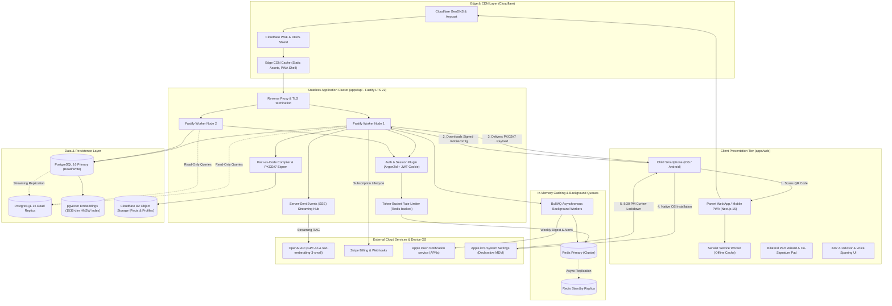
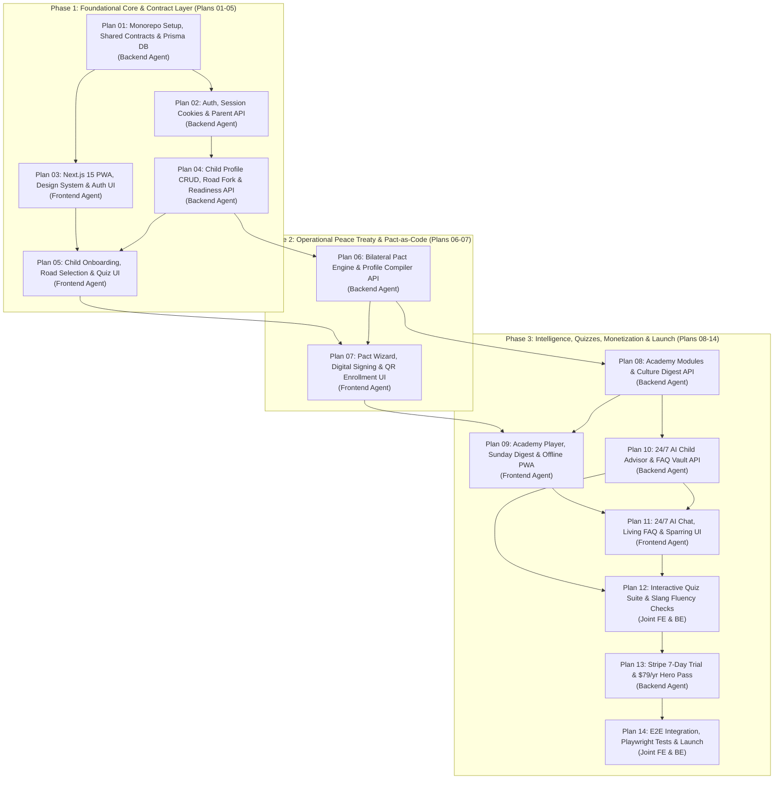

# System Design Specification: Alongside (ParentPath)

**Status:** Approved for Engineering Implementation  
**Author:** Chief Technology Officer (CTO) & Antigravity System Design Engine  
**Version:** 2.2.0 (The Comprehensive Parent Intelligence & Family Operating System)  
**Target Scale:** Baseline 100,000 DAU (~500,000 Registered Families, 700,000 Children) | Scalable to 1,000,000+ DAU  
**Primary SLA:** 99.95% Availability (< 4.38 hours downtime/year)  
**Latency Targets:** Read P95 < 50ms (P99 < 100ms) | Write P95 < 150ms (P99 < 300ms) | AI Advisor TTFT < 800ms  
**Target Audience:** Frontend Engineer, Backend Engineer, DevOps, Security Auditor, Executive Leadership  

---

## 1. Executive Summary & Context

**Alongside** is a category-defining parent intelligence platform and family operating system engineered for families with children aged 8–14+. In digital parenting, software historically suffers from a fatal dichotomy:
1. **The "Content in a Trenchcoat" Extreme:** Static advice blogs and printable refrigerator PDFs that parents consult during an acute crisis (e.g. buying a first phone or catching a kid on TikTok at midnight). Once the acute panic subsides, parents tape the paper to the fridge and churn within 30–60 days.
2. **The "Dumb Utility / Invasive MDM" Extreme:** Coercive surveillance tools (e.g. Bark, Qustodio) that install covert root certificates, scrape private text messages, log keystrokes, and track stealth GPS. These tools treat children like criminals, destroy household trust, ignite teenage rebellion, and face perpetual regulatory risk.

Alongside v2.2 synthesizes **The Mind (Parent Education, Awareness & Diagnostic Fluency)** with **The Hand (Operational Peace Treaty via Pact-as-Code Device Profiles)** into a unified platform. It educates parents on pediatric neurobiology and youth slang, guides families through co-negotiated bilateral agreements, and compiles those agreements into cryptographically signed native mobile configuration profiles (Apple Declarative Management and Android Enterprise) that enforce an automated 8:30 PM bedtime lockdown and App Store age category gates with a strict **Zero-Spyware Safe Harbor Guarantee**.

This System Design Specification defines the production-grade technical foundation, quantitative capacity sizing, component architecture, data models, trade-off defenses, resilience mechanisms, and engineering roadmap required to deliver Alongside at scale.

---

## 2. Requirements & Boundary Definition

### 2.1 Functional Requirements (Core Capabilities)

- **[FR-1] Contextual Road Bifurcation & Multi-Child Profiling:**
  - Dynamic household onboarding that forks into two operational realities:
    - **Road 1 (Pre-Device / No Phone Yet):** First-phone readiness assessment, delay strategies, bridge device evaluation, and pre-unboxing "Day 1 Charters".
    - **Road 2 (Active-Device / Already Has Phone):** Restorative Digital Reset treaties, bedtime lockdown profiles, and weekly exploit early warnings.
  - Multi-child management mapped across 4 developmental tiers: `TIER_1_AGES_8_9` (Impulse centers), `TIER_2_AGES_10_11` (Adrenarche & peer approval), `TIER_3_AGES_12_13` (Circadian sleep delay & social FOMO), and `TIER_4_AGES_14_PLUS` (Autonomy & graduated privileges).
- **[FR-2] Parent Intelligence Academy & Interactive Quizzes:**
  - Micro-learning curriculum (5-minute audio/text lessons) organized by developmental tier.
  - Dynamic assessment engine powering interactive quizzes: *"Do You Speak Tween?"*, Parenting Style Profiler, and the 10-Dimension First-Phone Readiness Audit (Scored 0–100).
  - Real-time client-side calculation and persistent attempt history with radar-chart dimension breakdowns.
- **[FR-3] 24/7 AI Child Advisor & Voice Sparring Simulator:**
  - Streaming conversational interface powered by Server-Sent Events (SSE).
  - Retrieval-Augmented Generation (RAG) over a curated vault of 100+ clinical pediatric parenting FAQs and de-escalation scripts using PostgreSQL `pgvector` cosine similarity.
  - Real-time AI voice sparring simulator allowing parents to rehearse high-conflict confrontations (e.g., arguing for Snapchat) with vocal coaching feedback on tone and firmness.
- **[FR-4] Bilateral Family Pact & Pact-as-Code Compiler:**
  - 5-minute interactive guided wizard where parents and tweens co-design agreed boundaries (curfews, screen-free zones, allowed app categories).
  - Dual digital signature canvas for parent and child.
  - Automated compilation of agreed terms into cryptographically signed Apple `.mobileconfig` (PKCS#7 SHA-256) and Android Enterprise policy payloads.
  - Downloadable vector PDF pact generation and browser-ready `@media print` layouts for refrigerator display.
- **[FR-5] Single-Scan QR Device Enrollment & Automated Enforcement:**
  - One-tap enrollment QR code displayed on parent web dashboard.
  - Direct delivery of signed mobile profile to child device over HTTPS.
  - Automated operating system-level 8:30 PM bedtime lockout of non-exempt applications.
  - App Store category age gating (e.g. blocking 17+ apps on 11yo phone) and in-app purchase disabling.
  - **Zero-Spyware Safe Harbor Guarantee:** Whitelisting of emergency phone calls (911/112), parent voice calls, and confidential crisis lines 24/7.
- **[FR-6] Sunday Youth Culture Digest & Exploit Alerts:**
  - Scheduled weekly Sunday briefing delivering decoded teen vernacular (*skibidi, rizz, crashout, cooked*).
  - Exploit and bypass early warnings (e.g., Google Translate stealth browsers, decoy calculator vault apps).
  - Sunday dinner conversation starters.
- **[FR-7] Subscription Billing & 7-Day Trial Lifecycle:**
  - Upfront 7-day risk-free trial transitioning into Annual Hero Pass ($79/year, ~$6.58/mo) or Monthly Flex Pass ($9.99/mo).
  - Stripe Checkout and Customer Portal integration with automated webhook synchronization.

### 2.2 Non-Functional Requirements (Qualities of Service)

- **Availability:** 99.95% uptime (< 4.38 hours unplanned downtime per calendar year). Multi-instance stateless application cluster with automated health checks and database read replicas.
- **Latency (SLA Targets):**
  - Read Requests (Academy, Quizzes, Digest, Dashboard): P95 < 50ms, P99 < 100ms.
  - Write Requests (Quiz submissions, pact signing, profile compilation): P95 < 150ms, P99 < 300ms.
  - 24/7 AI Advisor Streaming: Time-to-First-Token (TTFT) < 800ms via Fastify Server-Sent Events (SSE).
  - QR Code Profile Delivery: < 1.0s download time on 4G mobile connections.
- **Consistency Model:**
  - **Strong Consistency (CP):** User authentication, child profiles, bilateral pact records, cryptographic device tokens, and Stripe billing states.
  - **Eventual Consistency (AP):** Academy course catalog, Sunday culture digests, and vector FAQ embeddings (cached with TTL in Redis and CDN edge).
- **Data Durability & Minor Privacy (COPPA / GDPR-K Conscious):**
  - Zero PII exposure: Only child nickname/first name, birth month/year, and device OS are collected.
  - Multi-tenant data isolation strictly enforced at the ORM layer (`where: { userId: currentParentId }`).
  - Zero spyware invariant: No keystroke capture, no message reading, no stealth camera/microphone access, and no continuous background GPS tracking.
  - Complete data deletion: "Right to be Forgotten" cascade purge of parent and child records in < 5 seconds.
- **Security & Cryptography:**
  - Passwords hashed using `argon2id` (memory: 64MB, iterations: 3, parallelism: 4).
  - Stateless authentication using `HttpOnly`, `Secure`, `SameSite=Strict` rotating JWT cookies.
  - Apple `.mobileconfig` payloads cryptographically signed with Apple Developer / WWDR certificate via PKCS#7 / CMS (SHA-256).

### 2.3 Explicit Non-Goals (Out of Scope for v1)

- **[NG-1] No Covert Spyware or Social Media Scraping:** AlongSide will not read WhatsApp, Instagram, or iMessage chats, nor record screen captures. This is an intentional ethical and architectural invariant.
- **[NG-2] No Continuous Background GPS Breadcrumb Tracking:** AlongSide will not log real-time geolocation breadcrumbs to prevent battery drain, cloud cost explosion, and surveillance anxiety.
- **[NG-3] No Custom Android ROMs or Device Rooting/Jailbreaking:** All device enforcement operates strictly through sanctioned, native OS configuration mechanisms (Apple Declarative Management / MDM profiles and Android Enterprise).
- **[NG-4] No Dedicated Desktop Electron Client:** The responsive Next.js 15 Progressive Web App (PWA) with offline Serwist caching provides unified desktop and mobile access without packaging multi-hundred-megabyte Electron runtimes.
- **[NG-5] No Child Social Network or Peer-to-Peer Chat:** AlongSide is strictly a parent intelligence and household governance system; it will not build child-to-child communication infrastructure.

---

## 3. Back-of-the-Envelope Capacity Estimations

### 3.1 Traffic & Scale Projections

We evaluate capacity for a **Baseline Scale** of **100,000 Daily Active Users (DAU)** (representing ~500,000 registered parent accounts, average 1.4 children per family = 700,000 child profiles) and project headroom for **1,000,000 DAU**.

```
Time Conversions: 1 day = 86,400 seconds ≈ 10^5 seconds
Peak Traffic Factor = 4x (Traffic heavily concentrates between 7:00 PM and 9:30 PM local bedtime window)
```

| Metric | Sizing Formula | Baseline Value (100k DAU) | 10x Scale (1M DAU) |
| :--- | :--- | :--- | :--- |
| **Daily Active Users (DAU)** | Target Parent User Base | 100,000 | 1,000,000 |
| **Daily Parent Interactions** | 15 web/PWA requests/user/day | 1,500,000 req/day | 15,000,000 req/day |
| **Daily AI Advisor Interactions** | 10% DAU × 10 queries/session | 100,000 queries/day | 1,000,000 queries/day |
| **Daily Device Profile Checks** | 1 scheduled check-in/enrolled child | 100,000 requests/day | 1,000,000 requests/day |
| **Total Daily Requests** | $\sum (\text{Web} + \text{AI} + \text{Device})$ | **1,700,000 req/day** | **17,000,000 req/day** |
| **Average QPS** | $1,700,000 / 86,400$ | **~20 QPS** | **~200 QPS** |
| **Peak QPS (4x Evening Spike)** | $\text{Average QPS} \times 4$ | **~80 QPS** | **~800 QPS** |
| **Read vs. Write Split** | Read-Heavy Architecture (85% Read / 15% Write) | 85% Read / 15% Write | 85% Read / 15% Write |
| **Peak Read QPS** | $\text{Peak QPS} \times 0.85$ | **~68 QPS** | **~680 QPS** |
| **Peak Write QPS** | $\text{Peak QPS} \times 0.15$ | **~12 QPS** | **~120 QPS** |

### 3.2 Storage Capacity Sizing

```
User Record + Settings: ~1.5 KB
Child Profile + Road State: ~1.0 KB
Bilateral Pact + Clauses + Signatures: ~15 KB
Compiled Signed .mobileconfig Payload: ~8 KB
Exported Vector PDF Pact: ~120 KB (stored in S3/R2)
Quiz Attempt + Dimension Breakdown: ~3 KB
AI Chat Message (Prompt + Response): ~1.2 KB
Culture Digest + Slang Terms: ~25 KB (shared, 1 record/week)
```

- **Daily Data Ingestion (Database Write Volume):**
  - New users, child edits, quiz submissions, AI messages, and pact modifications:
  - $\text{Daily Writes} \approx 1,700,000 \times 0.15 = 255,000 \text{ write events/day}$
  - Average write payload in DB: ~2.5 KB (excluding PDF blobs stored in S3/R2)
  - $\text{Daily DB Ingestion} = 255,000 \times 2.5\text{ KB} \approx 637.5\text{ MB/day} \approx 0.64\text{ GB/day}$
- **5-Year Persistent Storage Requirement:**
  - $\text{Annual DB Volume} = 0.64\text{ GB} \times 365 \approx 233.6\text{ GB/year}$
  - $5\text{-Year DB Storage} = 233.6 \times 5 \times 1.25\text{ (25\% indexing \& WAL overhead)} \approx \mathbf{1.46\text{ TB}}$
- **Object Storage Sizing (Encrypted PDFs & Signed Mobileconfigs):**
  - Average 1 signed pact PDF (120 KB) per active child per year:
  - $100,000 \text{ children} \times 120\text{ KB} \approx 12\text{ GB/year}$
  - $5\text{-Year Object Storage} \approx \mathbf{60\text{ GB}}$ (Easily and affordably accommodated by Cloudflare R2 / AWS S3).
- **Vector Embedding Sizing (`pgvector`):**
  - 100+ FAQ items + 50 clinical guidelines + slang definitions = ~500 text chunks.
  - Model: OpenAI `text-embedding-3-small` (1,536 dimensions, 4 bytes/float = ~6.14 KB per vector).
  - $500 \times 6.14\text{ KB} \approx \mathbf{3.07\text{ MB}}$.
  - The entire vector index fits comfortably in PostgreSQL RAM buffer cache.

### 3.3 Memory & Cache Sizing (Redis)

Applying the **80/20 Pareto Rule**: 20% of content accounts for 80% of read traffic.
- Hot read data includes: User session tokens, Academy course curriculum, 10-dimension quiz question trees, weekly Sunday Culture Digest, and active child curfew metadata.
- Total active daily working set: $\approx 10\text{ GB}$.
- 20% Cache Requirement: $10\text{ GB} \times 0.20 = \mathbf{2.0\text{ GB RAM}}$.
- Adding a $2\times$ safety buffer for BullMQ queue operations, rate limiter sliding windows, and Redis memory fragmentation:
- **Recommended Cache Allocation:** **4.0 GB to 8.0 GB RAM**.

### 3.4 Network Bandwidth & Hardware Instance Sizing

- **Network Egress Throughput:**
  - Peak Read QPS = ~68 QPS (Baseline) / ~680 QPS (10x).
  - Average response size = ~25 KB (JSON DTOs, compressed with Gzip/Brotli).
  - $\text{Peak Egress (Baseline)} = 68 \times 25\text{ KB} = 1,700\text{ KB/s} \approx \mathbf{13.6\text{ Mbps}}$.
  - $\text{Peak Egress (10x Scale)} = 680 \times 25\text{ KB} = 17,000\text{ KB/s} \approx \mathbf{136\text{ Mbps}}$.
- **Application Server Node Count:**
  - Fastify on Node.js 22 LTS handles **1,500 to 3,000 simple I/O QPS per 2-vCPU core**.
  - Peak load is ~80 QPS (Baseline) and ~800 QPS (10x).
  - Sizing for N+1 high availability: **2 application server instances (2 vCPU, 4 GB RAM each)** will operate at < 5% CPU utilization at baseline, gracefully handling sudden 10x traffic spikes.
- **Database Node Count:**
  - Primary Database: PostgreSQL 16 on **4 vCPU, 16 GB RAM SSD (Provisioned IOPS)**.
  - Read Replicas: **1 Read Replica (4 vCPU, 16 GB RAM)** for offloading Academy lesson reads, FAQ searches, and analytics.

---

## 4. High-Level Architecture & Mermaid Blueprint

### 4.1 End-to-End System Architecture



### 4.2 Component Roles & System Boundaries

1. **Edge & CDN Layer (Cloudflare):**
   - Terminates TLS 1.3 with automated certificate renewal.
   - Shields application servers from DDoS attacks using rate limiting and web application firewall (WAF) rule sets.
   - Caches immutable Next.js static chunks, PWA application bundles, icons, and fonts at edge points of presence worldwide.
2. **Client Presentation Tier (`apps/web`):**
   - Built on Next.js 15 (App Router, React 19) and Tailwind CSS v3.4.
   - Implements the accessible, warm "Parent Calm" design system using Radix UI / `shadcn/ui`.
   - Progressive Web App (PWA) with Serwist service worker providing offline read access to crisis de-escalation conversation scripts, platform decoders, and signed pact agreements.
   - TanStack Query v5 manages optimistic server cache updates and automatic background invalidation; Zustand handles multi-step agreement wizard and quiz runner state.
3. **Stateless API Cluster (`apps/api`):**
   - Powered by Node.js LTS 22 and Fastify, providing high-throughput asynchronous request handling and native schema validation.
   - Enforces `HttpOnly`, `Secure`, `SameSite=Strict` cookie authentication with Argon2id password hashing.
   - Implements native Server-Sent Events (SSE) streaming for 24/7 AI Child Advisor conversations.
   - Houses the **Pact-as-Code Compiler**, generating valid Apple Declarative Management XML (`.mobileconfig`) and Android Enterprise JSON payloads cryptographically signed with Apple Developer certificates via `node-forge`.
4. **Caching & Asynchronous Processing Layer:**
   - Managed Redis cluster powering session blacklisting, distributed rate limiting, and BullMQ task queues.
   - Background workers schedule and dispatch Sunday morning Youth Culture Digests, synchronize Stripe billing webhooks, and compile large PDF pact downloads asynchronously.
5. **Data & Persistence Layer:**
   - PostgreSQL 16 relational database with primary-replica topology.
   - `pgvector` extension for unified storage of clinical pediatric FAQ vector embeddings and cosine similarity nearest-neighbor queries within the same transactional database.
   - Cloudflare R2 / AWS S3 encrypted object storage for downloadable vector PDF pacts and generated device configuration bundles.

---

## 5. Data Model & Storage Design

### 5.1 Relational Schema Architecture (DDL Definition)

The database schema is structured around strict tenant ownership, ensuring that all child profiles, agreements, quiz attempts, and AI conversations belong exclusively to an authenticated parent user (`User`).

```sql
-- PostgreSQL 16 Canonical Schema with pgvector
CREATE EXTENSION IF NOT EXISTS "uuid-ossp";
CREATE EXTENSION IF NOT EXISTS "vector";

-- Enum Definitions
CREATE TYPE "RoadType" AS ENUM ('PRE_DEVICE', 'ACTIVE_DEVICE');
CREATE TYPE "DevelopmentalTier" AS ENUM ('TIER_1_AGES_8_9', 'TIER_2_AGES_10_11', 'TIER_3_AGES_12_13', 'TIER_4_AGES_14_PLUS');
CREATE TYPE "SubscriptionTier" AS ENUM ('TRIAL', 'ANNUAL_HERO', 'MONTHLY_FLEX', 'INSTITUTIONAL');
CREATE TYPE "DeviceProfileStatus" AS ENUM ('PENDING_ENROLLMENT', 'ACTIVE', 'REVOKED', 'EXPIRED');
CREATE TYPE "DevicePlatform" AS ENUM ('APPLE_IOS', 'ANDROID_ENTERPRISE');
CREATE TYPE "AgreementStatus" AS ENUM ('DRAFT', 'SIGNED', 'ACTIVE', 'SUPERSEDED');

-- 1. Users Table
CREATE TABLE "users" (
    "id" UUID PRIMARY KEY DEFAULT uuid_generate_v4(),
    "email" VARCHAR(255) UNIQUE NOT NULL,
    "password_hash" VARCHAR(255) NOT NULL,
    "full_name" VARCHAR(255) NOT NULL,
    "subscription_tier" "SubscriptionTier" NOT NULL DEFAULT 'TRIAL',
    "trial_ends_at" TIMESTAMPTZ NOT NULL,
    "created_at" TIMESTAMPTZ NOT NULL DEFAULT NOW(),
    "updated_at" TIMESTAMPTZ NOT NULL DEFAULT NOW()
);

-- 2. Children Table (Contextual Road Fork & 4 Tiers)
CREATE TABLE "children" (
    "id" UUID PRIMARY KEY DEFAULT uuid_generate_v4(),
    "user_id" UUID NOT NULL REFERENCES "users"("id") ON DELETE CASCADE,
    "name" VARCHAR(100) NOT NULL,
    "birth_year" INT NOT NULL,
    "birth_month" INT NOT NULL,
    "road_type" "RoadType" NOT NULL,
    "developmental_tier" "DevelopmentalTier" NOT NULL,
    "device_platform" "DevicePlatform",
    "created_at" TIMESTAMPTZ NOT NULL DEFAULT NOW(),
    "updated_at" TIMESTAMPTZ NOT NULL DEFAULT NOW()
);
CREATE INDEX "idx_children_user_id" ON "children"("user_id");

-- 3. Agreements Table (Bilateral Family Pact)
CREATE TABLE "agreements" (
    "id" UUID PRIMARY KEY DEFAULT uuid_generate_v4(),
    "user_id" UUID NOT NULL REFERENCES "users"("id") ON DELETE CASCADE,
    "child_id" UUID NOT NULL REFERENCES "children"("id") ON DELETE CASCADE,
    "title" VARCHAR(255) NOT NULL,
    "version" INT NOT NULL DEFAULT 1,
    "status" "AgreementStatus" NOT NULL DEFAULT 'DRAFT',
    "curfew_time" VARCHAR(10) NOT NULL DEFAULT '20:30',
    "parent_signature" TEXT,
    "child_signature" TEXT,
    "signed_at" TIMESTAMPTZ,
    "pdf_s3_key" VARCHAR(500),
    "created_at" TIMESTAMPTZ NOT NULL DEFAULT NOW(),
    "updated_at" TIMESTAMPTZ NOT NULL DEFAULT NOW()
);
CREATE INDEX "idx_agreements_child_user" ON "agreements"("child_id", "user_id");

-- 4. Device Profiles Table (Pact-as-Code Signed Mobileconfig)
CREATE TABLE "device_profiles" (
    "id" UUID PRIMARY KEY DEFAULT uuid_generate_v4(),
    "agreement_id" UUID UNIQUE NOT NULL REFERENCES "agreements"("id") ON DELETE CASCADE,
    "child_id" UUID NOT NULL REFERENCES "children"("id") ON DELETE CASCADE,
    "enrollment_token" VARCHAR(128) UNIQUE NOT NULL,
    "platform" "DevicePlatform" NOT NULL DEFAULT 'APPLE_IOS',
    "status" "DeviceProfileStatus" NOT NULL DEFAULT 'PENDING_ENROLLMENT',
    "payload_s3_key" VARCHAR(500) NOT NULL,
    "enrolled_at" TIMESTAMPTZ,
    "last_heartbeat_at" TIMESTAMPTZ,
    "created_at" TIMESTAMPTZ NOT NULL DEFAULT NOW(),
    "updated_at" TIMESTAMPTZ NOT NULL DEFAULT NOW()
);
CREATE UNIQUE INDEX "idx_device_profiles_token" ON "device_profiles"("enrollment_token");

-- 5. Modern Parenting FAQ Items & Vector Embeddings
CREATE TABLE "faq_items" (
    "id" UUID PRIMARY KEY DEFAULT uuid_generate_v4(),
    "question" TEXT NOT NULL,
    "answer_markdown" TEXT NOT NULL,
    "target_tier" "DevelopmentalTier" NOT NULL,
    "embedding" vector(1536) NOT NULL,
    "created_at" TIMESTAMPTZ NOT NULL DEFAULT NOW()
);
-- HNSW Vector Index for Sub-Millisecond Cosine Similarity Search
CREATE INDEX "idx_faq_items_embedding" ON "faq_items" USING hnsw ("embedding" vector_cosine_ops);
```

### 5.2 Indexing & Partitioning Strategy

1. **Composite Tenant Indices:** All child, agreement, and quiz queries execute within parent tenant boundaries. Composite B-Tree index on `(user_id, created_at DESC)` ensures single-digit millisecond query execution without sequential table scans.
2. **Unique Token Indices:** Device enrollment tokens (`enrollment_token`) use high-entropy 256-bit cryptographic strings with unique B-Tree indices to support sub-5ms device profile downloads during QR code scans.
3. **Vector Indexing (HNSW):** We utilize Hierarchical Navigable Small World (HNSW) indexing on `faq_items.embedding` with cosine distance operators (`vector_cosine_ops`). HNSW outperforms traditional IVFFlat indexes in low-latency environments by eliminating the need for periodic index rebuild training phases and maintaining sub-15ms search latencies under concurrent queries.
4. **Partitioning Roadmap (1M+ Scale):**
   - At 1M+ DAU, the `quiz_responses` and `ai_messages` tables will be partitioned by range on `created_at` (monthly partitions) to maintain small active index footprints in memory and simplify data retention pruning.

---

## 6. Deep-Dive Architectural Trade-Off Decisions ("Why X Over Y")

### 6.1 Storage Selection: PostgreSQL 16 + `pgvector` vs. MongoDB + Pinecone

- **Selected:** **PostgreSQL 16 with native `pgvector` extension (via Prisma ORM)**.
- **Alternative Considered:** MongoDB (for document flexibility) + Pinecone or Qdrant (for vector search).
- **Architectural Rationale:**
  - *Single Operational Footprint:* AlongSide is a highly relational domain. A parent owns children; a child is governed by an agreement; an agreement compiles into a device profile; a quiz attempt evaluates a child. Splitting this data across MongoDB and a dedicated vector database introduces distributed transaction failure modes, two-phase commits, and multi-vendor operational overhead.
  - *Transactional Relational Integrity:* With `pgvector`, the AI Advisor can execute a single ACID query that filters by the child's exact developmental tier (`WHERE target_tier = child.developmental_tier`) while simultaneously ranking vector cosine distance.
  - *Zero Sync Lag:* FAQ updates or clinical guideline additions are instantly searchable without asynchronous vector ETL pipeline delays.
- **Trade-off Accepted:** HNSW vector index builds consume dedicated PostgreSQL RAM. Sizing the DB node with 16 GB RAM mitigates this cleanly given our compact ~500 FAQ chunk dataset.

### 6.2 Communication Protocol: Fastify REST + Server-Sent Events (SSE) vs. WebSockets

- **Selected:** **Standard HTTP/2 REST for CRUD + Server-Sent Events (SSE) for AI Advisor Streaming**.
- **Alternative Considered:** Full-duplex WebSockets (`ws://`).
- **Architectural Rationale:**
  - *Simplicity & Firewall Traversal:* Server-Sent Events operate over standard HTTPS (Port 443). They traverse strict school Wi-Fi networks, cellular carrier proxies, and enterprise VPNs without connection drops or proxy blocking that frequently sever long-lived WebSocket handshakes.
  - *Automatic Reconnection:* SSE includes native browser reconnection semantics (`EventSource` auto-reconnects and sends `Last-Event-ID`).
  - *Unidirectional Stream Fit:* AI Advisor token streaming is fundamentally unidirectional (server to client). The parent asks a question via standard `POST`, and the server streams tokens back. WebSockets' full-duplex capability is unnecessary overhead here.
- **Trade-off Accepted:** Audio voice sparring simulation uses chunked audio uploads via multipart HTTP with streaming SSE transcription responses rather than raw binary WebSocket audio frames in v1.

### 6.3 Device Management Strategy: Transparent "Pact-as-Code" (.mobileconfig) vs. Invasive MDM Agent

- **Selected:** **Apple Declarative Management / `.mobileconfig` Profiles & Android Enterprise Policies**.
- **Alternative Considered:** Proprietary background agent / VPN proxy with deep packet inspection (e.g., Bark, Qustodio).
- **Architectural Rationale:**
  - *Zero Spyware Guarantee:* Invasive monitoring tools require installing a root SSL certificate on the child's phone to decrypt private traffic. This breaks child trust, introduces catastrophic security vulnerabilities, and violates AlongSide's foundational brand ethos.
  - *Zero App Store Rejection Risk:* Apple aggressively terminates third-party apps that abuse screen recording or enterprise MDM certificates for consumer snooping. Standard `.mobileconfig` profiles are native Apple configuration files installed through standard iOS Settings.
  - *Hardware-Level Bedtime Lock:* At 8:30 PM, the operating system neutrally disables non-whitelisted apps. Parents are not the "bad guys" policing bedroom doors; the OS enforces the pact the child co-signed.
- **Trade-off Accepted:** Installing an Apple `.mobileconfig` requires the parent to tap "Allow" in Safari and "Install" in iOS Settings (a 30-second multi-step OS prompt). AlongSide mitigates this with an interactive 3-step visual enrollment guide.

### 6.4 Client Delivery: Progressive Web App (PWA) vs. Pure Native iOS/Android Apps

- **Selected:** **Next.js 15 PWA (`@ducanh2912/next-pwa` Serwist) + Mobile QR Code Profile Enrollment**.
- **Alternative Considered:** Native Swift (iOS) and Kotlin (Android) App Store applications.
- **Architectural Rationale:**
  - *Zero Friction Immediate Access:* When an exhausted parent encounters AlongSide at 10:00 PM during a family conflict, an instant web app eliminates the friction of App Store search, 100MB download, and Apple ID password prompts.
  - *Avoidance of 30% App Store Tax:* Apple charges 30% on digital subscriptions. A web-first subscription model preserves unit economics ($79/year Annual Hero Pass remains 100% net revenue to the business).
  - *Unified Codebase Velocity:* The single TypeScript / Next.js monorepo allows the Frontend Agent to deliver features simultaneously across desktop and mobile browsers.
- **Trade-off Accepted:** PWA push notifications on iOS require the user to tap "Add to Home Screen". We prompt parents during onboarding to install the PWA shortcut to receive their Sunday morning Culture Digest.

### 6.5 Concurrency, Locking & Idempotency: Optimistic Locking + Distributed Idempotency Keys

- **Selected:** **Optimistic Concurrency Control (Version Counters) + Redis Distributed Idempotency Keys**.
- **Alternative Considered:** Pessimistic Database Row Locking (`SELECT FOR UPDATE`).
- **Architectural Rationale:**
  - *Non-Blocking High Read Performance:* In consumer family applications, concurrent write conflicts on the same agreement are rare. Pessimistic row locking introduces database lock contention and deadlocks under concurrent reads.
  - *Stripe Webhook Idempotency:* Stripe sends webhooks asynchronously with potential retries. Every incoming Stripe event is checked against an `idempotency_keys` table inside a database transaction. If the `event.id` was already processed, the worker immediately returns `200 OK` without re-processing subscription state.
- **Trade-off Accepted:** If both parents edit the same agreement simultaneously, the second save receives a `409 Conflict` error and is prompted to merge changes.

### 6.6 Session Security: Argon2id + HttpOnly Secure Cookie JWT vs. LocalStorage Tokens

- **Selected:** **Argon2id Password Hashing + `HttpOnly`, `Secure`, `SameSite=Strict` Cookie JWT Rotation**.
- **Alternative Considered:** Storing Bearer JWTs in browser `localStorage`.
- **Architectural Rationale:**
  - *Immunity to XSS Token Theft:* Storing tokens in `localStorage` allows any injected third-party JavaScript or compromised npm dependency to extract parent authentication tokens. `HttpOnly` cookies cannot be accessed via JavaScript.
  - *State-of-the-Art Password Protection:* `argon2id` is the winner of the Password Hashing Competition (PHC), providing maximal resistance against GPU/ASIC brute-force cracking compared to legacy bcrypt.
- **Trade-off Accepted:** Fastify must validate CSRF tokens on state-changing requests (`POST`, `PUT`, `DELETE`) via double-submit cookie verification.

---

## 7. Failure Modes, Resiliency & Bottlenecks

### 7.1 Comprehensive Failure Mode Analysis Matrix

| Failure Scenario | Severity | Detection Mechanism | Mitigation & Recovery Procedure |
| :--- | :--- | :--- | :--- |
| **1. Primary PostgreSQL Node Crash** | Critical | Automated health check probe (HTTP 500 spike, DB heartbeat failure > 10s) | Cloud managed failover (Neon/AWS RDS) automatically promotes standby read replica to primary within 30 seconds. Fastify connection pool reconnects with exponential backoff. |
| **2. Redis Cache Cluster Collapse** | High | Redis connection timeout error logged by Pino logger | Application falls back to direct database reads with circuit breaker throttling. Stale-while-revalidate pattern prevents DB saturation. Jittered TTLs ($TTL \pm 15\%$) prevent cache avalanche upon Redis restart. |
| **3. Apple Signing Certificate Expiration** | Critical | Daily automated cron check alert 30 days prior to expiry | Fastify monitoring fires alert to DevOps. PKCS#7 signing service hot-reloads renewed `.p12` certificates from encrypted vault without server restart. Existing installed profiles remain active on devices. |
| **4. AI Provider (OpenAI) Outage / High Latency** | Medium | OpenAI API timeout (> 5,000ms) or HTTP 503 response | Circuit breaker (Resilience4j pattern) trips to OPEN state after 5 consecutive failures. Fastify returns curated static clinical pediatric guidance and conversation scripts matching the child's tier from local database. |
| **5. Stripe Webhook Replay or Out-of-Order Delivery** | Medium | Stripe webhook handler detects existing `event.id` in `webhook_events` table | Strict idempotency enforcement: Each webhook is processed inside a PostgreSQL serializable transaction. Duplicate events return immediate `200 OK` with zero duplicate subscription state changes. |
| **6. Child Attempts Profile Removal / Bypass** | Medium | Apple APNs MDM unenrollment notification webhook received | Device status immediately changes to `REVOKED`. Fastify dispatches an empathetic, non-punitive notification to the parent dashboard with a restorative conversation guide: *"Maya removed the profile—here's how to talk about it."* |
| **7. Sunday Morning Digest Traffic Surge (10x Spike)** | Medium | Cloudflare CPU/Bandwidth metrics & Fastify request rate spike | Cloudflare CDN edge caches the compiled Sunday Culture Digest with `stale-while-revalidate=86400`. 95% of digest reads never hit origin Fastify servers. Background worker push notifications are throttled over 45 minutes via BullMQ. |
| **8. Slow Database Queries / Connection Pool Exhaustion** | High | Prisma query duration metric exceeds 500ms; connection timeout | Strict statement timeout (2,000ms) prevents runaway queries from starving pool. Read-heavy routes (Academy, Digest) explicitly route to read replica. PgBouncer manages pooled connections. |

### 7.2 Cache Collapse Mitigations: Detailed Strategies

1. **Cache Avalanche:**
   - *Risk:* Hundreds of cached Academy modules or FAQ embeddings expiring at the exact same second, causing thousands of concurrent database queries.
   - *Mitigation:* Apply randomized TTL jitter:
     $$\text{Actual TTL} = \text{Base TTL} + \text{random}(-0.15 \times \text{Base TTL}, +0.15 \times \text{Base TTL})$$
2. **Cache Penetration:**
   - *Risk:* Malicious or errant queries requesting non-existent child IDs or FAQ IDs, bypassing Redis and hitting PostgreSQL on every request.
   - *Mitigation:* Cache `null` results with a short 60-second TTL; enforce UUID v4 regex format validation in Zod middleware before querying the database.
3. **Thundering Herd (Cache Stampede):**
   - *Risk:* Sunday morning Culture Digest cache expires right as 50,000 parents click the weekly push notification.
   - *Mitigation:* Mutex locking pattern in Redis: The first request that encounters a cache miss acquires a 5-second distributed lock to re-compute and re-cache the digest; all concurrent requests await the lock or return the stale cached version.

---

## 8. Phased Implementation Roadmap & Engineering Plan Mapping

The Alongside system design is executed across **14 discrete, ordered engineering plans** adhering strictly to [`docs/engineering-standards/plan-standards.md`](./engineering-standards/plan-standards.md) and [`AGENTS.md`](../AGENTS.md).



### 8.1 Detailed Phase Breakdown

#### Phase 1: MVP Core Backbone & Monorepo Foundation (Plans 01–05)
- **Deliverables:**
  - Standard npm workspaces (`apps/web`, `apps/api`, `packages/shared`, `packages/database`).
  - `@alongside/shared` with Zod validation schemas, domain enums (`RoadType`, 4 `DevelopmentalTier`s), and scoring algorithms.
  - PostgreSQL 16 schema with `pgvector` migration and Prisma client.
  - Argon2id password hashing and `HttpOnly` JWT cookie rotation.
  - Next.js 15 App Router scaffolding with accessible "Parent Calm" Tailwind CSS design system.
  - Child profile CRUD with Contextual Road Fork selection (`PRE_DEVICE` vs `ACTIVE_DEVICE`).

#### Phase 2: Operational Peace Treaty & "Pact-as-Code" (Plans 06–07)
- **Deliverables:**
  - Bilateral Family Pact co-negotiation wizard and digital canvas co-signing.
  - `node-forge` PKCS#7 cryptographic signing engine generating signed Apple `.mobileconfig` payloads and Android Enterprise policies.
  - Single-scan QR code enrollment screen with automatic 8:30 PM bedtime curfew enforcement and zero-spyware guarantee.
  - Downloadable vector PDF pact generation via `@react-pdf/renderer` and refrigerator print styles.

#### Phase 3: Parent Intelligence, AI Advisor, Quizzes & Monetization (Plans 08–14)
- **Deliverables:**
  - Parent Intelligence Academy micro-learning course player with lesson progress tracking.
  - Sunday Youth Culture Digest with slang decoders and exploit early warnings.
  - 24/7 AI Child Advisor with low-latency Server-Sent Events (SSE) streaming and `pgvector` RAG over 100+ clinical FAQs.
  - AI Voice Sparring Simulator for verbal conflict practice.
  - Interactive quiz suite (*"Do You Speak Tween?"*, Parenting Style Profiler, 10-Dimension Readiness Audit).
  - Stripe subscription checkout and webhook sync (7-day trial, $79/yr Annual Pass, $9.99/mo Flex Pass).
  - Playwright end-to-end test suite verifying critical family journeys and CI/CD automation.

---

## 9. Architectural Sign-Off & Governance

This specification serves as the canonical technical contract for the Alongside platform. Any deviations or modifications to data models, API envelopes, or agent boundaries require explicit review and approval by the Chief Technology Officer (CTO).

- **Canonical Product Scope:** [`PROJECT_SCOPE.md`](../PROJECT_SCOPE.md)
- **Database ERD & Schema:** [`docs/data-models.md`](./data-models.md)
- **API Endpoints & Contracts:** [`docs/api-specification.md`](./api-specification.md)
- **Engineering Team Governance:** [`AGENTS.md`](../AGENTS.md)
- **Discrete Execution Plans:** [`plans/README.md`](../plans/README.md)
