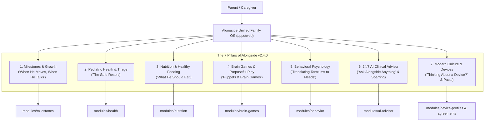
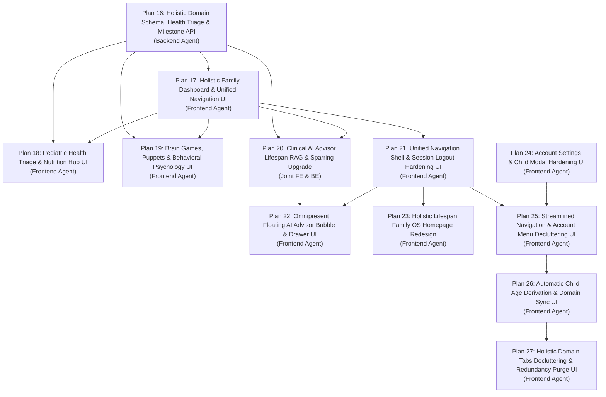

# Alongside — Technical Roadmap Specification (Version 2.4.0)
## The Holistic Child Upbringing, Pediatric Health & Lifespan Family Operating System (Ages 0–18)
**Author:** Chief Technology Officer (CTO)  
**Status:** Approved Canonical Technical Roadmap  
**Target Audience:** Engineering Team (Frontend, Backend, Research), Product Leadership, Board of Directors  
**Companion Documents:**
- [`docs/PROJECT_SCOPE.md`](PROJECT_SCOPE.md) (Canonical Product Scope v2.4.0)
- [`docs/system-architecture.md`](system-architecture.md) (Monorepo System Architecture v2.4.0)
- [`docs/codebase-design.md`](codebase-design.md) (Deep Modules & Seam Architecture v2.4.0)
- [`docs/data-models.md`](data-models.md) (Prisma Schema & Data Models v2.4.0)
- [`docs/api-specification.md`](api-specification.md) (REST API Specification v2.4.0)
- [`docs/holistic-redesign-and-navigation-spec.md`](holistic-redesign-and-navigation-spec.md) (Holistic Redesign & Navigation Spec v2.4.0)
- [`plans/README.md`](../plans/README.md) (Master Engineering Execution Plans Index)

---

## 1. Executive Summary & Architectural Horizon

### 1.1 The Strategic Shift
Alongside has executed an epochal architectural and strategic upgrade from a screen-time and device management utility to **The Holistic Child Upbringing, Pediatric Health & Lifespan Family Operating System (Ages 0–18)**.

The initial versions of Alongside (v1.0.0 through v2.2.0) built a world-class digital parenting infrastructure:
- Bilateral Family Pacts ("Pact-as-Code")
- Cryptographic Apple `.mobileconfig` and Android Enterprise enrollment
- Automated 8:30 PM bedtime hardware curfews
- Weekly Sunday Youth Culture Digests & Slang Decoders
- 24/7 AI Child Advisor with streaming Server-Sent Events (SSE)

However, as codified in [`docs/PROJECT_SCOPE.md`](PROJECT_SCOPE.md) v2.4.0 and confirmed in the decacorn evaluation ([`docs/PAUL_GRAHAM_ROAST.md`](PAUL_GRAHAM_ROAST.md)), framing an entire family product solely around screens creates a fatal vulnerability:
1. **The "Device-Only" Keyhole:** When a child is playing outside, having a meal, or sleeping peacefully, screen-time apps feel irrelevant.
2. **The 24-Month Churn Curse:** Traditional baby and infant trackers capture parents for 12–24 months (diapers, ounces, sleep) and suffer 90% churn when the child turns 2 because they fail to evolve into speech development, picky eating, emotional boundary testing, and elementary school.
3. **The Fragmented Panic Loop:** Modern parents are exhausted from juggling fragmented single-point sources: 2:00 AM fever panic on WebMD, conflicting mommy blogs for baby-led weaning, and authoritarian surveillance apps that destroy family trust.

**Alongside v2.4 unifies the 4 Core Pillars of Childhood into one seamless, trusted companion:**
1. **Physical Health & Wellness (The Safe Resort):** Pediatric symptom triage (Red/Yellow/Green zones based on Barton Schmitt protocols), fever thresholds by age, sleep regressions, and acute illness care.
2. **Pediatric Nutrition & Feeding:** From exclusive infant milk and baby-led weaning (BLW) to safe early allergen introduction, toddler picky eating solutions (Division of Responsibility), school lunch fuel, and adolescent athletic growth.
3. **Developmental Milestones & Purposeful Brain Play:** Motor skills (when he moves), speech and language bursts (when he talks), cognitive benchmarks, early puppets, sensory exploration, and logic brain games.
4. **Behavioral Psychology & Cultural Mentorship:** Translating tantrums into unmet neurological needs (HALT diagnostic), co-regulation scripts, authoritative boundary setting, and mentoring children to thrive in a modern world.
5. **Modern Living & Balanced Technology:** Navigating multi-device ecologies (TVs, tablets, consoles, smartwatches, phones) with the "Thinking About Buying a Device?" Action Hub, Bilateral Family Pacts, and automated 8:30 PM curfews with zero spyware.

---

## 2. Architectural Evolution Matrix: v2.2.0 to v2.4.0

| Architectural Dimension | Legacy Implementation (v2.2.0) | Upgraded Lifespan OS (v2.4.0) |
| :--- | :--- | :--- |
| **Target Age Range** | Ages 8–14+ (Tween/Teen focus) | **Ages 0–18 (Full Childhood Lifespan)** |
| **Developmental Tiers** | 4 Tiers (`TIER_1_AGES_8_9` to `TIER_4_AGES_14_PLUS`) | **6 Canonical Tiers (Tier 0: 0–3y, Tier 1: 4–6y, Tier 2: 7–9y, Tier 3: 10–12y, Tier 4: 13–15y, Tier 5: 16–18y)** |
| **Primary Value Proposition** | Device contracts & bedtime curfew enforcement | **Holistic child health, nutrition, milestone tracking, brain play, and modern cultural guidance** |
| **Device Governance Role** | The core product | **An integrated transition milestone within the Modern World & Device Hub** |
| **Client Navigation (`apps/web`)** | Bifurcated Road 1 (`PRE_DEVICE`) vs Road 2 (`ACTIVE_DEVICE`) fork | **Unified Multi-Child Family Dashboard with 7 dedicated domain hubs** |
| **Backend Domain Modules (`apps/api`)** | `auth`, `children`, `academy`, `quizzes`, `ai-advisor`, `agreements`, `device-profiles`, `digest`, `billing` | **Added 5 new deep domain modules: `milestones`, `health`, `nutrition`, `brain-games`, `behavior`** |
| **Clinical Safety Guardrails** | General parenting advice guardrails | **AAP/Schmitt Pediatric Safe Harbor: Immediate Red-Flag detection, 911 one-tap dialer, and zero speculative diagnosis** |
| **Database Architecture (`packages/database`)** | 16 relational models centered on pacts, quizzes, and digest | **23 relational models incorporating milestones, symptom protocols, health logs, nutrition guides, and brain game activities** |
| **Shared Contracts (`packages/shared`)** | Readiness scoring and pact clause resolvers | **Added pure milestone evaluators, allergen schedules, symptom triage calculators, and daily play recommenders** |

---

## 3. The 7 Core Balanced Pillars Architecture



### Pillar 1: Developmental Milestones & Growth ("When He Moves, When He Talks")
- **Clinical Authority:** CDC Developmental Benchmarks & AAP Bright Futures.
- **Engine Capabilities:**
  * Age-indexed tracking across gross motor, fine motor, speech & language bursts, and cognitive milestones.
  * Receptive vs. expressive language evaluation (e.g. 50-word burst and 2-word combinations at 18–24 months).
  * Guilt-free progress tracking without anxiety or competitive comparison.

### Pillar 2: Pediatric Health, Wellness & Acute Symptom Companion ("The Safe Resort")
- **Clinical Authority:** Barton Schmitt Pediatric Telephone Protocols & AAP/HealthyChildren.org.
- **Engine Capabilities:**
  * 3-Zone Clinical Triage:
    - **Red Zone (Immediate Life Threat):** Inconsolable lethargy, respiratory distress (chest retractions, stridor), petechial purple rash, infant fever <90 days ≥100.4°F -> Triggers one-tap emergency calling UI.
    - **Yellow Zone (Pediatrician Visit):** Fever >3 days, ear pulling, dehydration signs, persistent barking cough -> Generates exportable Pediatrician Summary.
    - **Green Zone (Supportive Home Care):** Hydration protocols, sleep restoration, and age-weight-based acetaminophen/ibuprofen dosing calculators.

### Pillar 3: Pediatric Nutrition, Diet & Healthy Feeding
- **Clinical Authority:** WHO Infant Feeding Guidelines, ESPGHAN, AAP Section on Breastfeeding, Solid Starts clinical team.
- **Engine Capabilities:**
  * Feeding stage guidance: Exclusive milk/formula (0–6m), purees vs. baby-led weaning (6–12m), toddler table food (1–5y), school focus nutrition (6–12y), adolescent athletic fuel (13–18y).
  * Safe early allergen introduction protocol (peanut, baked egg, dairy between 4–11m) reducing lifetime allergy risks.
  * Visual choking hazard guardrails (grape lengthwise slicing, hotdog spears, honey prohibition under 12m).
  * Conquering picky eating through Ellyn Satter's Division of Responsibility and food chaining.

### Pillar 4: Brain Games, Sensory Play & Early Toys/Puppets
- **Clinical Authority:** Harvard Center on the Developing Child ("Serve and Return") & Montessori developmental play.
- **Engine Capabilities:**
  * Age-indexed toy & activity matrix: High-contrast sensory cards and animal puppets for infancy vocal mirroring, open-ended wooden unit blocks and Magna-Tiles for early childhood, and logic riddles, chess, and spatial puzzles for elementary/teens.
  * The "Boredom Buster" protocol: Embracing boredom as a neurological catalyst for intrinsic creativity.

### Pillar 5: Behavioral Psychology, Emotional Decoding & Cultural Mentorship
- **Clinical Authority:** Dr. Daniel Siegel (The Whole-Brain Child), Dr. Ross Greene (Collaborative & Proactive Solutions), and authoritative parenting frameworks.
- **Engine Capabilities:**
  * Translating behavior into unmet physiological/emotional needs (The HALT diagnostic: Hungry, Anxious/Angry, Lonely, Tired).
  * De-escalation scripts: Word-for-word empathy dialogues for tantrums, hitting, defiance, whining, and bedtime resistance.
  * Coaching calm co-regulation ("Time-Ins" rather than isolating time-outs).

### Pillar 6: 24/7 Clinical AI Advisor & Voice Sparring Simulator
- **Architecture:** Fastify streaming SSE engine backed by Multi-LLM fallback (OpenAI -> Gemini -> Mistral) and `pgvector` RAG.
- **Engine Capabilities:**
  * Contextualized multi-child memory (age, developmental tier, dietary stage, health log history).
  * Clinical Safe Harbor filter: Immediate red-flag detection preventing speculative medical diagnoses.
  * Interactive Voice Sparring Simulator: Rehearsing emotionally intense confrontations aloud with real-time calmness scoring.

### Pillar 7: Modern Culture, Multi-Device Ecology & "Thinking About a Device?" Hub
- **Architecture:** Apple `.mobileconfig` compiler (`node-forge` PKCS#7 signing) + Android Enterprise policies.
- **Engine Capabilities:**
  * Multi-device guidance (Smart TVs, family tablets, gaming consoles, smartwatches as bridge devices).
  * "Thinking About Buying a Device?" 7-step transition pipeline.
  * Bilateral Family Pacts ("Pact-as-Code") and automated 8:30 PM bedtime curfews with zero spyware.

---

## 4. Canonical Monorepo Domain Boundaries & Seam Catalog

Conforming to [`docs/codebase-design.md`](codebase-design.md), the system organizes functionality into **deep domain modules** exposing minimal interfaces backed by in-memory test fakes at designated seams.

```
┌──────────────────────────────────────────────────────────────────────────────────────────────────┐
│                                    ALONGSIDE MONOREPO ARCHITECTURE                               │
├──────────────────────────────────────────────────────────────────────────────────────────────────┤
│                                                                                                  │
│   apps/web/ (Next.js 15 App Router + React 19 + Tailwind v3.4)                                   │
│   ├── src/app/(dashboard)/                                                                       │
│   │   ├── dashboard/           # Today & Milestones (Home Feed with Child Switcher)             │
│   │   ├── health/              # Pediatric Health & Symptom Triage ("Safe Resort")              │
│   │   ├── nutrition/           # Nutrition, Solids, BLW & Allergen Hub                          │
│   │   ├── brain-games/         # Purposeful Play, Puppets & Logic Puzzles                       │
│   │   ├── behavior/            # Behavioral Decoding & Emotional Co-Regulation                  │
│   │   ├── advisor/             # 24/7 Clinical AI Advisor & Voice Sparring                      │
│   │   └── devices/             # Modern Culture & Device Governance Hub                         │
│   └── src/stores/              # useChildContextStore, usePactWizardStore, useQuizRunnerStore   │
│                                                                                                  │
│   apps/api/ (Fastify LTS 22 + TypeScript)                                                        │
│   └── src/modules/                                                                               │
│       ├── auth/                # Session guard & parent authentication (Argon2id + JWT)          │
│       ├── children/            # Child profile CRUD & 6-tier developmental calculation           │
│       ├── milestones/          # Milestone catalog & achievement tracking                        │
│       ├── health/              # Pediatric symptom triage engine & health logs                   │
│       ├── nutrition/           # Nutrition guides, BLW protocols & allergen schedules            │
│       ├── brain-games/         # Purposeful play activities & toy matrix                         │
│       ├── behavior/            # Behavioral translation guides & de-escalation scripts           │
│       ├── ai-advisor/          # 24/7 Clinical AI streaming RAG & voice sparring engine          │
│       ├── agreements/          # Bilateral family pact engine & vector PDF generator             │
│       ├── device-profiles/     # Pact-as-Code Apple/Android compiler & cryptographic signer      │
│       ├── digest/              # Sunday youth culture digest & slang intelligence                │
│       ├── quizzes/             # Gamified assessments & cultural fluency engine                  │
│       └── billing/             # Stripe 7-day trial & subscription lifecycle                     │
│                                                                                                  │
│   packages/shared/ (Pure Algorithmic Engines & Contracts)                                        │
│   ├── algorithms/              # Triage rules, milestone checks, allergen timing, readiness      │
│   ├── constants/               # 6 Developmental tiers, dietary stages, triage zones             │
│   ├── schemas/                 # Zod validation schemas across all domain entities               │
│   └── types/                   # Canonical TypeScript DTO interfaces                             │
│                                                                                                  │
│   packages/database/ (PostgreSQL 16 + pgvector + Prisma ORM)                                     │
│   ├── prisma/schema.prisma     # 23 canonical models with indexes and cascade rules              │
│   └── prisma/seed/             # Seed scripts for AAP triage, CDC milestones, BLW, toys, FAQs   │
│                                                                                                  │
└──────────────────────────────────────────────────────────────────────────────────────────────────┘
```

---

## 5. Phased Engineering Execution Roadmap

The engineering transition is structured across 8 rigorous execution plans authored in [`plans/`](../plans/):



### Phase 1: Foundation — Database Evolution & Domain API (Plan 16) — ✅ Completed (PR #28)
- **Assignee:** Backend Agent (`apps/api` & `packages/database`)
- **Key Deliverables:**
  * Evolve `DevelopmentalTier` to 6 canonical tiers:
    - `TIER_0_INFANCY_TODDLER_0_3` (Ages 0–3)
    - `TIER_1_EARLY_CHILDHOOD_4_6` (Ages 4–6)
    - `TIER_2_MIDDLE_CHILDHOOD_7_9` (Ages 7–9)
    - `TIER_3_PRE_TEEN_10_12` (Ages 10–12)
    - `TIER_4_EARLY_ADOLESCENCE_13_15` (Ages 13–15)
    - `TIER_5_LATE_ADOLESCENCE_16_18` (Ages 16–18)
  * Evolve `Child` model with `birthDate`, `dietaryStage`, `allergies`, and `pediatricNotes`.
  * Add models: `Milestone`, `ChildMilestone`, `SymptomProtocol`, `ChildHealthLog`, `NutritionGuide`, `BrainGameActivity`, `BehaviorGuide`.
  * Implement Fastify routes: `/api/v1/milestones`, `/api/v1/health/triage`, `/api/v1/nutrition/guides`, `/api/v1/brain-games`, `/api/v1/behavior/guides`.
  * Seed database with Barton Schmitt triage rules, CDC milestones, Solid Starts BLW guidance, and Montessori play matrix.

### Phase 2: Navigation & Dashboard Shift — Unified Family Experience (Plan 17) — ✅ Completed (PR #29)
- **Assignee:** Frontend Agent (`apps/web`)
- **Key Deliverables:**
  * Global multi-child switcher (`ChildSelector`) persisting active child in Zustand.
  * Unified navigation architecture providing seamless access to all 7 domain hubs.
  * Redesigned `/dashboard` Home Feed:
    - Today's Milestones widget ("When he moves, when he talks").
    - Daily Brain Game / Sensory Activity recommendation.
    - Daily Nutrition & Healthy Feeding tip.
    - Quick 24/7 AI Clinical Advisor prompt launcher.

### Phase 3: Clinical Health & Nutrition Hubs (Plan 18) — ✅ Completed (PR #27)
- **Assignee:** Frontend Agent (`apps/web`)
- **Key Deliverables:**
  * Pediatric Health & Symptom Companion (`/health`):
    - 3-Zone Clinical Triage Runner with instant Red-Flag emergency dialer.
    - Weight-based antipyretic dosing assistant (Acetaminophen / Ibuprofen).
    - Sleep regression companion and nap transition schedules.
  * Pediatric Nutrition & Feeding Hub (`/nutrition`):
    - Feeding stage explorer (Infant solids, BLW vs purees, Toddler table food, School lunchboxes, Pubertal growth fuel).
    - Safe early allergen introduction tracker.
    - Interactive Ellyn Satter Division of Responsibility guide for picky eating.

### Phase 4: Purposeful Play & Behavioral Psychology (Plan 19) — ✅ Completed (PR #30)
- **Assignee:** Frontend Agent (`apps/web`)
- **Key Deliverables:**
  * Brain Games, Sensory Play & Early Toys UI (`/brain-games`):
    - Age-indexed play matrix (animal puppets, sensory bins, blocks, logic riddles, chess).
    - "Boredom Buster" creative challenge generator.
  * Behavioral Psychology & Cultural Advisor UI (`/behavior`):
    - Tantrum & meltdown decoder (HALT diagnostic).
    - Word-for-word emotional de-escalation scripts.
    - Authoritative parenting coaching (warmth + firm boundaries, time-ins).

### Phase 5: Clinical AI Advisor & Voice Sparring Lifespan Upgrade (Plan 20) — ✅ Completed (PR #31)
- **Assignee:** Joint (Backend Agent & Frontend Agent)
- **Key Deliverables:**
  * Backend: Whole-child clinical RAG pipeline ingesting 250+ FAQ scenarios, multi-child memory context injection, and pediatric emergency override filters.
  * Frontend: 5 expanded Voice Sparring scenarios (2:00 AM fever panic, picky eating dinner wars, sibling biting, peer group chat exclusion, bedtime curfew cutoff) with real-time vocal tone analysis.

### Phase 6: UX Unification, Omnipresent AI Advisor & Homepage Redesign (Plans 21–24) — ✅ Completed
- **Assignee:** Frontend Agent (`apps/web`)
- **Key Deliverables:**
  * **Plan 21 (Unified Navigation & Logout Hardening):** Completed in PR #33.
  * **Plan 22 (Omnipresent Floating AI Advisor Bubble):** Completed in PR #34.
  * **Plan 23 (Holistic Lifespan Homepage Redesign):** Completed in PR #35.
  * **Plan 24 (Account Settings & Child Modal Hardening):** Completed in PR #36.

### Phase 7: Streamlined Navigation, Zero-Redundant-Age Architecture & Tab Decluttering (Plans 25–27) — 🚀 Active
- **Assignee:** Frontend Agent (`apps/web`)
- **Key Deliverables:**
  * **Plan 25 (Streamlined Navigation & Account Menu Decluttering UI):** Rename "Today" to "Home", purge duplicate domain links from user dropdown, eliminate "More" menu, establish 6-tab balanced navbar, and remove duplicate link card from Home feed.
  * **Plan 26 (Automatic Child Age Derivation & Domain Sync UI):** Author `useChildAge`, eliminate manual age input fields in dosing calculator, auto-calibrate weight, age in months, and contraindications without asking parents.
  * **Plan 27 (Holistic Domain Tabs Decluttering & Redundancy Purge UI):** Declutter Health, Nutrition, Play, Behavior, and Devices tabs. Collapse 5-stage feeding selector to child's current stage, auto-filter play catalog and behavior scripts, and consolidate Sunday Culture Digest into Devices Hub.

---

## 6. Definition of Done & Quality Gate

Every task in the v2.4.0 roadmap must satisfy the canonical Definition of Done:
- [ ] Conforms strictly to [`docs/codebase-design.md`](codebase-design.md) (deep modules, clean seams, Deletion Test passed).
- [ ] No TypeScript compilation errors (`npm run typecheck` exits with code 0).
- [ ] 100% automated test pass rate with in-memory test fakes (`npm test` passes).
- [ ] Ponytail Principle diff audit passed via `ponytail-review`.
- [ ] Git commits follow Conventional Commits v1.0.0 (`docs/git-commit-standards.md`).
- [ ] Pull Requests submitted with plain-text (`.txt`) descriptions and zero autonomous merging.
