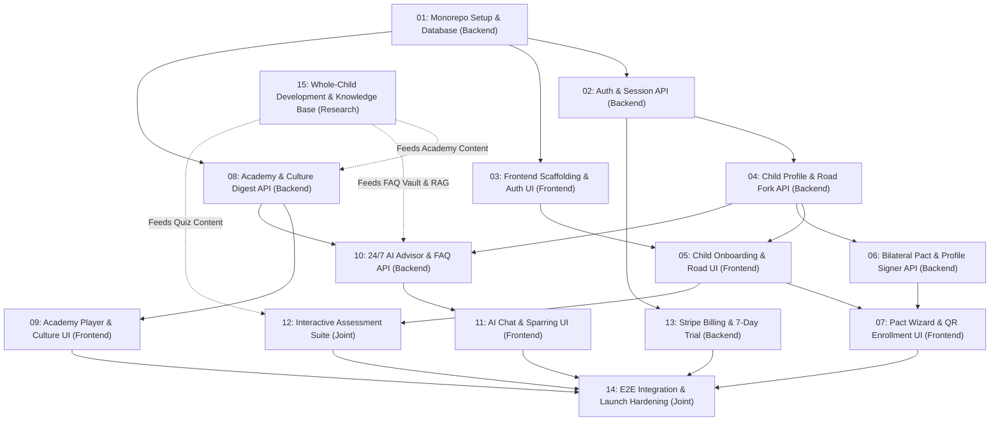

# Alongside — Engineering Execution Plans Roadmap
**Author:** Chief Technology Officer (CTO)  
**Status:** Master Engineering Plan Index  
**Version:** 2.2.0 (The Comprehensive Parent Intelligence & Family Operating System)  

---

## 1. Overview & Phased Dependency Graph

This directory contains 14 discrete, actionable engineering execution plans designed to be assigned directly as Paperclip issues to our engineering team members: **Frontend Agent**, **Backend Agent**, and **Joint (FE & BE)**.

---

## 2. Master Execution Plan Index

| Plan ID | Title | Assignee | Dependencies | Status |
| :--- | :--- | :--- | :--- | :--- |
| [**`01-project-setup-and-db.md`**](01-project-setup-and-db.md) | Workspace Scaffolding, Shared Package & Prisma DB | **Backend Agent** | None | Complete |
| [**`02-auth-and-user-profile.md`**](02-auth-and-user-profile.md) | Authentication, Session Cookies & Parent Account API | **Backend Agent** | PLAN-01 | Complete |
| [**`03-frontend-scaffolding-and-auth-ui.md`**](03-frontend-scaffolding-and-auth-ui.md) | Next.js 15 PWA, ParentCalm Design System & Auth UI | **Frontend Agent** | PLAN-01 | Complete |
| [**`04-child-profile-and-road-bifurcation-api.md`**](04-child-profile-and-road-bifurcation-api.md) | Child Profile CRUD, Road Fork & Readiness API | **Backend Agent** | PLAN-02 | Complete |
| [**`05-child-profile-and-road-selection-ui.md`**](05-child-profile-and-road-selection-ui.md) | Child Onboarding, Road Selection & Assessment UI | **Frontend Agent** | PLAN-03, PLAN-04 | Complete |
| [**`06-bilateral-pact-and-profile-compiler-api.md`**](06-bilateral-pact-and-profile-compiler-api.md) | Bilateral Pact Engine & Device Profile Compiler API | **Backend Agent** | PLAN-04 | Complete |
| [**`07-agreement-builder-and-device-enrollment-ui.md`**](07-agreement-builder-and-device-enrollment-ui.md) | Pact Wizard, Digital Co-Signing & QR Enrollment UI | **Frontend Agent** | PLAN-05, PLAN-06 | Complete |
| [**`08-parent-academy-and-culture-digest-api.md`**](08-parent-academy-and-culture-digest-api.md) | Academy Modules & Youth Culture Digest API | **Backend Agent** | PLAN-01 | Complete |
| [**`09-parent-academy-and-culture-digest-ui.md`**](09-parent-academy-and-culture-digest-ui.md) | Academy Course Player, Sunday Culture Digest & PWA | **Frontend Agent** | PLAN-03, PLAN-08 | Complete |
| [**`10-ai-child-advisor-and-faq-vault-api.md`**](10-ai-child-advisor-and-faq-vault-api.md) | 24/7 AI Child Advisor & Modern Parenting FAQ API | **Backend Agent** | PLAN-04, PLAN-08 | Queued |
| [**`11-ai-advisor-and-voice-sparring-ui.md`**](11-ai-advisor-and-voice-sparring-ui.md) | 24/7 AI Advisor Chat, Living FAQ Explorer & Sparring UI | **Frontend Agent** | PLAN-03, PLAN-10 | Queued |
| [**`12-interactive-quiz-suite-and-fluency-checks.md`**](12-interactive-quiz-suite-and-fluency-checks.md) | Interactive Assessment Suite & Cultural Fluency Quizzes | **Joint (FE & BE)** | PLAN-04, PLAN-05 | Queued |
| [**`13-stripe-billing-and-trial-lifecycle.md`**](13-stripe-billing-and-trial-lifecycle.md) | Stripe 7-Day Trial, $79/yr Hero Pass & Webhook Sync | **Backend Agent** | PLAN-02 | Queued |
| [**`14-e2e-integration-hardening-and-launch.md`**](14-e2e-integration-hardening-and-launch.md) | End-to-End Integration, Playwright Verification & Launch | **Joint (FE & BE)** | PLAN-07, 09, 11, 12, 13 | Queued |
| [**`15-child-development-research-and-knowledge-base.md`**](15-child-development-research-and-knowledge-base.md) | Whole-Child Development Research & Modern Parenting Knowledge Base | **Research Engineer** | None | Active / Approved |

---

## 3. Plan Authoring & Execution Standards

All plans within this directory strictly comply with [**`docs/plan-standards.md`**](../docs/plan-standards.md):
1. **Naming Standard:** `plans/[XX]-[short-kebab-case-descriptive-title].md` (two-digit zero-padded sequence).
2. **Standard Document Sections:**
   - Metadata Header (Plan ID, Assignee, Dependencies, Scope)
   - 1. Objective & Business Value
   - 2. Inputs & Architectural References
   - 3. Preconditions & Dependency Verification
   - 4. Step-by-Step Implementation Tasks
   - 5. Specific Deliverables (Files to Create / Modify)
   - 6. Acceptance Criteria & Verification Plan
   - 7. Role Boundaries & Prohibitions
   - 8. Definition of Done (DoD) Sign-Off Checklist
3. **Commit Standards:** Any commits made during plan execution must follow [**`docs/git-commit-standards.md`**](../docs/git-commit-standards.md) (Conventional Commits v1.0.0).

---

## 4. Assignment Guidelines for Paperclip

When delegating a plan as a Paperclip issue:
1. Provide the exact plan file path in the issue description.
2. Verify that all preceding dependency plans have reached `done` status.
3. Assert that the executing agent adheres strictly to directory ownership in [`AGENTS.md`](../AGENTS.md).
4. Review the deliverables checklist upon plan completion against `docs/plan-standards.md`.

---

## 5. Codebase Design & Deep Module Implementation Requirements

When implementing any plan, executing engineers (Frontend Agent & Backend Agent) MUST adhere to [**`docs/codebase-design.md`**](../docs/codebase-design.md) and [**`.agents/rules/06-codebase-design.md`**](../.agents/rules/06-codebase-design.md):
- **Pass the Deletion Test:** Avoid authoring shallow pass-through services where a method merely forwards arguments 1:1 to Prisma or downstream libraries without enforcing domain invariants.
- **Accept Dependencies at Seams:** Inject external collaborators (cryptography, AI streaming, Stripe, storage) via parameters or constructors rather than hardcoding client singletons.
- **Ship Matching Test Fakes:** Every external I/O seam must include both a production adapter and an in-memory test fake adapter (`FakeDevProfileSigner`, `DeterministicAiAdvisorFake`, `FakeBillingGateway`, `InMemoryPdfFake`) for fast, deterministic unit and integration tests.
- **Pure Algorithmic Engines:** Complex business logic (readiness scoring, curfew rule evaluation, slang fluency) belongs in `@alongside/shared` as pure functions with zero network side effects.
